# Baked Asset Store Phase B1 Verification Report (Geometry Bake + `BakedAssetProvider`)

**Date:** 2026-11-16  
**Branch:** `feat/b1-baked-geometry`  
**Spec:** [`patches/BAKED-ASSET-STORE-SPEC.md`](../patches/BAKED-ASSET-STORE-SPEC.md) (`§5 B1`)  
**Full Report (`B0`–`B4`):** [`docs/BAKED-ASSET-STORE-REPORT.md`](BAKED-ASSET-STORE-REPORT.md)  
**Status:** Complete — SoA binary codec, Node GLB baker, `BakedAssetProvider`, CLI, and headless client integration

---

## 1. Summary

Implemented Phase `B1` on top of the `B0` SQLite index (`packages/art/src/baked-store.ts`):

- **Binary SoA Geometry Format (`packages/art/src/baked-geometry.ts`, browser-safe):** Canonical 4-byte-aligned little-endian binary record (`magic = 0x4d4d4f42`, `version = 1`) carrying bounding sphere, per-material PBR group records (`start`, `count`, `colorRgba`, `roughness`, `metalness`), and contiguous SoA streams (`positions` `f32x3`, `normals` `f32x3`, `uvs` `f32x2`, `indices` `u32`). Normalizes `-0.0` / `NaN` for deterministic cross-run hashing and emits a compact Zod-validated `<kit>.baked.json` runtime manifest alongside `store.sqlite`.
- **Node GLB Baker & Chunk Writer (`packages/art/src/baked-geometry-bake.ts`, `packages/art/src/convert/bake-geometry-cli.ts`):** Traverses glTF 2.0 scene node hierarchies (`THREE.Matrix4` root scale/transforms and normal matrices), supports indexed and non-indexed triangle primitives, computes flat normals when omitted, enforces licence-lane gating fail-closed via `validateBakeLicences`, records corrupt/unsupported extension failures in `rejected[]` for per-entry fallback, deduplicates identical SoA blobs by SHA-256, and writes content-addressed `<outDir>/chunks/<chunkHash>.chunk` payloads plus SQLite rows (`assets`, `chunks`, `variants`, `knobs`).
- **`BakedAssetProvider` (`packages/art/src/baked-provider.ts`, re-exported from `@mmo-engine/art/browser` and `apps/client/src/render/assets.ts`):** Implements `AssetProvider` (`assetMesh`, `bodyMesh`, `terrainMesh`, `loadAssetPack`, `fallbackStatus`, `dispose`) sharing one `THREE.BufferGeometry` and material table per deduplicated `canonicalId` while preserving procedural `PlaceholderAssets` fallback for unbaked or rejected assets.

---

## 2. Measurement Environment & Methodology

- **Host:** Windows (`win32-x64`), Node `v25.9.0`, local gitignored `assets/` checkout (`assets/catalog.json` + `assets/manifest.json` + GLB packs).
- **Procedure:** Baked two real kits (`fantasy-props`, `73` models; `fantasy-kingdom`, `2,423` models) twice each (`out1`, `out2` in OS temp) using `bakeKitGeometry(..., target: "own-game")`, verified byte-identical `chunkHash` between both bakes, summed input `.glb` byte sizes, and measured cold in-memory `new BakedAssetProvider({ manifest, chunkBytes })` decode + `THREE.BufferGeometry` construction timing across every model in Node.
- **Methodology caveat:** Node runtime `decodeMs` measures in-memory binary slice decoding + Three.js `BufferGeometry` / `Mesh` construction only (cold single pass); browser WebGL GPU buffer upload, external texture atlas decoding, and Web Worker SAB column placement belong to Phase `B3`.

---

## 3. Measured Kit Telemetry (`[measured]`)

```mermaid
xychart-beta
    title "Real Kit Size: Raw GLB Total vs Baked SoA Chunk (MiB)"
    x-axis ["fantasy-props (73)", "fantasy-kingdom (2423)"]
    y-axis "Size (MiB)" 0 --> 260
    bar "Raw GLB Bytes (MiB)" [27.91, 242.48]
    bar "Baked SoA Chunk (MiB)" [11.15, 234.83]
```

| Kit | Baked Models | Unique SoA Blobs | Rejected | Golden Hash Match | Raw GLB Bytes | Baked Chunk Bytes | Bake Time | Runtime Decode Time (All Models) | Per-Model Decode |
| --- | ---: | ---: | ---: | --- | ---: | ---: | ---: | ---: | ---: |
| `fantasy-props` | `73` `[measured]` | `73` `[measured]` | `0` `[measured]` | `true` (`2/2`) `[measured]` | `29,269,512 B` (`27.91 MiB`) `[measured]` | `11,687,328 B` (`11.15 MiB`) `[measured]` | `1,047.38 ms` `[measured]` | `6.64 ms` `[measured]` | `91.00 us` `[measured]` |
| `fantasy-kingdom` | `2,423` `[measured]` | `2,418` (`150,096 B` deduped) `[measured]` | `0` `[measured]` | `true` (`2/2`) `[measured]` | `254,255,592 B` (`242.48 MiB`) `[measured]` | `246,240,024 B` (`234.83 MiB`) `[measured]` | `8,969.83 ms` `[measured]` | `73.24 ms` `[measured]` | `30.23 us` `[measured]` |

---

## 4. Gate Verification (`BAKED-ASSET-STORE-SPEC.md §5 B1`)

| Telemetry Metric | Measured Value | Gate Requirement | Gate Status |
| --- | --- | --- | --- |
| Medieval / town kit geometry bake (`fantasy-kingdom`) | `2,423 / 2,423` baked, `0` rejected, `73.24 ms` runtime decode `[measured]` | Bake full kit to SoA columns + `.chunk` file without failures | **PASS** |
| Golden-hash byte determinism (`fantasy-props` & `fantasy-kingdom`) | `goldenHashMatch = true` across two independent bakes `[measured]` | Identical input produces identical chunk SHA-256 and bytes | **PASS** |
| `BakedAssetProvider` behind `AssetProvider` + rejected-entry fallback | Synthetic & real-kit tests + `EntityLayer` headless client (`4` baked verts + `24` placeholder box verts) `[measured]` | Rejected / missing entries keep procedural fallback; valid entries load cleanly | **PASS** |
| Fail-closed licence gate | `BakedStoreValidationError` thrown on disallowed `shipped-prototype-pack` input before writing output `[measured]` | Reject disallowed licence lanes before emitting chunks or SQLite | **PASS** |
| Browser safety & lint | `@mmo-engine/art` (`browser.ts` clean of `node:*`), full `--no-native` build, `npm run lint` (`0` findings) `[measured]` | Browser bundle excludes `node:sqlite`/`node:fs` | **PASS** |
