# Baked Asset Store Verification Report (`B0`–`B4`)

**Date:** 2026-11-16  
**Branch:** `feat/b1-baked-geometry`  
**Spec:** [`patches/BAKED-ASSET-STORE-SPEC.md`](../patches/BAKED-ASSET-STORE-SPEC.md) (`§2`, `§4`, `§5 B0–B4`)  
**Phase B1 Report:** [`docs/BAKED-ASSET-STORE-B1-REPORT.md`](BAKED-ASSET-STORE-B1-REPORT.md)  
**Status:** Complete (`B0`–`B4` verified) — SQLite store, SoA geometry (`MMOB`), SoA animation clips (`MMOC`), client SAB column placement (`SabBakedLoader`), and on-demand hash-verified chunk streaming (`ChunkedBakedAssetClient`)

---

## 1. Summary

Implemented all remaining phases (`B1`–`B4`) on top of the `B0` SQLite index (`packages/art/src/baked-store.ts`):

1. **`B1` — Baked SoA Geometry & `BakedAssetProvider`:**
   - Binary `MMOB` v1 format (`packages/art/src/baked-geometry.ts`, browser-safe) storing normalized bounds, PBR material groups, and contiguous SoA streams (`positions`, `normals`, `uvs`, `indices`), alongside `bakeKitGeometry` (`packages/art/src/baked-geometry-bake.ts`), `bake:geometry` CLI, and `BakedAssetProvider` (`packages/art/src/baked-provider.ts`, re-exported from `@mmo-engine/art/browser` and `apps/client/src/render/assets.ts`).
2. **`B2` — Baked SoA Animation Clips & Validation Gate:**
   - Binary `MMOC` v1 format (`packages/art/src/baked-clips.ts`, browser-safe) supporting `"quant16"` (delta-quantized translation/scale + octahedral/smallest-three 16-bit quaternion quantization) and `"none"` float32 tracks, plus `bakeClipStore` (`packages/art/src/baked-clips-bake.ts`), `bake:clips` CLI, fail-closed `validateRetargetedClip` / `measureClipFootSlide` / licence-lane checks, SQLite `clips` row commits, and `AnimationLibrary.fromBakedManifest` / `AnimationLibrary.loadBaked` (`apps/client/src/render/character/character-animator.ts`).
3. **`B3` — Client SAB Column Placement (`apps/client`):**
   - Added `bakedPlace` worker task (`apps/client/src/workers/{types,index,handlers/baked-place}.ts`) decoding baked SoA slices off the main thread directly into `SabArena` (`SharedArrayBuffer`) with slice deduplication and single-retry overflow handling, paired with `SabBakedLoader` (`apps/client/src/assets/sab-baked-loader.ts`) building zero-copy `THREE.BufferGeometry` views over `arena.sab` (`array.buffer === sab`) and falling back cleanly on the main thread when `crossOriginIsolated` or workers are absent.
4. **`B4` — Chunked Delivery & On-Demand Streaming:**
   - Added browser-safe `BakedStoreIndexManifestSchema`, `ChunkedBakedAssetClient`, and `resolveRegionChunkId` (`packages/art/src/baked-chunk-streaming.ts`), multi-chunk mounting (`registerBakedChunk` / `registerBakedRecords`) on `BakedAssetProvider`, and `bakeMultiChunkBundle` (`packages/art/src/baked-geometry-bake.ts`). Clients download ONLY the `base` chunk at boot, stream `kit:*` / `region:*` chunks once on demand with inflight deduplication (`0` repeat fetches), and fail closed on SHA-256 verification before mounting.

---

## 2. Measurement Environment & Methodology

- **Host & Runtime:** Windows `win32-x64` sandbox, Node `v25.9.0`, local gitignored `assets/` pack checkout (`assets/catalog.json`, `assets/manifest.json`, `.glb` sources).
- **Geometry & SAB Benchmark (`fantasy-props` 73 models, `fantasy-kingdom` 2,423 models):**
  - Baked twice per kit (`bakeKitGeometry(..., target: "own-game")`) to confirm byte-identical `chunkHash` (`goldenHashMatch = true`).
  - Measured **cold** pass (empty provider/loader) and **warm** median across `5` iterations after `1` warmup comparing: (a) raw runtime GLB parsing (`extractGlbGeometry` + `buildObjectFromBakedRecord`), (b) main-thread `BakedAssetProvider`, and (c) OS `worker_threads` `SabBakedLoader` (`sabWallMs` end-to-end vs `sabMainBlockingMs` main-thread zero-copy bind only).
- **Clip Compression Benchmark:** Baked all real `cmu-traversal.glb` (`20/20` P1 traversal clips) and `ual1.glb` (`own-game`) with `quant16`, comparing raw Float32 payload size vs baked `MMOC` bytes, `maxPosErrM`, `maxRotErrRad`, and `avgFootSlideM`.
- **Chunked Delivery Benchmark:** Bundled `193` real models from `fantasy-props` + `fantasy-kingdom` across `4` chunks (`base`, `kit:fantasy-props`, `region:0_0`, `region:1_0`) via `bakeMultiChunkBundle`, measuring boot payload bytes, region entry bytes, and repeat-entry bytes under `ChunkedBakedAssetClient`.
- **Methodology Caveats:** Node benchmarks measure CPU decoding, SAB `worker_threads` placement, and Three.js `BufferGeometry`/`Mesh` construction; browser WebGL texture uploads and shader compilation are excluded. In isolated synchronous worker microbenchmarks on `234.83 MiB` `fantasy-kingdom`, copying `ArrayBuffer` across `worker_threads` adds IPC overhead (`285.47 ms` wall) vs main-thread `Uint8Array` slicing (`52.96 ms`), whereas offloading decode to a browser worker cuts main-thread blocking from **`2,879.19 ms`** (GLB parse) to **`70.50 ms`** (`40.8×` reduction) and overlaps with frame rendering.

---

## 3. Measured Benchmarks (`[measured]`)

### 3.1 Cold & Warm Geometry Load Timing (`B1` & `B3`)

```mermaid
xychart-beta
    title "fantasy-kingdom (2,423 models): Runtime Load Time (ms, lower is better)"
    x-axis ["Cold Load (ms)", "Warm Median (ms)"]
    y-axis "Time (ms)" 0 --> 3000
    bar "Raw GLB Parse" [2747.34, 2879.19]
    bar "SAB Worker Wall" [431.53, 285.47]
    bar "SAB Main-Thread Blocking" [431.53, 70.50]
    bar "Baked Main-Thread" [65.51, 52.96]
```

| Dataset | Mode | Cold Time | Warm Median (`5` runs) | Main-Thread Blocking (Warm) | Speedup vs GLB (Warm) | Payload Size |
| --- | --- | ---: | ---: | ---: | ---: | ---: |
| `fantasy-props` (`73` models) | Raw GLB Parse | `87.94 ms` `[measured]` | `87.20 ms` `[measured]` | `87.20 ms` `[measured]` | `1.0×` `[measured]` | `29,269,512 B` (`27.91 MiB`) `[measured]` |
| `fantasy-props` (`73` models) | Baked Main-Thread (`BakedAssetProvider`) | `5.67 ms` `[measured]` | `2.62 ms` `[measured]` | `2.62 ms` `[measured]` | **`33.3×`** `[measured]` | `11,687,328 B` (`11.15 MiB`) `[measured]` |
| `fantasy-props` (`73` models) | `SabBakedLoader` (`worker_threads` SAB) | `16.10 ms` `[measured]` | `12.56 ms` `[measured]` | **`2.43 ms`** `[measured]` | **`35.9×`** less main-thread block `[measured]` | `11,664,348 B` SAB `[measured]` |
| `fantasy-kingdom` (`2,423` models) | Raw GLB Parse | `2,747.34 ms` `[measured]` | `2,879.19 ms` `[measured]` | `2,879.19 ms` `[measured]` | `1.0×` `[measured]` | `254,255,592 B` (`242.48 MiB`) `[measured]` |
| `fantasy-kingdom` (`2,423` models) | Baked Main-Thread (`BakedAssetProvider`) | `65.51 ms` `[measured]` | `52.96 ms` `[measured]` | `52.96 ms` `[measured]` | **`54.4×`** `[measured]` | `246,240,024 B` (`234.83 MiB`) `[measured]` |
| `fantasy-kingdom` (`2,423` models) | `SabBakedLoader` (`worker_threads` SAB) | `431.53 ms` `[measured]` | `285.47 ms` `[measured]` | **`70.50 ms`** `[measured]` | **`40.8×`** less main-thread block `[measured]` | `246,078,204 B` SAB `[measured]` |

### 3.2 Animation Clip Compression & Quality (`B2`)

```mermaid
xychart-beta
    title "B2 Baked Animation Clips: Raw vs Quant16 Compressed Size (KiB)"
    x-axis ["cmu-traversal (20 clips)", "ual1 (35 clips)"]
    y-axis "Size (KiB)" 0 --> 2800
    bar "Raw Float32 (KiB)" [2616, 1378]
    bar "Quant16 MMOC (KiB)" [1585, 854]
```

| Clip Pack | Baked / Rejected | Raw Bytes | Quant16 Bytes | Compression Ratio | Max Pos Err | Max Rot Err | Avg Foot Slide | Bake Time | Decode Time |
| --- | ---: | ---: | ---: | ---: | ---: | ---: | ---: | ---: | ---: |
| `cmu-traversal` (`own-game`) | `20` / `0` `[measured]` | `2,678,824 B` `[measured]` | `1,622,704 B` `[measured]` | `0.6058` (`-39.4%`) `[measured]` | `0.001133 m` `[measured]` | `0.00005787 rad` `[measured]` | `0.3205 m` `[measured]` | `325.87 ms` `[measured]` | `27.07 ms` `[measured]` |
| `ual1` (`own-game`) | `35` / `1` `[measured]` | `1,411,173 B` `[measured]` | `874,368 B` `[measured]` | `0.6196` (`-38.0%`) `[measured]` | `0.0007913 m` `[measured]` | `0.0000584 rad` `[measured]` | `0.2091 m` `[measured]` | `203.15 ms` `[measured]` | `11.69 ms` `[measured]` |

### 3.3 Multi-Chunk Streaming (`B4`, `193` Real Models Across `4` Chunks)

Total bundle size: **`31,427,316 B` (`29.97 MiB`)** across `base` (`10` assets, `1,620,888 B`), `kit:fantasy-props` (`63` assets, `10,066,440 B`), `region:0_0` (`60` assets, `16,495,152 B`), and `region:1_0` (`60` assets, `3,244,836 B`):

- **Fresh `boot()`:** Downloaded ONLY `base` (**`1,620,888 B` = `5.16%` of bundle** in **`17.77 ms`** `[measured]`). Zero `kit:*` or `region:*` chunks fetched.
- **On region entry (`region:0_0`):** Streamed ONLY **`16,495,152 B`** in **`60.93 ms`** `[measured]`.
- **Re-entry / repeat calls:** Transferred **`0 B`** (`repeatBytes = 0` `[measured]`).

---

## 4. Gate Verification (`BAKED-ASSET-STORE-SPEC.md §5 B0–B4`)

| Telemetry Metric | Measured Value | Gate Requirement | Gate Status |
| --- | --- | --- | --- |
| `B0` SQLite store & two-lane fail-closed licence gate | `node:sqlite` `store.sqlite` schema v1 + `BakedStoreValidationError` on disallowed `shipped-prototype-pack` (`ual1`, custom fixtures) `[measured]` | Authoritative store + fail-closed licence enforcement before chunk emission | **PASS** |
| `B1` Full-kit SoA geometry bake & golden-hash determinism | `2,423/2,423` `fantasy-kingdom` (`52.96 ms` warm decode), `73/73` `fantasy-props` (`2.62 ms` warm decode), `goldenHashMatch = true` (`2/2`) `[measured]` | Deterministic binary `.chunk` + `BakedAssetProvider` with per-entry fallback | **PASS** |
| `B2` Clip baking, `validateClip` gate & `AnimationLibrary` intake | `20/20` `cmu-traversal` (`-39.4%`), `35` `ual1` (`1` bad rejected by `validateRetargetedClip`), headless `CharacterAnimator` playback `[measured]` | Reproducible clip SoA bake + loop/foot-slide rejection + runtime playback | **PASS** |
| `B3` Client SAB column placement & zero-copy views | `array.buffer === sab` verified, `SabBakedLoader` overflow single-retry + fallback verified; `40.8×` main-thread blocking drop (`2,879.19 -> 70.50 ms`) `[measured]` | Worker writes SoA columns to `SharedArrayBuffer` with zero main-thread copy + clean fallback | **PASS** |
| `B4` Chunked boot + on-demand hash-verified streaming | Boot downloads `base` only (`5.16%` of bundle), `ensureRegion` streams `1` chunk once (`0 B` repeat), tampered chunk rejected before mount `[measured]` | Fresh client fetches only `base` at boot; streams regions once on demand; SHA-256 tamper fails closed | **PASS** |
| Monorepo integrity (`--no-native` build, lint, graphify) | Verified on clean build, `npm run lint` (`0` findings), `npm run graphify:check` (`byte-identical`) `[measured]` | Zero build/lint/graph drift and clean browser bundle separation | **PASS** |
