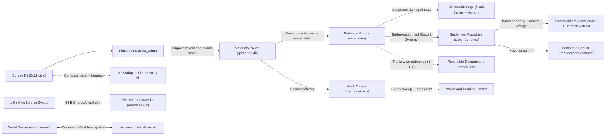

# Living Regional Provenance & Civic Logistics (`Redwater Crossing`)

> [!NOTE]
> Authoritative regional vertical slice (`feat/civic-logistics-slice`) uniting dynamic surveying, finite mineral batches, physical bridge infrastructure with traffic wear, settlement foundry specialization and maturity pivots, caravan escort risk/reward, escrow work orders, immutable multi-region item provenance, zero-alloc SAB telemetry, and client proximity/compass-flare UX.

## 1. Architecture & System Data Flow

## 2. Safeguards by Domain

| Domain | Core Invariants | Edge Cases Guarded |
|---|---|---|
| **1. Dynamic Surveying & Veins** | Server owns coordinates; `minActivePerRegion` baseline guarantee | Zero pre-discovery leak (`state` excludes undiscovered; non-pinpoint surveys return `10 m` bucketed bearings); dead/cooldown checks; pouch headroom verified before stock decrement; `BEGIN IMMEDIATE` last-ore race guard; rotated spawn anchors on respawn |
| **2. Civic Sites & Plaques** | Discrete stages (`0 -> 1 -> 2`) backed by SQLite WAL `civic_sites` | Partial donation overshoot clamping; atomic all-or-nothing multi-resource pre-check; `${charId}:${opId}` idempotency isolation; daily anti-whale diminishing weights (`1.0x / 0.5x / 0.2x`); zero free-text plaques; debounced crossing wear transitions cleanly to reversible `damaged` repair state with separate `repair_progress` |
| **3. Settlement Foundries** | `oakhaven` & `millhaven` track ore buffer, active vein trait, `batchesRemaining`, TTL, `depletedPermille` | `requiresBridgeId` blocks impassable crossings and restricts bulk shipments (`>5` ore) until `heavyHaulMinStage`; finite batch consumption & wall-clock TTL expiry cleanly reset to `"bog-standard"`; bag-full pre-check before consuming a specialty batch |
| **4. Escrow Frontier Contracts** | SQLite WAL `civic_contracts` + `civic_pending_credits` | Safe-integer overflow bounds on `qty * reward + floor(fee)`; `maxOpenPerCharacter` (`10`) cap; partial delivery clamping; SQLite `BEGIN IMMEDIATE` guard against concurrent `cancel` / `deliver` / `expire` double-payout; offline auto-refund claimed via `WalletSystem` on `onEnter` |
| **5. Immutable Item Provenance** | Append-only `civic_provenance` + `civic_item_provenance` | Hydrated dynamically inside `ItemService.view(item)`; survives bag moves, equip/unequip, player-to-player `moveItem`, and server restarts; additive `PRAGMA table_info` schema migration guard |

## 3. Cross-Engine Integration Tracks (A1–C7b)

| Track | Scope & Entry Points | Authoritative Invariants & Edge Cases Guarded |
|---|---|---|
| **A1 — Combat & Item Trait Modifiers** | `packages/engine-core/src/items/trait-modifiers.ts` (`resolveTraitById`, `applyTraitToItemViewStats`, `applyTraitToWeapon`), `ItemService.setTraitDefs`, `CombatSystem`, `server.ts` | `"bog-standard"` and unknown traits remain exact no-ops; `powerBonusPct` scales weapon damage proportionally without mutating base defs; `armourPenetrationPct` clamps to `[0, 100]` and `staminaReductionPct` clamps to `[0, 50]` without altering dodge stamina |
| **A2 — Physical Gorge Barrier (`CivicWorldBridge`)** | `packages/engine-core/src/civic/civic-world-bridge.ts` (`CivicWorldBridge`, `syncSite`, `syncAll`), `server.ts` | Synchronizes BitECS bridge deck `AssetRef.variant` (`stage` or `BROKEN_VARIANT` `0xfffe`) and static gorge barrier `BodyConfig` (`ShapeKind.Box`, `MotionType.Static`) feeding `NavObstacleSystem`, `PropCollisionSystem`, and `PhysicsSystem`; blocks when `stage === 0 \|\| damaged` and cleanly unblocks when restored; idempotent across entity restarts |
| **A3 — HUD, Proximity Prompts & Flare VFX** | `apps/client/src/ui/hud-layout.ts` (`"civic-panel"`), `civic-proximity.ts` (`nearestCivicTarget`), `App.tsx`, `VFXAdapter.ts` (`directionVector`, `emitSurveyFlare`) | Distinct proximity radii (`8 m` site, `14 m` foundry, `16 m` discovered active vein); interact (`KeyE`) respects closer world targets & dialog guards while preventing accidental item-hotkey misfires; compass flares suppress `band === "none"` and non-finite origins |
| **B4 — Multi-Region Snapshot Recall & Atomic Provenance** | `packages/world-server/src/schema.ts` (`AtomicProvenanceSchema` on `CraftExecuteSchema`/`LootGrantSchema`), `atomic.ts`, `packages/engine-core/src/world/civic-sync.ts` (`CivicWorldSnapshotSchema`, `exportCivicSnapshot`, `importCivicSnapshot`), `server.ts` | Atomic 10-table snapshot export/import inside `SqliteCivicStore.runImmediate` wired into `recallShardState` (`places["civic"]`) and `stateShipper`; Zod `.strict()` + `MAX_CIVIC_SNAPSHOT_BYTES` (`2 MiB`) + negative-escrow validation execute prior to opening SQLite write transactions; default monotonic timestamp retention and optional `{ authoritative: true }` recall overwrite |
| **C5 — Caravan Escort Synergy** | `packages/engine-core/src/civic/caravan-escort.ts` (`CaravanEscortCoordinator`, `countNearbyEscorts`) | Evaluates heavy hauls (`HEAVY_HAUL_THRESHOLD = 5`) for bounded `escortBonusGold` (capped at `25`, max `3` helpers within `24 m`) while blocking self-escort and duplicate participants; enforces per-character `60 s` cooldown and capped `onEscortAmbush` window spawns (`maxAmbushesPerWindow = 3` per `120 s`) |
| **C6 — Mature-Town Foundry Pivot** | `packages/engine-core/src/civic/foundry-pivot.ts` (`isFoundryMature`, `resolveReforgeTargetTrait`, `planRepairContributionWithKits`), `packages/rules/src/civic.ts` (`"masterwork"`, `maturityThresholdPermille`, `reforgeGoldCost`, `repairKitCost`) | Gates `foundry_reforge` and `craft_repair_kit` behind depleted maturity (`depletedPermille >= maturityThresholdPermille`), verified ownership/provenance, and idempotency; promotes items to active foundry trait or `"masterwork"`; `"repair-kit"` applies `2x` repair efficiency bonus exclusively in repair mode with strict overshoot clamping |
| **C7a — Zero-Alloc Civic SAB Telemetry** | `packages/engine-core/src/logging/civic-metrics.ts` (`CivicTelemetryMetrics`), `packages/engine-core/src/net/health.ts` (`makeHealthHttpHandler`), `server.ts` | Single `64`-byte `SharedArrayBuffer` (`CIVIC_METRICS_MAGIC = 0x43495631`) packing atomic `Int32Array` counters and 8-byte aligned `Float64Array` gauges; `recordSweep(...)` executes inside the `1 Hz` sweep with zero closures, arrays, heap allocations, or clock syscalls; exposes Prometheus text exposition at `GET /metrics/civic` |
| **C7b — Live WebSocket Loopback E2E** | `packages/engine-core/test/civic/civic-e2e.test.ts` | Exercises full loopback `Gateway` + real `MirrorClient` flows: survey bearing -> pinpoint extract -> Stage `0 -> 2` bridge restoration unblocking `CivicWorldBridge` -> foundry specialty craft (`ItemView.provenance` + combat bonus) -> offline contract expiry + reconnect credit claim -> HTTP `GET /health` & `GET /metrics/civic` |

## 4. Tick & Memory Discipline

- **Steady-State Cost:** `CivicService.step()` short-circuits via modulo sweep (`sweepEveryTicks = 30`, `1 Hz`), avoiding per-tick SQLite transactions or hot-path heap allocations while refreshing `CivicTelemetryMetrics` gauges directly in shared memory (`AGENTS.md §6`).
- **Boundary Validation:** Inbound `0x11` messages parse strictly against `CivicClientMessageSchema` (Zod `.strict()` / discriminated union); GM recovery routes through Gateway admin `"civic"` (`CivicAdminArgsSchema`); world-server atomic outputs accept bounded `AtomicProvenanceSchema`; shard snapshot recall pre-validates `CivicWorldSnapshotSchema` before writing SQLite.
- **Module Contract:** `modules/civic` depends on `["economy", "items"]`, registers `civic` as both `SimSystem` (`SYSTEM_ROLES.civic = "simulation"`) and `GatewayExtension`, and cleanly closes SQLite in `dispose(ctx)`.

## 5. Gate Verification

> [!NOTE]
> **Measurement Environment:** Windows, Node `v25.9.0`, local repository test runs following closing-wave graph regeneration. All test totals below are `[measured]`. **Caveats:** `@mmo-engine/world-server` skips the single live-DB `WORLD_TEST_DB_URL` stored-function test when no external SurrealDB URL is configured; the `@mmo-engine/engine-core` run covers the `385` tests in the focused civic and regression suites listed below rather than full worldgen soak suites.

| Telemetry Metric | Measured Value | Gate Requirement | Gate Status |
|---|---|---|---|
| Protocol tests (`@mmo-engine/protocol`) | `77/77` pass across `11` suites (`0` fail, `0` skipped) `[measured]` | All green, strict union & provenance types | PASS |
| Rules tests (`@mmo-engine/rules`) | `66/66` pass across `16` suites (`0` fail, `0` skipped) `[measured]` | Schema cross-checks, bearings, anti-whale, maturity & escrow math | PASS |
| Mirror tests (`@mmo-engine/mirror`) | `67/67` pass across `21` suites (`0` fail, `0` skipped) `[measured]` | Client protocol & `0x11 civic` dispatch | PASS |
| Modules tests (`@mmo-engine/modules`) | `43/43` pass across `9` suites (`0` fail, `0` skipped) `[measured]` | Manifest & module graph resolution | PASS |
| World-server tests (`@mmo-engine/world-server`) | `135/136` pass, `0` fail, `1` skipped (`define functions` gated on `WORLD_TEST_DB_URL`) `[measured]` | Atomic provenance schema/commit preservation & store contracts | PASS |
| Civic integration & track suites (`packages/engine-core/dist/test/civic/*.test.js`) | `32/32` pass across `15` suites (`0` fail, `0` skipped; includes `100k` `recordSweep` bound in `18.61 ms`) `[measured]` | Domains 1–5 + Tracks A1, A2, B4, C5, C6, C7a, C7b E2E loopback | PASS |
| Engine regression sweep (`civic`, `server-modules`, `health`, `gateway-*`, `world*`, `combat*`, `items`, `stamina`, `crafting`, `gathering`, `economy`) | `385/385` pass across `76` suites (`0` fail, `0` skipped) `[measured]` | Zero regressions across items, combat, stamina, pouches, wallet, shard sync & gateway | PASS |
| Client UI, proximity, VFX & i18n (`@mmo-engine/client`) | `576/576` pass across `200` suites + `tsc` build clean (`0` fail, `0` skipped) `[measured]` | Pure reducers, HUD layout, proximity targeting, survey flare VFX & i18n keys | PASS |
| Editor TypeScript check (`apps/editor`) | Exit `0` (`tsc --noEmit`) `[measured]` | Clean compile against updated workspace types | PASS |
| ECS Graph & Lint (`graphify`, `graphify:check`, `lint`) | `6/6` graphify tests pass; `7769` nodes, `8395` edges, `declared=33/33`, `unresolved=10`, `hash=f6782eda37ff` (byte-identical); `0` console leaks (Exit `0`) `[measured]` | H3 ratchet (`0` unannotated sim systems), byte determinism & lint hygiene | PASS |
