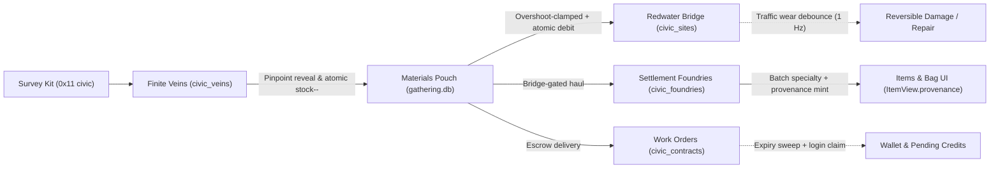

# Living Regional Provenance & Civic Logistics (`Redwater Crossing`)

> [!NOTE]
> Authoritative regional vertical slice (`feat/civic-logistics-slice`) uniting surveying, finite mineral batches, cooperative infrastructure with traffic wear, foundry specialization, escrow work orders, and immutable item provenance.

## 1. Architecture & System Data Flow

## 2. Safeguards by Domain

| Domain | Core Invariants | Edge Cases Guarded |
|---|---|---|
| **1. Dynamic Surveying & Veins** | Server owns coordinates; `minActivePerRegion` baseline guarantee | Zero pre-discovery leak (`state` excludes undiscovered; non-pinpoint surveys return `10 m` bucketed bearings); dead/cooldown checks; pouch headroom verified before stock decrement; `BEGIN IMMEDIATE` last-ore race guard; rotated spawn anchors on respawn |
| **2. Civic Sites & Plaques** | Three discrete stages (`0 -> 1 -> 2`) backed by SQLite WAL `civic_sites` | Partial donation overshoot clamping; atomic all-or-nothing multi-resource pre-check; `${charId}:${opId}` idempotency isolation; daily anti-whale diminishing weights (`1.0x / 0.5x / 0.2x`); zero free-text plaques; debounced crossing wear transitions cleanly to reversible `damaged` repair state with separate `repair_progress` |
| **3. Settlement Foundries** | `oakhaven` & `millhaven` track ore buffer, active vein trait, `batchesRemaining`, TTL, `depletedPermille` | `requiresBridgeId` blocks impassable crossings and restricts bulk shipments (`>5` ore) until `heavyHaulMinStage`; finite batch consumption & wall-clock TTL expiry cleanly reset to `"bog-standard"`; bag-full pre-check before consuming a specialty batch |
| **4. Escrow Frontier Contracts** | SQLite WAL `civic_contracts` + `civic_pending_credits` | Safe-integer overflow bounds on `qty * reward + floor(fee)`; `maxOpenPerCharacter` (`10`) cap; partial delivery clamping; SQLite `BEGIN IMMEDIATE` guard against concurrent `cancel` / `deliver` / `expire` double-payout; offline auto-refund claimed via `WalletSystem` on `onEnter` |
| **5. Immutable Item Provenance** | Append-only `civic_provenance` + `civic_item_provenance` | Hydrated dynamically inside `ItemService.view(item)`; survives bag moves, equip/unequip, player-to-player `moveItem`, and server restarts; additive `PRAGMA table_info` schema migration guard |

## 3. Tick & Memory Discipline

- **Steady-State Cost:** `CivicService.step()` short-circuits via modulo sweep (`sweepEveryTicks = 30`, 1 Hz), avoiding per-tick SQLite transactions or hot-path heap allocations.
- **Boundary Validation:** Inbound `0x11` messages parse strictly against `CivicClientMessageSchema` (Zod `.strict()` / discriminated union); GM recovery routes through Gateway admin `"civic"` (`CivicAdminArgsSchema`).
- **Module Contract:** `modules/civic` depends on `["economy", "items"]`, registers `civic` as both `SimSystem` (`SYSTEM_ROLES.civic = "simulation"`) and `GatewayExtension`, and cleanly closes SQLite in `dispose(ctx)`.

## 4. Gate Verification

| Telemetry Metric | Measured Value | Gate Requirement | Gate Status |
|---|---|---|---|
| Protocol tests (`@mmo-engine/protocol`) | `77/77` pass `[measured]` | All green, strict union & provenance types | PASS |
| Rules tests (`@mmo-engine/rules`) | `66/66` pass `[measured]` | Schema cross-checks, bearings, anti-whale & escrow math | PASS |
| Modules tests (`@mmo-engine/modules`) | `43/43` pass `[measured]` | Manifest & module graph resolution | PASS |
| Mirror tests (`@mmo-engine/mirror`) | `67/67` pass `[measured]` | Client protocol & `0x11 civic` dispatch | PASS |
| Civic integration suite (`civic.test.js`) | `6/6` tests (`5` suites) pass `[measured]` | Domains 1–5 edge cases, DB migration, admin, module assembly & dispose | PASS |
| Engine regression suites (`items`, `gathering`, `crafting`, `economy`, `modules`, `gateway-*`) | `195/195` tests across focused suites pass `[measured]` | Zero regressions across items, pouches, wallet, crafting & gateway | PASS |
| Client UI & i18n (`@mmo-engine/client`) | `19/19` pass + Vite bundle clean `[measured]` | Pure reducer, zero bare UI text, valid English string keys | PASS |
| Editor TypeScript check (`apps/editor`) | Exit `0` `[measured]` | Clean compile against updated workspace types | PASS |
| ECS Graph & Lint (`graphify:check`, `lint`, `graphify` tests) | `6/6` pass, `declared=33/33`, `0` console leaks `[measured]` | H3 ratchet (`0` unannotated sim systems) + byte determinism | PASS |
