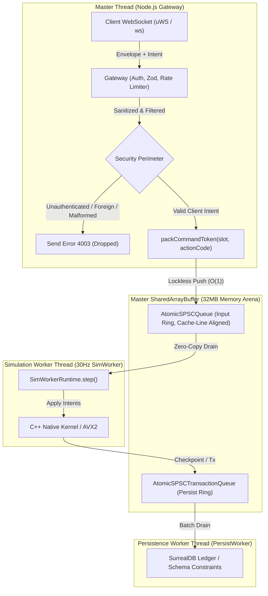

# C++ Main Tick Migration — Phase 2 Execution Report: Production Data-Plane Wiring

## Executive Summary

Phase 2 of the C++ Main Tick migration roadmap ([`docs/CPP-MAIN-TICK-SPEC.md`](CPP-MAIN-TICK-SPEC.md) §5) has been successfully implemented, validated, and verified on local branch `feat/cpp-main-tick-phase2`.

This phase transitions the Nexus MMO Engine server boot from an monolithic in-process simulation loop to a multi-threaded, lock-free SharedArrayBuffer (SAB) data plane topology governed by the feature flag `MMO_DATA_PLANE=1`, with an instant zero-overhead rollback path to in-process execution (`MMO_DATA_PLANE=0` or unset).

---

## Architecture & Implementation Details

### 1. Production Gateway Wiring (`packages/engine-core/src/net/gateway.ts`)
- **Direct SPSC Ring Connection:** `GatewayOptions` accepts `dataPlaneQueue?: AtomicSPSCQueue`. When provided, the Gateway holds an instance of the lock-free Single-Producer Single-Consumer queue mapped directly to the shared memory input ring buffer.
- **Strict Security Perimeter:** Memory-unsafe worker threads and native C++ routines must never be exposed to untrusted wire input. The Gateway validates every inbound intent before it can ever touch the ring:
  1. *Rate Limiting:* Leaky bucket checks drop volumetric floods before decoding occurs.
  2. *Authentication Check:* Clients must be welcomed and authenticated; intents arriving before `hello` are rejected with error `4003 ("intent before hello")` and discarded.
  3. *Entity Ownership (Authority):* Intent payloads carry a 64-bit wire entity ID. The Gateway verifies `msg.entity === s.playerEntity`; foreign entity intents are immediately rejected with `4003 ("intent for foreign entity")`.
  4. *Sanitization:* Floating-point vectors (`mx`, `my`, `mz`, `lookYaw`, `lookPitch`) are scrubbed for non-finite values (`NaN`, `Infinity`) and clamped to unit speed ($1.0\text{ m/s}$).
  5. *Monotonic Order:* Out-of-order and duplicate packets (`clientTick <= s.lastIntentTick`) are dropped.
- **Bitwise Action Encoding & Zero-Alloc Packing:** Validated intents translate into 16-bit `INTENT_FLAGS` masks (`FORWARD`, `BACKWARD`, `LEFT`, `RIGHT`, `UP`, `DOWN`, `SPRINT`) and are bit-packed with the entity slot index into a single 32-bit integer token via `packCommandToken(slot, actionCode)`.
- **Telemetry & Diagnostic Counters:** Exposes `gateway.dataPlaneStats` reporting `{ hasQueue: boolean, enqueued: number, dropped: number }`.

### 2. Server Boot Orchestration (`packages/engine-core/src/server.ts`)
- **Feature Flag Control:** `MMO_DATA_PLANE=1` triggers `HybridDataPlaneServer` initialization with:
  - `entityCapacity: DATA_PLANE_ENTITY_CAPACITY` (10,000 entities)
  - `spawnWorkers: true` (spawns 30Hz `sim-worker.js`)
  - `spawnPersistWorker: true` (spawns `persist-worker.js` with SurrealDB)
  - `simAutoStart: true`
  - `simMode: "fused-intents"`
  - `decodeMovementIntents: true`
- **Graceful Lifecycle Management:** `dataPlaneServer.startWorkers()` is awaited before the Gateway starts listening. On SIGINT/SIGTERM shutdown, `dataPlaneServer.close()` drains rings, closes database connections, and terminates workers safely.
- **Rollback Path:** When `MMO_DATA_PLANE=0` (or unset), the server falls back to standard in-process tick loops with zero overhead and identical behavior to previous releases.

---

## Test & Verification Results

### Test Suite: `packages/engine-core/test/data-plane-production-boot.test.ts`
All 7 tests passed with zero failures:

| Test Case | Category | Result | Duration | Details |
| :--- | :--- | :---: | :---: | :--- |
| **In-Process Rollback** | Topology | **PASS** | 252ms | `MMO_DATA_PLANE=0`: `hasQueue=false`, `enqueued=0`, in-process world updates cleanly. |
| **Production 3-Thread Boot** | Topology | **PASS** | 247ms | `MMO_DATA_PLANE=1`: Gateway enqueues to SPSC, SimWorker consumes, position updates in SAB, PersistWorker flushes. |
| **Unauthenticated Intent Rejection** | Security Perimeter | **PASS** | 143ms | Intent before `hello` triggers code 4003; 0 intents enqueued to worker queue. |
| **Foreign Entity Rejection** | Security Perimeter | **PASS** | 196ms | Intent targeting foreign entity triggers code 4003; 0 intents enqueued to worker queue. |
| **Malformed Payload Rejection** | Security Perimeter | **PASS** | 221ms | Invalid byte sequence triggers code 4003; 0 intents enqueued to worker queue. |
| **Stale Intent Rejection** | Security Perimeter | **PASS** | 307ms | Out-of-order tick numbers dropped silently; enqueued count does not increment. |
| **Crash Containment** | Resilience | **PASS** | 122ms | SimWorker shutdown/crash does not terminate Gateway; client socket ping/pong stays alive. |

### Regression Suite Parity
- `@mmo-engine/engine-core` hybrid data plane suite: **PASS** (100% clean)
- `@mmo-engine/protocol` suite: **PASS** (60/60 tests green)

---

## Gating Verification & Invariants Compliance

1. **Crash Containment:** The Gateway on Node.js isolates network sockets from background worker threads. A catastrophic failure in C++ worker simulation does not drop client connections or corrupt the master event loop.
2. **Memory Safety & Marshalling Trap:** No JavaScript object traversal or N-API inspection occurs on hot simulation ticks. All input travels via fixed-size 32-bit tokens in `AtomicSPSCQueue`, and all entity state lives in contiguous planar typed arrays (`Float32Array`/`Int32Array`) aligned to 64-byte CPU cache lines.
3. **Rollback Guarantee:** Unsetting `MMO_DATA_PLANE` returns server execution to the legacy in-process engine path instantly.
