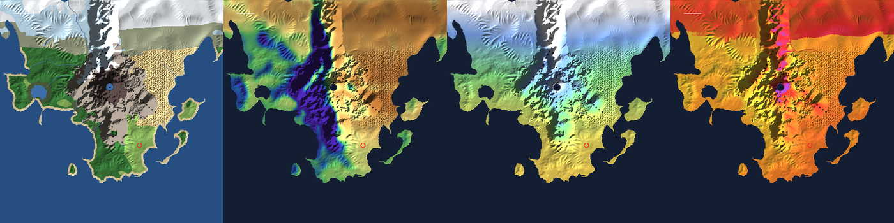

# Getting Started

From a fresh clone to walking around a 4 km world in your browser: about
fifteen minutes, most of it spent compiling the native addons once.

By the end you will have:

- the authoritative game server running a baked open world on `ws://localhost:7777`;
- the browser client on `http://localhost:5173`, with an account, a character, and a world to explore;
- optionally, the editor companion on `http://localhost:5174` and the world server on `http://localhost:7780`.

> **Shell syntax.** Commands are shown for bash (Linux, macOS, Git Bash).
> On Windows PowerShell, set environment variables with `$env:NAME = "value"`
> on its own line, then run the command. Examples are given where it matters.

---

## 1. Prerequisites

| Tool | Version | Why | How to get it |
|---|---|---|---|
| **Node.js** | 22 or newer (CI runs 24) | Server, tools, client build | [nodejs.org](https://nodejs.org) |
| **C++17 compiler** | — | The native addons (Jolt physics, Recast navigation, FastNoise2, PICG, scatter) compile during `npm install` through node-gyp | Windows: Visual Studio 2022 Build Tools with *Desktop development with C++*. macOS: `xcode-select --install`. Linux: `sudo apt install build-essential` |
| **Python 3** | 3.8+ | node-gyp needs it | Usually present. Windows: the Microsoft Store or python.org |
| **A WebGL 2 browser** | Chrome, Edge or Firefox | The client | On a laptop with two GPUs, give the browser the fast one (see [Troubleshooting](#troubleshooting)) |
| SurrealDB server | optional | Only for a *durable* world server | [surrealdb.com/install](https://surrealdb.com/install) |

Everything else (three.js, React, SQLite, the vendored C++ libraries) comes
with `npm install`. The build never downloads C++ dependencies: Jolt, Recast,
FastNoise2 and PICG are vendored in the repo and compiled directly by node-gyp.

## 2. Install

```bash
git clone https://github.com/SirHertzAlot/NexusMMOEngine.git
cd NexusMMOEngine
npm install        # installs every workspace and compiles the native addons (several minutes the first time)
```

`npm start` (next section's shortcut) does the rest itself: it regenerates
the FlatBuffers bindings, bakes the world, the loot pool and ten dungeons
when they are missing, then starts the server and the client. You only need
to run these steps yourself when you change the schema or want a fresh
bake:

```bash
npm run codegen    # packages/schema/mmo_engine.fbs -> C++ and TypeScript bindings
npm run bake:world
```

Optional but worthwhile: prove the install with the test suite.

```bash
npm test           # builds everything, runs all 16 suites (a few minutes)
```

## 3. Bake a world

`npm start` bakes a world automatically the first time. To do it (or force a
re-bake) yourself:

```bash
npm run bake:world
```

This reads [`packages/engine-core/worlds/default.world.json`](../packages/engine-core/worlds/default.world.json)
and, in under a minute, produces a **4 × 4 km peninsula**: a mountain spine
with a volcano, glaciers in the frozen north, a rain-shadow desert, rivers,
lakes and 12 biomes. It lands in `packages/engine-core/data/world.db`
(about 92 MB, git-ignored).

Want to see what you are about to bake? `npm run preview:world` draws the
spec's biomes, rainfall, temperature and UV index to `world-preview.png`
in about 10 seconds, without baking anything.



## 4. Optional: textured ground

```bash
npm run surfaces:fetch   # ~23 MB of CC0 photo-scanned ground materials
```

Without them the terrain uses flat biome colours. With them it blends
grass, rock, sand, snow and mud by biome, slope and height. The files go to
`apps/client/public/surfaces/` and are never committed.

## 5. Start the game

```bash
npm start
```

That runs the missing setup (codegen, bakes), then starts the region
server (ws://localhost:7777), the edge (ws://localhost:3001,
http://localhost:3000) and the browser client (http://localhost:5173)
together. Ctrl+C stops them all. For separate processes, see
[CONFIGURATION.md](CONFIGURATION.md): `npm start -- --server` runs only the
game server, `npm run editor` the editor, `npm run world` the world server,
`npm run edge` the edge. The full split topology (world, region, edge)
is in [CLI.md](CLI.md#other-servers); players connect to the region until
the client cutover (E3b).

Some settings worth trying (full list in [CONFIGURATION.md](CONFIGURATION.md)):

```bash
MMO_BOTS=10 npm start                # ten computer-driven characters near spawn: sparring pairs and wanderers
MMO_DAY_SECONDS=600 npm start        # a ten-minute day, to watch the sun set
MMO_PLAYER_ABILITIES=swim,fly npm start   # players can fly (F)
```

`npm start` forwards its arguments on, so `MMO_BOTS=10 npm start -- --server`
also works.

In PowerShell:

```powershell
$env:MMO_BOTS = "10"
npm start
```

Settings set this way stay set in that terminal until you close it
(`Remove-Item Env:MMO_BOTS` clears one).

## 6. Play

With `npm start` running, open **http://localhost:5173**, then:

1. Leave the server URL at `ws://localhost:7777`.
2. Choose **Create account**, pick a username and password, and connect.
3. On the character screen, make a character: face, hair, brows, beard
   and ears, colours for skin, hair, stubble, scars and body art (or
   **Randomise**), then a name.
4. **Create & enter world.**

### Controls

| Input | Action |
|---|---|
| Click the canvas | Capture the mouse for mouse-look |
| Mouse | Look around (third-person camera) |
| Mouse wheel | Camera distance (4–24 m) |
| W A S D / arrow keys | Move |
| Space | Jump; swim or fly up |
| C | Swim or fly down |
| F | Toggle flight (when the server allows it) |
| Left click | Attack; click again in rhythm to chain the 3-hit combo |
| Hold right click | Guard |
| Q | Dodge roll |

The buttons at the top right switch wireframe terrain, screen effects and
the FX showcase (six elemental orbs around you), and reconnect or
disconnect.

### What you see without the licensed art

The Synty art packs and third-party animations live in the git-ignored
`assets/` folder and are never in the repository (see
[ART-PIPELINE.md](ART-PIPELINE.md)). On a machine without them:

- scenery is the engine's own procedural PICG trees instead of the art-pack nature set;
- characters are placeholder shapes, and the character creator has nothing to show.

Everything else (terrain, water, sky, weather, physics, combat, networking)
works the same.

## 7. Optional: the editor

```bash
npm run editor           # http://localhost:5174
```

The editor is a docking workspace with a tab per area: **World** (terrain at
world scale), **Scene** (the read-only ECS inspector), **Characters** (a
read-only record view), **Gameplay** (rules and gameplay tables), **Dungeons &
PCG** (baked-pool browser, 3D view, patches, graph editor), **Live ops**
(tick and activity telemetry), **Debug** (play mode with the client's world
view and the debugger's performance graphs), **Database**, **Story** (quests
and strings), **Art & audio** (the art asset pipeline), and **Release**
(pipeline and playtests). See [EDITOR.md](EDITOR.md).

## 8. Optional: the world server

```bash
npm run world            # http://localhost:7780, in-memory store
```

The game server only talks to it when started with `WORLD_URL` and
`WORLD_API_KEY` (see [CONFIGURATION.md](CONFIGURATION.md#world-server)).
On its own, the game server runs as a standalone region, which is the
normal development setup.

## 9. Where to go next

- [ARCHITECTURE.md](ARCHITECTURE.md): how the pieces fit, one tick at a time.
- [GAMEPLAY.md](GAMEPLAY.md): movement, characters, combat and bots, and how to extend them.
- [WORLD-BUILDING.md](WORLD-BUILDING.md): design your own world, scenery plans and terrain edits.
- [../CONTRIBUTING.md](../CONTRIBUTING.md): the branch workflow, tests and code standards.

---

## Troubleshooting

**`npm install` fails with `EPERM: operation not permitted, unlink ... physics.node`.**
A running game server has the physics addon loaded, and Windows cannot
replace a loaded file. Stop every server (`npm start` / `npm run editor`,
Ctrl+C) and install again. If the addons haven't changed, `npm
install --ignore-scripts` also works while servers run.

**The client runs at a few frames per second.**
The HUD's `gpu` line shows which GPU the browser got. On laptops with
integrated and dedicated graphics, set the browser to *High performance*
(Windows: Settings → System → Display → Graphics). The **effects off**
button skips the screen effects for weak GPUs.

**Port already in use.**
Another server is running. Stop it, or pick other ports: `MMO_PORT` for the
game server; the client's Vite dev server takes `--port`, e.g.
`npm run client -- --port 5180`.

**Newly added scenery doesn't appear where I've been.**
Chunks are populated once, the first time a player comes near, and saved.
Areas you've visited keep what they grew. To see new scenery everywhere,
bake a fresh world into a separate data folder:

```bash
MMO_DATA_DIR=./data/fresh npm run bake:world
MMO_DATA_DIR=./data/fresh npm run server
```

(`data/` is git-ignored at any depth.) Accounts live in the data folder
too, so register again in the fresh world.

**I want to start my world over.**
Stop the server, then `npm run bake:world:force` (it refuses to overwrite a
world otherwise).

**Registration is refused.**
The server was started with `MMO_ALLOW_REGISTER=0`. Unset it, or create
accounts from the command line:

```bash
MMO_DEV_PASSWORD='a-long-password' npm run seed:user --workspace=@mmo-engine/engine-core -- alice
```
