# Hybrid Data Plane Runtime Wiring Report (`PATCH-01` – `PATCH-05`)

**Date:** 2026-11-16  
**Branch:** `feat/de5-cf6-closeout`  
**Status:** Complete — primitives wired into `SimWorkerRuntime`, `HybridDataPlaneServer`, `Gateway`, and `PersistenceWorkerRuntime`

---

## 1. Summary

Completed runtime integration for the five Hybrid Data Plane patches (`PATCH-01` through `PATCH-05`) that previously existed only as standalone unit-tested primitives:

- **PATCH-01 (`stepSimulationSoABitset` + `aliveBitset`)**: Exposed `stepSimulationSoABitset` on `NativeEngineKernel` (C++ AVX2 FMA3 binding + IEEE-754 `Math.fround` fallback in [`sim-worker.ts`](../packages/engine-core/src/sim-worker.ts)) and wired `SimWorkerRuntime` (`mode: "planar-soa"`) to invoke it directly over the SAB-backed `aliveBitset`.
- **PATCH-02 (`MortonSpatialIndex`) & PATCH-05 (`GenerationalSlabAllocator`)**: Wired ABA-safe `allocateEntity`, `freeEntity`, `isEntityHandleValid`, `rebuildSpatialIndex`, and zero-allocation `queryEntitiesInRadius` into both `SimWorkerRuntime` and [`data-plane-server.ts`](../packages/engine-core/src/data-plane-server.ts), adding optional `intMatrixView` passthroughs in [`sab-store.ts`](../packages/engine-core/src/sab-store.ts) to eliminate per-call `Int32Array` view wrapping. Note: `net/interest.ts` continues to use its cached 64 m `SectorFrame` + native `@mmo-engine/addon-fanout` pipeline (`PF1`–`PF3`) for the bitECS path.
- **PATCH-03 (`AtomicMPSCQueue`)**: Added `offset`-attached shared-arena support (`MemoryArenaOffsets.MPSC_INPUT_RING`), atomic one-time `seq[i] = i` initialization (`MPSC_INIT_STATE_IDX`), zero-closure `enqueue`/`dequeue`/`drainTo`/`enqueueBatch`, and monotonic `size()` to [`lockless-ring.ts`](../packages/engine-core/src/lockless-ring.ts). Upgraded `SimWorkerRuntime.inputQueue`, `HybridDataPlaneServer.gatewayInputQueue`, and `Gateway.dataPlaneQueue` (`DataPlaneCommandQueue` in [`gateway.ts`](../packages/engine-core/src/net/gateway.ts)).
- **PATCH-04 (`PersistenceWorkerRuntime`)**: Pre-allocated `seenCheckpoints` dirty-bitset and scratch buffers in [`persist-worker.ts`](../packages/engine-core/src/persist-worker.ts) (removing per-flush `new Uint32Array` heap allocations) and batched deduplicated `ENTITY_CHECKPOINT` writes into a single vectorized SurrealQL `FOR $item IN $items` query.

---

## 2. Measurement Environment & Methodology

- **Host:** Windows (`win32-x64`), Node `v25.9.0`, native addon loaded (`isNativeKernel: true`), `BENCH_DB_URL=mem://`.
- **Command:** `node packages/engine-core/dist/src/hybrid-data-plane-bench.js` (run on built workspace output).
- **Methodology:**
  - **Ring bench:** `2,000,000` enqueue/dequeue ops (`512`-item chunks, `10,000`-op warmup) over SAB `AtomicSPSCQueue`.
  - **Kernel bench:** `1,000` / `10,000` / `50,000` / `100,000` entities, `25` warmup iterations + `400` timed iterations per cell. `50%` pseudo-random alive/dead entropy for JS, Matrix, Fused-Intent, Planar SoA, and `stepSimulationSoABitset`; `10%` contiguous alive block for sparse hierarchical skip timing (`cppBitsetSparse10Ms`). Micro-kernel step only — excludes full gameplay systems, physics, and network I/O.
  - **30 Hz Stress Test:** `300` simulated ticks at `10,000` entity capacity, `512` binary command tokens/tick (`153,600` total commands) through `HybridDataPlaneServer` `AtomicMPSCQueue` -> `SimWorkerRuntime` -> `PersistenceWorkerRuntime` (`2,400` commits on `mem://`).

---

## 3. Measured Results

### 3.1 Kernel Latency (`1k` – `100k` Entities, `[measured]`)

```mermaid
xychart-beta
    title "Data-Plane Kernel Step Latency (ms, lower is better)"
    x-axis ["1k", "10k", "50k", "100k"]
    y-axis "Step Time (ms)" 0 --> 1.1
    bar "JS Reference (50%)" [0.0099, 0.0899, 0.5017, 1.0067]
    bar "Planar SoA SIMD (50%)" [0.0020, 0.0080, 0.0358, 0.0656]
    bar "AVX2 Bitset (50%)" [0.0027, 0.0057, 0.0280, 0.0507]
    bar "AVX2 Bitset (10% Sparse)" [0.0032, 0.0022, 0.0039, 0.0063]
```

| Entity Count | JS Ref (`50%`) | C++ Planar SoA (`50%`) | C++ Bitset AVX2 (`50%`) | C++ Bitset AVX2 (`10%`) | Bitset `50%` vs JS | Bitset `10%` vs JS |
| --- | ---: | ---: | ---: | ---: | ---: | ---: |
| `1,000` | `0.0099 ms` `[measured]` | `0.0020 ms` `[measured]` | `0.0027 ms` `[measured]` | `0.0032 ms` `[measured]` | `3.61x` `[measured]` | `3.05x` `[measured]` |
| `10,000` | `0.0899 ms` `[measured]` | `0.0080 ms` `[measured]` | `0.0057 ms` `[measured]` | `0.0022 ms` `[measured]` | `15.73x` `[measured]` | `41.24x` `[measured]` |
| `50,000` | `0.5017 ms` `[measured]` | `0.0358 ms` `[measured]` | `0.0280 ms` `[measured]` | `0.0039 ms` `[measured]` | `17.92x` `[measured]` | `128.63x` `[measured]` |
| `100,000` | `1.0067 ms` `[measured]` | `0.0656 ms` `[measured]` | `0.0507 ms` `[measured]` | `0.0063 ms` `[measured]` | `19.87x` `[measured]` | `159.55x` `[measured]` |

### 3.2 Ring & 30 Hz Stress Loop (`[measured]`)

| Telemetry Metric | Measured Value | Gate Requirement | Gate Status |
| --- | --- | --- | --- |
| Kernel `100k` (`50%` alive, AVX2 bitset) | `0.0507 ms` (`19.87x` vs JS) `[measured]` | Sub-millisecond integration step | **PASS** |
| Kernel `100k` (`10%` sparse, AVX2 bitset) | `0.0063 ms` (`159.55x` vs JS) `[measured]` | Hierarchical zero-word block skipping | **PASS** |
| Stress loop mean / p50 / p99 (`10k`, `512` cmd/tick) | `0.0988 / 0.0890 / 0.1858 ms` `[measured]` | `< 33.33 ms` tick budget (`0` overruns) | **PASS** (`0.297%` mean utilization, `0` overruns) |
| Max stress tick (`300` ticks) | `0.4896 ms` `[measured]` | `< 33.33 ms` | **PASS** |
| Data-plane & addon tests (`8` suites) | `49 / 49` pass, `0` fail, `0` skipped `[measured]` | `100%` pass rate | **PASS** |

---

## 4. Caveats

- Kernel timings measure the data-plane integration step in isolation (`stepSimulationSoABitset` / `stepSimulationSoA`), not a full world tick with Jolt physics, creature AI, or client fan-out.
- `run30HzStressTest()` executed persistence commits against embedded volatile `mem://`; durable external `ws://127.0.0.1:8000/rpc` SurrealMX AOL latencies depend on disk/RPC round-trips.
- Linux `valgrind:perf` / `valgrind:memcheck` suites require WSL/Linux addon builds and were not run on this Windows host.
