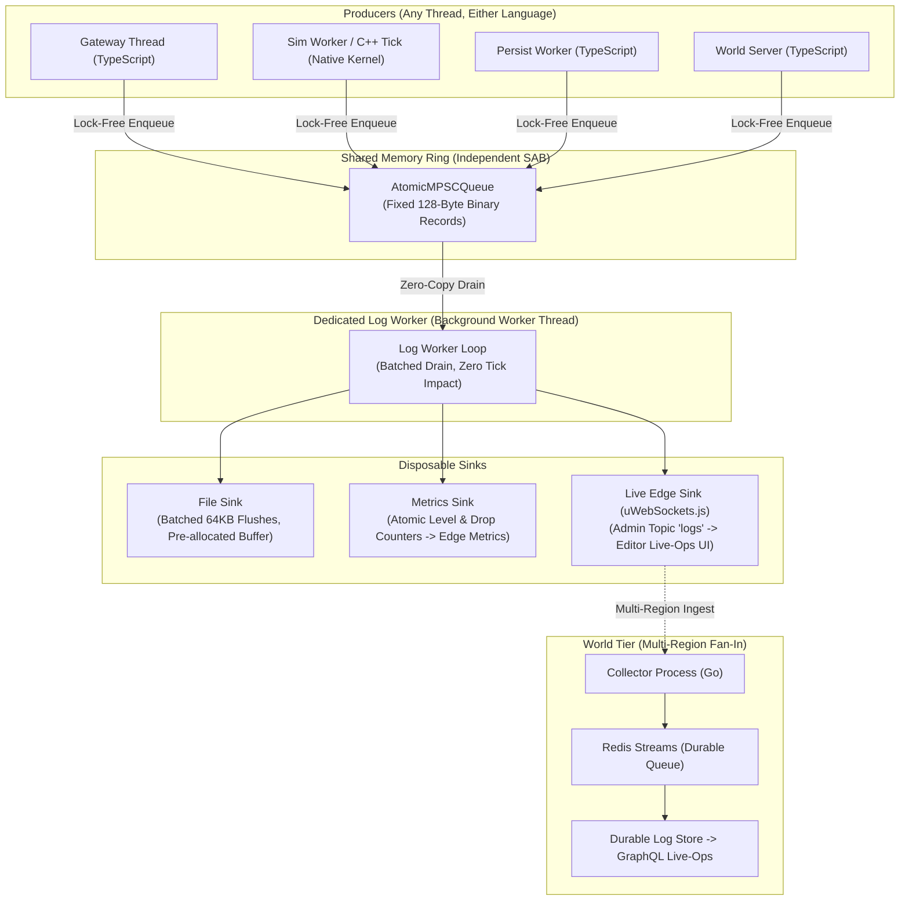

# SAB Logging Layer — Specification and Implementation Roadmap

**Status:** Spec + roadmap, commissioned by Joey 2026-10-27 ("We need a performant logging layer that extends our SAB. Maybe some sort of uWs.js socket or backend queue?"). Extends the direction delivered 2026-10-26. Implementation phases gated on Joey's word per phase.
**One-line answer to the either/or:** both of Joey's ideas are in the design — each at the layer where it belongs. The SAB ring is the hot path; the uWS socket is the live edge; the backend queue is the world-tier fan-in. Neither the socket nor the queue ever touches the tick.

---

## 1. Current State (Verified Against origin/main, 2026-10-27)

- **No logging library or pipeline exists anywhere.** `packages/engine-core` server code alone carries **131 `console.*` calls**; `packages/world-server` and apps are in the same shape. Formatting, string interpolation, and stdio happen on whatever thread called them — including, today, the tick's process.
- **The ring already exists.** `packages/engine-core/src/lockless-ring.ts` ships `AtomicSPSCQueue`, `AtomicSPSCTransactionQueue`, and `AtomicMPSCQueue` (PATCH-03: Dmitry Vyukov's bounded lock-free MPSC, SAB-backed, cache-line-separated head/tail, drop counter in the header). Logging is a new *payload* on existing, tested machinery — not a new concurrency primitive.
- **Telemetry precedent exists.** The data plane's sim worker already writes lockless atomic telemetry (`TELEMETRY_SLOTS`) — proof the "producer writes counters/records into SAB, someone else reads them" pattern is house style.
- **Consumers already exist and are hungry.** `apps/edge/src/metrics.ts` (metrics endpoint shape) and the editor's live-ops surface (`liveops-model.ts`, `liveops-telemetry.ts`, `ui/liveops-live.tsx`) — which today **polls snapshots on a timer** because there is no live feed to subscribe to. This layer is what turns that polling into a stream.
- **The recorded dependency:** the GraphQL live-ops query layer (scoped 2026-10-14) requires structured log/metric stores first. This spec is that prerequisite.

---

## 2. Design

### 2.1 Topology

#### Rules, in order of importance:
1. **The producer path is sacred.** A log call does exactly one thing: pack a fixed-size binary record and enqueue it in the MPSC ring. If the ring is full, the record is dropped and the header's drop counter increments. No formatting, no string building, no allocation target, no locks, no IO — ever. A producer can measure its worst case in tens of nanoseconds and it does not change under load.
2. **Logs are lossy by design; truth is not.** Anything that must not be lost — economy, audit, atomic ops — is a Tier-1 ledger event on the persist tier, exactly as today. The log bus carries diagnostics. The drop counter makes the loss *visible and countable* instead of silent.
3. **Formatting happens once, on the consumer, or never.** Records carry a numeric code + typed args; the format string lives in a dictionary (§2.3). Records nobody reads are never formatted at all — which, at 30 Hz × thousands of potential records, is most of them.
4. **Every sink is independently disposable.** Slow file disk, dead collector, stalled editor subscriber: each sink drops on its own counter and the others keep flowing. Nothing can backpressure the ring.

---

### 2.2 The Record (128 bytes, fixed, language-neutral)

The layout is shared verbatim between TypeScript and C++ (one header definition, same discipline as `SOA_LAYOUT` in the data plane):

| Offset | Field | Type | Notes |
|:---:|:---:|:---:|:---|
| **0** | `level` | `u8` | TRACE 0 · DEBUG 1 · INFO 2 · WARN 3 · ERROR 4 |
| **1** | `producer` | `u8` | gateway / sim / persist / world-server / native-kernel… |
| **2** | `code` | `u16` | dictionary id (§2.3) |
| **4** | `tick` | `u32` | sim tick when produced in the sim; 0 outside it |
| **8** | `timestamp` | `u64` | ns since process start (monotonic; worker stamps wall-clock base) |
| **16** | `entityRef` | `u64` | wire id / character id / 0 = none |
| **24** | `args` | `4 × (tag u8 + value u64)` | typed: i64, f64 bits, interned-string id, or short-string handle |
| **56** | `inline string` | `64 B` | the rare dynamic string, truncated with a marker; longer strings go through the intern table |
| **120** | `reserved` | `8 B` | flags (e.g. "sampled"), format version |

- **Slot Stride for `AtomicMPSCQueue`**: $32 \times \text{u32} = 128\text{ bytes}$.
- **Default Ring Capacity**: $16,384\text{ records} = 2\text{ MB}$ of SAB — about 9 seconds of buffer at a heavy $2,000\text{ records/s}$, $\sim 90\text{s}$ at a sane steady-state $200/\text{s}$. Capacity is a config value, not a constant.
- **Sampling is a Producer-Side Feature**: Hot codes can be declared sampled (e.g. 1-in-N with the count folded into one arg) in the dictionary, so a per-tick diagnostic can exist in the code permanently without ever flooding the ring when enabled.

---

### 2.3 The Code Dictionary

- One source file (`log-codes`, JSON/TS) defines every code: id, level default, format string with named args, sampled flag.
- Build step generates: the TS producer API (typed per code — wrong arg types are compile errors), the C++ header for native producers, and the formatter table for the worker.
- Codes are **append-only** once shipped (ids are never reused), same discipline as component ids and wire opcodes.
- This makes the native side possible: a C++ kernel writes code `0x0231` with two integer args and the worker renders `"player {0} entered sector {1}"` if anyone is listening.

---

### 2.4 The Log Worker

- A dedicated worker thread owns the ring's dequeue end. It batches: drain what's available, format into a growable buffer, flush sinks on size ($64\text{ KB}$) or time ($50\text{ms}$) boundaries, whichever occurs first.
- **File Sink:** One batched `write` per flush of a pre-allocated buffer — never per-record stream writes (the Snell rule; per-record `.write()` through Node streams is the known 100× trap). Size-based rotation, plain text (formatted) + optional raw-binary archive segment for replay tooling.
- **Metrics Sink:** Per-code and per-level counters + drop counters, published into a small SAB counter page the edge metrics endpoint already knows how to read — no new endpoint shape.
- **Level Masks:** Per-producer level thresholds live in shared atomic slots. Raising verbosity on the sim at runtime = one atomic write from the admin path; no restart, no recompile. `ERROR` is never maskable off.
- **Crash Behavior:** Worker death loses in-flight records and nothing else; producers keep dropping-or-buffering per the ring; a supervisor restarts the worker. The tick cannot tell the difference.

---

### 2.5 Placement of the Architecture

**uWS Socket — YES, as the live edge (the "live sink").**
uWebSockets.js is a server library, so the direction is: consumers connect to *us*. The gateway's existing Transport already exposes topic pub/sub (`WireSocket.subscribe/publish` — shipped for Phase 5 sector topics). The log worker hands formatted batches to the gateway process, which publishes them on an admin-only `logs` topic; the editor's live-ops view subscribes and its timer-polling is deleted.

Properties that make this safe:
- Rides the gateway process (never the sim).
- Batches are already formatted and bounded (one publish per flush, not per record).
- Slow subscribers are uWS's problem (its backpressure drops the subscriber, not the publisher).
- Topic is behind the same admin auth as every other live-ops surface.

**Backend Queue — YES, at the world tier only (fan-in).**
When multi-region is real, region log workers ship batches to a collector, and the collector lands them in **Redis Streams** (persisted, consumer groups, replayable — not pub/sub, per the 2026-10-26 decision) feeding the durable log store that the GraphQL live-ops layer will query. The game process never touches Redis; a regional outage loses diagnostics, never game state, and the queue's durability is spent on the aggregated store where it earns its keep. **Not** in v1: single-region has no fan-in problem to solve, and putting a network queue anywhere near the producer path would violate rule 1.

---

### 2.6 What This Replaces

- All 131 `console.*` calls in `engine-core` (and their equivalents in `world-server`/apps) migrate code-by-code, subsystem by subsystem; a lint rule (`no-console` outside the logger's own file) lands with the first subsystem migration so the count only moves one way.
- The `TickLoop`'s spiral/drop counters and the sim worker's `TELEMETRY_SLOTS` stay as-is — counters are metrics, not logs; the metrics sink reads them, it doesn't replace them.
- The data plane's intent/persist rings are untouched. The log ring is a third, independent SAB — **not** carved out of the component plane.

---

## 3. Performance Expectations (Modeled — Gates Replace with Measurements)

| Figure | Expectation | Basis |
|:---|:---|:---|
| **Producer cost per record** | Tens of ns, allocation-free | Vyukov MPSC enqueue = one atomic ticket + slot write; same class as the intent-token path already benched in the contention work |
| **Tick impact** | Below measurement noise | Bounded single enqueue; no formatting/IO/syscalls on the tick thread (vs today: `console.*` formatting + stdio on the calling thread) |
| **Worker cost** | One core fraction at steady state | Formatting is the only real work and it's batched; sized by the Phase 0 bench |
| **Memory** | Ring 2 MB default + worker buffers | Fixed, configurable, no growth under load (drops instead) |
| **Failure cost** | Zero to producers under any sink failure | Per-sink drop counters; ring is the only coupling |

---

## 4. Implementation Roadmap (Phased, Gated)

Standing rules apply: local branches, tests green, perf phases ship a metrics doc + chart, push/merge only on Joey's word.

### Phase 0 — Ring + Dictionary + TS Producers (Gateway First)
1. `log-codes` dictionary + code generation (TS API, formatter table; C++ header generated but not yet consumed).
2. Log ring module over the existing `AtomicMPSCQueue`; producer API with per-producer level masks; drop accounting.
3. Migrate the gateway's `console.*` calls as the first subsystem.
4. Bench: producer cost under contention (1/2/4 producer threads), ring-full behavior, drop-counter accuracy. Metrics doc + chart.
- **Gate:** Measured producer cost in the tens-of-ns class, zero allocations on the hot path (verified by bench design), suite green.

### Phase 1 — Log Worker + File/Metrics Sinks
1. Worker thread: drain/format/batch; file sink per §2.4 (batched writes, rotation); metrics sink into the edge-readable counter page.
2. Runtime level control via the admin path (one atomic write).
3. Migrate world-server + remaining engine-core subsystems; no-console lint rule on.
- **Gate:** A full soak produces complete, ordered-enough logs with the file sink sustaining flush load; killing the worker mid-soak costs the game nothing (drill it).

### Phase 2 — Native Producers (Rides the C++ Tick Program)
1. Native kernels/sim worker emit records through the generated C++ header — first sources: tick budget overruns, spiral events, kernel telemetry. This is the C++ tick spec's Phase 2/4 observability dependency, delivered.
2. Cross-language parity test: same code+args from TS and C++ format identically.
- **Gate:** Native records flowing end-to-end in the data-plane topology; parity green.

### Phase 3 — Live Edge (uWS Pub/Sub) + Editor Stream
1. Admin-only `logs` topic on the gateway Transport; worker→gateway batch handoff (formatted, bounded, per-flush).
2. Editor live-ops view subscribes; the timer-polling path is removed.
3. Optional raw-archive replay tool (reads binary segments, formats offline).
- **Gate:** Live log stream in the editor during a soak with measurable zero impact on fan-out CPU (`bench:transport` before/after).

### Phase 4 — World-Tier Fan-In (Only When Multi-Region is Real)
1. Collector process; region workers ship batches outbound; Redis Streams ingest; durable store.
2. The GraphQL live-ops query layer gets its log store (its recorded prerequisite, now met).
- **Gate:** Two regions' logs queryable in one place; region-local behavior unchanged when the collector is down. **Do not build early** — this phase exists so the v1 design doesn't paint it into a corner.

---

## 5. Addendum — Go / Rust Logger Evaluation (2026-10-27)

Joey asked whether the logger should be Go or Rust. Evaluated against this design:

- **Producers are not a language choice.** TS and C++ write the ring; that is fixed by the SAB topology. A separate Go or Rust process cannot attach to a `SharedArrayBuffer` — SAB is shared between threads of one process, not across processes. Putting the consumer in Go/Rust therefore means either (a) an extra forwarding hop from an in-process worker anyway, or (b) redesigning the ring onto an mmap'd file with native bindings in every producer language. Both spend real complexity to buy nothing at v1 rates: the TS worker shares the generated code dictionary and formatter, and batched formatting is not the bottleneck.
- **Decision: The v1 consumer stays a TS worker thread.** Go is named now as the Phase 4 collector language — a single static binary, independent of Node, goroutine fan-in from many regions, and a mature structured-logging ecosystem (zerolog/zap class). Rust (tracing ecosystem) is the fallback if the collector ever needs to own an mmap ring of its own. Recorded here so Phase 4 doesn't re-litigate it; nothing about Phases 0–3 changes.
