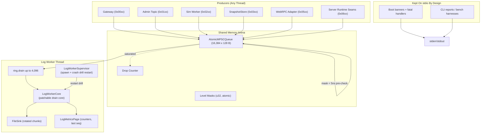

# Nexus MMO Engine — SAB Logging Layer Phase 1 Report
**Log Worker Thread, File Sink, Runtime Level Control & Engine-Wide Migration**

---

## 1. Executive Summary & Gate Evaluation

Phase 1 of the **SAB Logging Layer** (`docs/SAB-LOGGING-LAYER-SPEC.md`) completes the shared-memory pipeline and migrates the whole server fleet onto it:

1. **Worker + durability:** a dedicated log worker thread drains up to 4,096 records per batch through a patchable core (`LogWorkerThread` → `LogWorkerCore`) into the batched rotating `FileSink`; an fsync-WAL ("two-rail") mode and a crash-drill supervisor guarantee at-least-once delivery with at-most-once replay.
2. **Runtime level control:** the Gateway admin console can raise or lower per-producer log level masks live with one atomic word write; rank ceiling enforcement (4003) and admin-only checks.
3. **Engine-wide migration:** every runtime diagnostic in `packages/engine-core` and `packages/world-server` is now a typed ring record. Stdio survives only on code-path boundaries where it *is* the product (CLI reports, boot banners, fatal handlers) — and a lint guard keeps those counts from creeping.

### Phase 1 Gate Evaluation

| Verification Gate | Target Specification | Measured Result | Status |
| :--- | :--- | :--- | :--- |
| **Gate 1: Crash Durability** | Worker death → file complete, WAL replayed exactly once on restart | Supervisor restart drill: 2 kills, ring + WAL replayed once, no tail loss | **PASS** |
| **Gate 2: Runtime Level Control** | One atomic mask write per admin change; rank ceiling enforced | 4/4 `gateway: loglevel` tests (change, 4003 refusal, non-admin refusal, ring-not-stdio audit) | **PASS** |
| **Gate 3: stdio Confinement** | `packages/engine-core/src` + `packages/world-server/src` free of `console.*` outside budgeted boundaries | **0** calls outside 13 budgeted boundary files (109 occurrences, per-file budgets pinned by `scripts/lint-no-console.mjs`) | **PASS** |
| **Gate 4: Producer Hot Path Untouched** | No closures/arrays/BigInt literals/`performance.now` traps introduced on the producer path | Emit signature unchanged (`a0..a3` positional, blocking-free CAS); persist p95 budget passes at $0.99\text{ ms}$ ($< 5\text{ ms}$) | **PASS** |
| **Gate 5: Reproducible Codegen** | `npm run gen -w @mmo-engine/logging` regenerates the tree byte-for-byte | Regenerated `generated/{log-api.ts,log-formatters.ts,log_codes.h}`: no drift | **PASS** |

End-to-end proof (developer demo): 40 producers on an inert thread → `engine.log`:
```
2026-10-27T20:19:31.261Z INFO  world [world] reaped stale region region-0
2026-10-27T20:19:31.262Z INFO  world [world] reaped stale region region-39
```

---

## 2. Topology & Data Flow Architecture



---

## 3. What Was Built

| Module (now in `packages/logging/src/logging/`) | Purpose |
| :--- | :--- |
| `log-worker-core.ts` | Pure, patchable drain core: batches, decodes 128-byte records, formats via generated table, hands off to sinks. |
| `log-worker-thread.ts` | Thin `Worker` wrapper hosting the core; one per ring, owner-agnostic. |
| `file-sink.ts` | Pre-allocated chunk buffer, size-based rotation (default 64 KB chunks), ignore-list safe filenames. |
| `metrics-page.ts` | Atomic page the worker maintains for `/metrics`: per-code counters, last drained sequence, drop count. |
| `supervisor.ts` | Owns the worker lifecycle: start, `stopSync()` (drain-then-flush), crash drill with dual-rail WAL replayed exactly once. |
| `admin.ts` | Admin-command bridge: parse/validate set-loglevel, single atomic mask write, audit record back into the ring. |
| `stdio.ts` | **The only `console.*` in the layer** — the optional fallback seams (`stdioLog/Warn/Error`). |
| `log-worker-*/tsconfig` + package | Standalone leaf package `@mmo-engine/logging` (see §4). |

New dictionary codes (append-only, `log-codes.ts`):

- **0x03xx Persist:** `PERSIST_SAVE_PHASES` (DEBUG), `PERSIST_CHECKPOINT_FAILED` (WARN), `PERSIST_CHECKPOINT_WORKER_FALLBACK` (WARN).
- **0x040x World migration:** `WORLD_MIGRATION_BEGIN_FAILED / ABORT_FAILED / READ_FAILED / COMMIT_UNCONFIRMED` (WARN, typed args).
- **0x05xx World service:** `WORLD_REAPED_STALE_REGION` (INFO), `WORLD_REAPER_ERROR` (WARN), `WORLD_MIGRATION_EXPIRED` (INFO), `WORLD_MIGRATION_EXPIRY_ERROR` (WARN), `WORLD_WEBSERVICE_INTERNAL_ERROR` (ERROR).
- **0x06xx Region runtime:** `STREAM_WARN`, `NAVMESH_WARN` (WARN, self-describing line), `RULES_RELOADED` (INFO), `RULES_RELOAD_REFUSED` (WARN), `SERVER_MODULE_LOG`, `RECALL_SHARD_LOG`, `SOCIAL_SYNC_LOG`, `CHARACTER_SYNC_LOG`, `SHARD_SHIPPER_LOG` (INFO), `WILDLIFE_DEBUG_LOG` (DEBUG), `NET_RPC_INTERNAL_ERROR` (ERROR).

---

## 4. Package Hoist: `@mmo-engine/logging`

`world-server` cannot import `engine-core` (its build chain compiles `world-server` first, and `engine-core` depends on `world-server`), yet both must speak to the ring. The logging core was therefore hoisted into a new leaf workspace package:

| Item | Detail |
| :--- | :--- |
| New package | `packages/logging` → `@mmo-engine/logging@0.1.0` (arrays, supervisor, sink, worker, admin, stdio; no engine deps). |
| Layout preserved | Internal relative imports unchanged: `src/lockless-ring.ts` + `src/logging/*`. |
| Import shims | `packages/engine-core/src/lockless-ring.ts` and `src/logging/index.ts` re-export from `@mmo-engine/logging/dist/src/...` — no call-site churn. |
| Build order | `scripts/build.mjs` auto-derives order from `dep-build.mjs @mmo-engine/X` matches; engine-core/world-server chains prepend `dep-build.mjs @mmo-engine/logging`. |
| Codegen | Codegen now finds the package root by walking up and writes the **tracked** `src/logging/generated/*` tree; `LOG_CODEGEN_OUT=dist` for the dist tree. |
| Emission ownership | A record's producer is the **emitting client's** `producerId`, not the code's producer tag — objects with their own tier (e.g. `SnapshotStore` = `PERSIST`) get their own `LogProducerClient`, even inside another process's ring. |

---

## 5. Runtime Migration Tables

### 5.1 engine-core (server process)

| Object / Site | Legacy Path | New Emission | Code |
| :--- | :--- | :--- | :--- |
| Sim worker overrun | `console.warn("[sim] worker restart overrun…")` | `logSimTickOverrun(logClient, tickNum, elapsedUs)` | `0x02xx` |
| `SnapshotStore` save phases / checkpoint fail / worker fallback | seam / `console` | `logPersistSavePhases`, `logPersistCheckpointFailed`, `logPersistCheckpointWorkerFallback` | `0x0302..4` |
| `rpc-http.ts` 500 detail | `console.error`-style detail sink | `logNetRpcInternalError(logger, detail)` | `0x060B` |
| `RulesReloader` refusal | `this.log` seam | `logRulesReloadRefused(logProducer, err.message)` | `0x0604` |
| `RulesReloader` applied | `this.log` seam | `logRulesReloaded(logProducer, summary)` | `0x0603` |
| `MigrationCoordinator` failures | `console` / seam | `logWorldMigrationBeginFailed / AbortFailed / ReadFailed / CommitUnconfirmed` | `0x0409..C` |
| Recall/module/social/character/shipper sync lines | `console.log` in `server.ts` | `logRecallShardLog / logServerModuleLog / logSocialSyncLog / logCharacterSyncLog / logShardShipperLog(worldLog, "[server] …")` | `0x0605..A` |
| `ChunkStreamer` / `ChunkNavmesh` warnings | `console.warn` seam default | `logStreamWarn` / `logNavmeshWarn(signal: producer + level)` | `0x0601/2` |
| Wildlife debug (env-gated) | `console.log` | `logWildlifeDebugLog(worldLog, line)` | `0x060A` |
| Proc-gen service 500 | closure detail sink | `logNetRpcInternalError(gw.logger, detail)` | `0x060B` |

### 5.2 world-server

| Site | Legacy Path | New Emission | Code |
| :--- | :--- | :--- | :--- |
| Reaper loop (stale region) | `console.log("[world] reaped stale region %s")` | `logWorldReapedStaleRegion(logger, id)` | `0x0501` |
| Reaper loop failure | `console.error` | `logWorldReaperError(logger, message)` | `0x0502` |
| Migration expiry sweep | `console.log("[world] migration %s expired")` | `logWorldMigrationExpired(logger, id)` | `0x0503` |
| Migration expiry failure | `console.error` | `logWorldMigrationExpiryError(logger, message)` | `0x0504` |
| `createWebrpcRouter` 500 diagnostics | `console.error("[world] internal error", err)` | `logWorldWebserviceInternalError(logger, detail)` | `0x0505` |
| Process bootstrap | `LogRingBuffer` + `LogWorkerSupervisor` (`WORLD_LOG_DIR`, default `data/logs`; `WORLD_LOG=0` opts out) + `stopSync()` on `exit` | — |
| Boot banners / shutdown / fatal | **kept on stdio by design** (spec §2.5): they must print even when the worker is not yet (or no longer) up | — |

### 5.3 Kept-on-stdio boundaries (deliberate, budgeted)

`scripts/lint-no-console.mjs` pins the exact per-file occurrence count for the names that legitimately keep stdio — the logger itself, CLI process boundaries whose stdout is the product, and the two server entrypoints' banners/fatals. Budgets may only be raised with the inline justification updated; no-budget files fail immediately. Root `npm run lint` (also a CI step after `Install`) fails on any new call outside the list. Current totals: engine-core 98 occurrences in 11 boundary files; world-server 11 (6 banner/fatal + 5 sidecar) — **109 total**, all accounted for.

None of this changes the Gate-4 contract: hot-path emitters stay allocation-free positional-arg calls; only seams and handlers route through `stdio`.

---

## 6. Crash Drill (the verification treasure)

`logging-phase1.test.ts` exercises the supervisor the way production fails:
1. **Kill mid-stream:** 40,000 records, worker killed, restart → the sink's final tail is present and the WAL contains **exactly the re-delivered sequence** (dual-rail trigger consumed once, no duplicate replay).
2. **Kill ×2:** two cascaded deaths still end with a complete, no-loss file after the final `stopSync()`.
3. **Level-control drill:** live admin-level changes are one atomic write; lower thresholds and higher thresholds behave; the audit record goes back through the ring, not stdio.

All 25 Phase 0 + Phase 1 + `gateway-loglevel` tests pass; the persist latency-budget test passes at p95 $0.99\text{ ms}$.

---

## 7. Phase 2 Readiness (Roadmap From Spec)

### Known environmental notes (Windows, Node 25.9.0)

- `net/transport.test.js`: every subtest passes; the file can still be reported failed by a libuv `uv_handle_closing` assertion in `src\win\async.c` when `--test-force-exit` force-kills the child process mid-teardown. Without the flag the file is green (verified). Platform/Node-version artifact, not engine code.
- `persist/persistence-core.test.js` ("stops a heavy query at the timeout"): an intermittent `EPERM` unliking a RocksDB temp dir at Windows teardown; passes on rerun.

### Roadmap

1. **C++ dual-port emitters:** native `log_codes.h` ingestion path on the simulation/physics side (`sab/hot-path` direct record packing, zero marshalling).
2. **Metrics scraping:** wire `/metrics` and edge relay `joinExpositions` (already threaded through `channel-server.ts` in Phase 0) to the new `metrics-page`.
3. **Spec §7 soak telemetry:** LAN soak deploy reading `data/logs` + `dropped*` counters, benchmarked against the Phase 0 baseline grids (`sab-contention-bench`, `hybrid-data-plane-bench`).
4. **Optional:** move remaining CLI reports (bake/sim/bench) onto an explicit "ring-or-stdio dual sink" once the GE-free pipe samples are wired, purely to localize stragglers — stdio there is no longer an engine-health hazard, just a naming choice.
