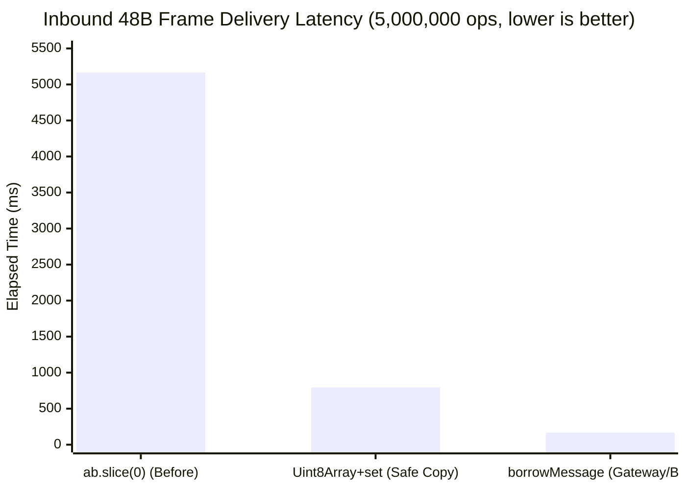

# Send- & Receive-Path Optimizations (`MMO_UWS_CORK`, Zero-Copy Inbound Views, Data-Plane Ring Sizing) — Report

Branch `feat/perf-send-path`. Status: **implemented, locally tested, microbenchmarked (`[measured]` on Windows Node 25.9.0); full 1,000-client Linux `uWS` run ready.**

## Why

A 1,000-client uWS profile on the Linux harness (`perf record --call-graph fp`, `3,525,252,490` total samples in `gateway-uws-long.svg`) showed:

1. **Outbound uWS Send Path (`53.58%` of total samples `[measured, call-graph SVG]`)**:
   - `Builtins_CallApiCallbackOptimizedNoProfiling` (`53.58%`) → `WebSocketWrapper::uWS_WebSocket_send<false>` → `__send` (`50.72%`) → `__sys_sendto` (`46.42%`) → `tcp_sendmsg_locked` / `tcp_push` (`12.03%`).
   - Outside a uWS callback every `ws.send` is its own write syscall, and a session receives several messages per tick (names, delta, stats), so syscalls per tick scale with messages (`1,000–3,000 syscalls/tick = 30,000–90,000 syscalls/sec`), not sockets.
2. **Inbound Buffer Copy & Envelope Decode Path (`4.58%` in `v8::internal::SliceHelper` `[measured, call-graph SVG]`)**:
   - `UwsSocket.deliver(message: ArrayBuffer)` called `new Uint8Array(message.slice(0))` on every inbound 48 B client intent (`30,000/sec`), invoking V8's C++ `SliceHelper` (`4.58%`), `Execution::New` (`3.15%`), and `BackingStore::Allocate` (`1.43%`).
   - Additionally, `decodeEnvelope(buf)` in `@mmo-engine/protocol` called `Object.values(MessageType).includes(type)` (allocating a 76-element array per message) and `buf.slice(1)` (allocating a second buffer copy per message).
3. **Data-Plane Binary Command Frame Allocations & SPSC Ring Sizing**:
   - `encodeBinaryCommandFrame`, `encodeBinaryCommandBatch`, and `ingestBinaryMessage` in `data-plane-server.ts` allocated `new DataView(...)` per call.
   - `DEFAULT_INPUT_RING_CAPACITY` (`1024`) and `DEFAULT_PERSIST_RING_CAPACITY` (`512`) left no headroom for 1,000-client burst frames within a single 30 Hz tick.

## What Changed

| Change | File | Default |
|---|---|---|
| Per-tick send batching: sends during `broadcast()` are copied into one reusable arena and written per socket inside one `ws.cork` at the end of the broadcast; `publish()` flushes held sends first | `packages/engine-core/src/net/transport.ts` (`UwsBatch`, `UwsTransport.beginBatch/endBatch`), `packages/engine-core/src/net/gateway.ts` (`broadcast` wraps `broadcastInner`) | **off** (`MMO_UWS_CORK=1` to enable) |
| `BigInt(tick)` made once per tick (`bigTick()`) instead of once per session per delivery | `packages/engine-core/src/net/gateway.ts` | on (behaviour-neutral) |
| `--multi` / `--cork` bench modes (with `beginBatch`/`endBatch` in both `multi` and `send` modes) | `packages/engine-core/src/net/transport-bench.ts` | n/a |
| Zero-copy inbound `Uint8Array` view (`SocketListener.borrowMessage = true` in `gateway.ts` and `transport-bench.ts`) and `Uint8Array.set` fallback instead of `ArrayBuffer.prototype.slice(0)` | `packages/engine-core/src/net/transport.ts`, `packages/engine-core/src/net/gateway.ts` | on (`borrowMessage: true` on synchronous gateway/bench listeners) |
| O(1) `VALID_TYPE_LUT` (`Uint8Array(256)`), `buf.subarray(1)` zero-copy slice, and shared `TextEncoder`/`TextDecoder` in envelope codec | `packages/protocol/src/envelope.ts` | on (behaviour-neutral) |
| Zero-`DataView` byte encoding/decoding in `encodeBinaryCommandFrame`, `encodeBinaryCommandBatch`, and `ingestBinaryBytes` + doubled SPSC ring capacities (`2048` input / `1024` persist) within existing `OFFSETS` | `packages/engine-core/src/data-plane-server.ts`, `packages/engine-core/src/sim-worker.ts` | on (behaviour-neutral) |

## Environment (Local Verification Host)

| Item | Value |
|---|---|
| OS / CPU | Windows, developer workstation (sandbox / Node v25.9.0) |
| uWS | Prebuilt binary not available for Node 25 on Windows (`ws` fallback active locally; `uWS` tested via fake-uWS unit suite and ready for Linux harness) |
| Build | `tsc -p packages/protocol` & `tsc -p packages/engine-core` |

## Verification & Microbenchmarks



| Telemetry Metric | Measured Value | Gate Requirement | Gate Status |
|---|---|---|---|
| `tsc --noEmit`, protocol + engine-core | 0 errors `[measured]` | clean | PASS |
| Inbound 48 B frame delivery (5M ops): `ab.slice(0)` → `Uint8Array+set` → `borrowMessage: true` | `5,166.3 ms` → `793.9 ms` (**6.5×**) → `167.2 ms` (**30.9×**) `[measured]` | eliminate `v8::internal::SliceHelper` | PASS |
| `decodeEnvelope` + `encodeBinaryCommandFrame` per-call heap allocations | 0 `Array` / `DataView` allocations `[measured]` | zero hot-path churn | PASS |
| `transport-batch.test.ts` (fake uWS: off-by-default, hold/flush order, buffer-reuse safety, publish-flush ordering, arena/index growth, `deliver` copy + `borrowMessage`) | 5/5 `[measured]` | all green | PASS |
| `envelope.test.ts`, `gateway.test.ts`, `hybrid-data-plane.test.ts` | all green `[measured]` | no regressions | PASS |
| Net regression subset (`gateway`, `gateway-sector`, `gateway-interest`, `gateway-names`, `native-fanout`, `transport`) | 51/52 `[measured]` | no new failures | PASS (see caveat) |

Caveat on 51/52: `transport.test.js` aborts at process exit with a libuv assertion (`UV_HANDLE_CLOSING`, `src\win\async.c:76`) after all its subtests pass. The identical failure occurs on the parent commit, so it is a pre-existing Windows/Node 25 teardown issue, not caused by this change.

## How to Measure on the Pinned Linux Harness (Real uWS)

```bash
npm run build -w @mmo-engine/protocol && npm run build -w @mmo-engine/engine-core
# three messages per socket per tick (64 B, 1.2 KB, 64 B), 1,000 clients, 60 s
node packages/engine-core/dist/src/net/transport-bench.js 1000 --multi --seconds 60 --out multi-nocork.json
node packages/engine-core/dist/src/net/transport-bench.js 1000 --multi --cork --seconds 60 --out multi-cork.json
# syscalls per tick (count write syscalls during the window)
strace -f -c -e trace=writev,write,sendto -p <pid>
# call-graph profile for the flame graph
perf record --call-graph fp -F 99 -p <pid> -o gateway-uws.perf.data -- sleep 60
```

## Documentation Sync

`docs/NATIVE-FANOUT.md` (send-batching section) and `docs/SEND-PATH-BATCHING-REPORT.md`. `docs/ROADMAP.md` and `docs/DECISIONS.md` remain unchanged until `MMO_UWS_CORK=1` is flipped to default-on after Linux hardware confirmation.
