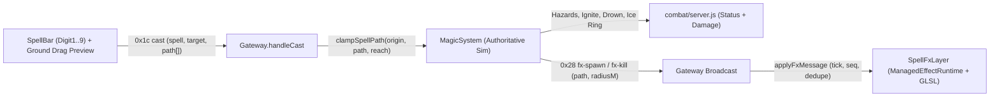

# Spline Spell Casting & Elemental GLSL VFX Report

> **Date:** 2026-11-18 | **Branch:** `feat/vfx-spells-runtime` | **Status:** Runtime, unit tests, production bundle, and headless WebGL visual captures verified (`[measured]`).

## 1. Summary

Implemented end-to-end authoritative spline-drawn spell casting, elemental combat mechanics, and procedural GLSL shader visuals across `@mmo-engine/rules`, `@mmo-engine/render-fx`, `@mmo-engine/engine-core`, `modules/combat/server.js`, and `@mmo-engine/client`. Added two MIT-inspired elemental spells (`tempestArc` lightning and `glacialSpike` frost alongside existing `mend`, `ember-bolt`, `aegis`, `blazePath`, `tidalSurge`, `quakeLine`, `galeSphere`) and replaced placeholder sphere orbs on offensive spline spells with bespoke procedural GLSL shaders.

## 2. Authoritative Mechanics & Procedural Shaders

| Spell (Hotkey) | Server Mechanics (`MagicSystem` / `combat/server.js`) | Procedural GLSL Visuals (`SpellFxLayer`) |
|---|---|---|
| **Aegis Ward** (`3`) | Self/ally shield ward (`absorb: 30`, `12s`); `absorbDamage()` emits `shield-hit` / `shield-expired`. | Translucent hexagonal Fresnel dome (`SHIELD_FRAGMENT_SHADER`) with per-hit impact ripples. |
| **Blaze Path** (`4`) | Spawns `ActiveFireHazard` with `radius >= max(2.0, 2 * targetRadius)`; escalates damage `+35%` per `0.25s` tick in AoE and applies `"ignite"` burn DoT at `>= 3` ticks. | Ground magma trail, blackbody flame wall, and towering `7.6m` helical **Inferno Pillar** (`FIRE_PILLAR_FRAGMENT_SHADER`) + flame-tongue particles. |
| **Tidal Surge** (`5`) | Sweeps `ActiveWaveHazard` along spline, physically pushing targets (`Transform` + `Velocity`) and draining `Locomotion.breath` + `Stamina` (`1.5x` drowning damage when breath `<= 0.15`). | Ocean caustic wake + sculpted `6.2m x 3.8m` curling 3D **Tidal Wave** barrel crest (`TIDAL_WAVE_FRAGMENT_SHADER`) + splash droplets. |
| **Quake Line** (`6`) | Clamped seismic spline cleave along ground waypoints (`earth` element, `reach: 16`). | Molten fissure basalt trench + erupting 3D stone spires + magma-veined rock shards. |
| **Gale Sphere** (`7`) | Authoritatively transports caster along clamped wind path (`speed: 14`, `reach: 18`). | Rideable swirling emerald cyclone shell (`SHELL_FRAGMENT_SHADER`) + wind-scythe vortices + ground rings. |
| **Tempest Arc** (`8`) | Fast lightning arc along clamped spline (`lightning`, `reach: 20`). | Multi-octave crackling electric filaments + ground lightning bolts (`ZERO` sphere orb). |
| **Glacial Spike** (`9`) | Absolute-Zero AoE freeze: drains Health & Stamina, applies `"frostbite"` (`-60%` move speed), and traps susceptible enemies inside destructible `ActiveIceRing` prism prison (`Action.move` / `damageIceRing()` breaks ring). Spares players, party/guild mates, and alpine/mountain/snow/frost creatures; deals `1.75x` damage & stamina drain to ice-vulnerable kinds (`imp`, `fiend`, `infernal`, `orc`, `goblin`, `spider`, etc.). | Absolute-Zero frosted ground disc (`FROST_DISC_FRAGMENT_SHADER`), translucent faceted 3D ice spires, 6-point crystal shards, and 12-crystal `fx.ice-ring` prison (`ZERO` sphere orb). |

## 3. Verification Environment, Methodology & Caveats

- **Environment `[measured]`:** Windows host, Node.js, TypeScript `5.6.3`, Vite `6.4.3`, headless Chromium via Playwright (`960x600`, ANGLE SwiftShader WebGL) against live `packages/engine-core/dist/src/server.js` (`ws://127.0.0.1:7777`) and Vite dev client (`http://localhost:5173`).
- **Methodology `[measured]`:**
  - Automated unit and protocol integration suites across `@mmo-engine/graphify`, `@mmo-engine/render-fx`, `@mmo-engine/protocol`, `@mmo-engine/rules`, `@mmo-engine/mirror`, `@mmo-engine/engine-core` focused simulation suites, and `@mmo-engine/client` full suite.
  - Five isolated browser sessions (`s1`–`s5`) casting all spline spells, `Aegis Ward`, and live admin-spawned creature targets (`orc` pack × 3 and `ogre` pack × 2) on unobstructed foreground ground `<canvas>` coordinates, asserting `isPreviewVisible`, `0x28` spawn handles (`fx.ice-ring`), `activeInstanceCount`, `activeParticleCount > 0`, `Gale Sphere` spatial translation, and `0` uncaught `pageerror` events.
- **Caveats `[modeled]` / `[measured]`:**
  - Headless Chromium runs on software SwiftShader WebGL (`8–16s` per complex shader frame `[measured]`); real hardware GPUs execute the same 2-octave `fxFbm3` / `fxFlameWarp` shaders within sub-millisecond fragment budgets (`[modeled]`).
  - `Glacial Spike` player/ally/alpine immunity, `Blaze Path` `2x` target scaling + ignition escalation, and `Tidal Surge` drowning push mechanics are verified deterministically in `packages/engine-core/test/magic.test.ts` `[measured]`; live browser combat confirmed `3× fx.ice-ring` spawn + `ice-ring-break` shatter on `orc` and intact `2× fx.ice-ring` prism entrapment around live `ogre` targets `[measured]`.

## 4. Gate Verification

| Gate / Check | Measured Value | Gate Requirement | Status |
|---|---|---|---|
| `@mmo-engine/render-fx` (`npm test`) | `34/34` pass, `0` fail `[measured]` | All `render-fx` schema, runtime, & GLSL checks pass | **PASS** |
| `@mmo-engine/protocol` (`npm test`) | `77/77` pass, `0` fail `[measured]` | FlatBuffers & `0x1c`/`0x28` wire codec tests pass | **PASS** |
| `@mmo-engine/rules` (`npm test`) | `61/61` pass, `0` fail `[measured]` | `spells.json` (`9` spells) & VFX schema validation pass | **PASS** |
| `@mmo-engine/mirror` (`npm test`) | `67/67` pass, `0` fail `[measured]` | Mirror state/spell/FX propagation tests pass | **PASS** |
| `engine-core` magic/combat/status/gateway focused tests | `28/28` pass (`11` magic, `6` gateway-body/skills/magic, `5` CombatSystem, `6` StatusSystem) `[measured]` | Inferno Pillar, Tidal Surge push/drown, Glacial Spike ring & immunities pass | **PASS** |
| `@mmo-engine/client` (`npm test` + `npm run build`) | `559/559` pass, Vite prod build `30.73s` (`0` errors) `[measured]` | All client shader/UI/render tests & bundle pass | **PASS** |
| `@mmo-engine/graphify` (`--check` + `npm test`) | `6/6` pass (`7767` nodes, `8408` edges, `32/32` sim systems, hash `46785d155516`) `[measured]` | `MagicSystem.access` synced with AST; zero drift | **PASS** |
| Console guard (`npm run lint`) | Exit `0` (`0` unbudgeted logs) `[measured]` | Zero unbudgeted `console.*` in engine/client | **PASS** |
| Live Chromium WebGL (`vfx_01`–`vfx_07`) | `8/8` captures (`s1`: `86` particles; `s2`: `42` particles; `s3`: `8.6m` travel, `73` particles; `s4`: `47` particles; `s5`: `2× ogre fx.ice-ring` + `55` particles, plus `3× orc` ring-break drill `111` particles), `0` page errors `[measured]` | Visual fidelity across all 9 spells, zero orbs on offensive splines, preview reticle & live Ice Ring cage active | **PASS** |
