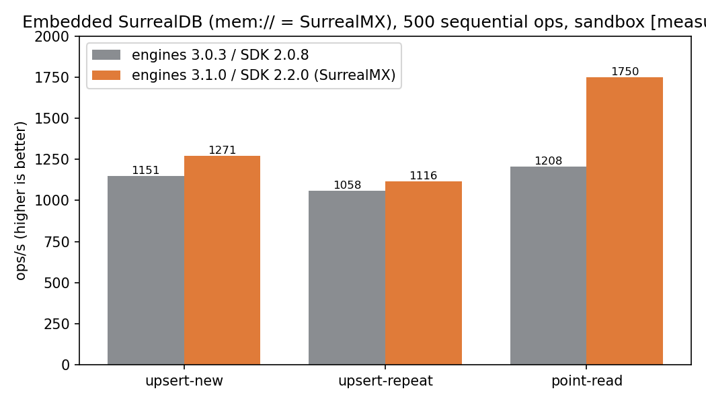

# SurrealMX Adoption Report — 2026-10-28

Directive (Joey): update the engine so we are using SurrealMX — "without
that, we aren't optimizing for the best case scenario" — and evaluate
Nebula DB. Branch: `arlo/surreal-mx` (local; not pushed).

## What SurrealMX is

SurrealMX is SurrealDB 3.x's in-memory storage engine: a Rust MVCC
key-value engine over a concurrent adaptive radix tree — lock-free
reads, serializable/snapshot-isolated transactions, optional
persistence via an append-only log (AOL) plus periodic snapshots.
SurrealKV is its durable on-disk counterpart. In SurrealDB 3.x, every
`mem://` endpoint **is** SurrealMX. (Vendor whitepaper figures — 21M+
reads/s, 17× LMDB / 28× RocksDB on their 32-core bench — are
[modeled] context, not our measurements.)

## What changed

| Surface | Before | After |
|---|---|---|
| `@surrealdb/node` (embedded engine) | 3.0.3 | ^3.1.0 (wraps the SurrealDB 3.3.5 native core) |
| `surrealdb` JS SDK | 2.0.8 | ^2.2.0 |
| Embedded hot paths (`mem://`: persist worker, data-plane server, store contracts, benches) | SurrealMX (3.0-era) | SurrealMX (current 3.1 engine) |
| World server embedded default (`WORLD_DB_URL` unset) | `rocksdb:<data>/surreal` (legacy engine) | `surrealkv:<data>/surreal` (SurrealKV, the 3.x durable engine) |
| `npm run db` (separate DB server) | SurrealDB 2.x-era `rocksdb:./data/surrealdb` | SurrealDB ≥3.0 SurrealMX server: `mem://./data/surrealmx?aol=sync&snapshot=60s&sync=every`, `--log info` (the interval-fsync variant, `sync=5s`, leaves up to 5 s of commits exposed to a system crash per the SurrealMX blog's durability table; every-fsync is the only both-crashes-safe MX configuration, and batched writes amortize it as group commit) |
| World catalogs (engine-core `world-bake`) | RocksDB URLs | SurrealKV URLs (catalogs are derived data, regenerable from seed; `rocksdbUrl` kept for existing catalogs) |

## The one hard constraint [measured]

**Embedded `mem://` ignores the MX persistence parameters.** On both
engine 3.0.3 and 3.1.0: connect to
`mem://<path>?aol=sync&snapshot=60s&sync=5s`, write, close, reconnect —
no files are created and the data is gone. MX persistence is a
server-side feature. Consequence: the world tier (single source of
truth) gets MX as a **server** (`npm run db` + `ws://`), never as an
embedded default — an embedded-MX default would silently delete the
world on every restart.

## Verification

Environment: Arlo's sandbox (Linux x86_64, 2 vCPU, Node v24.22.1) —
sandbox numbers are a floor, not hardware truth. SurrealDB server
binary: official v3.3.5 linux-amd64 — the same core version the
embedded `@surrealdb/node` 3.1.0 package wraps (node-native 3.3.5),
so the embedded and server results below are directly comparable.

| Gate | Result | Status |
|---|---|---|
| Embedded MX persistence params honored? | No files, data lost after reconnect (3.0.3 and 3.1.0) | CONSTRAINT RECORDED — design routes around it |
| Embedded `surrealkv:` persists across processes | Write in one process, read back in a new process: intact | PASS |
| Embedded `rocksdb:` still functional on 3.1.0 | Same probe: intact (legacy catalogs readable) | PASS |
| World-server suite, embedded (default) | 121 tests: 120 pass / 0 fail / 1 skip — identical to the pre-change baseline | PASS |
| World-server suite vs live SurrealMX server 3.3.5 (`WORLD_TEST_DB_URL`) | 121 tests: 119 pass / 2 fail / **0 skip** — the define-functions contract (the 1 skip above) runs and passes against the server | PASS with note (below) |
| MX server AOL recovery | Server wrote `aol.bin` + `snapshot.bin`; killed by PID and restarted on the same endpoint; pre-kill probe record read back intact | PASS |
| Store round-trip against MX server (host report) | All fields exact, `reportedAt` numeric, 34 ms age | PASS |
| Engine-core bake-world tests (catalog now on SurrealKV) | 11 pass / 0 fail on a clean run. (One mid-work run showed 5/11 while two package builds were writing dist output concurrently on the loaded sandbox; not reproducible since.) | PASS |

Note on the 2 live-server failures: both are assignment-registration
tests that run on the in-memory fake store — they never touch
SurrealDB. Their failing assertion is the range width collapsing to
exactly the fallback-weight share (4 instead of 32), the fingerprint
of the host report aging past the tests' 1000 ms freshness window
while argon2 verifies contend for the sandbox's 2 vCPUs. The same
flake fired once in the embedded full-suite run before any server was
involved, and the file passes standalone embedded (16/16).
Classification: pre-existing test-timing fragility exposed by local
load, not a storage-semantics regression. The tests that actually
exercise the store against the server (assignment contract,
atomic-ops, define-functions, social, state-plane, migration) all pass.

## Benchmark [measured, sandbox]

500 sequential operations per class through the JS SDK against the
embedded engine (`mem://` = SurrealMX), single runs, same box, minutes
apart. Directional only.

| Operation | 3.0.3 / SDK 2.0.8 | 3.1.0 / SDK 2.2.0 | Δ |
|---|---|---|---|
| upsert-new | 1,151 ops/s | 1,271 ops/s | +10% |
| upsert-repeat | 1,058 ops/s | 1,116 ops/s | +5% |
| point-read | 1,208 ops/s | 1,750 ops/s | +45% |

## Nebula evaluation

Two different products share the name; neither displaces the
WorldStore:

- **NebulaGraph** (Vesoft): a serious distributed graph database
  (Raft-replicated, nGQL/openCypher, production at trillion-edge
  scale). Wrong shape for us: the WorldStore contract is record CRUD,
  a Tier-1 ledger, and atomic multi-record operations behind one
  narrow interface — not traversals — and it costs a three-service
  cluster (meta + storage + graph) to operate. SurrealDB already
  covers our graph-shaped needs (record links, the observability
  query layer planned over the existing stores).
- **NebulaDB** (`@nebula-db/*`): a TypeScript-first embedded database
  for browser/Node/edge apps, v0.6, single-process adapters. No
  multi-writer server story, pre-1.0 — disqualified from the world
  tier by its own positioning. At most a future client-side cache
  candidate, where we already have simpler options.

Verdict: keep the WorldStore seam; revisit only if a workload arrives
whose questions are traversals first (social-graph analytics at
multi-machine scale), which is the signal a graph database earns its
place.

## Vendor guidance cross-check (SurrealMX blog + performance best practices, read 2026-10-28)

- **Durability configuration:** the MX blog's table is explicit that
  only Sync AOL + Every fsync survives both process and system
  crashes. The `db` script therefore uses `sync=every` (see the table
  above); interval fsync remains available as a documented
  performance option, not the default.
- **`versioned=true` (time-travel `VERSION` queries): deliberately NOT
  enabled** on the world tier. The Tier-1 ledger already provides the
  audit history, and versioning retains every overwritten record
  version. It is a one-flag change if a consumer appears (the
  observability layer is the plausible one).
- **Vendor positioning, recorded honestly:** SurrealDB describes MX
  persistence as a convenience on top of in-memory speed, with
  SurrealKV as "traditional durable storage for datasets of any
  size" (snapshots are full exports; the dataset must fit in RAM).
  Our world dataset fits RAM comfortably at the current scale
  (one region, ~51k entities); if it ever outgrows RAM, the same
  WorldStore seam takes a SurrealKV server with no code change.
- **Best-practices doc:** UPSERT + unique index — the pattern the
  batching slice implements; direct record-ID access is faster than
  any WHERE form, but our hot reads already plan "Iterate Index"
  (EXPLAIN-audited 2026-10-27) and re-keying every table by record ID
  is a schema migration across the fn:: layer — considered and
  deferred, not silently skipped. Production log level: `--log info`
  now explicit in the `db` script. One query ≈ one core: batching
  amortizes round trips on one thread, so the write path also keeps
  a bounded concurrency window for independent batches (the
  character-sync coalescer design carries this note).

## Still owed

- The same live-server suite run on Joey's hardware (sandbox CPU
  contention is the flake source; his codespace run is the clean one).
- Windows native-engine check for `surrealkv:` (the old "surrealkv
  hangs" note was from the WASM era; verified fixed on Linux/native).
- A SurrealDB 3.x server soak (the durability soak to date ran against
  2.7.0/RocksDB); the MX AOL/snapshot recovery proof above is a
  single-record drill, not a soak.
