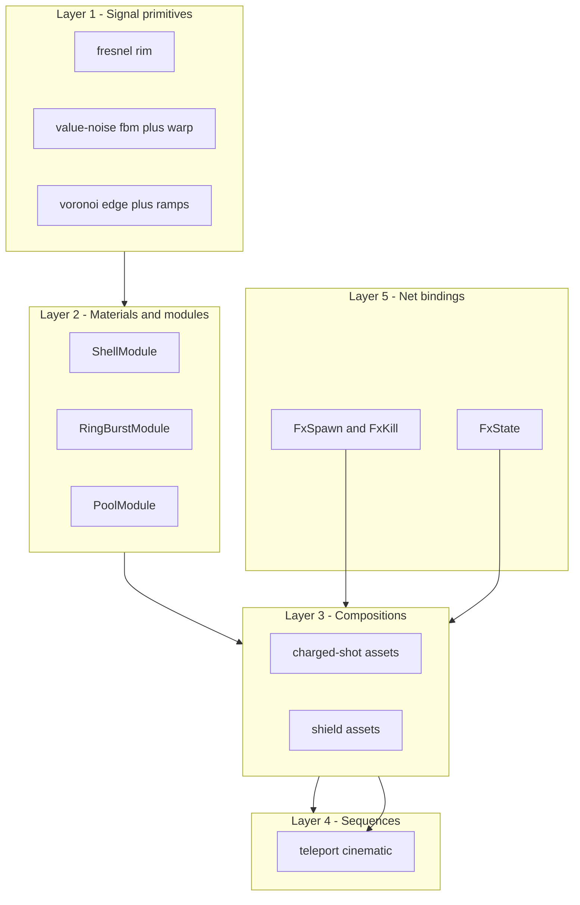
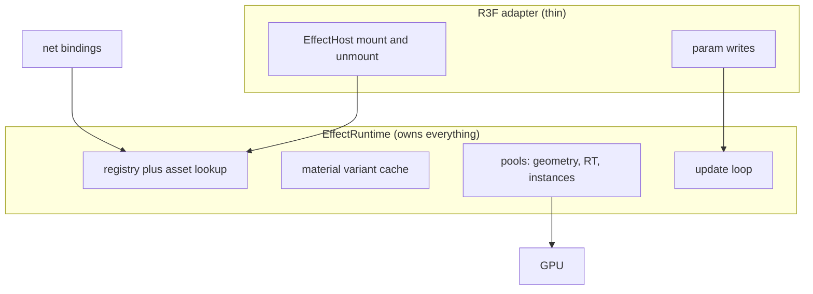
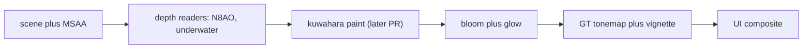

# NexusMMOEngine — Modular Shader, VFX & Post-Processing Specification

> Status: **PROPOSED specification, revision 2** (not yet implemented).
> Revision 1 (commit `5fb82ae9`) was an aspirational blueprint; this revision
> resolves its schema/interface/example mismatches and is written so that the
> first implementation PR can be cut directly from section 12.
>
> Tag legend: `[EXISTING]` = verified in this repo at `main` (`5fb82ae9`).
> `[PROPOSED]` = new design in this document: illustrative skeletons, not
> production code. `[MEASURED]` = numbers produced by a repo benchmark.
> `[TARGET]` = proposed budget, not yet measured — must be replaced by
> measurement at the phase gate.
> No visual node/graph editor is proposed. No universal GLSL/TSL abstraction.

## 0. Executive recommendation (unchanged architecture)

Build a framework-independent TypeScript VFX runtime (`[PROPOSED]`
`packages/render-fx/`, zero `react` imports) owning every GPU resource and
per-frame update, plus a thin React Three Fiber adapter that only
mounts/unmounts effect handles and writes params. Keep the proven `[EXISTING]`
WorldCanvas contract: R3F owns renderer/camera/loop; plain classes do the work;
mirror state never flows through React state
(`apps/client/src/render/world-canvas.tsx`).

- **Baseline:** WebGL2 + handwritten GLSL (`THREE.ShaderMaterial`,
  `onBeforeCompile` injection) composed through the `[EXISTING]`
  `postprocessing`-based `EffectComposer` (`post-fx.tsx`; `postprocessing
  ^6.39.5`, `three ^0.186.1`).
- **WebGPU/TSL is an opt-in backend module**, required by exactly one reference
  (`hologram-particles`, `WebGPURenderer`). No GLSL/TSL interop is promised.
- **Authoring model:** versioned composition schema (JSON + typed params +
timeline tracks). A full graph editor is explicitly deferred.
- **First vertical slice:** charged-shot presentation (charge → release →
  travel → impact) driven by authoritative presentation messages, running
  inside the existing `PostFx` chain. Post-paint work beyond one verified
  stylization pass is deferred to a later PR.



---

## 1. Source audit and exact provenance (revision 2 resolves: no commit pins)

Reference checkouts were re-read 2026-11-11 from `/tmp/cortiz` (shallow clones).
Exact SHAs below were recorded with `git rev-parse HEAD` on that date.
Shallow-clone caveat: SHAs are exact for the fetched snapshot but history was
not fetched; re-pin with full clones before any code-level port.

| Repo | Exact SHA (2026-11-11) | Deps / backend (verified in `package.json`) | Inspected source files | License / assets |
|---|---|---|---|---|
| `cortiz2894/stylized-components` | `1cece0a296b29299d1380c34feb5c158b2f04500` (2026-09-29) | `three ^0.182.0`, `postprocessing ^6.38.2`, `@react-three/*`, `three-stdlib`; WebGL `EffectComposer` + custom `Pass` subclasses | `src/components/kuwahara/AnisotropicKuwaharaPass.ts`, `kuwahara/glsl/anisotropicKuwahara.ts`, `kuwahara/glsl/structureTensor.ts`, `kuwahara/README.md`, `outline/OutlineFilter.tsx`, `volumetricLight/glsl/volumetricLight.ts`, `volumetricLight/README.md`, `waterFloor/shaders/fragment.ts`, `waterFloor/shaders/vertex.ts`, `grassField/shaders/grassBlade.ts`, `grassField/materials/bladeMaterial.ts` | MIT `LICENSE` (Copyright 2026 Christian Ortiz). GLB/texture assets under `public/**` are third-party or authored content — techniques only, never copy. |
| `cortiz2894/charged-blast-vfx` | `391cbe1c60a807b674091dad4bf6a8c2ba2c6a13` (2026-04-03) | `three ^0.182.0`, `@react-three/fiber ^9.5.0`, `@react-three/postprocessing ^3.0.4`, `postprocessing ^6.38.2`; **plain WebGL + handwritten GLSL** | `src/components/ChargeShotVFX/ChargeOrb/shaders.ts`, `ChargeOrb/index.tsx`, `ChargeParticles/shaders.ts`, `ChargeReadySphere/shaders.ts`, `Projectile/shaders.ts`, `playground/PostProcessing.tsx`, `playground/chargeStore.ts` | **No LICENSE file found** — all-rights-reserved/unknown. Learn techniques; do not copy code. `public/assets/sounds/*`, `public/megaman-separate-blaster.glb` are third-party — never copy. |
| `cortiz2894/flow-shield-effect` | `bf34d9ea48fd4333f5b42ef3e3772c89de2adccb` (2026-05-22) | `three ^0.182.0`, `postprocessing ^6.38.2`; WebGL + handwritten GLSL | `src/components/ForceShield/shaderMaterial.ts`, `ForceShield/index.tsx`, `ForceShield/consts/index.ts` (`MAX_HITS = 6`) | **No LICENSE file found** — all-rights-reserved/unknown. `public/droideka.glb` is third-party — never copy. |
| `cortiz2894/hologram-particles` | `26f9cc1c16a51df2b67b4e5caaa50a6fc531c2dc` (2026-06-30) | `three ^0.182.0` **WebGPU path**: `three/webgpu` `WebGPURenderer`, `three/tsl` node graph, `three/addons/tsl/display/BloomNode.js` | `src/components/hologramParticles/ParticlesHologram.tsx`, `utils/presets.ts`, `types/index.ts`, `HologramScene.tsx` | **No LICENSE file found** — all-rights-reserved/unknown. `public/glb/*.glb`, `public/assets/triangle-texture.png` are content — never copy. |

Not verified: video content on `https://www.youtube.com/@cortizdev` (not
scraped); any repository beyond the four above; exhaustive channel coverage is
not claimed.

### 1.1 Existing engine surface this specification builds on `[EXISTING]`

| Area | Location | Verified facts (revision 2 corrections) |
|---|---|---|
| Client renderer shell | `apps/client/src/render/world-canvas.tsx` | R3F owns renderer/camera/loop; plain classes do scene work; mirror state bypasses React state. |
| Post chain | `apps/client/src/render/post-fx.tsx` | `EffectComposer enabled={quality.effects} multisampling={quality.msaa}` + N8AO + Bloom + `UnderwaterEffect` + `GTToneMapEffect` + Vignette. |
| Custom effects (precedent) | `apps/client/src/render/effects/underwater-effect.ts`, `gt-tonemap-effect.ts` | Hand-written `postprocessing` `Effect` subclasses. `UnderwaterEffect` declares `EffectAttribute.DEPTH` and reads view-Z via `getViewZ(depth)`; tonemap is a pure colour effect. |
| VFX materials | `apps/client/src/render/vfx/materials/*.ts` | `FlowMaterial`, `WorldFlowMaterial`, `PolarFlowMaterial`, `DissolveMaterial`, `ColorRampMaterial` (+ `Fire/Smoke/Magic/Portal/Dust/Healing/Poison/Rain` ramp variants). WebGL2 GLSL strings, `AdditiveBlending`, `depthWrite: false` (except `DissolveMaterial`, which keeps `depthWrite: true`). |
| Shared GLSL | `apps/client/src/render/glsl.ts` | `[EXISTING]` `NOISE_GLSL` (`fxHash`/`fxNoise`/`fxFbm` 4-octave/`fxRidge`) already shared by `element-fx.ts`, `entity-fx.ts`, `terrain-fx.ts`. **All new primitives must extend this file; no second noise copy.** |
| Particle backends | `apps/client/src/render/fx/particle-fx.ts` (three-nebula), `apps/client/src/render/vfx/quarks-fx.ts` (three.quarks `BatchedRenderer`) | Two CPU-sim stacks bridged by `VFXAdapter`. `QuarksFx.setBudget(mult, cap)` + `ParticleFx.setBudget(mult, weatherCap)` scale emission; budgets come from `[EXISTING]` `content/vfx/budgets.json` (`version: 1`; per-tier `maxEmitters`/`maxParticles`). |
| Quality tiers | `apps/client/src/render/quality.ts` | Canonical tier union is `low \| medium \| high \| ultra` (`QUALITY_TIERS`, `QUALITY_PRESETS`). **Revision-1 `Tier`/`Low|Medium` mismatches are corrected: this spec uses `QualityTier` verbatim.** Governor varies `dpr` then tier; `effects: false` on `low` bypasses the composer entirely. |
| Content VFX format | `content/vfx/fireball-impact.json`, `shrine-*.json`, `budgets.json` | `[EXISTING]` precedent: `{id, name, version, authoredTier, blendMode, emitters[]}` with `bursts`, `color.stops[]`, `lifetime/size/speed` point curves, `spawnShape`, `forces`. **Revision-2 example assets reuse `emitters[]`-style module lists and `version: 1`; they do not invent a conflicting schema.** |
| Pooled decals | `apps/client/src/render/telegraphs.ts` | `TELEGRAPH_POOL = 32`, per-slot `ShaderMaterial`, `apply()`/`update()`/`clear()`/`dispose()` contract, `renderOrder = 1`, `polygonOffsetFactor: -2`. The pooling/lifecycle pattern `PoolModule` copies. |
| Server tick | `packages/engine-core/src/tick-loop.ts` | `STEP_MS = 1000/30`; 30 Hz authoritative. `welcome.tick_hz = 30`. |
| Net envelope + catalog | `packages/protocol/src/envelope.ts`, `types.ts`, `docs/MESSAGE-CATALOG.md` | `[u8 type][payload]`; control plane JSON, data plane FlatBuffers; u64 ids as JSON strings. `PROTOCOL_VERSION = 29`. Highest assigned type is `0x27` (`Interact`); `0x1d` = ability, `0x1e` = telegraph, `0x1f` = status. **Revision 1's invented `MessageType` assignments and FlatBuffers wire fragments are withdrawn; section 8 defines the real 0x28 proposal.** |
| Combat moves | `packages/protocol/src/combat.ts` | Move table (id/clip/duration/chain/hitAt/sound); server runs moves, clients play clips from `(moveId, startTick)`. Presentation events in section 8 key off the same `(tick, entity)` pair. |
| Dependencies | `apps/client/package.json` | `three ^0.186.1`, `@react-three/fiber ^9.8.1`, `@react-three/postprocessing ^3.1.3`, `postprocessing ^6.39.5`, `three.quarks ^0.17.1`, `three-nebula ^13.3.0`. Reference repos pin `three ^0.182.0`; APIs cited here are stable across both. |
| Measured baselines | `docs/CPP-MAIN-TICK-PHASE0-REPORT.md` | `[MEASURED]` sandbox: `ws` fan-out p99 22.5/42.4/79.2/135.7 ms @250/500/1k/2k clients; full JS tick mean 6.06 ms / p99 23.9 ms; JS kernel-only mean 0.708 ms / p99 2.681 ms. **No FX numbers exist yet — every FX budget in section 11 is `[TARGET]`, not measured.** |

---

## 2. Technique-to-building-block inventory (revision 2: verified-only claims)

Legend: **V** = verified in the listed source file at the pinned SHA.
**I** = inference from surrounding code (marked per-row). **N** = proposed
Nexus adaptation (newly authored, never copied).

### T1. View-dependent fresnel / rim shell (V)

- **Reference:** `charged-blast-vfx@391cbe1/.../ChargeOrb/shaders.ts`
  (`FRESNEL_FRAG`, `GLOW_FRAG`); `Projectile/shaders.ts` (`PROJECTILE_FRAG`).
- **Visual purpose:** hot core with coloured rim on opaque energy bodies.
- **Implementation (V):** view-space normal `f = 1 - abs(dot(n, vec3(0,0,1)))`,
  `pow(f, power)` mixes core/rim, multiplied by emission x progress. (I: the
  `abs()` makes front and back faces rim identically — intended for shells.)
- **Inputs / state (V):** view normal; colours; power/emission/progress
  uniforms; `AdditiveBlending`, `transparent`, `depthWrite: false`.
- **Extraction (N):** `prim_fresnel` in `glsl.ts` + `ShellModule`.
- **Limits:** view-space trick, not world-space true fresnel; breaks under
  strong normal mapping; no soft-particle depth fade in source.
- **Validation:** fixed-seed screenshot at 3 camera angles; rim > core at
  silhouette probe pixels.

### T2. Hash value-noise fbm + domain warp (V)

- **Reference:** `ChargeOrb/shaders.ts` `NOISE_FRAG` (hash/value-noise/fbm +
  2-stage warp `q`,`r`); engine precedent `[EXISTING]` `glsl.ts` `NOISE_GLSL`.
- **Implementation (V):** 5-octave fbm in the reference; engine already ships
  4-octave `fxFbm`. Nexus uses the engine's `fxHash/fxNoise/fxFbm` and adds
  only a warp wrapper — no second noise implementation.
- **Extraction (N):** `prim_warp2` snippet in `glsl.ts`.
- **Limits:** fragment-ALU cost scales with octaves x covered pixels; shells
  only, never fullscreen.
- **Validation:** frame-ms probe with/without warp at fixed radii.

### T3. Gradient sweep + muzzle star + ring + trail kit (V)

- **Reference:** `Projectile/shaders.ts` (`PROJECTILE_FRAG` 3-stop sine sweep,
  `MUZZLE_FRAG` angular sectors, `RING_FRAG` tube-cross-section blend,
  `TRAIL_FRAG` uv.y tail fade x facing fade).
- **Implementation (V):** capsule/torus/cylinder/quad + per-mesh uniforms;
  `RING_VERT` derives the blend from tube cross-section so it is
  rotation-aware. (I: `uTipY/uTailY` assume +Y travel alignment.)
- **Extraction (N):** `RingBurstModule`, `TrailModule`, `MuzzleFlashModule`.
- **Limits:** source trail geometry is a fixed cylinder; Nexus `TrailModule`
  rebuilds from a position-history ring buffer for curved paths.
- **Validation:** ring-blend symmetry unit test (A-B-A); overdraw probe.

### T4. Instanced in-drag particle set (V)

- **Reference:** `ChargeOrb/index.tsx` (pooled `MAX_PARTICLES` instanced
  capsules, zero per-frame allocation via reused `_dummy`/`Vector3` refs).
- **Extraction (N):** `PoolModule` (fixed-capacity instanced quads, one
  spawn/update pass, seeded RNG) — the MMO-safe pattern: bounded, no React
  state, no allocation after warmup.
- **Limits:** CPU per-instance matrix compose caps at a few thousand; beyond
  that use the GPU path (T9, WebGPU-only).
- **Validation:** allocation counter (0 allocs post-warmup); N-spawn spike test.

### T5. Multi-term shield shell with hit ring buffer (V)

- **Reference:** `flow-shield-effect@bf34d9e/.../ForceShield/shaderMaterial.ts`
  (fresnel + hex + simplex flow + cell flash + reveal edge +
  `uHitPos[6]`/`uHitTime[6]` expanding rings + bottom fade);
  `ForceShield/index.tsx` (click → ring-buffer upload, `lifeRef` → `uLife`).
- **Implementation (V):** one sphere (r=1.8, 64x64), `FrontSide`, additive;
  per-frame `uTime`/`uLife`/`uReveal` only; hits are uniform writes.
- **Extraction (N):** `ShieldModule` with `hitSlots` sized by tier
  (Low 0/disabled, Medium 4, High/Ultra 8) and the same uniform contract.
- **Limits:** fixed array size; object-space coords require `worldToLocal`;
  sender should also transmit the surface normal (section 8 does).
- **Validation:** hits at N slots → N rings; life 1→0 colour ramp; reveal
  1→0 hides mesh (`visible = false`).

### T6. Voronoi-animated stylized water + ripple field (V)

- **Reference:** `stylized-components@1cece0a/.../waterFloor/shaders/fragment.ts`
  (`voronoiF1`/`voronoiSF1` + `smin`, fbm distortion, cel-stepped edge,
  `uRippleCenters[8]`/`uRippleTimes[8]` analytic rings, camera-distance fade).
- **Extraction (N):** `WaterModule` — deferred past PR1 (section 12); listed
  here for inventory completeness only.
- **Limits:** no refraction/reflection in source; shoreline foam needs a depth
  texture the reference never reads.
- **Validation (deferred):** ripple-count render test; preset stills.

### T7. Instanced grass with wind + trample + soft-shadow ring (V)

- **Reference:** `grassField/shaders/grassBlade.ts` (height-masked wind,
  `uRocks[24]` trample spheres, per-blade shadow-tap ring neutralising
  Lambert's single sample) injected via `onBeforeCompile`; teaches the
  preferred lit-VFX pattern: inject into lit materials, never reimplement
  lighting. Deferred past PR1; inventory only.
- **Limits:** `uRocks` fixed at 24; shadow taps cost fetches per fragment —
  tier-gated.

### T8. Painterly post chain: anisotropic Kuwahara + outline + volumetrics (V)

- **Reference:** `kuwahara/AnisotropicKuwaharaPass.ts` + `glsl/*` (2-stage
  single `Pass`: structure tensor → 8-sector paint; defaults radius 3, alpha 2)
  + `kuwahara/README.md` pass-order rules; `outline/OutlineFilter.tsx` (3x3
  Sobel; DEPTH-before-paint vs LUMINANCE-after-paint; thicker lines before
  paint); `volumetricLight/README.md` (screen-space march toward sun pixel).
- **Verified buffer contract (V, replaces revision-1 assumptions):** Kuwahara
  owns a private tensor target, samples colour from the composer's input
  buffer, and renders the scene exactly once; it is a plain `Pass`, not a
  depth reader. Depth-reader passes (N8AO `[EXISTING]`, volumetrics) MUST run
  before any `needsSwap` rotation consumes the depth attachment — the
  reference README documents depth returning 1.0 afterwards. `UnderwaterEffect`
  `[EXISTING]` declares `EffectAttribute.DEPTH` and is itself a depth reader,
  so it also sits pre-paint. Bloom/tonemask/grade are colour-only and may sit
  after paint. Tone mapping + sRGB encode happen once at the end of the
  chain (`[EXISTING]` `GTToneMapEffect`).
- **Extraction (N):** `KuwaharaPass` as the single verified stylization pass;
  outline/volumetrics deferred past PR1.
- **Limits:** fill-rate bound (`8 x radius x 5` taps/px; ~200 at radius 5);
  Low tier off, Medium r=2 half-res, High r=3, Ultra r=4 (`[TARGET]`).

### T9. GPU model-to-particle hologram with TSL compute (V, WebGPU-only)

- **Reference:** `hologram-particles@26f9cc1/.../ParticlesHologram.tsx`
  (`MeshSurfaceSampler` → position/normal buffers →
  `StorageInstancedBufferAttribute` drift → `MeshBasicNodeNode` TSL graph with
  fresnel + scanline + mouse glow; `PostProcessing` via
  `three/addons/tsl/display/BloomNode.js`).
- **Extraction (N):** `HologramModule` as an optional WebGPU-only module.
  WebGL fallback = `PoolModule` at reduced count with identical asset params
  (explicitly degraded, never pixel-identical).
- **Limits:** `three/tsl` API is version-sensitive (verified against `^0.182.0`
  only); deferred past PR1.

### Reuse demonstrations (one primitive, three effects)

1. `prim_fresnel` → charge orb rim (T1) + projectile rim (T3) + shield edge (T5).
2. `fxFbm` warp → orb plasma (T2) + shield flow (T5) + (deferred) water distortion (T6).
3. Ring-buffer uniform pattern → shield impacts (T5) + (deferred) water ripples
   (T6) + muzzle shockwaves (T3).
4. `RingBurstModule` → impact wave + shield-hit echo + teleport arrival ring
   (same module, different ramp/scale/lifetime params).

---

## 3. Rendering backend and shader strategy (unchanged decision, clarified)

**WebGL2 + GLSL is the baseline; WebGPU + TSL is an opt-in module.**

| Concern | Baseline (PR1) | Optional / deferred |
|---|---|---|
| Shading language | Handwritten GLSL ES 3.0 via `THREE.ShaderMaterial` + `onBeforeCompile`; extend `[EXISTING]` `glsl.ts` `NOISE_GLSL` (revision-1 standalone `prim_*` lib withdrawn — it duplicated `fxHash/fxNoise/fxFbm`). | TSL node graphs only inside `HologramModule` (T9, deferred). No GLSL/TSL transpiler exists or is proposed. |
| Materials | Reuse `[EXISTING]` `FlowMaterial`/`DissolveMaterial`/`ColorRampMaterial` family; add `ShellModule`, `RingBurstModule` GLSL in PR1 scope. | `WaterMaterial`, `BladeMaterial`, node-material variants — deferred. |
| R3F | Thin adapter only (mount/unmount + param writes). Per-frame sim stays in runtime `update(dt)` (precedent: `entity-fx.ts update(dt)`, `telegraphs.ts update(now)`). No per-particle components, no React state per frame. | Nothing R3F-specific inside module internals. |
| Post | Keep `[EXISTING]` `postprocessing` `EffectComposer`; PR1 adds zero passes (section 12). Kuwahara arrives in a later PR with the section-8 buffer contract. | TSL `PostProcessing` only with the WebGPU tier. |
| Fallbacks | Quality tiers disable passes or shrink counts. A fallback **disables** rather than fakes: no fake depth-soft particles on Low — alpha fade instead. | Identical cross-backend rendering is explicitly NOT promised. |

Capability detection `[PROPOSED]`: `detectBackend()` runs once per renderer —
`isWebGPU`, float-target support, `maxTextureSize`, plus the `[EXISTING]`
`detectGpu()` software flag — publishing `BackendCaps { webgpu, floatTargets,
maxTextureSize, softwareRenderer }`. `QualityTier` selection stays in
`[EXISTING]` `quality.ts` (`detectQuality`/`tierForGpu`); `BackendCaps` only
gates module variants. No per-frame detection.

---

## 4. Runtime architecture and ownership

`[PROPOSED]` `packages/render-fx/` (framework-independent; eslint-enforced zero
`react` imports) + `[PROPOSED]` `apps/client/src/render/fx-r3f/` (thin
adapter). The runtime mirrors the `[EXISTING]` `Telegraphs` contract shape:
`apply()`-style event intake, `update()` per frame, `clear()` on region leave,
`dispose()` on teardown.



- **Registry/assets:** `registerAsset(def)` validates (zod, section 6 schema)
  + freezes; lookup by `assetId@version`. Async loads carry cancellation
  tokens; missing deps → deterministic magenta placeholder, never a crash.
- **Ownership:** runtime owns geometries, textures, render targets, materials
  (refcount `acquire`/`release`; pooled instances never escape). Context loss →
  `handleContextLost()` disposes GPU handles, keeps defs/params; restore
  recompiles via the prewarm list.
- **Pooling:** fixed-capacity `PoolModule` (T4 pattern) and `RingBurstModule`
  slots (copy `TELEGRAPH_POOL = 32` precedent). Global + per-category
  concurrency caps from `[EXISTING]` `content/vfx/budgets.json` tiers;
  spawn rejection returns `dropped` counter, never grows.
- **Params:** typed declarations (`float|vec3|color|ramp|curve|enum`), clamped
  and validated on write; curves/gradients become LUT textures generated once.
- **Bindings:** `EffectBinding { kind, entityId, socket, offset }` where `kind`
  is `local|world|entity|socket` and `entityId` is the **protocol wire id
  string** (matches `AbilityMessage.entity`, `HitMessage` ids — revision-1
  `uint64 entity` mismatch corrected). Entity destroy / DeltaSet `Leave` /
  despawn → binding invalidates → asset `onOrphan: fade|detach|kill`.
  Sockets resolve bone names at most once per frame.
- **Lifecycle:** `spawn → update → interrupt | finish → dispose` (section 7
  state machine). Persistent (shield) vs one-shot (impact) flagged in asset;
  persistent effects rehydrate from `FxState` on late join (section 8).
- **Hot reload (dev only):** asset file watch → revalidate → swap def, keep
  live instances on the old def until finish.
- **Quality tiers:** `QualityTier` (`low|medium|high|ultra`) maps to pass
  on/off, instance caps, ripple/hit slots — read from `BackendCaps` +
  `[EXISTING]` `quality.ts` + `content/vfx/budgets.json`.
- **Instrumentation:** per-module draw calls, instances, overdraw estimate,
  update ms; `fx.debug` overlay; dropped-spawn counters.

What runs where: **React reconciliation** — mount/unmount + asset id/param
props only. **Each frame** — `update(dt, camera)` (CPU pools, uniforms, LOD).
**On net updates** — binding/event queue → spawn/interrupt/param set (no inline
geometry build; queue it). **CPU sim** — pool integration, ring histories,
seeded RNG. **GPU** — noise/warp/rim/gradients/rings, instanced quads, post.

---

## 5. Proposed directory structure (PR1 scope marked)

```text
[PROPOSED] packages/render-fx/            # PR1 ships ONLY schema + types + validator
  src/index.ts                             #   (sections 6-7; no three.js import in PR1)
  src/asset-schema.ts                      # PR1: zod schema + migrateAsset + validate-fx CLI
  src/types.ts                             # PR1: canonical types (section 6)
  src/primitives-glsl.ts                   # PR1: GLSL source strings only (no renderer)
  src/post-contracts.ts                    # PR1: buffer contract types (section 9)
  src/runtime.ts src/modules/* src/net/*   # DEFERRED past PR1 (stubs forbidden)
[PROPOSED] apps/client/src/render/fx-r3f/  # DEFERRED past PR1
[EXISTING] apps/client/src/render/
  world-canvas.tsx                         # unchanged in PR1 (hosts EffectHost later)
  post-fx.tsx                              # UNCHANGED in PR1 (no new passes)
  glsl.ts                                  # PR1 extends with warp snippet (section 6)
  vfx/materials/*                          # kept; new modules import shared chunks
[EXISTING] content/vfx/                    # PR1 adds 2 JSON assets (section 7)
[EXISTING] packages/protocol/src/          # PR1 adds 0x28 FxMessage (section 8)
```

---

## 6. Canonical types and schema (revision 2: mismatches resolved)

Corrections vs revision 1: `QualityTier` uses the engine union verbatim;
`entityId` is the protocol wire-id string (not u64); `ParamValue` is a closed
discriminated union (revision-1 open `Record<string, number|string>` could not
validate); `EffectBinding`/`PresentationEvent` FlatBuffers-style shapes are
withdrawn and replaced by the JSON control-plane types in section 8;
`EffectRuntime.spawn` returns `EffectHandle | null` and never a live object
with methods that bypass the runtime; `EffectModule` gains explicit
`kind: "cpu-pool" | "mesh-shell" | "post-pulse"` so the scheduler knows
what it may warm up analytically vs must simulate (section 10).

```ts
// [PROPOSED] packages/render-fx/src/types.ts — canonical types (PR1 ships this file).
import type { QualityTier } from "../../../../apps/client/src/render/quality.js";
// NOTE: the import above is illustrative; PR1 (section 12) inlines the union
// `export type QualityTier = "low" | "medium" | "high" | "ultra"` to keep
// packages/render-fx dependency-free, with a static assert against quality.ts.

export type FxTier = QualityTier; // canonical alias; never redeclare the union

export type ParamType = "float" | "vec3" | "color" | "ramp" | "curve" | "enum" | "int";
export interface ParamDecl {
  type: ParamType; default: ParamValue;
  min?: number; max?: number; options?: string[]; // enum only
  units?: "s" | "m" | "x" | "deg"; // SI per AGENTS section 5 ($1 unit = 1 m)
}
// Closed value union — every writer validates before uniform upload.
export type ParamValue = number | [number, number, number] | string | number[];

export type BindingKind = "local" | "world" | "entity" | "socket";
export interface EffectBinding {
  kind: BindingKind;
  entityId?: string; // protocol wire-id string (matches AbilityMessage.entity)
  socket?: string;    // bone/socket name; resolved <= once per frame
  offset?: [number, number, number]; // metres, applied in the binding space
  pos?: [number, number, number];    // kind == "world": authoritative metres
  normal?: [number, number, number]; // optional surface normal (unit)
}

export type OrphanRule = "fade" | "detach" | "kill";
export interface EffectModuleDef {
  module: "ShellModule" | "RingBurstModule" | "PoolModule" | "TrailModule" | "MuzzleFlashModule" | "ShieldModule";
  params: Record<string, ParamValue>;
  ramp?: string; curve?: string; // LUT ids generated once at load
}
export interface EffectDefinition {
  assetId: string; // stable, e.g. "fx.charged-shot"
  version: 1;      // PR1 ships version 1 only; migrateAsset rejects others
  kind: "oneshot" | "persistent";
  params: Record<string, ParamDecl>;
  modules: EffectModuleDef[];      // bounded: 1..8
  bindings: EffectBinding[];       // at least 1
  timing: { duration: number; loop: "once" | "loop" | "pingpong"; seedable: boolean };
  quality: { minTier: FxTier; slotCaps?: Partial<Record<FxTier, number>> };
  onOrphan: OrphanRule;
}

export type InstanceState = "spawning" | "active" | "interrupting" | "finished";
export interface EffectInstance { // runtime-owned; handles only, no methods except dispose via runtime
  handle: number; def: EffectDefinition; age: number; seed: number; state: InstanceState;
}
export interface EffectRuntime {
  registerAsset(def: EffectDefinition): void;
  spawn(assetId: string, binding: EffectBinding, opts?: { seed?: number; startAge?: number }): number | null; // null = budget-dropped; out: handle
  setParam(handle: number, name: string, v: ParamValue): void;
  interrupt(handle: number, fade: number): void;
  disposeHandle(handle: number): void;
  update(dt: number, camera: unknown): void; // camera typed as THREE.Camera in the client package only
  setQuality(t: FxTier): void;
  dispose(): void;
}
```

```glsl
// [PROPOSED] addition to [EXISTING] apps/client/src/render/glsl.ts (PR1 ships exactly this).
// fxWarp2: domain-warp helper over the existing fxFbm. Newly authored; T2-derived.
float fxWarp2(vec2 p, float t, float scale, float speed) {
  vec2 q = vec2(fxFbm(p * scale + t * speed), fxFbm(p * scale + vec2(3.7, 2.1) + t * speed * 0.7));
  return fxFbm(p * scale + 2.0 * q + t * speed * 0.5);
}
float prim_fresnel(vec3 viewNormal) {
  return 1.0 - abs(dot(normalize(viewNormal), vec3(0.0, 0.0, 1.0)));
}
```

```tsx
// [PROPOSED] R3F adapter — DEFERRED past PR1. Kept here only to fix revision-1
// type errors: `binding` rebind goes through runtime.rebind(handle, binding),
// never a cast; params type is the closed ParamValue union.
// EffectHost mounts/unmounts + writes params. It never simulates.
```

---

## 7. Data-driven effect assets (revision 2: schema-valid examples)

Authoring model: constrained composition schema + timeline tracks (section 10).
Validation rule: every example below validates against the section-6 schema
(`modules[]` 1..8, closed `ParamValue`s, at least one binding, `version: 1`).
Param indirection (`"$paramName"`) is resolved at spawn from `params` defaults
or `setParam` overrides; literal values are used verbatim. This resolves the
revision-1 mismatch where examples mixed `$refs`, bare strings, and undeclared
params with no resolution rule.

### 7.1 `fx.charged-shot` v1 `[PROPOSED]` (source-inspired: T1–T4)

```json
{ "assetId": "fx.charged-shot", "version": 1, "kind": "oneshot", "onOrphan": "detach",
  "params": {
    "charge01": { "type": "float", "default": 0.0, "min": 0, "max": 1 },
    "bodyColor": { "type": "color", "default": "#ff5522" },
    "power01": { "type": "float", "default": 1.0, "min": 0, "max": 1 } },
  "modules": [
    { "module": "ShellModule", "params": { "rimColor": "$bodyColor", "power": 1.5 } },
    { "module": "PoolModule", "params": { "count": 256, "mode": 0 } },
    { "module": "RingBurstModule", "params": { "count": 3, "axis": 1 } },
    { "module": "MuzzleFlashModule", "params": { "rays": 8 } } ],
  "bindings": [{ "kind": "entity" }],
  "timing": { "duration": 2.4, "loop": "once", "seedable": true },
  "quality": { "minTier": "medium", "slotCaps": { "medium": 8, "high": 16, "ultra": 24 } } }
```

Charge scales `charge01` → orb radius/emission/pool target count; release
fires muzzle + rings; travel drives gradient sweep + trail; impact spawns a
`RingBurstModule`. Server owns phase transitions (section 8); client
interpolates cosmetic age between 30 Hz ticks.

### 7.2 `fx.force-shield` v1 `[PROPOSED]` (source-inspired: T5)

```json
{ "assetId": "fx.force-shield", "version": 1, "kind": "persistent", "onOrphan": "fade",
  "params": {
    "color": { "type": "color", "default": "#26aeff" },
    "hp01": { "type": "float", "default": 1.0, "min": 0, "max": 1 },
    "hexScale": { "type": "float", "default": 3.0, "min": 1, "max": 8 } },
  "modules": [ { "module": "ShieldModule", "params": { "hitSlots": 8, "hexScale": "$hexScale" } } ],
  "bindings": [{ "kind": "entity" }],
  "timing": { "duration": -1, "loop": "loop", "seedable": true },
  "quality": { "minTier": "low", "slotCaps": { "low": 0, "medium": 4, "high": 8, "ultra": 8 } } }
```

Activation plays reveal 1→0 + ring; `shield_hit` messages (section 8) write
ring slots; `hp01` drives the life colour ramp; shutdown reverses reveal then
disposes. Reuse proof: same `prim_fresnel`/`fxFbm` as the charged shot, no
shader copy. `slotCaps.low = 0` means the shield shell is **disabled** on Low
(fallback disables, never fakes).

### 7.3 Teleport / character entrance `[PROPOSED]` (new composition; deferred past PR1)

Dissolve-out (`[EXISTING]` `DissolveMaterial` + ramp edge) + upward `PoolModule`
burst + arrival `RingBurstModule` + 0.6 s Kuwahara-radius dip (post pulse).
WebGPU tier swaps the pool burst for `HologramModule` (T9); WebGL keeps the
pool — same asset, capability-selected module variant. Deferred: needs
`DissolveModule` wrapper + post-pulse hook (not in PR1).

### 7.4 Cinematic micro-sequence `[PROPOSED]` (new composition; deferred past PR1)

8-second gate activation: camera dolly + shield reveal + charge loop + impact
rings + bloom pulse + sting. References assets by id; no new shaders. Deferred:
needs the sequence runtime (section 10).

---

## 8. Authoritative multiplayer presentation (revision 2: real protocol)

Revision-1 corrections: invented `MessageType` codes and FlatBuffers fragments
are withdrawn. Presentation rides the `[EXISTING]` JSON control plane on a new
`0x28` message (next free code after `0x27` Interact), with `PROTOCOL_VERSION`
29 → 30. Persistent state piggybacks the `[EXISTING]` snapshot/delta component
block convention (new optional `FxState` block decoded alongside `Action`), not
a new channel. Wire ids are strings (u64-as-string per catalog). Server owns
ability validity, phase transitions, projectile paths/collisions, damage/shield
HP, and shared sequence state. Client owns cosmetic age, particle seeds, and
camera. Particles are never replicated; GPU nondeterminism never touches
gameplay.

```ts
// [PROPOSED] packages/protocol/src/fx.ts — JSON control-plane messages on 0x28 (PR1 ships types + codec + tests; server emit + client apply land in PR2).
// Bump: PROTOCOL_VERSION 29 -> 30; MessageType.Fx = 0x28; MESSAGE-CATALOG.md row.
export type FxPhase = "charge" | "release" | "travel" | "impact" | "active" | "hit" | "shutdown";
export interface FxSpawn { // S->C transient spawn (oneshots + persistent activation)
  kind: "fx-spawn"; fxId: string; // dedupe key (uuid); supersedes (tick, seq)
  tick: number; seq: number; // server tick + per-tick sequence
  assetId: string; assetVersion: 1; seed: number;
  binding: EffectBinding; // section 6 (wire-id strings; world pos in metres)
  phase: FxPhase; // authoritative phase at spawn
  params?: Record<string, ParamValue>; // closed union (section 6)
}
export interface FxUpdate { // S->C phase advance / param set (e.g. charge01, hp01, hit slot)
  kind: "fx-update"; fxId: string; tick: number; seq: number;
  phase?: FxPhase; params?: Record<string, ParamValue>;
  hit?: { pos: [number, number, number]; normal?: [number, number, number] }; // object-space via worldToLocal; normal supplied by server
}
export interface FxKill { // S->C interrupt/cancel
  kind: "fx-kill"; fxId: string; tick: number; seq: number; fade: number; // seconds; 0 = hard cut
}
export interface FxState { // S->C persistent rows in snapshot/delta ( alongside Action )
  entity: string; assetId: string; assetVersion: 1; startTick: number; seed: number;
  hp01?: number; active: boolean;
}
export type FxMessage = FxSpawn | FxUpdate | FxKill;
```

Protocol rules (PR1 tests enforce): `(tick, seq)` orders supersession — a newer
`fx-kill`/`fx-update` with greater `(tick, seq)` wins; `fxId` dedupes replays
(bounded LRU, 512 entries); `spawnAge = (clientTick - tick) / 30` seeks oneshots
to the authoritative phase (late/duplicate arrivals start mid-effect, never
restart); DeltaSet `Leave` / despawn / generation mismatch invalidates the
binding → `onOrphan` rule; interest-range exit kills one-shots, keeps
persistent rows for rehydrate; re-entry replays `FxState` with
`startAge = now - startTick`. Predicted cosmetics (local muzzle flash) are
cancellable placeholders reconciled by the authoritative message within 500 ms
or killed — never gameplay-visible.

---

## 9. Post-processing (revision 2: verified buffer contracts only)

Revision-1 assumptions withdrawn: no `needsSwap`-rotation claim beyond what the
reference README states (depth attachment is consumed after the first swapping
pass — the reference's words are "used as a render target and cleared", depth
reads 1.0 afterwards); no per-object outline selection promise; no
multi-view/dynamic-resolution design. What is verified:

- `[EXISTING]` `post-fx.tsx`: single `EffectComposer`, `multisampling =
  {quality.msaa}`, N8AO → children → Bloom → `UnderwaterEffect` →
  `GTToneMapEffect` → Vignette. `low` tier bypasses the composer.
- `[EXISTING]` `UnderwaterEffect` is a depth reader (`EffectAttribute.DEPTH`,
  `getViewZ(depth)`); `[EXISTING]` N8AO reads depth+normals. Both must precede
  any pass after which depth is unavailable.
- Reference `kuwahara/README.md` (V): colour-only passes may follow paint;
  depth readers (fog, flare, SSAO) must precede it. `AnisotropicKuwaharaPass`
  owns a private tensor target, samples colour from the input buffer, renders
  the scene once; `KUWAHARA_DEFAULTS` radius 3 / alpha 2.
- `frameBufferType: HalfFloatType` HDR working space is the reference demos'
  composer setting (`PostProcessing.tsx` in both WebGL repos); the engine
  composer relies on `postprocessing` defaults — PR1 does not change it.

`[PROPOSED]` frame graph (Kuwahara lands in a later PR; PR1 changes nothing):



Ordering: depth readers first; Kuwahara first among colour passes (bloom then
works on painted light); tonemap + sRGB encode last; UI after the composer.
Kuwahara cost `[TARGET]`: `8 x r x 5` taps/px; tiers Low off / Medium r=2
half-res / High r=3 / Ultra r=4 — all `[TARGET]`, gated by measurement in the
post PR. Accessibility toggles (`flashes`, `shake`, `distortion`) are required
in the post PR: flash-envelope clamp, shake→fade, paint/distortion hard-off.

---

## 10. Animation and cinematic sequencing (deferred past PR1; model fixed)

One `[PROPOSED]` timeline runtime coordinates `vfx|animation|audio|camera|
param|visibility|marker|nested` tracks; specialized systems stay underneath
(`combat.ts` moves + engine animation clips stay authoritative; client audio
stays the player). Module analytic-vs-stateful contract (resolves revision-1
 vagueness): `mesh-shell`/`post-pulse` tracks evaluate directly at time `t`
(seekable); `cpu-pool` tracks require warm-up (capped fast-forward sub-steps,
else steady-state spawn) — declared per module, never silently wrong. Server
gates shared sequences (start tick + participants); late entry seeks analytical
tracks and warm-starts pools; skip/interrupt needs server release for
gameplay-bound sequences, 200 ms fade for cosmetic ones; camera ownership
tokens restore state on end. No sequence code ships in PR1.

---

## 11. Performance budgets (revision 2: measured vs target separated)

`[MEASURED]` (repo benchmarks, sandbox, `docs/CPP-MAIN-TICK-PHASE0-REPORT.md`):
`ws` fan-out p99 22.5/42.4/79.2/135.7 ms @250/500/1k/2k clients; full JS tick
mean 6.06 ms / p99 23.9 ms / max 55.6 ms; kernel-only mean 0.708 ms /
p99 2.681 ms. No FX rendering numbers exist anywhere in the repo.

`[TARGET]` (proposed, must be measured at the gate; PR1 measures only its own
rows): FX draw calls ≤ 40 quiet / ≤ 120 dense; material variants ≤ 24 cached;
CPU FX update ≤ 1.5 ms/frame with 0 post-warmup allocs; instances ≤ 4k/1.5k/500
(High/Med/Low); FX screen coverage ≤ 25% @1080p; fullscreen passes ≤ 3 active;
RT pool ≤ 64 MB; spawn spikes: 50 concurrent impacts without dropped frames
(degraded counts allowed, drops counted); prewarm all PR-scope variants at
load. Benchmark matrix (later PR): quiet × dense-combat × 8-shield-overlap ×
transparent-storm @720p/1080p/1440p × Low/Med/High, p50/p99 frame ms + FX ms +
draws + instances + RT MB + drops; gate table `measured|modeled|PASS/FAIL`.

---

## 12. First implementation PR (narrowly scoped; the whole system is NOT built here)

**PR1 — `feat/fx-schema-protocol`: schema + protocol + validator + examples.**
No renderer, no runtime, no R3F, no passes, no HologramModule, no WaterModule,
no sequences. It makes every later phase cuttable by freezing the contract.

### Files to change (exact)

| # | File | Change |
|---|---|---|
| 1 | `packages/render-fx/package.json` (new) | Package scaffold: `{name: "@mmo-engine/render-fx", version: "0.1.0", type: "module"}`, deps: `zod ^4.6.7` only (matches client dep). No `three`, no `react` — lint-enforced. |
| 2 | `packages/render-fx/src/types.ts` (new) | Canonical types from section 6 (`FxTier` inlined union + static assert comment, `ParamDecl`, `ParamValue`, `EffectBinding`, `EffectModuleDef`, `EffectDefinition`, `EffectInstance`, `EffectRuntime` interface). |
| 3 | `packages/render-fx/src/asset-schema.ts` (new) | Zod schema for `EffectDefinition` + `migrateAsset` (v1 only; rejects others) + `$param` indirection resolver + `slotCaps`/`module` allow-lists. |
| 4 | `packages/render-fx/src/primitives-glsl.ts` (new) | GLSL source strings only (`fxWarp2`, `prim_fresnel`): exported `const` strings, zero imports, no renderer. |
| 5 | `packages/render-fx/src/post-contracts.ts` (new) | Buffer contract types: `DepthReaderPass`, `ColourPass`, `FrameGraphOrder` (`depth-readers < paint < bloom < tonemap`), tier→Kuwahara table type. Types only. |
| 6 | `packages/render-fx/test/asset-schema.test.ts` (new) | Tests: §7.1 + §7.2 validate; 8-module cap rejects 9; bad `ParamValue` rejected; unknown module rejected; `slotCaps.low=0` accepted; version 2 rejected. |
| 7 | `packages/render-fx/test/glsl-snapshot.test.ts` (new) | Tests: `fxWarp2`/`prim_fresnel` strings contain `fxFbm(`/`abs(dot(` and balanced braces; snapshot pinned. |
| 8 | `apps/client/src/render/glsl.ts` (edit) | Append `FX_WARP_GLSL` chunk (`fxWarp2` + `prim_fresnel`, section 6). Pure string addition; no import changes. |
| 9 | `content/vfx/charged-shot.json` (new) | §7.1 asset, verbatim. |
| 10 | `content/vfx/force-shield.json` (new) | §7.2 asset, verbatim. |
| 11 | `content/vfx/budgets.json` (edit) | Additive only: keep tiers/version; add optional `fxSlots: {"fx.charged-shot": {medium: 8, high: 16, ultra: 24}, "fx.force-shield": {low: 0, medium: 4, high: 8, ultra: 8}}`. Existing `tiers` untouched. |
| 12 | `packages/protocol/src/fx.ts` (new) | `FxPhase`, `FxSpawn`, `FxUpdate`, `FxKill`, `FxState`, `FxMessage` (section 8) + `isFxMessage` guard + `(tick, seq)` comparator + 512-entry dedupe helper. |
| 13 | `packages/protocol/src/types.ts` (edit) | Add `Fx = 0x28` to `MessageType` + bump `PROTOCOL_VERSION` 29 → 30 with changelog comment (v30: 0x28 FX presentation). |
| 14 | `packages/protocol/src/index.ts` (edit) | Re-export `fx.ts` types. |
| 15 | `packages/protocol/test/fx.test.ts` (new) | Tests: encode/decode round-trip via `encodeControl`/`decodeControl`; `(tick, seq)` ordering; dedupe LRU bound; `spawnAge` seek math; wire-id strings preserved. |
| 16 | `docs/MESSAGE-CATALOG.md` (edit) | Add `0x28 fx` row + bump header `Protocol version: 25` → `30` line? No — catalog header says 25 while `PROTOCOL_VERSION = 29`: record the skew as a known inconsistency and add the 0x28 row under a `v30 (proposed)` note. Do not renumber anything. |
| 17 | `scripts/validate-fx.mjs` (new) | CLI: `node scripts/validate-fx.mjs <file>` — validates any asset JSON against the built schema; exit 0 valid / 2 invalid. Used by CI smoke + lab later. |
| 18 | `docs/VFX-SHADER-POSTFX-BLUEPRINT-REPORT.md` (edit) | Append revision-2 entry (this spec supersedes revision 1; PR1 scope pointer). |

### Tests (PR1 must be green)

- `npm test --workspace=@mmo-engine/protocol` (includes new `fx.test.ts`).
- New `packages/render-fx` tests run under the repo root `npm test` workspaces sweep (add `test` script mirroring `packages/protocol`: build-free, `node --test`).
- `node scripts/validate-fx.mjs content/vfx/charged-shot.json` → exit 0;
  `content/vfx/force-shield.json` → exit 0; a negative fixture (9 modules) → exit 2.
- `node --test` on protocol + render-fx suites: all pass; no other workspace touched.

### Acceptance criteria (all required)

1. §7.1 and §7.2 JSON validate byte-for-byte against the shipped zod schema.
2. `Fx = 0x28` registered; `PROTOCOL_VERSION` is 30; `encodeControl`/`decodeControl` round-trip `FxSpawn` with wire-id strings intact.
3. `(tick, seq)` comparator + dedupe LRU behave per section 8 rules (unit-proven).
4. `glsl.ts` addition is a pure string append; `git diff --stat` shows no other client changes.
5. Zero `react`/`three` imports in `packages/render-fx` (grep check in CI).
6. `validate-fx` CLI passes on both new assets, fails (exit 2) on the negative fixture.

### Main risks

- Catalog header (25) vs code (29→30) skew confuses reviewers — mitigated by the explicit `v30 (proposed)` note, no renumbering.
- Zod version drift (`^4.6.7` shared with client) — pin exact in `render-fx` if CI resolves differently.
- Scope creep into runtime/passes — mitigated by the file list: any `.tsx`, `Pass` subclass, or `three` import fails review.

### Explicitly deferred (not in PR1; stubs forbidden)

Runtime (`runtime.ts`, modules, `EffectHost`), any `postprocessing` `Pass`/`Effect`, Kuwahara/outline/volumetrics, water/vegetation/hologram content, sequence runtime, server emit + client apply of 0x28, late-join rehydrate wiring, benchmark matrix, visual editor.

---

## 13. Risks, deferred work, and open decisions (revision 2)

- **License:** only `stylized-components` is MIT; the other three references have
  no LICENSE — adaptation only, no copied files. Re-verify before each phase.
- **Version drift:** references pin `three ^0.182.0`, engine uses `^0.186.1`;
  TSL is version-sensitive — re-verify `three/tsl` imports if the WebGPU tier
  activates. Exact reference SHAs are in section 1.
- **Depth-ordering:** structural (section 9 contract) — enforced by the frame
  graph, not convention.
- **Protocol skew:** catalog header says 25, code says 29. PR1 adds the 0x28
  row as `v30 (proposed)` without renumbering; a catalog-owner cleanup pass is
  deferred but tracked here.
- **Undecided:** `FxState` snapshot-block encoding (piggyback shape alongside
  `Action` — needs engine-core owner); server emit point for 0x28 (ability
  system vs new FxSystem); hologram WebGPU tier priority.

---

## 14. Definition of success (traceability; `[TARGET]` rows need measurement)

| Criterion | Proved by |
|---|---|
| Primitives shared without copies | `glsl.ts` single source; reuse lint in module PR |
| No React in runtime | `packages/render-fx` has zero `react` imports (PR1 grep check) |
| R3F is a thin adapter | `EffectHost` only mounts/params (later PR; no per-frame setState) |
| Explicit post buffers | `post-contracts.ts` types + section-9 ordering (PR1) |
| Authority on server | 0x28 protocol tests; client never writes gameplay (PR1 types, PR2 wiring) |
| Late-join reconstruction | `FxState` + `startAge` tests (PR2) |
| Clean interruption | `FxKill` + orphan-rule tests (PR1 comparator/dedupe; PR2 lifecycle) |
| Shared sequence infra | teleport + cinematic on one timeline (deferred; model fixed in section 10) |
| Budget governance | section-11 `[TARGET]` table; measured rows land with the benchmark PR |
| Provenance explicit | section-1 SHAs + licenses; no copied assets |
| No editor needed for slice 1 | JSON assets + `validate-fx` CLI only (PR1) |

*End of specification revision 2 — first build PR1 (`feat/fx-schema-protocol`) per section 12.*
