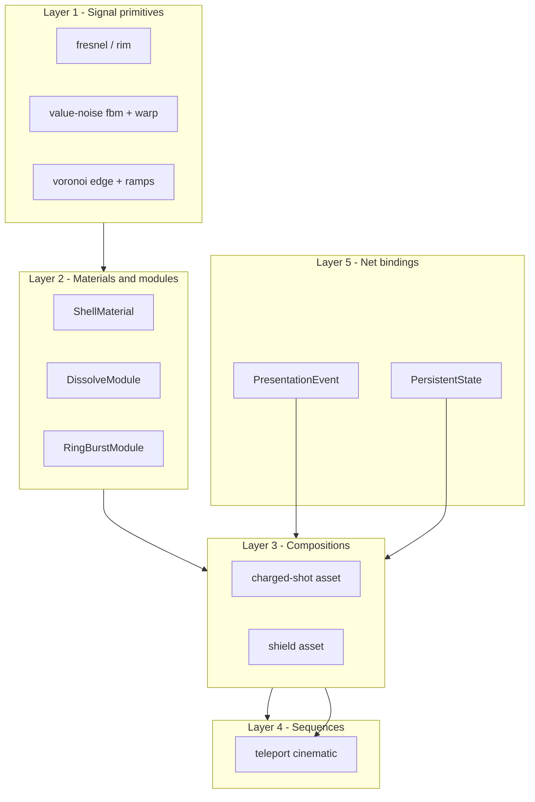
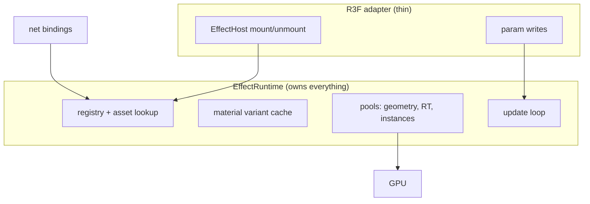
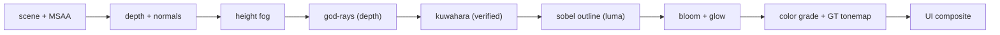

# NexusMMOEngine — Modular Shader, VFX & Post-Processing Blueprint

> Status: **PROPOSED design** (not yet implemented). Anything marked `[EXISTING]`
> was verified in this repository at commit `2d766e40` (`main`). Anything marked
> `[PROPOSED]` is new design in this document: illustrative skeletons, not
> production code. No universal shader graph or visual editor is proposed.

## 0. Executive recommendation

Build a **framework-independent TypeScript rendering runtime** (`[PROPOSED]`
`packages/render-fx/`) that owns every GPU resource and per-frame update, plus a
**thin React Three Fiber adapter** that only mounts/unmounts effect handles.
Keep the proven `[EXISTING]` WorldCanvas contract: R3F owns the renderer,
camera, resize and frame loop; plain Three.js classes do the work; mirror state
never flows through React state (`apps/client/src/render/world-canvas.tsx`).

- **Baseline:** WebGL2 + handwritten GLSL (`THREE.ShaderMaterial`,
  `onBeforeCompile` injection into lit materials) composed through the
  `[EXISTING]` `postprocessing`-based `EffectComposer` (`post-fx.tsx`). This
  matches every verified reference implementation and the engine's current
  dependencies (`three ^0.186.1`, `postprocessing ^6.39.5`).
- **WebGPU/TSL is an opt-in backend module**, not the baseline. Exactly one
  reference (`hologram-particles`) requires it (`WebGPURenderer`); everything
  else is WebGL GLSL. Do not promise GLSL/TSL interop.
- **Authoring model:** a constrained, versioned **composition schema** (JSON +
  typed params + timeline tracks), not a node graph. A full graph editor is
  explicitly deferred; the schema must be able to grow into one.
- **First vertical slice:** a charged-shot composition (charge → release →
  travel → impact) built from new shared primitives, driven by an authoritative
  presentation event, running inside the existing `PostFx` chain with one new
  verified stylization pass. It proves reuse, server/client separation, and
  post-processing integration before any editor work.



---

## 1. Source audit and evidence table

All reference checkouts below were cloned 2026-11-11 at shallow HEAD (`--depth 1`).
Commit pins were not recorded (limitation); file paths are the stable evidence.
Licensing: `stylized-components` carries an MIT `LICENSE` (Copyright 2026 Christian
Ortiz). The other three checkouts contain **no LICENSE file** — treat them as
**all-rights-reserved / unknown license**: learn techniques from them, do not copy
code or assets verbatim. Public availability is not permission to copy.

| Repo | Deps / backend (verified in `package.json`) | Inspected source files | License / assets |
|---|---|---|---|
| `stylized-components` | `next 16.1.1`, `three ^0.182.0`, `postprocessing ^6.38.2`, `@react-three/*`, `three-stdlib`; WebGL `EffectComposer` + custom `Pass` subclasses | `src/components/kuwahara/AnisotropicKuwaharaPass.ts`, `kuwahara/glsl/anisotropicKuwahara.ts`, `kuwahara/glsl/structureTensor.ts`, `kuwahara/README.md`, `outline/OutlineFilter.tsx`, `volumetricLight/glsl/volumetricLight.ts`, `volumetricLight/README.md`, `waterFloor/shaders/fragment.ts`, `waterFloor/shaders/vertex.ts`, `grassField/shaders/grassBlade.ts`, `grassField/materials/*.ts` | MIT LICENSE present. GLB/texture assets (`public/assets/**`, `public/glb/**`) are third-party or authored content — do not copy; only the techniques transfer. |
| `charged-blast-vfx` | `three ^0.182.0`, `@react-three/fiber ^9.5.0`, `@react-three/postprocessing ^3.0.4`, `postprocessing ^6.38.2`, `gsap`, `howler`; **plain WebGL + handwritten GLSL** | `src/components/ChargeShotVFX/ChargeOrb/shaders.ts`, `ChargeOrb/index.tsx`, `ChargeParticles/shaders.ts`, `ChargeReadySphere/shaders.ts`, `Projectile/shaders.ts` (`PROJECTILE_FRAG`, `MUZZLE_FRAG`, `RING_FRAG`, `TRAIL_FRAG`), `Projectile/ProjectileTrail.tsx`, `playground/PostProcessing.tsx`, `playground/chargeStore.ts` | No LICENSE file found — provenance unknown. Sounds in `public/assets/sounds/*.wav|mp3` and `public/megaman-separate-blaster.glb` are third-party — never copy. |
| `flow-shield-effect` | Same WebGL stack as charged-blast (`three ^0.182.0`, `postprocessing ^6.38.2`) | `src/components/ForceShield/shaderMaterial.ts` (simplex-3D + hex + hit-ring shader), `ForceShield/index.tsx` (ring-buffer hit upload, reveal lerp), `ForceShield/consts/index.ts` (`MAX_HITS = 6`, presets) | No LICENSE file found — provenance unknown. `public/droideka.glb` is third-party — never copy. |
| `hologram-particles` | `three ^0.182.0` **WebGPU path**: `three/webgpu` `WebGPURenderer`, `three/tsl` node graph, `three/addons/tsl/display/BloomNode.js` | `src/components/hologramParticles/ParticlesHologram.tsx` (GLB surface sampling via `MeshSurfaceSampler`, `StorageInstancedBufferAttribute` compute drift, `MeshBasicNodeMaterial` TSL graph), `utils/presets.ts`, `HologramScene.tsx` | No LICENSE file found — provenance unknown. `public/glb/*.glb`, `public/assets/triangle-texture.png` are content — never copy. |

**What was NOT verified (limitations):** the YouTube channel
(`https://www.youtube.com/@cortizdev`) was not scraped and no video content is
claimed below; no additional repositories beyond the four named ones plus the
`stylized-components` sub-routes (`/god-rays`, `/grass`, `/painterly`, `/water`)
were inspected. Shader listings are quoted/paraphrased as technique evidence;
all adapted code in this blueprint is newly authored Nexus code, not copied.

### 1.1 Existing engine surface this blueprint builds on `[EXISTING]`

| Area | Location | What exists today |
|---|---|---|
| Client renderer shell | `apps/client/src/render/world-canvas.tsx` | R3F owns renderer/camera/loop; plain classes do scene work; mirror state bypasses React state. |
| Post chain | `apps/client/src/render/post-fx.tsx` | `EffectComposer enabled={quality.effects} multisampling={quality.msaa}` + N8AO + Bloom + `UnderwaterEffect` + `GTToneMapEffect` + Vignette. |
| Custom passes | `apps/client/src/render/effects/gt-tonemap-effect.ts`, `underwater-effect.ts` | Precedent for hand-written `postprocessing` `Effect` subclasses. |
| VFX materials (early) | `apps/client/src/render/vfx/materials/*.ts` | `FlowMaterial` (two-phase flow blend), `WorldFlowMaterial`, `PolarFlowMaterial`, `DissolveMaterial` (noise threshold + ramp edge), `ColorRampMaterial`. GLSL string shaders, WebGL-only. |
| Particle backends | `apps/client/src/render/fx/particle-fx.ts` (three-nebula), `apps/client/src/render/vfx/quarks-fx.ts` (three.quarks `BatchedRenderer`) | Two CPU-sim particle stacks bridged by `VFXAdapter`. No GPU-compute particle path yet. |
| Ground warnings | `apps/client/src/render/telegraphs.ts` | Pooled decal system (`TELEGRAPH_POOL = 32`), per-mesh uniforms, no per-frame allocation — the pooling pattern to copy. |
| Spawn FX | `apps/client/src/render/entity-fx.ts` | Burst ring + beam `ShaderMaterial`s, update-by-`update(dt)` contract. |
| Server tick | `packages/engine-core/src/tick-loop.ts` | Fixed-step simulation, `STEP_MS` = 30 Hz authoritative tick. |
| Net envelope | `packages/protocol/src/envelope.ts` | `[u8 type][payload]` envelope + `MessageType` LUT (`docs/MESSAGE-CATALOG.md`). FlatBuffers for the data plane. |
| Combat moves | `packages/protocol/src/combat.ts` | Shared move table (id/clip/duration/chain/hitAt/sound); server runs moves, clients play clips from `(moveId, startTick)`. |
| Dependencies | `apps/client/package.json` | `three ^0.186.1`, `@react-three/fiber ^9.8.1`, `@react-three/postprocessing ^3.1.3`, `postprocessing ^6.39.5`, `three.quarks ^0.17.1`, `three-nebula ^13.3.0`. Reference repos pin `three ^0.182.0`; API surface used here is stable across both. |

---

## 2. Technique-to-building-block inventory

Legend: **V** = verified in the listed source file; **I** = inference from
surrounding code; **N** = proposed Nexus adaptation (new code, not copied).

### T1. View-dependent fresnel / rim shell (V)

- **Reference:** `charged-blast-vfx/.../ChargeOrb/shaders.ts` (`FRESNEL_FRAG`,
  `GLOW_FRAG`); `Projectile/shaders.ts` (`PROJECTILE_FRAG` fresnel term).
- **Visual purpose:** hot core with coloured rim; sells energy volume on opaque spheres.
- **Implementation (verified):** view-space normal `f = 1 - abs(dot(n, vec3(0,0,1)))`,
  `pow(f, power)` blends core/rim colours, multiplied by emission \* progress.
- **Inputs:** view normal; colours; power/emission/progress uniforms.
- **Rendering state:** additive, `transparent`, `depthWrite: false`, high `renderOrder`.
- **Extraction target (N):** `prim_fresnel(viewNormal, power)` GLSL snippet + `ShellMaterial` (core/rim/edge-softness).
- **Limitations:** view-space trick (not world-space true fresnel); breaks under strong normal mapping. No soft-particle depth fade in source.
- **Validation:** screenshot test at 3 camera angles; luminance probe asserts rim > core at silhouette.

### T2. Hash value-noise fbm + domain warp (V)

- **Reference:** `ChargeOrb/shaders.ts` `NOISE_FRAG` (hash/fbm + 2-stage warp `q`,`r`).
- **Visual purpose:** boiling plasma surface on the charge orb.
- **Implementation:** 5-octave value-noise fbm; `smoothstep(0.3,0.75)` cloud mask \* silhouette mask.
- **Extraction target (N):** `prim_noise` snippet family (`hash2`, `vnoise2`, `fbm2(n)`, `domainWarp2`) shared by orb, water distortion, and shield flow.
- **Limitations:** 5-octave fbm in fragment is ALU-heavy at fullscreen; restrict to small shells, never fullscreen.
- **Validation:** perf probe (frame ms delta with/without warp at 3 radii).

### T3. Gradient sweep + muzzle star + ring + trail kit (V)

- **Reference:** `Projectile/shaders.ts` (`PROJECTILE_FRAG` 3-stop sine sweep, `MUZZLE_FRAG` angular sectors, `RING_FRAG` tube-cross-section blend, `TRAIL_FRAG` uv.y tail fade \* facing fade).
- **Visual purpose:** travel body, spawn flash, expanding shockwave rings, fading ribbon.
- **Implementation:** capsule/torus/cylinder/quad geometry + per-mesh uniforms; `RING_VERT` derives blend from tube cross-section so the gradient is rotation-aware.
- **Extraction target (N):** `RingBurstModule`, `TrailModule` (stretched billboard, uv fade), `MuzzleFlashModule` (procedural star disc — no texture needed).
- **Limitations:** trail geometry is a fixed cylinder in source (`ProjectileTrail.tsx`); Nexus trail must rebuild from a position history ring buffer for curved paths.
- **Validation:** unit test on ring-blend math (symmetry A-B-A); overdraw probe for trail.

### T4. Instanced in-drag particle set (V)

- **Reference:** `ChargeOrb/index.tsx` (pooled `MAX_PARTICLES` instanced capsules pulled toward orb centre + turbulence; zero per-frame allocation via reused `_dummy`/`Vector3` refs).
- **Visual purpose:** charge accretion — sparks streaming into the orb.
- **Implementation:** CPU update in `useFrame`, `setMatrixAt` + `instanceMatrix.needsUpdate`.
- **Extraction target (N):** `CPUPoolModule` (fixed-capacity instanced quads, spawn/update in one pass, seeded RNG) — the MMO-safe pattern: bounded, no React state, no allocation.
- **Limitations:** CPU per-instance matrix compose caps at a few thousand; beyond that use GPU path (T9).
- **Validation:** allocation counter test (0 allocs after warmup); spawn-spike test (N simultaneous charges).

### T5. Multi-term shield shell with hit ring buffer (V)

- **Reference:** `flow-shield-effect/.../ForceShield/shaderMaterial.ts` (fresnel + hex grid + simplex flow + cell flash + reveal edge + `uHitPos[6]`/`uHitTime[6]` expanding rings + bottom fade); `index.tsx` click→ring-buffer upload, `lifeRef`→`uLife` colour ramp.
- **Visual purpose:** persistent bubble: idle pattern, localized hit ripples, health tint, spawn/despawn reveal.
- **Implementation:** one sphere (r=1.8, 64x64), `FrontSide`, additive; per-frame `uTime`/`uLife`/`uReveal` only; hits are uniform writes, not geometry.
- **Extraction target (N):** `ShieldModule` (same uniform contract: `hitPos[8]`, `hitTime[8]`, `life`, `reveal`), driven by authoritative `shield_hit` events + replicated `shield_hp` state.
- **Limitations:** fixed array size; object-space hit coords require `worldToLocal` on receipt — sender must also transmit surface normal for decal orientation.
- **Validation:** hit at 6 points → 6 rings visible; life 1→0 shifts colour ramp; reveal 1→0 hides mesh (`visible=false`).

### T6. Voronoi-animated stylized water + ripple field (V)

- **Reference:** `stylized-components/.../waterFloor/shaders/fragment.ts` (`voronoiF1`/`voronoiSF1` + `smin`, fbm distortion, cel-stepped edge, `uRippleCenters[8]`/`uRippleTimes[8]` rings, camera-distance fade).
- **Visual purpose:** cel water with foam edges + interactive expanding ripples.
- **Implementation:** single floor quad, world-XZ varying, fully procedural (no textures); ripple rings computed analytically in-shader from centre/time arrays.
- **Extraction target (N):** `WaterModule` (voronoi edge + depth-tint ramp + ripple array). Ripple writes are event-sourced (footstep/splash → ring slot), matching the shield hit-buffer pattern.
- **Limitations:** no refraction/reflection in source; reads no depth — shoreline foam must be added via depth texture in Nexus (see post pipeline).
- **Validation:** 8 concurrent ripples render; calm→storm presets match reference stills.

### T7. Instanced grass with wind + trample + soft-shadow ring (V)

- **Reference:** `grassField/shaders/grassBlade.ts` (height-masked wind, `uRocks[24]` trample spheres, per-blade shadow-tap ring neutralising Lambert's single sample), `materials/bladeMaterial.ts` (`onBeforeCompile` into `MeshLambertMaterial`).
- **Visual purpose:** dense wind-blown field that flattens under objects and receives soft shadows.
- **Implementation:** 7-vertex blade strip, instanced; wind/trample in reassigned `begin_vertex`; shadow ring in reassigned `worldpos_vertex`.
- **Extraction target (N):** `VegetationModule` (wind uniform block + interaction-sphere array + LOD by distance). Teaches the preferred lit-VFX pattern: inject into lit materials, do not reimplement lighting.
- **Limitations:** `uRocks` fixed at 24; shadow ring taps cost `NUM_TAPS` shadow fetches per fragment — gate behind quality tier.
- **Validation:** wind-off still image vs wind-on variance; trample sphere → blades flatten; shadow acne regression test.

### T8. Painterly post chain: anisotropic Kuwahara + outline + volumetrics (V)

- **Reference:** `kuwahara/AnisotropicKuwaharaPass.ts` + `glsl/*` (2-stage single `Pass`: structure tensor → 8-sector paint; `KUWAHARA_DEFAULTS radius 3/alpha 2`); `kuwahara/README.md` (pass-order rules: colour-only passes after paint OK, depth-readers before); `outline/OutlineFilter.tsx` (3x3 Sobel, DEPTH-before-paint vs LUMINANCE-after-paint, thicker lines before paint); `volumetricLight/glsl/volumetricLight.ts` + `README.md` (screen-space march toward sun pixel, occluded by depth).
- **Visual purpose:** oil-paint stylization with ink lines and light shafts.
- **Implementation:** all are `postprocessing` `Pass`/`Effect` subclasses inside one `EffectComposer`; Kuwahara owns a private tensor target; cost `8 x radius x 5` taps/px.
- **Extraction target (N):** `KuwaharaPass`, `SobelOutlinePass`, `GodRaysPass` as first-class Nexus passes with explicit buffer contracts (see section 8). One verified stylization pass (Kuwahara at radius 3) ships in the vertical slice.
- **Limitations:** Kuwahara is fill-rate bound (~200 taps/px at defaults); never enable above Medium tier at full res — use reduced-res or radius 2. Depth-reader ordering constraint is structural (depth attachment rotates out after `needsSwap` passes).
- **Validation:** debug views (tensor/flow/anisotropy/sector) render; before/after wipe; fps at 720p/1080p/1440p per tier.

### T9. GPU model-to-particle hologram with TSL compute (V, WebGPU-only)

- **Reference:** `hologram-particles/.../ParticlesHologram.tsx` (`MeshSurfaceSampler` → position/normal buffers → `StorageInstancedBufferAttribute` drift in compute shader → `MeshBasicNodeMaterial` TSL graph with fresnel + scanline + mouse glow; `PostProcessing` via `three/addons/tsl/display/BloomNode.js`).
- **Visual purpose:** character/model dissolving into drifting particles and reforming (teleport entrance).
- **Implementation:** geometry sampled once at load (cached by URL:count); per-frame motion entirely on GPU; WebGPU `WebGPURenderer` required.
- **Extraction target (N):** `HologramModule` as an **optional backend-specific module**: WebGPU path = GPU compute as in source; WebGL fallback = CPU pool (T4) at reduced count with identical asset parameters (explicitly degraded, not identical rendering).
- **Limitations:** WebGPU-only; `three/tsl` API is version-sensitive (verified against `three ^0.182.0` only); no `three.quarks`/nebula interop in source.
- **Validation:** capability probe selects path; fallback asserts count cap; determinism NOT required (cosmetic only).

### Reuse demonstrations (one primitive, three effects)

1. `prim_fresnel` → charge orb rim (T1) + projectile rim (T3) + shield edge (T5).
2. `prim_noise/prim_warp` → orb plasma (T2) + water distortion (T6) + shield flow (T5).
3. Hit/ripple ring-buffer uniform pattern → shield impacts (T5) + water ripples (T6) + muzzle shockwaves (T3).
4. `RingBurstModule` → charged impact wave + shield-hit echo + teleport arrival ring (same module, different ramp/scale/lifetime params).

---

## 3. Rendering backend and shader strategy

**Decision: WebGL2 + GLSL is the baseline; WebGPU + TSL is an optional module.**

| Concern | Baseline (ships in slice 1) | Optional / deferred |
|---|---|---|
| Shading language | Handwritten GLSL ES 3.0 via `THREE.ShaderMaterial` + `onBeforeCompile` injection into lit materials (proven by T1–T8 sources and `[EXISTING]` `vfx/materials/*`). | TSL node graphs only inside `HologramModule` WebGPU path (T9). No GLSL↔TSL transpiler is proposed — that interop does not exist. |
| Materials | Extend `[EXISTING]` `FlowMaterial`/`DissolveMaterial` family with `ShellMaterial`, `RingMaterial`, `TrailMaterial`, `WaterMaterial`, `BladeMaterial`. | Node-material variants only if a WebGPU tier ships. |
| R3F | Thin adapter only (mount/unmount + param writes). Per-frame sim stays in the runtime `update(dt)`, matching `[EXISTING]` `world-canvas.tsx` + `entity-fx.ts` `update(dt)` precedent. Never per-particle components, never React state per frame. | Nothing R3F-specific in module internals. |
| Post | Keep `[EXISTING]` `postprocessing` `EffectComposer` (`post-fx.tsx`); add passes as `Pass`/`Effect` subclasses (Kuwahara precedent T8). | TSL `PostProcessing` (hologram source) only with the WebGPU tier. |
| Fallbacks | Quality tiers disable passes (Kuwahara/shadows/volumetrics) or shrink counts; hologram falls back to CPU pool at reduced count. A fallback **disables** rather than fakes: no fake depth-soft particles on Low — alpha fade instead. | Identical cross-backend rendering is explicitly NOT promised. |

Capability detection `[PROPOSED]`: `detectBackend()` runs once per renderer —
`isWebGPU = !!renderer.isWebGPURenderer`, float-target support, `maxTextureSize`,
and the `[EXISTING]` `detectGpu()` software-rasterizer flag — and publishes a
`BackendCaps { webgpu, floatTargets, maxInstances, softwareRenderer }` record
that quality tiers and the module registry read. No per-frame detection.

---

## 4. Runtime architecture and ownership

`[PROPOSED]` `packages/render-fx/` (framework-independent) + `[PROPOSED]`
`apps/client/src/render/fx-r3f/` (thin adapter). No React inside the runtime.



- **Registry/assets:** `registerAsset(def)` validates (zod) + freezes; lookup by `assetId@version`. Async load with cancellation tokens; missing deps → deterministic placeholder (magenta shell), never a crash.
- **Ownership:** runtime owns geometries, textures, render targets, materials.
  Reference counting per asset (`acquire`/`release`); pooled instances never
  escape. Context loss → `handleContextLost()` disposes GPU handles, keeps
  defs/params; restore recompiles via prewarm list.
- **Pooling:** fixed-capacity `CPUPoolModule` (T4 pattern) and `RingBurst` pool (copy `TELEGRAPH_POOL = 32` precedent); global + per-category concurrency caps; spawn rejection returns `dropped` counter, never grows.
- **Params:** typed declarations (`float|vec3|color|ramp|curve|enum`), clamped + validated on write; curves/gradients as LUT textures generated once.
- **Bindings:** `EffectBinding { kind: world|entity|socket, id, offset }`; entity destroy → binding invalidates → effect interrupts (fade) or detaches to world pos, per asset `onOrphan` rule. Socket = bone name resolved once per frame max.
- **Lifecycle:** `spawn → update → interrupt | finish → dispose`. Persistent (shield) vs one-shot (impact) flagged in asset; persistent effects rehydrate from state on late join.
- **Hot reload (dev only):** asset file watch → revalidate → swap def, keep live instances on old def until finish (no pop).
- **Quality tiers:** `Low|Medium|High|Ultra` map to pass on/off, instance caps, ripple/hit slots, shadow taps — read from `BackendCaps` + `[EXISTING]` `quality.ts`.
- **Instrumentation:** per-module draw calls, instances, overdraw estimate, update ms; `fx.debug.overlay` HUD; dropped-spawn counters.

What runs where: **React reconciliation** — mount/unmount host + asset id/param props only. **Each frame** — `EffectRuntime.update(dt, camera)` (CPU pools, uniform writes, LOD). **On net updates** — binding/event queue → spawn/interrupt/param set (never geometry build inline; queue it). **CPU sim** — pool integration, ring histories, seeded RNG. **GPU** — noise/warp/rim/gradients/rings, instanced quads, post chain.

---

## 5. Proposed directory structure

```text
[PROPOSED] packages/render-fx/src/
  index.ts            runtime facade (createEffectRuntime)
  primitives/glsl.ts  prim_fresnel/noise/fbm/warp/voronoi/ramp (T1,T2,T6)
  materials/          ShellMaterial, RingMaterial, TrailMaterial, WaterMaterial (extend [EXISTING] vfx/materials)
  modules/            CPUPoolModule, RingBurstModule, TrailModule, ShieldModule, WaterModule,
  ...                 VegetationModule, HologramModule (webgpu-gated), MuzzleFlashModule
  assets/schema.ts    EffectDefinition zod schema + migration
  assets/library/     charged-shot.v1.json, shield.v1.json, teleport.v1.json (examples below)
  post/               KuwaharaPass, SobelOutlinePass, GodRaysPass, frame-graph.ts
  net/                presentation-event.ts, persistent-state.ts, flatbuffers fragments
  seq/                sequence-runtime.ts (timeline; wraps [EXISTING] animation.ts clips)
  r3f/                EffectHost.tsx, useEffectRuntime.ts  (thin adapter lives here)
[EXISTING] apps/client/src/render/
  world-canvas.tsx    unchanged contract — hosts EffectHost + PostFx
  post-fx.tsx         extended with new passes (section 8)
  vfx/materials/*     kept; new materials import shared primitives
```

---

## 6. TypeScript interfaces (illustrative `[PROPOSED]` skeletons)

```ts
// EffectDefinition — versioned, serializable asset (section 7 schema).
interface EffectDefinition {
  assetId: string; version: number; // stable id + migration chain
  kind: "oneshot" | "persistent";
  params: Record<string, ParamDecl>; // typed defaults + ranges
  modules: EffectModuleDef[];        // bounded list, each with LOD caps
  bindings: EffectBinding[];         // local | world | entity | socket
  timing: { duration: number; loop: "once" | "loop" | "pingpong"; seedable: boolean };
  quality: { minTier: Tier; fallbacks: Partial<Record<Tier, string>> };
  onOrphan: "fade" | "detach" | "kill"; // entity-destroy rule
}

interface EffectModuleDef { module: string; params: Record<string, ParamValue>; ramp?: string; curve?: string; }
interface EffectBinding { kind: "local" | "world" | "entity" | "socket"; entityId?: string; socket?: string; offset?: [number, number, number]; }

// Runtime-owned live instance. No React inside.
interface EffectInstance {
  handle: number; def: EffectDefinition; age: number; seed: number;
  setParam(name: string, v: ParamValue): void;
  interrupt(fade: number): void; finish(): void; dispose(): void;
  readonly alive: boolean;
}
interface EffectModule { init(ctx: ModuleCtx): void; update(dt: number, t: number): void; interrupt(fade: number): void; dispose(): void; }
interface EffectRuntime {
  registerAsset(def: EffectDefinition): void;
  spawn(assetId: string, binding: EffectBinding, opts?: { seed?: number; startAge?: number }): EffectInstance | null; // null = budget-dropped
  update(dt: number, camera: THREE.Camera): void;
  setQuality(t: Tier): void; stats(): FxStats; dispose(): void;
}

// Server → client presentation contracts (see section 8 for wire form).
interface PresentationEvent {
  evt: string; evtId: bigint; tick: number; assetId: string; assetVersion: number;
  seed: number; binding: EffectBinding & { pos?: [number, number, number]; normal?: [number, number, number] };
  payload: Record<string, number | string>; // typed per evt
}
interface PersistentFxState { entityId: string; assetId: string; assetVersion: number; startTick: number; seed: number; hp01?: number; active: boolean; }
```

```tsx
// Thin R3F adapter — the ONLY React code in the system. It never simulates.
// [PROPOSED] apps/client/src/render/fx-r3f/EffectHost.tsx
import { useEffect, useRef } from "react"; import { useThree } from "@react-three/fiber";
export function EffectHost({ runtime, assetId, binding, params }: {
  runtime: EffectRuntime; assetId: string; binding: EffectBinding; params?: Record<string, ParamValue>;
}) {
  const ref = useRef<EffectInstance | null>(null);
  const group = useThree((s) => s.scene);
  useEffect(() => {
    const inst = runtime.spawn(assetId, binding, { seed: (Math.random() * 1e9) | 0 });
    ref.current = inst; // null means budget-dropped: render nothing, count it
    return () => inst?.dispose();
  }, [runtime, assetId]);
  useEffect(() => { if (params) for (const [k, v] of Object.entries(params)) ref.current?.setParam(k, v); }, [params]);
  useEffect(() => { if (binding) ref.current && (ref.current as any).rebind?.(binding); }, [binding]);
  return null; // adds no scene objects itself; modules own their meshes
}
```

```glsl
// Reusable shader primitive (newly authored from T1/T2 evidence — not copied).
// [PROPOSED] packages/render-fx/src/primitives/glsl.ts -> PRIM_FRESNEL_WARP
float prim_fresnel(vec3 viewNormal, float power) {
  return pow(1.0 - abs(dot(normalize(viewNormal), vec3(0.0, 0.0, 1.0))), power);
}
float prim_hash12(vec2 p) { return fract(sin(dot(p, vec2(127.1, 311.7))) * 43758.5453); }
float prim_voronoi_edge(vec2 p, float smoothK, out float f1); // T6 extraction
```

---

## 7. Data-driven effect assets and composition

**Authoring model: constrained composition schema + timeline tracks** (no graph,
no visual node editor). Justification: every verified reference composes a fixed
list of modules with scalar params (`chargeStore`, shield `consts`, hologram
`presets.ts`) — a typed module list with curves covers them; a graph adds
unbounded validation cost an MMO client cannot pay. Timeline tracks (section 10)
handle sequencing; nesting covers reuse.

Schema (zod-validated, migratable): `assetId`, `version`, typed `params` with
defaults/ranges, `modules[]`, `bindings[]`, `curves/gradients` as LUT ids,
`coordinateSpace` per binding, `seed`, `duration/loop`, `cleanup/cancel`,
`quality` overrides, `dependencies[]`. Migration: `migrateAsset(def)` chain
`v(n) -> v(n+1)` pure functions; unknown version → reject with placeholder.

### 7.1 Charged projectile `[PROPOSED]` (directly source-inspired: T1–T4)

```json
{ "assetId": "fx.charged-shot", "version": 1, "kind": "oneshot",
  "params": { "charge01": 0.0, "power01": 1.0, "bodyColor": "#ff5522" },
  "phases": ["charge", "release", "travel", "impact"],
  "modules": [
    { "module": "ShellMaterial", "params": { "core": "#ffffff", "rim": "$bodyColor" } },
    { "module": "CPUPoolModule", "params": { "count": 256, "mode": "accrete" } },
    { "module": "RingBurstModule", "params": { "count": 3, "axis": "travel" } },
    { "module": "TrailModule", "params": { "length": 6.0, "fade": "exp" } },
    { "module": "MuzzleFlashModule", "params": { "rays": 8 } }
  ]}
```

Charge scales `charge01` → orb radius/emission/particle target count (T1/T4);
release fires muzzle + rings; travel drives gradient sweep + trail (T3); impact
spawns a `RingBurstModule` + decal + audio cue. Server owns phase transitions;
client interpolates cosmetic age between 30 Hz ticks.

### 7.2 Shield `[PROPOSED]` (directly source-inspired: T5)

```json
{ "assetId": "fx.force-shield", "version": 1, "kind": "persistent",
  "params": { "color": "#26aeff", "hp01": 1.0, "hexScale": 3.0 },
  "modules": [{ "module": "ShieldModule", "params": { "hitSlots": 8 } }],
  "bindings": [{ "kind": "entity", "socket": "root" }],
  "onOrphan": "fade", "timing": { "duration": -1, "loop": "loop" } }
```

Activation plays reveal 1→0 + ring; sustained state = T5 shell; `shield_hit`
events write ring slots; `hp01` (replicated, section 8) drives the life colour
ramp; shutdown reverses reveal then disposes. Reuse test: same `prim_fresnel` +
`prim_noise` as the charged shot, different params — no shader copy.

### 7.3 Teleport / character entrance `[PROPOSED]` (new composition of T1+T4+T8+T9)

Dissolve-out (existing `DissolveMaterial` + ramp edge) + upward `CPUPoolModule`
burst + arrival `RingBurstModule` + 0.6 s Kuwahara-radius dip (post pulse) +
Teleport audio cue. WebGPU tier swaps the pool burst for `HologramModule`
(model-sampled reform, T9); WebGL keeps the pool version — same asset,
capability-selected module variant.

### 7.4 Cinematic micro-sequence `[PROPOSED]` (new composition, reuses all modules)

8-second "gate activation": camera dolly (sequence track) + shield reveal +
charge loop + impact rings + bloom pulse + music sting. All modules referenced by
`assetId`, no new shaders. Proves compositions nest inside sequences (section 10).

---

## 8. Authoritative multiplayer presentation

Server owns ability validity, phase transitions, projectile paths/collisions,
damage/shield HP, and shared sequence state. Client owns only cosmetic age,
particle seeds, and camera. Particles are never replicated; GPU nondeterminism
never touches gameplay.

- **Transient events:** `(evt, evtId, tick, assetId@version, seed, binding, payload)`
  over the `[EXISTING]` envelope (`packages/protocol/src/envelope.ts`). `evtId`
  (u64) dedupes replays; `tick` + `presentationAge = (nowTick - tick) / 30` lets
  late/duplicate arrivals start mid-effect deterministically. Unreliable-ordered
  transport: newer `interrupt` supersedes older `spawn` by `(tick, evtId)`.
- **Persistent state:** `(entityId, assetId@version, startTick, seed, hp01, active)`
  in the snapshot/delta feed; interest-range entry and late join reconstruct by
  `spawn(asset, startAge = now - startTick)` — no history replay needed.
  Entity destroy/generation mismatch → `onOrphan` rule (fade/detach/kill).
- **30 Hz vs variable-rate rendering:** sim tick advances gameplay; client
  `update(dt)` interpolates entity transforms between snapshots and integrates
  cosmetic pools with real `dt`, clamped to 50 ms to survive hitches without
  tunnelling. Visual sim may sub-step; it may never write gameplay state.

Illustrative FlatBuffers fragments `[PROPOSED — not a schema change]`:

```flatbuffers
table PresentationEvent { evt_id: uint64; tick: uint32; asset: string; asset_v: uint16;
  seed: uint32; entity: uint64; entity_gen: uint16; kind: byte; // 0 local 1 world 2 entity 3 socket
  pos: Vec3; normal: Vec3; socket: string; payload: [KeyFloat]; }
table PersistentFx { entity: uint64; entity_gen: uint16; asset: string; asset_v: uint16;
  start_tick: uint32; seed: uint32; hp01: float32; active: bool; }
```

Predicted cosmetics (muzzle flash on local input) are allowed only as
cancellable placeholders reconciled by the authoritative event within 500 ms or
killed — never gameplay-visible (no damage numbers, no telegraphs).

---

## 9. Post-processing architecture

`[PROPOSED]` frame graph on the `[EXISTING]` `postprocessing` composer in
`post-fx.tsx`. Order is load-bearing (verified T8: colour-only passes tolerate
reorder; depth-readers do not).



Pass rules: scene renders once (HDR halffloat, `frameBufferType HalfFloatType`
as in both reference `PostProcessing.tsx` files). Depth/normals attach to the
initial input buffer — every depth pass runs **before** Kuwahara (depth
attachment is consumed by `needsSwap` rotation; verified in `kuwahara/README.md`).
Kuwahara first among colour passes so bloom blooms painted light. Outline after
paint in **luminance** mode (vector-art look); an optional depth-mode outline may
run pre-paint with thicker lines (reference documents both). Tone map + sRGB
encode last via `[EXISTING]` `GTToneMapEffect`. UI renders after the composer.

- **Colour/HDR:** linear working space; Kuwahara must not re-encode (verified
  provenance note: reference removed `fromLinear()` for composer use). Bloom
  threshold ~0.9 (`post-fx.tsx`) so only FX/emissive bloom.
- **Transparency/AA:** composer disables canvas MSAA — keep `multisampling={quality.msaa}`
  on the composer; transparent FX use additive blending, `depthWrite:false`.
- **Resolution:** dynamic res + reduced-res Kuwahara tensor (half-res tensor is
  valid: tensor is low-frequency); render targets pooled by size, resized on
  camera change, multi-view forbidden (one composer per view).
- **Per-object selection:** layers/vig for outlines via stencil or object mask;
  no per-pixel material-ID promise in slice 1.
- **Accessibility:** `fx.accessibility { flashes, shake, distortion }` toggles —
  flash envelope clamp, shake→fade, Kuwahara/distortion hard-off; exposed in
  settings, respected by sequences.
- **Kuwahara cost control:** radius is brush size AND cost (`8 x r x 5` taps);
  tiers: Low off, Medium r=2 half-res, High r=3, Ultra r=4. Particles/outlines/text
  are painted over — by design (reference paints the whole frame); UI is exempt
  (composited after).

---

## 10. Animation and cinematic sequencing

One `[PROPOSED]` timeline runtime coordinates specialized systems; it does not
replace them (`[EXISTING]` `protocol/combat.ts` moves + `engine-core/animation.ts`
clips stay authoritative for gameplay; audio `apps/client/src/audio/*` stays the
player).

Tracks: `vfx | animation | audio | camera | param | visibility | marker | nested`.
Bindings resolve `entity|socket` at play; missing entity → track mutes (logs),
replacement rebinds live. Server gates shared sequences (start tick + participants);
clients interpolate. Skip/interrupt: gameplay-bound sequences require server
release; cosmetic ones fade 200 ms. Late entry: `startAge` seeks analytical tracks
(param curves, camera splines) directly; stateful pools (T4/CPU) fast-forward with
capped sub-steps or spawn at steady state — documented per module, never silently
wrong. Camera ownership tokens restore position/FOV on end; audio ducks then
restores volumes.

```ts
// [PROPOSED] illustrative sequence skeleton
interface SeqTrack { at: number; dur: number; }
interface SequenceDef { seqId: string; version: number; tracks: Array<
  | { kind: "vfx"; asset: string } & SeqTrack
  | { kind: "anim"; clip: string } & SeqTrack
  | { kind: "audio"; cue: string } & SeqTrack
  | { kind: "camera"; spline: string } & SeqTrack
  | { kind: "param"; target: string; curve: string } & SeqTrack
  | { kind: "nested"; seq: string } & SeqTrack>; }
```

---

## 11. Performance and MMO-scale budgets `[PROPOSED targets — not measured]`

| Budget | Target (to be measured in slice 9) |
|---|---|
| Draw calls (FX only) | <= 40 quiet, <= 120 dense combat; 1 call per pooled module |
| Material variants | <= 24 cached; LRU evict, prewarm on load |
| CPU update | <= 1.5 ms/frame FX total @60fps; 0 allocs after warmup |
| Instances | <= 4k billboards High, <= 1.5k Medium, <= 500 Low |
| Overdraw | FX screen coverage <= 25% @1080p dense fight |
| Fullscreen passes | <= 3 active (paint+bloom+grade max on High); each <= 1.2 ms @1080p target |
| Render targets | <= 64 MB pooled; tensor half-res above 1080p |
| Spawn spikes | 50 concurrent impacts without dropped frames (degraded counts allowed, drops counted) |
| Shader compile | prewarm all slice-1 variants at load; hitch <= 1 frame on first spawn afterwards |

Benchmark matrix: quiet \u00d7 dense-combat \u00d7 8-shield overlap \u00d7 transparent-storm,
at 720p/1080p/1440p \u00d7 Low/Med/High, recording p50/p99 frame ms, FX ms, draws,
instances, RT MB, drops. Gate table (`measured | modeled | PASS/FAIL`) ships per
section 7 of the workspace telemetry standard.

---

## 12. Testing and debugging strategy

- **Correctness:** golden-image tests for primitives (fresnel ramp, ring symmetry,
  voronoi edge) at fixed seeds; uniform-upload tests (shield 6-hit rings, life
  ramp); late-join reconstruction test (`startAge` == direct-aged render).
- **Performance:** benchmark matrix (section 11) in CI-smoke form (720p Low) +
  nightly full sweep; allocation counter (fail on post-warmup alloc in pools);
  compile-prewarm checklist.
- **Lifecycle:** fuzz spawn/interrupt/orphan/unload (deterministic seeds);
  context-loss kill/restore test; cancellation test (unload mid-load → placeholder).
- **Debug tooling:** `fx.debug` overlay (draws, instances, ms, drops), asset
  validator CLI (`validate-fx <file>`), Kuwahara-style debug views per pass,
  seeded replay (`--fx-seed`).

---

## 13. Phased implementation backlog

Scope check: the requested 10-phase sequence is kept, reordered so the backend
baseline precedes primitives. Each phase lists outputs, deps, acceptance, tests,
risks, and non-goals.

| # | Phase | Outputs | Deps | Acceptance | Tests | Risks | Out of scope |
|---|---|---|---|---|---|---|---|
| 0 | Effect laboratory | `[PROPOSED]` lab route: orbit camera, param panel (leva), time scrub, seeded replay | none | all slice-1 modules load with sliders | panel drives uniforms | lab-only code leaking into runtime | editor, save/load |
| 1 | Backend + ownership | `BackendCaps`, runtime skeleton, refcount pools, context-loss path, `quality.ts` tiers | P0 | context kill restores; no leaks over 1k spawn cycles | leak/fuzz tests | three r182\u2192r186 API drift — pin + verify | WebGPU backend |
| 2 | Primitives + curves | `prim_*` GLSL lib, LUT ramps/curves, golden images | P1 | 3 reuse proofs compile from same source | golden-image CI | fullscreen fbm cost — capped by review rule | new modules |
| 3 | Mesh FX + trail | `RingBurstModule`, `TrailModule`, `MuzzleFlashModule`, `CPUPoolModule` | P2 | ring symmetry, trail curves, 0-alloc pools | unit + alloc tests | trail history teardown | particles-GPU path |
| 4 | Charged shot (vertical slice) | `fx.charged-shot` asset + event binding + lab demo | P3 + net contract draft | full charge\u2192impact plays from one event | event→render e2e | tick/age skew | shield, post |
| 5 | Net adapter | `PresentationEvent`/`PersistentFx` encode/decode, dedupe, late-join, orphan rules | P4 | loss/dup/reorder suite green; late join reconstructs | protocol fuzz | transport ordering assumptions | prediction |
| 6 | Shield (reuse test) | `fx.force-shield` asset, hit slots, hp ramp | P5 | no new shader code (imports only) + T5 checks | reuse lint (no copied GLSL) | slot exhaustion under focus fire | new primitives |
| 7 | Post pipeline + paint | `KuwaharaPass` + outline + frame graph in `post-fx.tsx` | P1 | debug views, tier table, fps gates | res\u00d7tier matrix | fill-rate blowup — half-res default | volumetrics |
| 8 | Sequences | timeline runtime + teleport + micro-cinematic | P4–P7 | skip/late-entry/rebind suite green | sequence fuzz | stateful warm-up honesty | full editor |
| 9 | Stress + tiers + hardening | budgets, matrix report, prewarm, graceful degradation | P0–P8 | gate table all PASS/measured | bench CI | sandbox-vs-hardware labeling | new effects |

---

## 14. Risks, deferred work, and open decisions

- **License:** only `stylized-components` is MIT; the other three have no license
  — adaptation only, no copied files. Re-verify before each phase.
- **Version drift:** references pin `three ^0.182.0`, engine uses `^0.186.1`, TSL
  is version-sensitive — re-verify `three/tsl` imports if the WebGPU tier activates.
- **Depth-ordering:** Kuwahara/outline/depth passes have structural order
  constraints (T8) — enforced by the frame graph, not convention.
- **Deferred:** visual node/graph editor, universal GLSL/TSL abstraction,
  cross-backend pixel parity, vegetation and water production content, volumetrics
  beyond one pass, PBR-grade lighting of FX.
- **Undecided:** exact `MessageType` codes for `PresentationEvent` (needs
  `docs/MESSAGE-CATALOG.md` owner); snapshot channel for `PersistentFx`
  (piggyback vs new channel); hologram WebGPU tier priority.

---

## 15. Definition of success (traceability)

| Criterion | Proved by |
|---|---|
| Primitives reused without copies | P2 golden tests + P6 reuse lint |
| No React in runtime | `packages/render-fx` has zero `react` imports (lint) |
| R3F is a thin adapter | `EffectHost` only mounts/params; no per-frame setState |
| Explicit post buffers | frame-graph doc + pass `needsSwap` declarations |
| Authority on server | net adapter tests; client never writes gameplay |
| Late-join reconstruction | `startAge` tests for persistent FX |
| Clean interruption | orphan/cancel fuzz suite |
| Shared sequence infra | teleport + cinematic on one timeline |
| Budget governance | section-11 gate table, measured not modeled |
| Provenance explicit | section-1 table; no copied assets |
| No editor needed for slice 1 | lab + JSON assets only |

*End of blueprint — first build P0+P1, then the charged-shot vertical slice (P4).*
