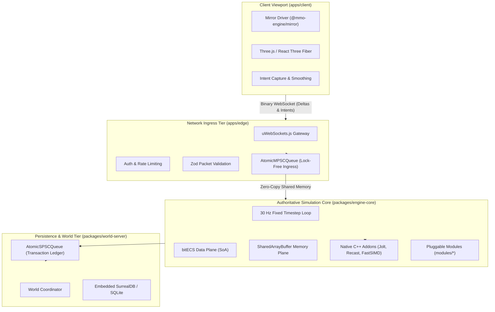

# Nexus MMO Engine — Technical Documentation Wiki

Welcome to the **Nexus MMO Engine Technical Wiki**. This document is the primary hierarchical knowledge base for engineers, systems designers, and content developers building on and extending the Nexus MMO Engine.

---

## Table of Contents

- [1. Engine Architecture & Core Philosophy](#1-engine-architecture--core-philosophy)
  - [1.1 Core Axioms & Design Principles](#11-core-axioms--design-principles)
  - [1.2 High-Level System Topology](#12-high-level-system-topology)
  - [1.3 The 3-Tier Execution Architecture](#13-the-3-tier-execution-architecture)
- [2. Engine / Game Decoupling (The Blank Substrate)](#2-engine--game-decoupling-the-blank-substrate)
  - [2.1 Zero-Content Clean Boot](#21-zero-content-clean-boot)
  - [2.2 Modular System Architecture (`modules/`)](#22-modular-system-architecture-modules)
  - [2.3 Data-Driven Rule Contracts (`packages/rules`)](#23-data-driven-rule-contracts-packagesrules)
  - [2.4 Authoring a New Game from Scratch](#24-authoring-a-new-game-from-scratch)
- [3. Simulation & ECS Subsystem](#3-simulation--ecs-subsystem)
  - [3.1 The 30 Hz Fixed Timestep Loop](#31-the-30-hz-fixed-timestep-loop)
  - [3.2 Spiral-of-Death Backlog Guard](#32-spiral-of-death-backlog-guard)
  - [3.3 Structure-of-Arrays (SoA) ECS (`bitECS`)](#33-structure-of-arrays-soa-ecs-bitecs)
  - [3.4 Lock-Free SPSC & MPSC Rings over Shared Memory](#34-lock-free-spsc--mpsc-rings-over-shared-memory)
  - [3.5 Generational Handle Slab Allocator](#35-generational-handle-slab-allocator)
- [4. Native C++ Kernel Ecosystem (`packages/addons`)](#4-native-c-kernel-ecosystem-packagesaddons)
  - [4.1 Bulk N-API SoA Memory Boundary](#41-bulk-n-api-soa-memory-boundary)
  - [4.2 Physics & Collision Engine (`addon-physics`)](#42-physics--collision-engine-addon-physics)
  - [4.3 Navmesh & Pathfinding (`addon-navigation`)](#43-navmesh--pathfinding-addon-navigation)
  - [4.4 Procedural Noise & SIMD Fields (`addon-procgen`)](#44-procedural-noise--simd-fields-addon-procgen)
  - [4.5 Constructive Solid Geometry (`addon-geometry`)](#45-constructive-solid-geometry-addon-geometry)
  - [4.6 Spatial Poisson Distribution (`addon-scatter`)](#46-spatial-poisson-distribution-addon-scatter)
  - [4.7 Particle Integration Kernel (`addon-integrate`)](#47-particle-integration-kernel-addon-integrate)
- [5. Networking & Distributed Scaling](#5-networking--distributed-scaling)
  - [5.1 Native WebSocket Transport (`uWebSockets.js`)](#51-native-websocket-transport-uwebsocketsjs)
  - [5.2 The Edge / Core Split Topology](#52-the-edge--core-split-topology)
  - [5.3 Area of Interest (AoI) & Sector Management](#53-area-of-interest-aoi--sector-management)
  - [5.4 State Serialization: Fast-Path vs. FlatBuffers](#54-state-serialization-fast-path-vs-flatbuffers)
  - [5.5 Multi-Region Coordination (`packages/world-server`)](#55-multi-region-coordination-packagesworld-server)
- [6. Procedural Generation & Spatial Synthesis](#6-procedural-generation--spatial-synthesis)
  - [6.1 Continuous Model Synthesis (`@mmo-engine/synthesis`)](#61-continuous-model-synthesis-mmo-enginesynthesis)
  - [6.2 Learned Architectural Scene Grammar](#62-learned-architectural-scene-grammar)
  - [6.3 Universal Measurement System (UMS) & SI Standards](#63-universal-measurement-system-ums--si-standards)
  - [6.4 Structural Load-Bearing Invariants](#64-structural-load-bearing-invariants)
  - [6.5 3D Wave Function Collapse (`@mmo-engine/wfc`)](#65-3d-wave-function-collapse-mmo-enginewfc)
- [7. Client & Viewport Mirror](#7-client--viewport-mirror)
  - [7.1 The Zero-Logic Thin Client Philosophy](#71-the-zero-logic-thin-client-philosophy)
  - [7.2 Snapshot & Delta Interpolation (`@mmo-engine/mirror`)](#72-snapshot--delta-interpolation-mmo-enginemirror)
  - [7.3 Biomechanical First-Person Rig & Viewmodel](#73-biomechanical-first-person-rig--viewmodel)
  - [7.4 WebGPU Modernization Roadmap](#74-webgpu-modernization-roadmap)
- [8. Persistence & Storage Tier](#8-persistence--storage-tier)
  - [8.1 Embedded SurrealDB & Regional SQLite](#81-embedded-surrealdb--regional-sqlite)
  - [8.2 Atomic Operations & Group Commit Ledger](#82-atomic-operations--group-commit-ledger)
- [9. Developer Guide & Extension Manual](#9-developer-guide--extension-manual)
  - [9.1 Setting Up the Environment](#91-setting-up-the-environment)
  - [9.2 Authoring a Custom Gameplay Module](#92-authoring-a-custom-gameplay-module)
  - [9.3 Authoring a Native C++ Addon](#93-authoring-a-native-c-addon)
  - [9.4 Running Automated Verification & Playtests](#94-running-automated-verification--playtests)
- [10. Developer Tooling & Interactive Documentation (Yank Note Ecosystem)](#10-developer-tooling--interactive-documentation-yank-note-ecosystem)
  - [10.1 Motivation & Modern Markdown Tooling](#101-motivation--modern-markdown-tooling)
  - [10.2 In-Note Executable REPL & Benchmarking](#102-in-note-executable-repl--benchmarking)
  - [10.3 Interactive Telemetry & Data Apps](#103-interactive-telemetry--data-apps)
  - [10.4 Client-Side Encrypted Notes (.c.md)](#104-client-side-encrypted-notes-cmd)
- [11. Private Repository Intelligence & Strategy](#11-private-repository-intelligence--strategy)

---

## 1. Engine Architecture & Core Philosophy

### 1.1 Core Axioms & Design Principles

The Nexus MMO Engine is engineered around five non-negotiable architectural axioms:

1. **Strict Server Authority**: The server is the single source of truth for all spatial positions, physical simulations, combat resolutions, and economic interactions. The client is a deterministic mirror that renders received snapshots and transmits raw player intents. No game logic runs in the browser.
2. **Unconstrained Substrate**: The engine core owns only generic spatial, mathematical, networking, and scheduling primitives. It boots with zero content and zero gameplay rules, allowing developers to create any genre without inheriting or fighting unwanted systems.
3. **Data-Oriented Structure-of-Arrays (SoA)**: Entity data is arranged in flat, contiguous typed arrays rather than object-oriented class hierarchies. Systems iterate sequentially over memory to maximize CPU L1/L2 cache hit rates and eliminate garbage collection on the tick loop.
4. **Zero-Copy Memory Planes**: Communication between network ingress, simulation threads, persistence workers, and C++ native kernels occurs over `SharedArrayBuffer` memory blocks using lockless atomic ring queues.
5. **Universal Metric Standardization**: All spatial coordinates, velocities, and bounding volumes adhere strictly to the International System of Units (SI standard: $1.0\text{ unit} = 1.0\text{ meter}$).

---

### 1.2 High-Level System Topology



---

### 1.3 The 3-Tier Execution Architecture

1. **Ingress & Networking Tier ([`apps/edge`](file:///c:/Users/user/Downloads/mmo-engine-full/apps/edge))**:
   - Manages client WebSocket connections over `uWebSockets.js`.
   - Validates incoming packets before they enter the simulation boundary.
   - Computes Area-of-Interest (AoI) sector visibility and serializes per-client binary deltas.
2. **Authoritative Simulation Tier ([`packages/engine-core`](file:///c:/Users/user/Downloads/mmo-engine-full/packages/engine-core))**:
   - Executes a deterministic 30 Hz fixed timestep loop ($33.33\text{ms}$ budget).
   - Manages entity lifecycles, transform updates, raycasting, physics integration, and module systems.
3. **Persistence & World Tier ([`packages/world-server`](file:///c:/Users/user/Downloads/mmo-engine-full/packages/world-server))**:
   - Runs off the tick loop to ensure database queries never stall the active simulation.
   - Manages chunk ownership, regional leases, cross-region migration, and atomic transaction ledgers.

---

## 2. Engine / Game Decoupling (The Blank Substrate)

A defining feature of the Nexus MMO Engine is the **Engine / Game Split** (detailed in [`docs/engine-game-split/README.md`](file:///c:/Users/user/Downloads/mmo-engine-full/docs/engine-game-split/README.md)). The engine provides a pure, high-performance simulation platform rather than a pre-baked RPG template.

### 2.1 Zero-Content Clean Boot
- The core engine contains **no hardcoded gameplay, items, species, skills, or recipes**.
- If launched with no content configuration, the engine initializes cleanly as a blank, high-performance spatial simulator.
- Game rules, skill hierarchies, and combat formulas live outside the engine in data packs (`content/rules/`) loaded through explicit environment seams (`MMO_*`).

### 2.2 Modular System Architecture (`modules/`)
Gameplay systems are decoupled into discrete, isolated packages located under [`modules/<name>/`](file:///c:/Users/user/Downloads/mmo-engine-full/modules). Each module declares its system order, dependencies, and extensions in a [`module.json`](file:///c:/Users/user/Downloads/mmo-engine-full/packages/modules/src/index.ts#L31-L50) manifest:

```json
{
  "name": "custom-propulsion",
  "version": "1.0.0",
  "server": {
    "entry": "dist/index.js",
    "systems": [
      { "name": "ThrustSystem", "after": ["TransformSystem"] },
      { "name": "AerodynamicDragSystem", "after": ["ThrustSystem"] }
    ]
  }
}
```

The active systems loaded by a region are defined in [`content/modules.json`](file:///c:/Users/user/Downloads/mmo-engine-full/content/modules.json). If a developer is creating a racing game or space flight simulator:
- They simply omit `combat`, `dungeons`, `quests`, and `crafting` from `content/modules.json`.
- Omitted systems are **never compiled, allocated, or ticked**, incurring zero runtime memory or CPU overhead.

### 2.3 Data-Driven Rule Contracts (`packages/rules`)
The [`packages/rules`](file:///c:/Users/user/Downloads/mmo-engine-full/packages/rules) package validates all content rules at boot time using strict Zod schemas:
- Missing rule files cause the engine to fall back to inert generic defaults.
- Corrupted or malformed rule files halt the server immediately at startup, displaying precise file and line errors rather than allowing silent runtime failure.

### 2.4 Authoring a New Game from Scratch
1. Create a content pack directory containing rules: `my-game/rules/`.
2. Configure environment seams to point to the new pack:
   ```sh
   export MMO_RULES=my-game/rules
   export MMO_MODULES=my-game/modules.json
   ```
3. Add custom game logic modules under `modules/` and declare their execution order relative to engine core systems (`TransformSystem`, `PhysicsSystem`).

---

## 3. Simulation & ECS Subsystem

### 3.1 The 30 Hz Fixed Timestep Loop
The core simulation runs at a deterministic 30 Hz ($33.333\text{ms}$ per tick) driven by [`packages/engine-core/src/tick-loop.ts`](file:///c:/Users/user/Downloads/mmo-engine-full/packages/engine-core/src/tick-loop.ts):
- Accumulates elapsed wall-clock time and steps the simulation world in discrete $dt = 1/30\text{s}$ increments.
- Decouples simulation state from variable server frame rendering or network dispatch rates.

### 3.2 Spiral-of-Death Backlog Guard
If an unexpected OS hitch or CPU spike occurs:
- The accumulator clamps the maximum catch-up steps to **`MAX_STEPS_PER_FRAME = 5`** ($166.6\text{ms}$).
- Any backlog beyond 5 frames is dropped and recorded via telemetry counters (`spiralEvents`, `droppedMs`).
- This prevents the server from entering an unrecoverable cascade where catch-up processing consumes more time than the frame budget itself.

### 3.3 Structure-of-Arrays (SoA) ECS (`bitECS`)
Simulation state is stored using `bitECS` with pure typed array backings:
- Components are defined as contiguous buffers (e.g., `Transform.px[eid]`, `Transform.py[eid]`, `Transform.pz[eid]`).
- Systems perform sequential vector operations over contiguous memory blocks, avoiding pointer indirection and object cache misses.

### 3.4 Lock-Free SPSC & MPSC Rings over Shared Memory
Inter-thread and inter-process communication avoids OS mutexes and thread contention by utilizing lock-free circular ring buffers:
- **`AtomicSPSCQueue`**: Single-Producer Single-Consumer queue with 64-byte cache-line isolation between head and tail pointers to prevent false sharing.
- **`AtomicMPSCQueue`**: Dmitry Vyukov bounded Multi-Producer Single-Consumer queue featuring per-slot atomic sequence numbers for high-throughput command ingress.

### 3.5 Generational Handle Slab Allocator
Entity IDs are protected against ABA recycling bugs through the [`GenerationalSlabAllocator`](file:///c:/Users/user/Downloads/mmo-engine-full/packages/engine-core/src/sab-store.ts):
- 32-bit packed handle structure: `[16-bit Generation | 16-bit Index]`.
- Freelist slot allocations update generation counts, ensuring that stale references from previous entities immediately fail validation.

---

## 4. Native C++ Kernel Ecosystem (`packages/addons`)

The engine offloads heavy mathematical and spatial operations to compiled C++20 N-API addons inside [`packages/addons/`](file:///c:/Users/user/Downloads/mmo-engine-full/packages/addons).

```
┌────────────────────────────────────────────────────────────────────────┐
│                   NATIVE C++ N-API ADDON ECOSYSTEM                     │
├────────────────────┬────────────────────┬──────────────────────────────┤
│ addon-physics      │ addon-navigation   │ addon-procgen                │
│ Jolt Physics C ABI │ Recast/Detour Nav  │ FastNoise2 / FastSIMD        │
├────────────────────┼────────────────────┼──────────────────────────────┤
│ addon-geometry     │ addon-scatter      │ addon-integrate              │
│ Manifold 3D CSG    │ Poisson-disc SIMD  │ Particle Euler/Verlet Kernel │
└────────────────────┴────────────────────┴──────────────────────────────┘
```

### 4.1 Bulk N-API SoA Memory Boundary
Addons do not cross the C++/JS boundary per entity. Instead, they adhere to the **Bulk SoA Pattern**:
- JS passes raw `Float32Array` or `BigUint64Array` pointers (`arr.Data()`) directly into C++.
- The C++ kernel executes vectorized loops over hundreds of thousands of entries in a single invocation, incurring only a fixed $58.9\text{ns}$ call overhead.

### 4.2 Physics & Collision Engine (`addon-physics`)
- Powered by a vendored C ABI wrapper over **Jolt Physics**.
- Manages static mesh colliders, dynamic rigid bodies, and terrain heightfields.
- Operates via bulk step queues: `syncBodies() -> step() -> copyResults()`.

### 4.3 Navmesh & Pathfinding (`addon-navigation`)
- Built on **Recast and Detour**.
- Performs asynchronous voxelization of world geometry into walkable navmeshes.
- Provides corridor-following path queries and dynamic obstacle avoidance.

### 4.4 Procedural Noise & SIMD Fields (`addon-procgen`)
- Integrates **FastNoise2** and **FastSIMD**.
- Generates multi-octave cellular, Perlin, and simplex heightfields with hardware AVX2/NEON vector acceleration.

### 4.5 Constructive Solid Geometry (`addon-geometry`)
- Houses **Manifold 3D** and **Clipper2**.
- Executes guaranteed 2-manifold topological booleans (union, difference, intersection) for runtime procedural room construction and carving.

### 4.6 Spatial Poisson Distribution (`addon-scatter`)
- Implements high-speed Poisson-disc spatial distributions.
- Guarantees minimum clearance radii between foliage, rocks, and props with deterministic pseudo-random seeds.

### 4.7 Particle Integration Kernel (`addon-integrate`)
- Hardware SIMD Euler integration kernel:
  $$\vec{p}_{t+1} = \vec{p}_t + \vec{v}_t \cdot \Delta t$$
- Integrates 100,000 entities in **$0.202\text{ms}$** ($2.02\text{ns}$ per entity).

---

## 5. Networking & Distributed Scaling

### 5.1 Native WebSocket Transport (`uWebSockets.js`)
The engine uses **`uWebSockets.js`** as its production network transport:
- Direct C++ event loop integration with native HTTP parsing and WebSocket framing.
- Sustains up to 38,000+ messages/sec delivery at 2,000 concurrent connections while maintaining low CPU utilization and memory footprints.
- Includes a pure-JS `ws` transport as a developmental fallback and testing reference.

### 5.2 The Edge / Core Split Topology
Network I/O is physically decoupled from authoritative simulation:
- **Edge Processes (`apps/edge`)**: Terminate client TLS/WebSockets, perform rate limiting, and route packets.
- **Core Sim (`packages/engine-core`)**: Dedicated exclusively to stepping the world.
- Communication between Edge and Core flows across high-speed framed channels with automatic reconnect and state resynchronization.

### 5.3 Area of Interest (AoI) & Sector Management
The world is partitioned into a 2D grid of **64-meter sectors**:
- Clients subscribe to sectors within their view radius (`enterM = 96m`, `leaveM = 128m`).
- Deltas are encoded once per active sector and broadcast natively using topic-based publish/subscribe fan-out.

### 5.4 State Serialization: Fast-Path vs. FlatBuffers
The wire contract is defined by [`packages/schema/mmo_engine.fbs`](file:///c:/Users/user/Downloads/mmo-engine-full/packages/schema/mmo_engine.fbs):
- **FlatBuffers**: Provides schema evolution and type safety for full entity snapshots, inventory changes, and combat events.
- **Fast-Path Binary Codec (`fast-path.ts`)**: Encodes the hottest per-tick data (position and velocity) into fixed 32-byte records, achieving a 16× speedup and 3× smaller payload size than general-purpose delta serialization.

### 5.5 Multi-Region Coordination (`packages/world-server`)
Large continuous worlds are divided into regional chunks handled by separate `engine-core` instances:
- The **World Server (`packages/world-server`)** coordinates regional leases, chunk registries, and migration handoffs.
- When an entity crosses regional boundaries, state handoff completes in $\sim 5\text{ms}$ ($p50$) without client disconnects.

---

## 6. Procedural Generation & Spatial Synthesis

### 6.1 Continuous Model Synthesis (`@mmo-engine/synthesis`)
To eliminate repetitive tiling artifacts found in traditional grid-based modular builders, [`@mmo-engine/synthesis`](file:///c:/Users/user/Downloads/mmo-engine-full/packages/synthesis) uses tileless continuous assembly:
- Assembles complex 3D environments from decomposed architectural assets.
- Solves continuous spatial constraints in **5–15 ms** for 100–140 parts with zero garbage collection allocations.

### 6.2 Learned Architectural Scene Grammar
- Synthesizers extract continuous spatial adjacency grammars directly from professionally authored 3D scenes.
- Learns rotational alignments, translation offsets, and placement frequencies to automatically construct authentic architectural spaces (crypt halls, colonnades, boss arenas).

### 6.3 Universal Measurement System (UMS) & SI Standards
The Universal Measurement System ([`packages/scene`](file:///c:/Users/user/Downloads/mmo-engine-full/packages/scene)) enforces authentic scale across all procedural algorithms:
- Establishes human reference metrics ($1.80\text{m}$ height, $0.50\text{m}$ shoulder breadth, $0.25\text{m}$ step rise).
- Calculates optical visual angles and perspective classification tiers (Intimate, Room, Monumental) to ensure procedural spaces feel authentic to the player camera.

### 6.4 Structural Load-Bearing Invariants
Procedural generation applies strict physical sanity checks:
- **Load-Bearing Invariant (`isConnectingTwoFloors`)**: Verifies that pillars and columns connect a ground floor to an overhead mezzanine deck or vaulted ceiling. Unattached, floating pillars are pruned.
- **Circulation Stair Alignment**: Ensures staircases bridge lower and upper floor boundaries with exact 180° orientation and zero vertical landing discontinuity.

### 6.5 3D Wave Function Collapse (`@mmo-engine/wfc`)
- Implements 3D Wave Function Collapse across 6-face cubic sockets.
- Resolves macro-level dungeon layouts and room connectivity before handing off fine architectural dressing to continuous synthesis.

---

## 7. Client & Viewport Mirror

### 7.1 The Zero-Logic Thin Client Philosophy
The client application ([`apps/client`](file:///c:/Users/user/Downloads/mmo-engine-full/apps/client)) is strictly a visualization mirror:
- Performs no authoritative simulation, physics resolution, or state reconciliation.
- Unpacks server delta frames, updates visual transforms, and dispatches user input intents.

### 7.2 Snapshot & Delta Interpolation (`@mmo-engine/mirror`)
- Smoothly blends entity positions across 30 Hz server ticks using hermite spline and linear interpolation.
- Ensures smooth 60–144 FPS client rendering despite lower network update frequencies.

### 7.3 Biomechanical First-Person Rig & Viewmodel
- Visible first-person arms and weapon rig ([`FirstPersonRig`](file:///c:/Users/user/Downloads/mmo-engine-full/apps/client/src/render/first-person-rig.ts)).
- Features Lissajous harmonic stride bobbing, lateral banking roll tilt, and critically damped spring-damper landing recovery.
- Dynamic weapon swing ribbon trails and server-authoritative pitch raycasting for anatomical combat targeting.

### 7.4 WebGPU Modernization Roadmap
- Architecture is designed for transition to **WebGPU + WGSL** compute shaders via Three.js `WebGPURenderer`.
- Enables GPU-driven indirect multi-draws and compute-driven particle simulations, unlocking the rendering of 50,000+ onscreen entities.

---

## 8. Persistence & Storage Tier

### 8.1 Embedded SurrealDB & Regional SQLite
- **Regional State**: Backed by embedded SQLite for fast local transactions and tick persistence.
- **World State**: Managed via embedded SurrealDB for distributed chunk registries and account persistence.

### 8.2 Atomic Operations & Group Commit Ledger
- State changes are recorded through atomic operations over lockless queues.
- Deduplicates dirty bitsets and flushes transactions in batched group commits to avoid disk I/O bottlenecks.

---

## 9. Developer Guide & Extension Manual

### 9.1 Setting Up the Environment
Prerequisites: **Node.js 22 LTS**, npm 10+, and Visual Studio C++ Build Tools (Windows) or GCC/Clang (Linux/macOS).

```sh
# Clone and install dependencies
git clone https://github.com/SirHertzAlot/NexusMMOEngine.git
cd NexusMMOEngine
npm install

# Generate FlatBuffers schemas
npm run codegen

# Run all test suites
npm test

# Launch local server and client
npm start
```

### 9.2 Authoring a Custom Gameplay Module
To add a new gameplay mechanic:
1. Create a directory in `modules/my-system/`.
2. Add a `module.json` specifying system order:
   ```json
   {
     "name": "my-system",
     "version": "1.0.0",
     "server": {
       "entry": "dist/index.js",
       "systems": [{ "name": "CustomMovement", "after": ["TransformSystem"] }]
     }
   }
   ```
3. Export `createSystems(world)` in your entry script to operate over `bitECS` component stores.
4. Add `"my-system"` to `content/modules.json`.

### 9.3 Authoring a Native C++ Addon
1. Create an addon directory in `packages/addons/my-addon/`.
2. Provide a `binding.gyp` configuring include paths and SIMD compiler flags (`-O3`, `-mavx2` / `/arch:AVX2`).
3. Write standard N-API bindings accepting raw typed-array pointers (`arr.Data()`) to process data in bulk.
4. Export the addon to be consumed by systems in `engine-core`.

### 9.4 Running Automated Verification & Playtests
The engine includes headless Playwright browser automation to verify gameplay end-to-end:
```sh
# Run synthesis examples render & staircase visibility verification
node packages/synthesis/scripts/render-examples.mjs

# Run automated in-engine locomotion playtest
node packages/synthesis/scripts/playtest-loft-access.mjs
```

---

## 10. Developer Tooling & Interactive Documentation (Yank Note Ecosystem)

### 10.1 Motivation & Modern Markdown Tooling
The Nexus MMO Engine standardizes on **Yank Note** ([purocean/yn](https://github.com/purocean/yn)) as our official programmer-oriented documentation environment. It provides a local-first Monaco editor kernel with zero cloud lock-in, operating directly over the repository's .md files.

### 10.2 In-Note Executable REPL & Benchmarking
Developers can execute build steps, test suites, and performance benchmarks directly inside documentation code blocks:
`sh
# Run protocol fast-path parity and AVX2 benchmark directly from docs
npm test -w @mmo-engine/protocol
node packages/protocol/test/bench/fast-path-pilot.bench.mjs
`

### 10.3 Interactive Telemetry & Data Apps
Using the /building-data-apps framework, documentation files can host embedded HTML5/React data applets that connect directly to live local engine instances (ws://localhost:3000/telemetry) to monitor tick budgets, queue depth, and memory allocations in real time. Full setup and sample applets live in [docs/wiki/10-developer-tooling-and-yank-note.md](wiki/10-developer-tooling-and-yank-note.md).

### 10.4 Client-Side Encrypted Notes (.c.md)
For proprietary game balance calculations, deployment credentials, or secret quest parameters, Yank Note supports .c.md files encrypted client-side with AES-GCM before writing to disk.

---

## 11. Private Repository Intelligence & Strategy

For executive comparisons, competitor dissections (vs. Unreal Engine 5, Unity DOTS, Bevy, SpatialOS, WoW), verified empirical telemetry (100k integration, 64k req/s ingress), strategic SWOT positioning, and cloud infrastructure unit economics, consult the **[Business Analysis & Competitive Intelligence Suite](business-analysis/README.md)**.


### 11. SAB Logging Layer Architecture (docs/SAB-LOGGING-LAYER-SPEC.md)
- **Ring Ingress**: Fixed 128-byte binary log records written to `AtomicMPSCQueue` in tens of nanoseconds with zero allocations and zero locks.
- **Log Worker**: Dedicated background worker thread drains ring, formats batches, and flushes to independent sinks.
- **Live Edge Sink (uWebSockets.js)**: Live log streams published to admin topic `logs` for real-time editor telemetry.
- **World-Tier Fan-In**: Collector process streaming regional logs to Redis Streams for persistent GraphQL live-ops queries.
