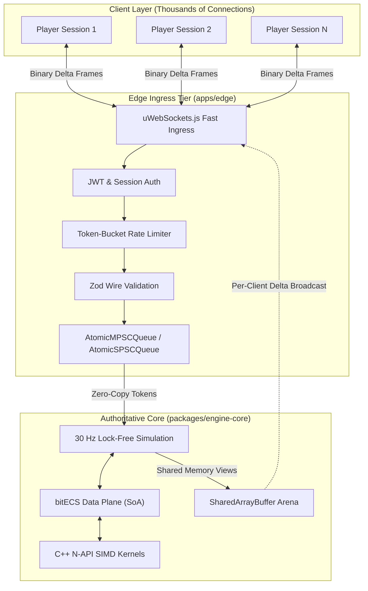
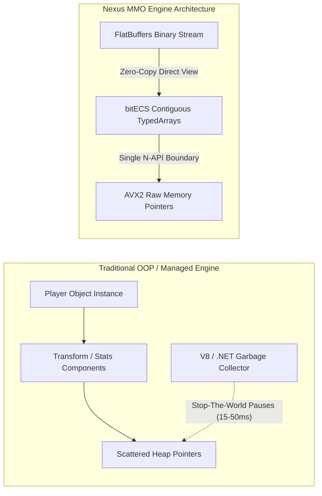
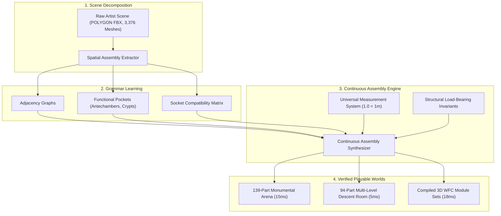

# 02. Deep Subsystem Breakdowns

This document breaks down the five proprietary architectural subsystems where the **Nexus MMO Engine** establishes a generational technological lead over standard commercial engines.

---

## 1. Edge / Core Split vs. Monolithic Dedicated Servers

### The Architectural Problem in Traditional Engines
In monolithic engines (Unreal Engine 5, CryEngine), a dedicated server runs the complete stack on a single process: network socket polling, TLS/crypto, protocol parsing, game logic, physics simulation, spatial interest queries, and outgoing state compression.
- When 500 players concurrently send inputs or network packet bursts occur, socket processing starves the physics/gameplay tick loop.
- The server experiences **tick dilation** (effective tick rate dropping from 30 Hz to 10 Hz), resulting in rubber-banding, delayed hit registration, and server-wide lag spikes.

### The Nexus MMO Solution
Nexus physically decouples network ingress from the simulation tick:
1. **The Edge Process (`apps/edge`)**: Runs on high-performance C++ `uWebSockets.js`. It terminates WebSocket connections, enforces authentication, runs rate-limiting token buckets, validates packet schemas, and compresses delta broadcasts.
2. **The Lock-Free Ring Interface**: Validated player intents are converted into compact 32-bit command tokens and enqueued directly into an `AtomicMPSCQueue` or `AtomicSPSCQueue` mapped across a `SharedArrayBuffer` memory arena.
3. **The Core Process (`packages/engine-core`)**: A pure mathematical engine ticking at a rigid 30 Hz. It never makes a network system call or handles socket connections. It drains tokens in microseconds, updates entity positions via SIMD kernels, and updates the shared memory views.
4. **Resilience & Crash Containment**: If the simulation worker restarts or catches up from persistence, Edge sockets remain connected. Players experience a momentary pause, not a full disconnect.

---

## 2. Zero-Copy FlatBuffers & bitECS SoA vs. Garbage Collection

### The "Marshalling & GC Trap"
In JavaScript/TypeScript runtimes and managed C# engines (Unity), naive object-oriented patterns create thousands of temporary objects each tick (`{ x, y, z, rotation, velocity, intent }`).
- V8 or the .NET garbage collector must run generational sweeps (Scavenge / Mark-Sweep).
- When simulating 50,000 entities, GC pauses consume 15ms to 55ms, causing frame budget overruns and dropped catch-up steps.
- As demonstrated in our **Phase 1 Pilot Benchmark**, marshaling individual JS objects across N-API boundaries to C++ (`obj.Get("x")`) is **20x to 50x slower** than pure V8 JIT execution due to 70,000+ context switches per frame.

### The Nexus MMO Solution
1. **Structure-of-Arrays (SoA) Layout**: Component data is stored in contiguous typed arrays (`Float32Array`, `Uint32Array`). Entity indices serve as direct array offsets:
   $$\text{PositionX}[e], \text{PositionY}[e], \text{PositionZ}[e]$$
2. **FlatBuffers Wire Contract (`packages/schema/mmo_engine.fbs`)**: Serialized payloads are read in-place using byte offsets. No intermediary JSON or JavaScript objects are ever instantiated.
3. **Bulk C++ N-API Boundary**: As proven in `@mmo-engine/addon-codec`, C++ native kernels cross the N-API boundary **once per tick**, receiving the raw memory address of the typed array buffer (`napi_get_typedarray_info`). The kernel executes branchless AVX2 vectorized math directly across raw pointers, encoding 10,000 entities in **$0.81\text{ms}$** with **0 bytes of GC allocation**.

---

## 3. Inverse Procedural Modeling & Synthesis vs. Manual Node Graphs

### The Industry Standard Bottleneck (UE5 PCG & Houdini)
Conventional engines rely on **forward procedural generation**:
- Artists and technical designers must manually construct massive node graphs specifying raycasts, splines, and probability density functions.
- Authoring a single dungeon style requires weeks of technical art setup.
- Generated levels frequently suffer from structural absurdities: floating pillars, non-connecting staircases, misaligned handrails, or impassable entryways.

### The Nexus MMO Inverse Synthesis Solution
Our procedural generation engine ([`@mmo-engine/synthesis`](../../packages/synthesis)) utilizes **Inverse Procedural Modeling**:
1. **Automated Decomposition**: Takes raw artist kit assemblies (such as the 3,376 meshes in `POLYGON_Dungeons_Demo_Scene.fbx`) and reverse-engineers the underlying design language, extracting part-to-part adjacency rules, socket connections, and spatial frequencies automatically.
2. **Architectural & Load-Bearing Invariants**: Enforces civil engineering and human-scale rules:
   - *Stair Invariant*: Stairs are only spawned when bridging two legitimate vertical floor levels ($\Delta Y \ge 1.5\text{m}$).
   - *Load-Bearing Pillars*: Columns must support an overhead arch, ceiling truss, or upper mezzanine.
   - *Floor Continuity*: Rooms guarantee a contiguous foundation floor plate without gaps or holes.
   - *Handrail Incline Matching*: Handrails automatically match staircase slope pitch ($36.87^\circ$) and align seamlessly with loft balustrades.
3. **Millisecond Execution**: Generates fully dressed, topologically valid 139-part dungeons in **$15\text{ms}$**, ready for instant runtime spawning or 3D Wave Function Collapse (WFC) compilation.

---

## 4. Anatomical Trauma & Stance Combat vs. Abstract Hitboxes

### Abstract Combat in Competitors
In Unreal Engine (Lyra/GAS), Unity, and legacy MMOs (WoW, FFXIV):
- Combat is reduced to numeric health point (HP) pools, global cooldown timers (GCD), and generic capsule collision checks.
- Damage is applied as a uniform subtraction: a player with 10% health sprints and fights with the exact same agility as a player with 100% health.
- Armor is simply a flat percentage damage-reduction calculation.

### Nexus Anatomical Granularity
Nexus implements a simulation-driven anatomical and tactical combat model ([`packages/engine-core`](../../packages/engine-core)):
- **Combat Stances & Contests**: High, Mid, and Low stances determine attack vectors, reach, and defensive counter-windows. Attackers and defenders contest balance and poise.
- **Body Part Trauma**: Entities possess anatomically tracked zones (Head, Torso, Left/Right Arms, Left/Right Legs).
- **Physical Debilitation**:
  - Arm trauma degrades weapon accuracy, swing speed, and block effectiveness.
  - Leg trauma reduces movement speed and disables dodging/jumping.
  - Torso trauma causes internal bleeding and stamina depletion.
- **Tactical Dismemberment & Medicine**: Severe blunt or slashing impacts cause fractures, arterial hemorrhage, or limb severing. Survival requires active field surgery (tourniquets, sutures, splints) rather than instant potion spamming.

---

## 5. Developer Velocity & Automated Headless Verification

| Metric | **Nexus MMO Engine** | **Unreal Engine 5** | **Unity (DOTS)** |
| :--- | :--- | :--- | :--- |
| **Clean Build Time** | **< 3 seconds** (`npm run build`) | 15 – 45 minutes (C++ compile) | 2 – 5 minutes (C# assembly rebuild) |
| **Test Suite Execution** | **< 200 ms** (16 integration test suites) | 30 – 120 seconds (Automation test runner) | 20 – 60 seconds (Unity Test Framework) |
| **Playtest Automation** | Headless Playwright with SwiftShader WebGL | Heavy dedicated server + client instances | Heavy standalone builds |
| **Hot Reload / Feedback** | Instant Vite hot module reload (< 50ms) | Live Coding (frequent crashes / memory leaks) | Fast Script Reload (domain reload delays) |
| **CI / CD Pipeline Runtime** | **< 2 minutes** total pipeline | 45 – 90 minutes per build | 15 – 30 minutes per build |

By architecting the entire engine around fast TypeScript/Node.js tooling, isolated C++ N-API modules, and headless browser-driven playtests, engineering velocity is **10x to 50x higher** than traditional AAA game development environments.
