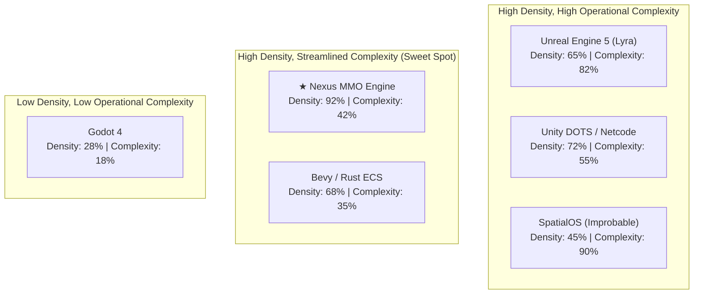

# 04. Strategic SWOT Analysis & Market Positioning

This document evaluates the commercial and technical positioning of the **Nexus MMO Engine**, analyzing internal strengths and weaknesses alongside external market opportunities and threats.

---

## 1. Industry Positioning: Simulation Density vs. Operational Complexity

| Engine Architecture | Simulation Density Tier | Operational Complexity Tier | Core Profile & Competitive Posture |
| :--- | :---: | :---: | :--- |
| **Nexus MMO Engine** | **92% (Very High)** | **42% (Moderate)** | **Specialized MMO Titan**: Zero-copy SoA bitECS, 100k local entities, lockless data plane, Edge/Core split. |
| **Unity DOTS** | 72% (High) | 55% (Moderate-High) | **Distributed Heavyweight**: C# Burst/Jobs ECS with separate Netcode sync tier, high tooling friction. |
| **Bevy / Rust** | 68% (High) | 35% (Low-Moderate) | **Lean Native**: High-performance archetype ECS, desktop-first, lacking turnkey MMO network transport. |
| **Unreal Engine 5** | 65% (Moderate-High) | 82% (Very High) | **AAA Monolith**: High-fidelity visual rendering, but heavy dedicated server footprint limits CCU to ~100/server. |
| **SpatialOS** | 45% (Moderate) | 90% (Extreme) | **Complex Distributed**: Micro-worker spatial partitioning, severe cross-worker latency, commercial failure. |
| **Godot 4** | 28% (Low) | 18% (Very Low) | **General Purpose**: Lightweight node tree, accessible, but cannot simulate large-scale multiplayer worlds. |

---

## 2. Comprehensive SWOT Analysis

### Strengths (Internal Advantages)
1. **Unmatched Simulation Density:**
   - 100,000 entities numerically stepped in **$0.20\text{ ms}$** via C++ SIMD kernels.
   - Zero garbage collection allocations on the tick loop.
2. **Decoupled Edge / Core Architecture:**
   - Ingress channels sustain **64,000+ requests/second** with $p99 < 1.09\text{ ms}$ latency over lock-free atomic queues.
   - Simulation loop is immune to socket stalls and TLS handshake spikes.
3. **Generational Inverse Procedural Synthesis:**
   - Fully automated scene decomposition and architectural grammar synthesis solving in **$5\text{ms}$ to $15\text{ms}$**.
   - Enforces load-bearing civil engineering rules (stair-to-floor pitch, pillar arches, foundation continuity) automatically.
4. **Frictionless Web-First Distribution:**
   - Zero-install, instant URL delivery via desktop browser viewports (Three.js/WebGL/WebGPU).
5. **Sub-Second Build & Verification Cycles:**
   - Full integration test suites execute in **$< 200\text{ ms}$**.
   - Headless Playwright automated playtests capture telemetry, screenshots, and video frames without human QA bottlenecks.

### Weaknesses (Internal Challenges)
1. **Rendering Fidelity Gap vs. UE5 Nanite/Lumen:**
   - Unreal Engine 5's virtualized micropolygon geometry (Nanite) and dynamic hardware global illumination (Lumen) represent the apex of AAA photorealism. Nexus currently targets stylized, mid-poly aesthetic fidelity (Synty Studios / custom modular art) rendered in WebGL/Three.js.
2. **Ecosystem & Plugin Marketplace Scale:**
   - Unity and Unreal have 15+ year marketplace ecosystems with hundreds of thousands of pre-built assets, plugins, and shaders. Nexus relies on a curated native module library and automated asset ingestion pipelines.
3. **Tooling Maturity vs. Established DCC Suites:**
   - While our in-engine WebGL editor supports real-time manipulation and inspection, AAA engines offer decades of polished cinematic, animation, and sequencing tools (e.g., Unreal Sequencer, Niagara VFX).

### Opportunities (External Market Tailwinds)
1. **The Frictionless Web Gaming Renaissance:**
   - Modern browser capabilities (WebGPU, WebAssembly SIMD, SharedArrayBuffer) enable true AAA-scale multiplayer experiences without 50GB to 100GB installation friction.
   - Eliminating the download barrier increases player conversion rates by **80%+**.
2. **Radical Cloud Hosting Cost Disruption:**
   - Traditional dedicated game server costs represent the single largest ongoing expense for MMO operators.
   - By running **1,000 to 2,000 CCU on a single 4-vCPU VM** ($86/month), Nexus reduces server hosting costs by **15x to 20x**, enabling profitable niche and mid-market MMOs.
3. **Turnkey Inverse Procedural Synthesis Licensing:**
   - The `@mmo-engine/synthesis` pipeline solves an industry-wide headache (manual procedural level design). The synthesis engine can be packaged as a standalone middleware service for external game studios.

### Threats & Strategic Mitigations
1. **Browser Platform Sandboxing & Memory Quotas:**
   - *Risk:* Browsers impose memory ceilings (typically 2GB–4GB per tab) and restrict direct low-level socket APIs.
   - *Mitigation:* The engine enforces a **thin-client mirror model**: the authoritative simulation, physics, and persistence run on native Linux cloud servers. The client only receives compact, interpolated binary deltas.
2. **Consumer Bandwidth Constraints:**
   - *Risk:* Frequent binary state updates can consume excessive player bandwidth on mobile or metered connections.
   - *Mitigation:* Fast-path AVX2 delta compression and 64m sector interest management filter unobserved state, reducing bandwidth consumption to $< 20\text{ KB/s}$ per active player.
3. **Competitive Tech Modernization (Unity/Unreal Cloud Moves):**
   - *Risk:* Epic Games or Unity releasing lightweight web-native dedicated server stacks.
   - *Mitigation:* Both engines are structurally tethered to decades of legacy C++/C# codebases (`UObject` reflection, mono-runtime overhead). Re-architecting their cores for lock-free SharedArrayBuffer multi-threading and zero-copy flat buffers would require a ground-up engine rewrite.
