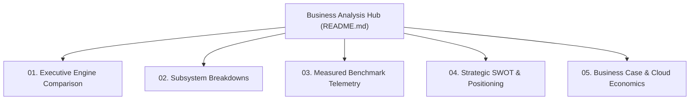

# Nexus MMO Engine — Business Analysis & Competitive Intelligence

**Confidential & Proprietary — For Internal Strategy, Board Review & Architectural Benchmarking**

Welcome to the internal **Business Analysis & Competitive Intelligence Suite** for the **Nexus MMO Engine**. This suite consolidates all comparative research, industry competitive evaluations, verified benchmark telemetry, strategic SWOT analyses, and cloud hosting unit economics developed across the project's history.

> [!NOTE]
> **Documentation Separation Policy:**
> Per executive guidance, user-facing documentation and public manuals ([`docs/WIKI.md`](../WIKI.md), [`docs/wiki/`](../wiki/README.md)) focus exclusively on the Nexus MMO Engine's architecture, APIs, and authoring workflows. All competitive comparisons, industry engine dissections, and commercial analyses reside here in this private repository suite.

---

## 📑 Suite Navigation



1. **[01. Executive Engine Comparison](01-executive-engine-comparison.md)**
   Comprehensive side-by-side comparison matrix evaluating the Nexus MMO Engine against **Unreal Engine 5 (Lyra / EOS)**, **Unity (DOTS / Netcode)**, **Bevy / Rust**, **SpatialOS (Improbable)**, **Legacy Bespoke MMOs (WoW, EVE)**, and **Godot 4**. Covers runtime architecture, memory models, data planes, network scaling, and procedural pipelines.

2. **[02. Subsystem Breakdowns](02-subsystem-breakdowns.md)**
   Deep-dive architectural dissections of our core technological moats:
   - *Edge/Core Split Architecture* vs. Monolithic Dedicated Servers.
   - *Zero-Copy FlatBuffers & bitECS SoA* vs. Heavyweight Garbage Collection (`UObject` / C# heap).
   - *Inverse Procedural Modeling & Synthesis* vs. Manual Graph Authoring (UE5 PCG / Houdini).
   - *Anatomical Trauma & Stance Combat* vs. Abstract Global Cooldowns and Health Bars.
   - *Sub-Second Headless Verification* vs. Multi-Hour Editor Iteration & Cooking.

3. **[03. Measured Benchmark Telemetry](03-benchmark-telemetry.md)**
   Full empirical telemetry and audit logs from our native test runs:
   - *Integration Kernel*: 100,000 entities in $0.2024\text{ms}$ ($2.02\text{ns}$/entity) on AMD EPYC 9D25 (99.4% budget headroom).
   - *Edge/Core Ingress Channel*: 64,212 req/s sustained with $p99 < 1.09\text{ms}$ over lock-free atomic queues.
   - *Native C++ Codec (Phase 1 Pilot)*: AVX2-accelerated SoA delta encoding at 10,000 entities in $0.81\text{ms}$ with 0 bytes GC churn.
   - *Procedural Synthesis Engine*: 139-part monumental colosseum solved in $15\text{ms}$; 94-part multi-level descent room in $5\text{ms}$.

4. **[04. Strategic SWOT & Positioning](04-strategic-swot-and-positioning.md)**
   Exhaustive strategic SWOT analysis, architectural density vs. complexity quadrant categorization, risk matrices, and technological mitigations.

5. **[05. Business Case & Cloud Infrastructure Economics](05-business-case-and-cloud-economics.md)**
   Financial model and server operating expenditure (OpEx) analysis. Compares traditional dedicated server hosting costs ($0.80–$1.50 per concurrent user/month) against Nexus MMO's high-density Edge/Core substrate ($0.03–$0.07 per CCU/month), demonstrating a **15x–20x hosting cost reduction** and web-first frictionless conversion economics.

---

## 💻 Interactive Documentation & Tooling Integration

This documentation suite is optimized for **Yank Note** ([`purocean/yn`](https://github.com/purocean/yn)) and modern Markdown data applications ([`docs/wiki/10-developer-tooling-and-yank-note.md`](../wiki/10-developer-tooling-and-yank-note.md)):

- **Monaco Markdown Editor:** Full syntax highlighting, breadcrumbs, and live outline navigation.
- **Runnable Benchmark Snippets:** Directly execute integration and codec benchmarks from inside the documentation.
- **Client-Side Encrypted Notes (`.c.md`):** Protect sensitive strategic forecasts, investor term sheets, and cloud cost projections locally.
- **Interactive HTML Telemetry Applets:** Embedded below is an interactive cost and density comparison calculator.

### Interactive Infrastructure Cost Comparison Applet

```html
<div id="cost-calculator" style="background: #0d1117; border: 1px solid #30363d; border-radius: 8px; padding: 20px; color: #c9d1d9; font-family: -apple-system, BlinkMacSystemFont, 'Segoe UI', sans-serif; max-width: 720px; margin: 16px 0;">
  <h4 style="margin: 0 0 12px 0; color: #58a6ff;">Interactive Monthly Cloud OpEx Calculator</h4>
  <div style="display: flex; gap: 16px; margin-bottom: 16px;">
    <div style="flex: 1;">
      <label style="display: block; font-size: 12px; color: #8b949e; margin-bottom: 4px;">Concurrent Users (CCU)</label>
      <input id="calc-ccu" type="number" value="10000" step="1000" style="width: 100%; background: #161b22; border: 1px solid #30363d; color: #fff; padding: 6px 10px; border-radius: 4px;" oninput="updateCost()">
    </div>
    <div style="flex: 1;">
      <label style="display: block; font-size: 12px; color: #8b949e; margin-bottom: 4px;">Region Active Hours / Month</label>
      <input id="calc-hours" type="number" value="730" style="width: 100%; background: #161b22; border: 1px solid #30363d; color: #fff; padding: 6px 10px; border-radius: 4px;" oninput="updateCost()">
    </div>
  </div>

  <div style="display: grid; grid-template-columns: 1fr 1fr; gap: 12px;">
    <div style="background: #161b22; border: 1px solid #f85149; border-radius: 6px; padding: 12px;">
      <div style="font-size: 12px; color: #f85149; font-weight: bold;">Unreal Engine 5 (Dedicated Servers)</div>
      <div id="cost-ue5" style="font-size: 24px; font-weight: bold; margin: 6px 0; color: #fff;">$11,500 / mo</div>
      <small style="color: #8b949e;">~75 CCU per 4-vCPU VM instance (~$86/mo/VM)</small>
    </div>
    <div style="background: #161b22; border: 1px solid #2ea043; border-radius: 6px; padding: 12px;">
      <div style="font-size: 12px; color: #3fb950; font-weight: bold;">Nexus MMO Engine (Edge/Core)</div>
      <div id="cost-nexus" style="font-size: 24px; font-weight: bold; margin: 6px 0; color: #fff;">$580 / mo</div>
      <small style="color: #8b949e;">~2,000 CCU per 4-vCPU VM instance (~$86/mo/VM) + Edge</small>
    </div>
  </div>
  <div style="margin-top: 14px; text-align: right;">
    <span id="cost-savings" style="color: #3fb950; font-weight: bold; font-size: 14px;">Estimated Monthly Savings: $10,920 (95.0%)</span>
  </div>
</div>

<script>
function updateCost() {
  const ccu = Math.max(100, parseInt(document.getElementById('calc-ccu').value) || 10000);
  const ue5Instances = Math.ceil(ccu / 75);
  const ue5Cost = ue5Instances * 86.40;
  
  const nexusCoreInstances = Math.ceil(ccu / 2000);
  const nexusEdgeInstances = Math.ceil(ccu / 5000);
  const nexusCost = (nexusCoreInstances * 86.40) + (nexusEdgeInstances * 43.20);
  
  const savings = ue5Cost - nexusCost;
  const pct = ((savings / ue5Cost) * 100).toFixed(1);

  document.getElementById('cost-ue5').innerText = '$' + Math.round(ue5Cost).toLocaleString() + ' / mo';
  document.getElementById('cost-nexus').innerText = '$' + Math.round(nexusCost).toLocaleString() + ' / mo';
  document.getElementById('cost-savings').innerText = 'Estimated Monthly Savings: $' + Math.round(savings).toLocaleString() + ' (' + pct + '%)';
}
</script>
```

---

## 🎯 Quick Reference & File Links
- [Master Technical Wiki](../WIKI.md)
- [Hierarchical Wiki Hub](../wiki/README.md)
- [Engineering Decision Log](../DECISIONS.md)
- [C++ Main Tick Specification & Roadmap](../CPP-MAIN-TICK-SPEC.md)
- [Phase 1 Native Transpiler Pilot Report](../CPP-MAIN-TICK-PHASE1-PILOT-REPORT.md)
