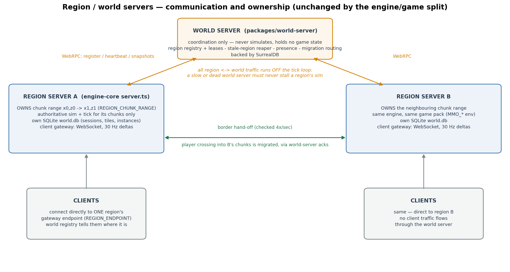
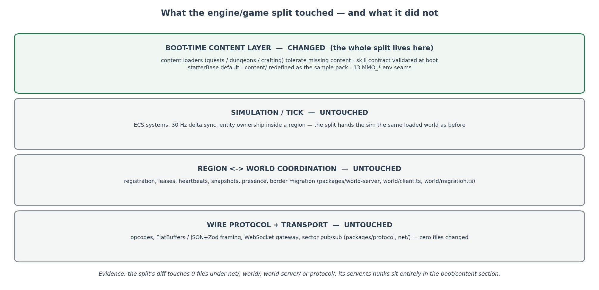

# Engine / Game Split — Visual Reference

What changed when the engine stopped being fused to one game's content, and
what it means for everyone building on the engine. All claims below are
verified against the code on `arlo/engine-game-split` (the hard-coded bestiary
extraction landed separately on `arlo/needs-schema`).

## Boot architecture

| Area | Before | After |
|---|---|---|
| Quest / dungeon content | Bare `readFileSync`, no existence check — a missing file crashed the boot | Missing → empty content / inert rules; half-present → boot throws, naming the missing files |
| Crafting rules | Bad or missing rules threw; the server caught it and called `process.exit(1)` | Missing file → `null`, boot logs and continues; present-but-invalid still fails loud |
| Skill IDs | Hard-coded strings in combat/body/mastery systems; a pack missing one degraded silently | `ENGINE_REQUIRED_SKILLS` (+ the `disarm` technique) declared once in `rules/skill-contract.ts` and validated at boot — a pack that declares skills but misses a required ID fails by name; a pack with no skills skips the check |
| Engine defaults | `starterBase` defaulted to `"sword"` — a game decision baked into engine code | Defaults to `null`; the game pack opts in explicitly |
| `content/` | The game, hardwired; no documented seams | The **sample game pack**; 13 `MMO_*` environment seams point the engine at any pack |

## Ecosystem impact

- **Before:** the repo was engine + Game #1 fused. A second game could not
  boot without the first game's content (and could not remove its species —
  the loader merged file content *over* a hard-coded bestiary). Every content
  change was an engine code change.
- **After:** the engine owns generics (code, schemas, loaders, systems,
  verbs) and boots with zero content. Games are content packs connected
  through the `MMO_*` seams (`MMO_QUESTS`, `MMO_DUNGEONS`, `MMO_CRAFTING`,
  `MMO_SPECIES`, `MMO_RULES`, `MMO_COMBAT`, `MMO_MODULES`, `MMO_BIOMES`,
  `MMO_ECOLOGY`, `MMO_SCENE(S)`, `MMO_PREFABS`, `MMO_PCG_ASSETS` — full table
  in `content/README.md`). The sample pack ships with the engine so it runs
  out of the box.
- **The working split this creates:** designers author content packs;
  developers build engine mechanisms. Neither edits the other's layer, and
  the boot contract catches a broken pack immediately, by name, instead of
  letting it degrade silently at runtime.

## Verification

- 24/24 new tests on the branch (tolerate-absent loaders, skill contract,
  starter-base default) plus the existing item suite 18/18.
- Boot-sequence check: 12/12 scenarios — sample pack loads and passes the
  contract; content-free boot works; a broken pack fails loud naming the
  missing skill IDs.

## Region / world servers: communication and ownership

The architecture the split operates inside — and does not change:

- A **region server** (an `engine-core` `server.ts` instance) is the
  authoritative simulator for exactly one chunk range
  (`REGION_CHUNK_RANGE`). It owns its entities, its tick, its client gateway
  (WebSocket, 30 Hz deltas) and its own SQLite `world.db`. Clients connect
  directly to a region; no client traffic passes through the world server.
- The **world server** (`packages/world-server`) is coordination only: region
  registry and leases, a stale-region reaper, cross-region presence, and
  migration routing, backed by SurrealDB. It never simulates and holds no
  game state.
- Regions talk to the world server over WebRPC (register, heartbeat,
  snapshot/load reports), and **all of it runs off the tick loop** — a slow or
  dead world server must never stall a region's sim. Border hand-offs are
  checked 4×/second: a player crossing into a neighbouring live region's
  chunks is migrated to it, coordinated through world-server acks. A region
  with `WORLD_URL` unset simply runs standalone.

**Why no networking overhaul follows from the split:** the split is a
boot-time change (what content loads, from where, validated how); region/world
communication and ownership are runtime concerns, and the two share no code
paths. Verified on the branch: the split's diff touches **zero files** under
`net/`, `world/`, `world-server/` or `protocol/`, and its `server.ts` hunks
sit entirely in the boot/content section — the region registration block is
byte-identical.

Two operational consequences, neither of them protocol changes:

1. **Pack consistency is now configuration discipline.** Every region must be
   pointed at the same game pack (the same `MMO_*` env). Before, the content
   rode along in the repo, so consistency was automatic; mismatched packs
   would still speak the same wire protocol, but the world would be
   incoherent (different items, skills, species per region).
2. **The boot contract is fleet safety.** The skill-contract check runs at
   every region's boot, so a misconfigured region now dies at startup —
   visible immediately — instead of registering and silently degrading.

Work that *does* change data flow is separate and already tracked: SAB
phases 2–5 (sector pub/sub fan-out and the fast-path codec, inside a region's
client fan-out) and the possible C++ sim backend (the sim↔Node boundary
inside one server). Neither is part of, or required by, this split.
