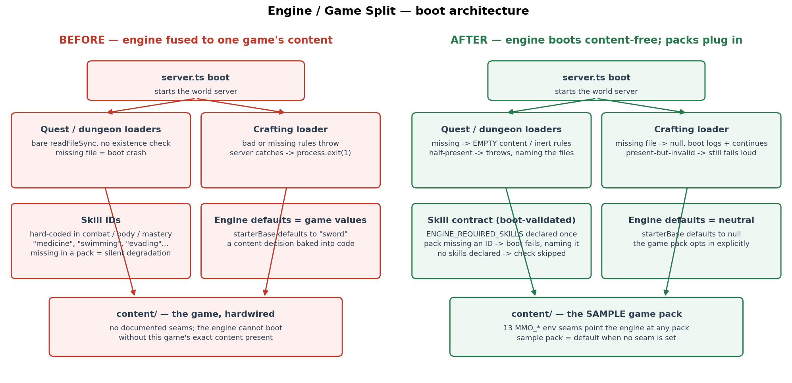
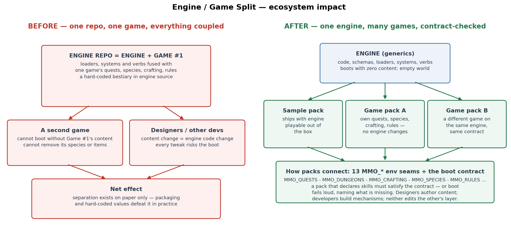

# Engine / Game Split — Visual Reference

What changed when the engine stopped being fused to one game's content, and
what it means for everyone building on the engine. All claims below are
verified against the code on `arlo/engine-game-split` (the hard-coded bestiary
extraction landed separately on `arlo/needs-schema`).

## Boot architecture

| Area | Before | After |
|---|---|---|
| Quest / dungeon content | Bare `readFileSync`, no existence check — a missing file crashed the boot | Missing → empty content / inert rules; half-present → boot throws, naming the missing files |
| Crafting rules | Bad or missing rules threw; the server caught it and called `process.exit(1)` | Missing file → `null`, boot logs and continues; present-but-invalid still fails loud |
| Skill IDs | Hard-coded strings in combat/body/mastery systems; a pack missing one degraded silently | `ENGINE_REQUIRED_SKILLS` (+ the `disarm` technique) declared once in `rules/skill-contract.ts` and validated at boot — a pack that declares skills but misses a required ID fails by name; a pack with no skills skips the check |
| Engine defaults | `starterBase` defaulted to `"sword"` — a game decision baked into engine code | Defaults to `null`; the game pack opts in explicitly |
| `content/` | The game, hardwired; no documented seams | The **sample game pack**; 13 `MMO_*` environment seams point the engine at any pack |

## Ecosystem impact

- **Before:** the repo was engine + Game #1 fused. A second game could not
  boot without the first game's content (and could not remove its species —
  the loader merged file content *over* a hard-coded bestiary). Every content
  change was an engine code change.
- **After:** the engine owns generics (code, schemas, loaders, systems,
  verbs) and boots with zero content. Games are content packs connected
  through the `MMO_*` seams (`MMO_QUESTS`, `MMO_DUNGEONS`, `MMO_CRAFTING`,
  `MMO_SPECIES`, `MMO_RULES`, `MMO_COMBAT`, `MMO_MODULES`, `MMO_BIOMES`,
  `MMO_ECOLOGY`, `MMO_SCENE(S)`, `MMO_PREFABS`, `MMO_PCG_ASSETS` — full table
  in `content/README.md`). The sample pack ships with the engine so it runs
  out of the box.
- **The working split this creates:** designers author content packs;
  developers build engine mechanisms. Neither edits the other's layer, and
  the boot contract catches a broken pack immediately, by name, instead of
  letting it degrade silently at runtime.

## Verification

- 24/24 new tests on the branch (tolerate-absent loaders, skill contract,
  starter-base default) plus the existing item suite 18/18.
- Boot-sequence check: 12/12 scenarios — sample pack loads and passes the
  contract; content-free boot works; a broken pack fails loud naming the
  missing skill IDs.
