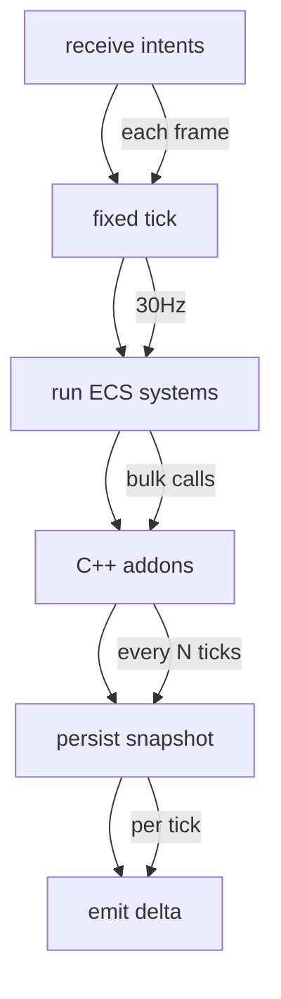
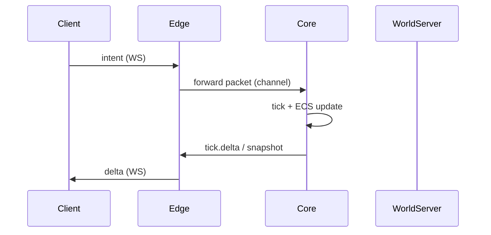
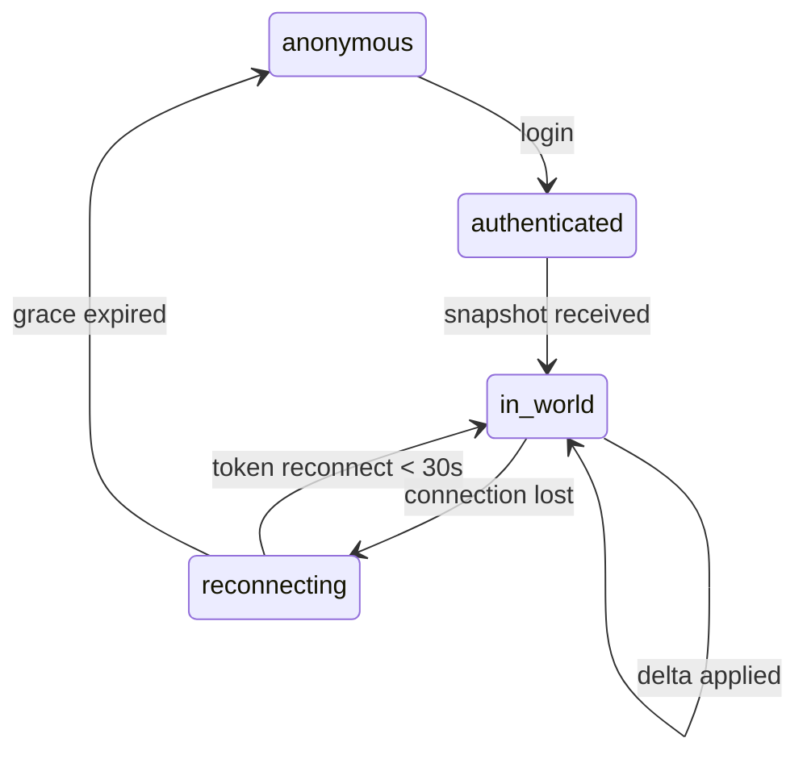
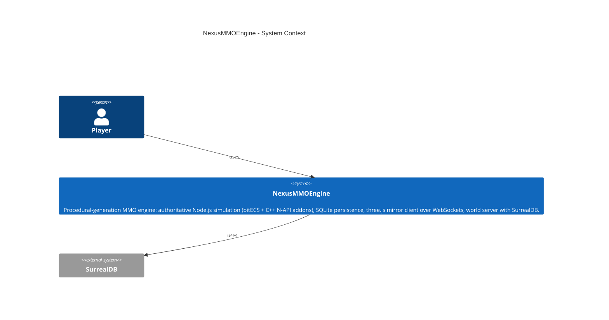
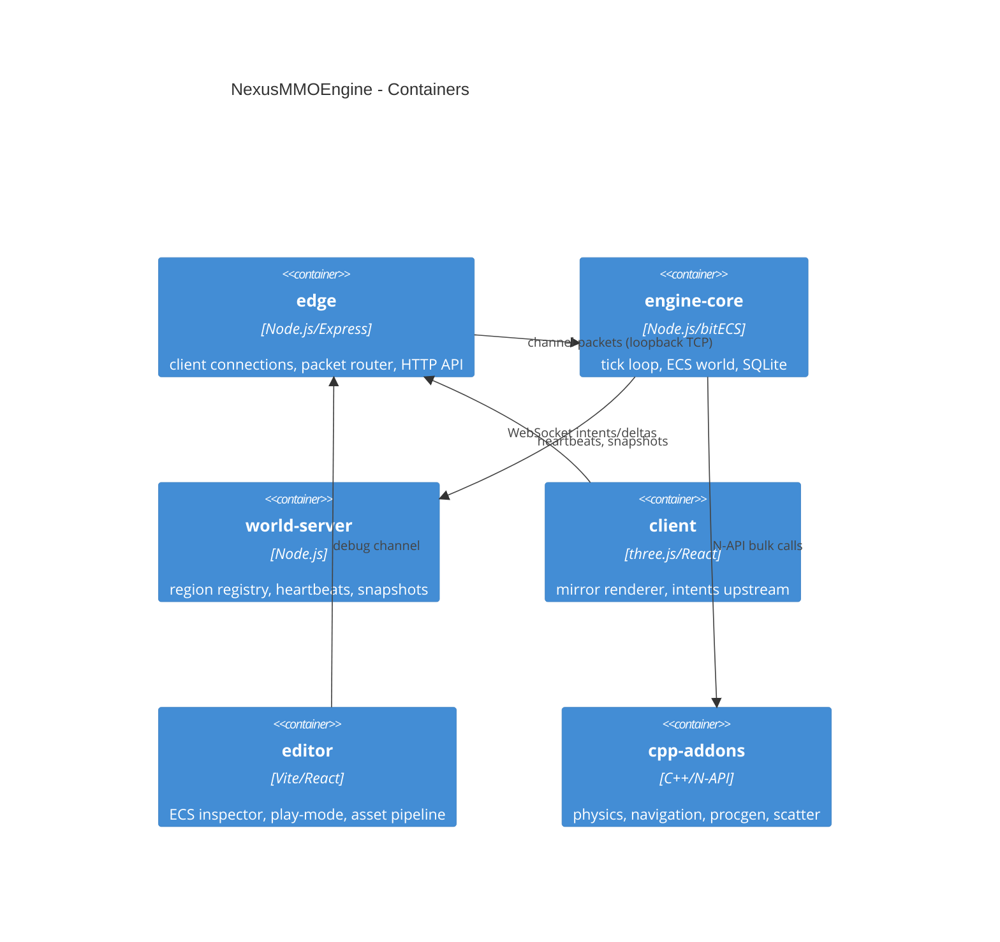
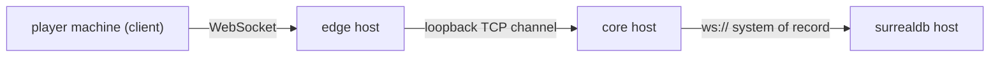

# NexusMMOEngine — Architecture Documentation

> Generated by Architecture Diagram Generator on 2026-10-02T12:03:05.251Z.
> Source of truth: `docs/arch-diagrams.json` — regenerate any time with
> `Arch Diagrams: Generate Complete Documentation Set`.

Procedural-generation MMO engine: authoritative Node.js simulation (bitECS + C++ N-API addons), SQLite persistence, three.js mirror client over WebSockets, world server with SurrealDB.

## Diagram index

1. [Flowchart](#1-flowchart)
2. [Sequence diagram](#2-sequence-diagram)
3. [Class diagram](#3-class-diagram)
4. [ER diagram](#4-er-diagram)
5. [State diagram](#5-state-diagram)
6. [C4: System Context](#6-c4-system-context)
7. [C4: Container](#7-c4-container)
8. [Deployment diagram](#8-deployment-diagram)

## 1. Flowchart

Process / logic flow with optional branches



## 2. Sequence diagram

Interactions between participants over time



## 3. Class diagram

Classes and their relationships

```mermaid
classDiagram
    class InputState
    class PlaceholderAssets
    class AnimationLibrary
    class ActionLayer
    class CharacterAnimator
    class CharacterKit
    class ModularCharacter
    class CharacterMaterial
    class CharacterStage
    class GTToneMapEffect
    class UnderwaterEffect
    class Trail
    class EntityFxSystem
    class EntityLayer
    class ParticleFx
    class InstancedProps
    class PcgMeshes
    class PerfSampler
    class PrefabGallery
    class PrefabBuilder
    class FxShowcase
    class DaySky
    class ScaleEffect
    class PhysicalSky
    class StarField
    class SyntyProps
    class ChainedPropModels
    class TerrainRenderer
    class OutlineMaterial
    class QuarksFx
    class WaterRenderer
    class EcsInspector
    class PlayModeController
    class TerrainView
    class FakeServer
    class FakeClient
    class Retargeter
    class ProgressEventShim
    class ManifestAssetProvider
    class CsvCredentialStore
```



## 4. ER diagram

Entities, attributes and relationships

```mermaid
erDiagram
```

## 5. State diagram

States and transitions of an entity or process



## 6. C4: System Context

System, users and external systems (C4 level 1)



## 7. C4: Container

Containers inside the system (C4 level 2)



## 8. Deployment diagram

Infrastructure nodes and connections



## How to use these diagrams

- **Debugging a flow?** Start at the Sequence diagram, then the Flowchart.
- **Planning a change or fixing a bug?** Check the Class and ER diagrams for blast radius.
- **Infra incident?** Go straight to the Deployment diagram.
- **Onboarding someone?** C4 Context first, then C4 Container.
- **Docs look stale?** Run `Arch Diagrams: Verify Documentation Accuracy` — it tests
  every documented finding against the codebase and rebuilds what drifted.
