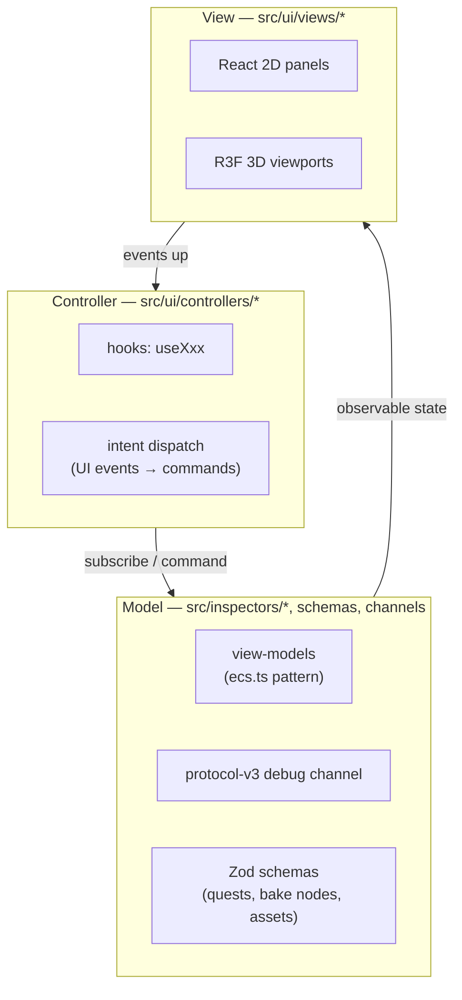
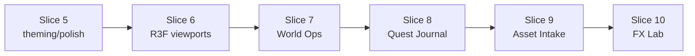

# MMO Engine — Comprehensive Editor Build Plan

**Date:** 2026-10-04 · **Status:** ready for implementation (after rebuild-spec slices 1–5)
**Repo:** `SirHertzAlot/NexusMMOEngine` · **App:** `apps/editor/` (Vite 6 + React 19 + Tailwind 3.4 + three.js 0.186 + TypeScript 5.6 + Zod 3.23)
**Relationships:**
- Extends `EDITOR-UI-REBUILD-SPEC.md` — slices 1–5 there are unchanged and
  run first, in fixed order. This document adds slices 6–10. It does not
  rewrite the earlier spec (append-only).
- Applies the **MMO Engine UI/UX Design Reference** (web artifact):
  MVC architecture, semantic design tokens, density controls,
  failure-state patterns, redlines, PR review checklist, and the three
  reference screens (world operations, quest journal, asset intake).
- Serves `QUEST-SYSTEM-BUILD-PLAN.md` (quest journal view) and the shader
  R&D program `SHADER-EXPERIMENTS.md` Exps 1–11 (FX lab view).

## 1. Vision

The rebuild spec turns the editor into a dockable shell. This plan makes it
*comprehensive*: the single control surface for building and overseeing the
world — entities, simulation sessions, terrain, art intake, bake graphs,
quests, shader/FX experiments, and server operations — with every view
obeying one MVC contract and one visual language, so the whole product reads
as designed, not assembled.

## 2. Locked architecture decisions (do not relitigate without Joey)

1. **R3F 9 + drei 10 for editor 3D viewports.** The client already runs
   `@react-three/fiber` 9 + `@react-three/drei` 10; the editor adopts the
   same versions for its viewports (play-mode, terrain, model preview).
   Rationale: one 3D idiom across client and editor; drei supplies
   `CameraControls` (yomotsu's library, the adopted camera solution),
   `TransformControls`, and `Html` overlays without hand-rolled code.
   The editor's non-3D UI stays plain React + Tailwind + shadcn.
2. **MVC for all UI code** (from the UI/UX Design Reference):
   - **Model** — data and rules only: `src/inspectors/*` view-models
     (existing `ecs.ts` pattern), the protocol-v3 debug channel
     subscription, Zod schemas, bake-graph JSON, quest JSON, FX lab
     outputs. Never imports a component. Never touches the network
     directly (it exposes observables the controllers subscribe to).
   - **View** — React (2D) and R3F (3D) components under `src/ui/views/`.
     Presentational: render props, emit events up. No `fetch`, no
     WebSocket, no host-process calls, no business logic.
   - **Controller** — hooks (`src/ui/controllers/use*.ts`) plus intent
     dispatch. Owns every side effect: host API calls, debug-channel
     commands, file writes, validation. Translates UI events into
     intents/commands the same way the game client translates input into
     server intents.
   - **Forbidden couplings:** View → network/server (never); View →
     Model mutation (views emit events, controllers mutate); Controller →
     JSX (never); Model → View imports (never).
3. **Rebuild-spec decisions stand:** dockview-react shell, versioned
   persistent layout, `@xyflow/react` v12 + `@dagrejs/dagre` bake graph,
   `uniforms` + Zod schema forms, shadcn-dark theming pass (no Tailwind-
   native shortcuts skipped), 290-test suite green throughout.
4. **Untouched (as in the rebuild spec):** dev host API (`src/host.ts`),
   the Rogue bridge package, the protocol-v3 debug channel, and the
   read-only live ECS view-model. The editor never writes live ECS state.
5. **Theming:** every new view ships themed — shadcn-dark tokens via the
   existing Tailwind setup, density controls and failure-state patterns
   per the UI/UX Design Reference. No unstyled third-party chrome.

## 3. Complete view inventory

Slices 1–5 deliver V1–V6 (rebuild spec §4). This plan adds V7–V10.
Each view lists its Model source, Controller duties, and acceptance bar.

### V7 — World Operations (from UI/UX reference: "world operations" screen)
- **Purpose:** oversee local server processes: status, start/stop/restart,
  per-process resource readouts, recent log tail. Play-mode (V2) keeps
  owning the *session*; this view aggregates *processes*.
- **Model:** dev host API `src/host.ts` status surface (do not invent new
  host endpoints in this slice; show status + pid + port + log tail only).
- **Controller:** `useWorldOps` — polls status, dispatches
  start/stop/restart, confirms destructive actions first.
- **Acceptance:** start/stop a server from this view with clean
  process-group kill; a dead process shows a failure-state pattern (per
  the reference), not a blank panel; destructive actions confirm.
- **Note:** multi-region management arrives with the edge/core
  implementation — no region UI until the host API exposes regions.

### V8 — Quest Journal (from UI/UX reference: "quest journal" screen)
- **Purpose:** browse and author quest definitions per
  `QUEST-SYSTEM-BUILD-PLAN.md`: chapters, Q1–Q9 chains, and Q9 mythic
  trigger constraints (event/location/sim/prior/restriction composition).
- **Model:** quest JSON content files + Zod schemas from the quest plan;
  read-only until the quest format is implemented, then read/write.
- **Controller:** `useQuests` — loads quest files via host API, validates
  edits against the schemas, blocks invalid trigger compositions with
  inline messages (uniforms forms, Slice 4 pattern).
- **Acceptance:** open a quest chain, see its ordered steps and trigger
  constraints; edit a constraint through a schema-driven form; invalid
  input is blocked with messages, never written.
- **Dependency:** the quest system's content format (quest plan). If the
  format isn't implemented yet, this slice builds the viewer + validator
  against the plan's schema and the authoring writes the plan's JSON.

### V9 — Asset Intake (from UI/UX reference: "asset intake" screen)
- **Purpose:** the import workflow for art assets: drop/import files,
  run manifest validation, extract style profiles (feeds the model
  style-matching pipeline), convert via `packages/art`, browse packs.
  Extends V4 (art browser/inspector); does not replace it.
- **Model:** existing asset view-model + `packages/art` convert pipeline
  (`convert:packs`).
- **Controller:** `useAssetIntake` — runs the import→validate→convert
  pipeline, surfaces per-file validation results, never blocks the UI
  (progress + failure states per the reference).
- **Acceptance:** import a model pack, see validation pass/fail per file,
  converted output appears in the asset browser; a failed file shows what
  failed and why, with retry.

### V10 — FX / Shader Lab (serves `SHADER-EXPERIMENTS.md` Exps 1–11)
- **Purpose:** the shader R&D program's workbench inside the editor:
  browse golden stills (noon/dusk/night triplets), benchmark results per
  experiment, toggle `quality.ts` tiers, A/B merged vs parked techniques.
- **Model:** read-only over the client render lab outputs (`bench.ts`
  results, `stills/`, `quality.ts` tiers). This view never runs
  experiments — it presents their outputs.
- **Controller:** `useFxLab` — loads experiment records, switches tiers,
  filters merged/parked.
- **Acceptance:** pick an experiment, see its stills triplet + measured
  numbers + verdict (merge/parked-with-note); switching tiers updates the
  presented configuration.
- **Dependency:** the client render lab must exist (bench harness,
  stills). Until then, this slice builds the viewer against fixture data
  matching the experiment record format.

## 4. Updated default layout (extends rebuild-spec §4)

| Region | Width/Height | Views (tab group) |
|---|---|---|
| Left | 20% width | Entity List, Asset Browser, Asset Intake |
| Center | 55% width | Play Mode viewport (default active), Terrain, Bake Graph, FX Lab |
| Right | 25% width | Inspector, Quest Journal |
| Bottom | 22% height | Console, World Operations |

Layout JSON version bumps to 2 (`mmo-editor:layout:v2`); Slice 1's
migration keeps v1 layouts loadable (fall back to default on unknown
view ids, never crash).

## 5. Implementation order — slices 6–10

Slices 1–5 (rebuild spec) run first, unchanged, in fixed order. Then:

### Slice 6 — R3F viewport migration
**Goal:** play-mode, terrain, and model-preview viewports run on R3F 9 +
drei 10, matching the client.
**Work:**
1. Install `@react-three/fiber@9`, `@react-three/drei@10` (pin to the
   client's versions), `camera-controls` (MIT). Verify licenses at
   install; record in the license review.
2. Migrate `play-mode.tsx`, `terrain.tsx`, `model-preview.tsx` viewports:
   `<Canvas>` + drei `CameraControls` (replaces the 3 hand-rolled
   `OrbitControls` sites and informs the future `follow-camera.ts`
   evaluation); `TransformControls` where gizmos exist; `Html` for
   overlay labels. Keep the protocol-v3 debug overlays (entities, path
   waypoints, navmesh tiles) — they become R3F scene children fed by the
   existing debug-channel view-model.
3. Viewport resize: listen to dockview resize events → Canvas resize
   (Slice 2's resize contract, unchanged).
4. MVC conformance for migrated views: viewport components render props;
   all host/debug-channel calls move into `usePlayMode` / `useTerrain`
   controllers. Do not refactor untouched views in this slice.
**Acceptance:** play-mode start/stop, debug overlays, terrain sculpting,
and model preview behave identically to pre-migration; viewport resizes
with dock splits; test suite green.

### Slice 7 — World Operations view
**Files:** `src/ui/views/world-ops.tsx`, `src/ui/controllers/useWorldOps.ts`.
**Acceptance:** §3 V7.

### Slice 8 — Quest Journal view
**Files:** `src/ui/views/quest-journal.tsx`,
`src/ui/controllers/useQuests.ts`, quest Zod schemas (from the quest
plan; new file `src/content/quest-schemas.ts` if the plan hasn't landed
them — schemas only, no quest content invented).
**Acceptance:** §3 V8. Uniforms forms for trigger constraints (Slice 4
pattern reused).

### Slice 9 — Asset Intake view
**Files:** `src/ui/views/asset-intake.tsx`,
`src/ui/controllers/useAssetIntake.ts`.
**Acceptance:** §3 V9. Intake never blocks the shell; progress and
per-file failure states per the UI/UX reference.

### Slice 10 — FX / Shader Lab view
**Files:** `src/ui/views/fx-lab.tsx`, `src/ui/controllers/useFxLab.ts`.
**Acceptance:** §3 V10. Fixture-backed until the client render lab
exists; the fixture format must match the experiment record format so
the swap is data-only.

## 6. MVC adoption rule (pragmatic, not a rewrite)

- Slices 6–10 are built MVC-clean from the first commit (per §2.2).
- Existing views (slices 1–5) are **not** refactored for MVC's sake. When
  a slice touches an existing view, it moves that view's side effects
  into a controller as it goes. No churn without a reason.

## 7. Cross-cutting requirements (extend rebuild-spec §10)

- **License review:** every new dependency recorded (name, version,
  license, evidence); GPL/AGPL/non-commercial transitive dep → stop and
  report.
- **Theming:** new views ship shadcn-dark themed; the PR checklist from
  the UI/UX Design Reference runs on every slice (density, empty/
  loading/error states, no unstyled third-party chrome).
- **Docs:** `docs/EDITOR.md` gains the new views, the v2 layout, the MVC
  contract summary, and the R3F viewport note.
- **Determinism boundary:** unchanged — editor never writes live ECS
  state; bake graph and quest authoring edit content inputs only.
- **Slice order is fixed:** 1→5 (rebuild spec), then 6→10 here. Tests
  green between slices.

## 8. Veto points for Joey

1. **R3F in the editor (Slice 6).** Recommended because the client is
   already R3F 9 + drei 10 — one 3D idiom, drei's camera/gizmo components
   for free. Veto → keep vanilla-three viewports and use the
   `camera-controls` npm package directly (the S-tier estimate from the
   incorporation report).
2. **Quest Journal before the quest format lands** builds viewer +
   validator against the plan's schema (no content invented). Veto → park
   Slice 8 until the quest system is implemented.
3. **FX Lab fixture-backed** until the client render lab exists. Veto →
   park Slice 10 until bench/stills outputs exist.
