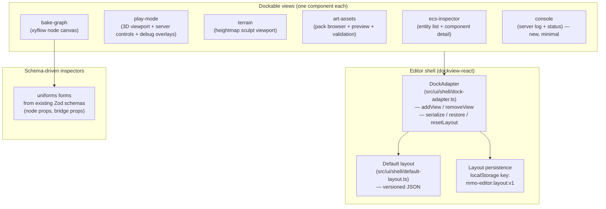

# MMO Engine — Editor UI Rebuild Spec

**Date:** 2026-10-03 · **Status:** ready for implementation
**Repo:** `SirHertzAlot/NexusMMOEngine` · **App:** `apps/editor/` (Vite 6 + React 19 + Tailwind 3.4 + three.js 0.186 + TypeScript 5.6, React 19, Zod 3.23)

## 1. Goal

Rebuild the editor shell from a tab bar on a centered page into a real dockable
editor: draggable panels, tab groups, split views, floating groups, and a
persistent layout. The four existing panels become dockable views. A new
node-graph view hosts the bake-lab graph UI. Inspector forms become
schema-driven.

## 2. Locked decisions (do not relitigate)

- **Dockable shell:** `dockview-react` (MIT). Explicit React 19 support,
  zero-dependency core, layout serialization built in. Do NOT install any
  package named `dockview-enterprise` (proprietary).
- **Node graph:** `@xyflow/react` v12 (MIT). Custom React nodes first-class.
  Auto-layout via `@dagrejs/dagre` (MIT). Do NOT use `elkjs` (EPL-2.0 weak
  copyleft) unless edge routing proves inadequate — record the choice.
- **Inspector forms:** `uniforms` (MIT) with its Zod schema bridge (verify the
  bridge package name at install time; fallback: derive JSON Schema from Zod
  via `zod-to-json-schema` and use the JSON-Schema bridge).
- **Rejected:** `rete.js` (subgraph plugins are CC-BY-NC-SA non-commercial),
  `golden-layout` v2 (stale), `@danfessler/react-dockable` (non-commercial),
  original `litegraph.js` (dormant; Comfy-Org fork is fallback only if nested
  editable subgraphs become a hard requirement).
- **Untouched:** the dev host API (`src/host.ts` — server start/stop/status,
  asset scan), the Rogue bridge package
  (`rogue-packages/sirhertzalot/mmo-editor/`), protocol v3 debug channel,
  the read-only ECS inspector view-model (`src/inspectors/ecs.ts`).
- **None of these libraries are Tailwind-native.** Every slice that adds one
  includes a theming pass to the shadcn dark aesthetic. Budget it; do not skip
  it.
- **Tests:** the existing suite (290 tests) stays green throughout. New code
  gets unit tests for view-models/adapters/serialization; no jsdom docking
  tests (jsdom cannot do real drag layout — test the adapter, not the DOM).

## 3. Non-goals

- No changes to the authoritative server, the mirror client, or the wire
  protocol.
- No new 3D viewport features in this spec (terrain mesh editing depth and
  the in-editor baker are separate slices, already identified).
- No embedding of Rogue Engine or any other external editor.

## 4. Architecture

**Default layout (concrete — implement exactly this):**

| Region | Width/Height | Views (tab group) |
|---|---|---|
| Left | 20% width | Entity List (from ECS inspector), Asset Browser |
| Center | 55% width | Play Mode viewport (default active), Terrain, Bake Graph |
| Right | 25% width | Inspector (component detail / asset inspector / selected node props) |
| Bottom | 22% height | Console (server log + status) |

The ECS inspector's existing entity list and component detail become two
separate dockable views (list → left, detail → right) sharing the existing
`src/inspectors/ecs.ts` view-model. The art asset panel splits the same way
(browser → left, preview/inspector → right).

## 5. Slice 1 — Dockable shell

**Goal:** `App` renders a dockview shell instead of a tab bar; layout persists.

**Work:**
1. Install `dockview-react`. Verify `LICENSE`/package metadata is MIT at
   install; record version in the repo license review.
2. Create `src/ui/shell/dock-adapter.ts`:
   - Wraps the imperative `DockviewApi`. React components never touch the
     API directly.
   - Methods: `addView(id)`, `removeView(id)`, `serialize(): string`,
     `restore(json: string): boolean`, `resetLayout(): void`.
   - `restore` returns false (and falls back to default) on corrupt JSON —
     never crash on a bad saved layout.
3. Create `src/ui/shell/default-layout.ts`: the table in §4 as versioned JSON
   (`{ version: 1, groups: [...] }`).
4. Create `src/ui/shell/EditorShell.tsx`: hosts `<DockviewReact>`,
   registers the six view components (initially as thin placeholders that
   render the existing panels' content in §6 — placeholders first, so the
   shell lands independently).
5. Persist on every layout change (debounced 500 ms) to
   `localStorage["mmo-editor:layout:v1"]`; load on startup; header button
   "Reset layout".
6. Replace the tab bar in `src/ui/App.tsx` with `<EditorShell/>`. Keep the
   header branding and the footer notice.

**Acceptance:**
- Drag any panel to any region; tab groups form; layout survives reload.
- Corrupt localStorage value → default layout, no crash.
- `npm run editor:test` green; existing 290 tests untouched and passing.
- Theming: dockview CSS variables overridden to shadcn dark tokens; no
  unstyled flash on load.

## 6. Slice 2 — Migrate the four panels to dockable views

**Goal:** every existing panel works as a dockable view with zero behavior
regressions.

**Work:**
1. `src/ui/views/ecs-list.tsx` + `src/ui/views/ecs-detail.tsx` — split the
   existing ECS inspector; both consume `src/inspectors/ecs.ts` unchanged.
2. `src/ui/views/play-mode.tsx` — existing `PlayModePanel` as a view; the 3D
   viewport must handle being resized by dock splits (listen to dockview
   resize events → `renderer.setSize` / camera aspect update).
3. `src/ui/views/terrain.tsx` — existing `TerrainEditorPanel` as a view.
4. `src/ui/views/art-browser.tsx` + `src/ui/views/art-inspector.tsx` — split
   the asset panel; both consume the existing asset view-model.
5. `src/ui/views/console.tsx` — new minimal view: tails the dev host server
   log (poll `GET /api/editor/server/status`; show last N log lines if the
   host exposes them — if not exposed, show status + pid + port only; do not
   invent a new host endpoint in this slice).
6. Register all views in the shell; remove the Slice 1 placeholders.

**Acceptance:**
- Each view functions identically to its tab-era behavior (connect, search,
  filter, play-mode start/stop with clean process-group kill, asset
  validation, terrain sculpting).
- Play-mode viewport resizes correctly when its dock group is split.
- A view closed by the user can be re-opened from a "Views" menu in the
  header (list of the six views; toggles visibility via the adapter).
- Full test suite green.

## 7. Slice 3 — Bake graph view

**Goal:** a node-graph canvas for the bake-lab "map sim outputs to game
assets" step, as a dockable center view.

**Work:**
1. Install `@xyflow/react` and `@dagrejs/dagre`. Verify MIT at install.
2. Create `src/ui/bake-graph/`:
   - `BakeGraphView.tsx` — `<ReactFlow>` with MiniMap, Controls, Background.
   - `nodes/` — three custom React node components (shadcn-styled):
     - `sim-output` — references a bake-kernel output table (props: table
       name, hash).
     - `transform` — named transform with params (props: transform id,
       JSON params).
     - `asset-target` — maps to a game asset id (props: asset id from the
       art manifest).
   - `graph-model.ts` — versioned serialization: `{ version: 1, nodes: [...],
     edges: [...] }`; `toJSON`/`fromJSON` round-trip; validation rejects
     unknown node types and dangling edges.
   - Auto-layout button runs dagre and applies positions.
3. "Save graph" persists JSON to `localStorage["mmo-editor:bakegraph:v1"]`
   (file export comes with the in-editor baker slice, not here).

**Acceptance:**
- Build a 3-node graph (output → transform → target), save, reload: graph
  restores exactly.
- Corrupt JSON → empty canvas + error notice, no crash.
- 200-node generated graph renders and pans at interactive framerate.
- Nodes use shadcn tokens; no default xyflow purple.

## 8. Slice 4 — Schema-driven inspector forms

**Goal:** node/bridge props edited through validated forms generated from the
existing Zod schemas.

**Work:**
1. Install `uniforms` + Zod bridge (verify names/licenses at install).
2. Create `src/ui/forms/` — a `<SchemaForm schema={zodSchema}
   value={...} onChange={...}/>` wrapper.
3. Apply to: bake-graph selected-node props (Slice 3 node prop schemas) and
   the `MmoEditorBridge` prop editor (companion URL, auto-open flags).
4. Invalid input is blocked with inline messages; valid edits flow back into
   the owning view-model.

**Acceptance:**
- Editing a node prop through the form updates the graph model; invalid
  values show messages and do not apply.
- Existing Zod schemas are reused, not duplicated.

## 9. Slice 5 — Theming and polish pass

**Goal:** the whole editor reads as one shadcn-dark product.

**Work:**
1. Audit every dockview and xyflow default style still leaking through;
   override via CSS variables/classes.
2. Consistent empty states, loading states, and error notices across views.
3. Keyboard: `Ctrl/Cmd+Shift+P`-style view toggle menu is out of scope;
   ensure all views are reachable by mouse and the Views menu.

**Acceptance:** visual review checklist in the PR; no unstyled third-party
chrome visible.

## 10. Cross-cutting requirements

- **License review:** append each new dependency (name, version, license,
  evidence) to the repo's license review doc. If a transitive dependency is
  GPL/AGPL/non-commercial, stop and report — do not ship it.
- **Docs:** update `docs/EDITOR.md` — replace the tab description with the
  dockable shell, document the default layout, the Views menu, layout reset,
  and the bake-graph JSON format.
- **Determinism boundary:** the editor never writes live ECS state (existing
  rule). The bake graph edits *bake inputs only*; it never talks to a
  running server.
- **Slice order is fixed:** 1 → 2 → 3 → 4 → 5. Each slice lands with tests
  green before the next begins.
