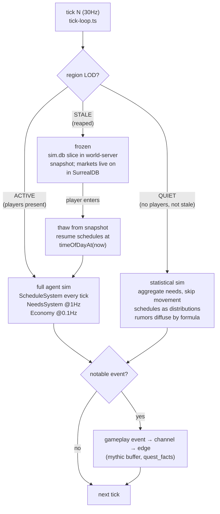
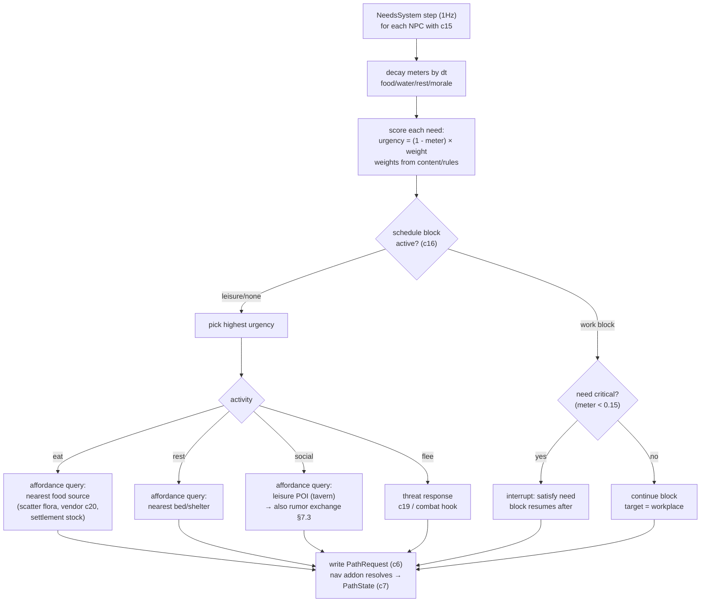
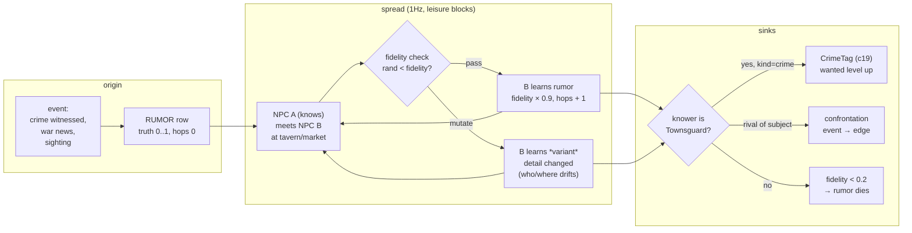
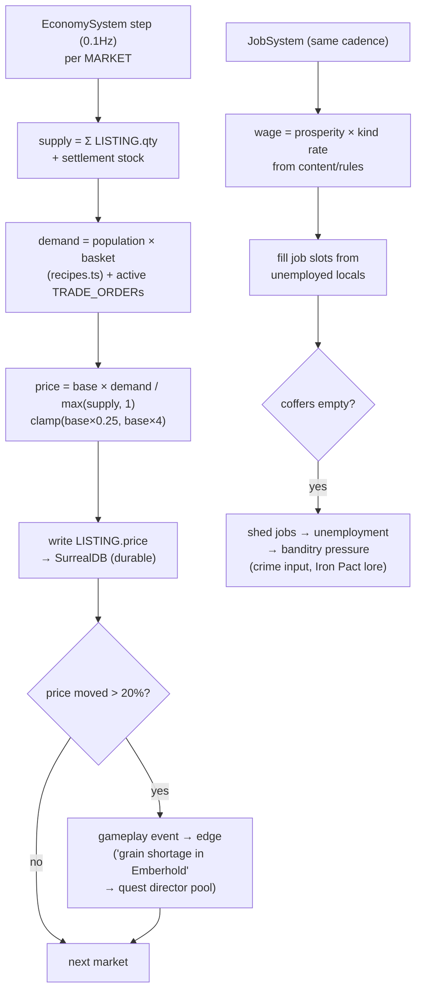
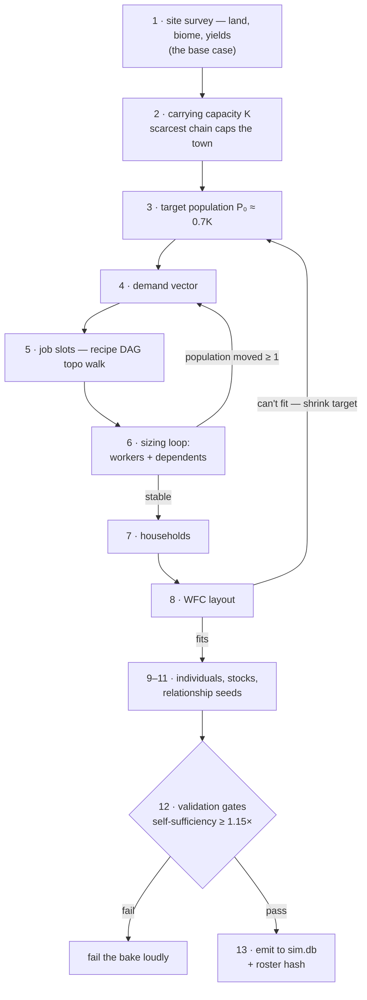

# Living Sim Deep Dive — the "real world sim"

How the MMO engine gets a world that lives whether or not the player is
watching: NPCs with needs and daily schedules, jobs, a supply-and-demand
economy, ecology, factions that remember, weather that matters, crime that
must be *witnessed*, rumors that travel, and centuries of pre-history the
player can discover but never saw happen.

Docs-only design. Nothing here modifies the engine repo. Every code
reference is a real path in `NexusMMOEngine @ 522c0c0` (fresh clone at
`~/workspace/mmo-engine/NexusMMOEngine`).

Companion docs:
- `~/workspace/your_files/mmo-engine-quest-system/QUEST-SYSTEM-BUILD-PLAN.md`
  — world-memory facts (`quest_facts`) and the hidden mythic trigger
  system this sim plugs into.
- `~/workspace/your_files/mmo-engine-quest-system/EDGE-CORE-SPLIT-BUILD-PLAN.md`
  — where sim code is allowed to live (placement rule: *needs the tick?
  core. Otherwise edge.*).

---

## 1. Vision and pillars

The target feeling: **Red Dead Redemption 2's Valentine at 8am** — the
stablehand is already at work, the shopkeeper opens when the sun is up,
rain sends people under cover, and if you rob the store, someone has to
*see* it for it to count. Plus **Dwarf Fortress's Legends mode** — the
world has centuries of wars, heroes, and ruins that happened before you
arrived, and you can dig them up.

Five pillars, each with a hard constraint:

1. **Deterministic at the core.** The sim runs on the 30Hz tick in
   `packages/engine-core/src/tick-loop.ts`. Same seed + same inputs =
   same world, always. No LLM in the tick loop, ever. (NPCSidekick's
   rule: *"no API key? the village still lives."*)
2. **Illusion, not autonomy.** RDR2's 1,000+ NPCs run fixed daily loops,
   not minds. We do the same: schedules and need-meters beat fake
   sentience, at 1/1000th the cost. A few *major* NPCs get deeper
   simulation; the crowd gets convincing loops.
3. **Tiered simulation (sim LOD).** Full agent sim near players,
   statistical abstraction far away, frozen-but-consistent when a region
   has nobody in it. Our region shards (`packages/world-server`) are the
   natural LOD unit.
4. **The world remembers.** Everything notable becomes a fact — in the
   core's sim SQLite for sim state, in the edge's `quest_facts` for
   player-facing history. Grudges outlive their participants (DF).
5. **Authored backbone + procedural filler.** The shipped norm
   (Wildermyth's "Library of Plays", Watch Dogs Legion's Census):
   hand-written structure with systemic who/when/where. Pure procedural
   sounds hollow; pure authored doesn't scale.

### 1.1 Design north star — a real world, not THE real world (2026-10-01)

Joey: *"We simulate A real world that we build, not THE real world
that's inhabited outside of this pseudo-space... Just enough so that
when users play they feel a sense of nostalgia and relation, like
they've been there before, even though it's not a real place."*

- We mimic reality **selectively**: daily rhythms, weather, needs,
  markets, gossip — the aspects that make a place feel inhabited. We
  never mirror it wholesale; the geography, history, and people are
  ours (S0's baked past, not Earth's).
- The target sensation is **recognition without replica**: the tavern
  at dusk, the market at opening, rain sending everyone under cover —
  archetypes a player already knows how to feel, in a place that
  doesn't exist.
- The payoff is the point: emotional connection builds the drive to
  return, and return visits are replayability. **Every sim system is
  judged against this**: does it make the world feel *known*?

---

## 2. What's already sim in this engine

We are not starting from zero. The repo already contains the substrate —
the deep dive's job is to connect it.

| Substrate | Path | What the sim gets for free |
|---|---|---|
| Fixed 30Hz tick | `packages/engine-core/src/tick-loop.ts` | Deterministic heartbeat; spiral-of-death guard already handled |
| bitECS SoA components | `packages/engine-core/src/components.ts` | Registry `COMPONENT_IDS` ends at `CharacterRef: 13` — sim components start at 14 |
| System interface | `packages/engine-core/src/systems.ts` | `SimSystem` (`name` + `step(world, dt)`); new sim systems plug in without touching the loop |
| Pathfinding | `PathRequest: 6`, `PathState: 7` components + nav addon | NPC movement reuses the player pathing pipeline |
| Authoritative day clock | `packages/protocol/src/day-clock.ts` | `timeOfDayAt()` — every schedule keys off this; all clients see the same sun |
| Weather visuals | `apps/client/src/render/fx/weather.ts` | The *look* of rain exists; the sim adds the *meaning* of rain |
| Species roster | `packages/species/src/species.ts` | `BUILTIN_SPECIES` with **sustenance kinds** (`food, water, rest, emotion, lifeforce, necromancy, none`), habitats by biome weight, pack sizes — a needs model for creatures, already data |
| Crafting materials | `packages/crafting/src/materials.ts` | `BUILTIN_MATERIALS` with sources (biomes, dungeon veins, creature drops) and `TRADABILITY` — the supply side of the economy, already balanced |
| Rules at boot | `packages/engine-core/src/rules/boot.ts` + `content/rules` | Authored tuning lives in versioned content, validated before the world starts — sim tuning goes here too |
| Region shards | `packages/world-server/src/core.ts` | Heartbeats, region registry, stale-region reaping — the sim LOD and freeze/thaw mechanism |
| World store | `packages/world-server/src/surreal-store.ts` | Durable cross-region aggregates (market prices, faction war state) |
| Persistence | `packages/engine-core/src/persist/store.ts` | Checkpoint/shutdown path sim state must serialize through |
| Quest facts | edge `quest.db`, `quest_facts` table (Q3 of quest plan) | Fact kinds `slew \| met \| completed \| befriended \| discovered` — the player-visible memory |
| Mythic triggers | Q9 of quest plan | 5 domains (`event/location/sim/prior/restriction`); the `sim` domain already listens to `weather`, `timeOfDay`, `season` — the sim *feeds* this |
| Lore factions | `content/lore/factions.json` (quest plan Q1) | `f_townsguard`, `f_riverfolk`, `f_ironpact`, `f_covenant`, `f_freeholds` with dispositions and relations — the faction sim's seed data |
| WFC solver | `packages/wfc` | Constraint solver for settlement layout, schedule assignment, population — bake-time, deterministic |

The gaps are exactly the systems in §4. Nothing on the list requires
rewriting what's there.

---

## 3. Reference study — the landscape

**Bottom line up front:** there is no drop-in "living sim" library. The
field is a set of projects, one dominant architecture pattern, and a
shelf of academic tools. We build the sim ourselves on our tick — and
our architecture (deterministic tick, regional sharding, world memory)
is unusually well suited to it.

### 3.1 The one pattern everybody converged on

> **LLM proposes, engine validates. The sim never depends on the LLM.**

Every serious project separates a *deterministic simulation core* from an
*optional generative layer* used only for dialogue/flavor, never for
state changes. NPCSidekick states it as a design guarantee ("no API
key? the village still lives — rule fallback"); aliveville encodes it
as an architecture decision record ("the LLM never touches the world
directly — it only proposes JSON, and every proposal is re-validated
against live state"). For us this is also a determinism requirement: the
tick loop in `tick-loop.ts` must stay bit-reproducible, so generative
models live at the *edges* (dialogue text, lore flavor) and never in
`systems.ts`.

### 3.2 Projects worth studying

| Project | License | What to steal |
|---|---|---|
| **NPCSidekick** (`lisheng5/npcsidekick`) | MIT | The hybrid architecture itself: NPCs work/gather on deterministic ticks, memory as plain editable JSON files, daily routine as data tables, "add an NPC by dropping one JSON file". Closest to our content/rules philosophy. |
| **Concordia** (`google-deepmind/concordia`) | Apache-2.0 | The **Game Master** pattern: a world-adjudicator that resolves agent actions against rules. Modular memory components, simulation checkpoints. Our mythic evaluator + director are a game-specific Game Master. |
| **Generative Agents / Smallville** (`joonspk-research/generative_agents`, Park et al. 2023) | Apache-2.0 | Memory stream + importance scoring + reflection + retrieval (`recency × importance × relevance`). Only the *algorithms* — we reimplement deterministically, no LLM in the loop. |
| **AI Town** (`a16z-infra/ai-town`) | MIT | Fixed-interval tick engine + persistent world state + agent loop driver. Validates our "tick owns the world" shape. |
| **NetLogo** (Northwestern Univ., `ccl.northwestern.edu`) | Open-source (GPL — check version before embedding code) | The academic canon of agent-based modeling: turtles/patches/links/observer, discrete ticks. Its models library (e.g. Wolf-Sheep Predation) is the reference implementation of the ecology in §4.3. |
| **Watch Dogs Legion "Census"** (GDC 2021, industry) | Proprietary — study only | A relational NPC database generating demographically-coherent profiles and schedules; missions generated at runtime from a recruit's backstory. The template for our emergent quest hooks (§4.9). |
| **Wildermyth "Library of Plays"** (industry) | Proprietary — study only | Hand-crafted plot events + targeting/scoring against live world state. The authored-backbone + procedural-filler norm. |
| **Santa Fe Institute** (`santafe.edu`) | Research — study only | Complex-systems literature: emergence from simple local rules. Useful when tuning so the sim surprises without exploding. |

**Do not use as code:** `adaraneo/gameenginetools` (GET Core) is
**proprietary** (© 50PSoftware) — study its *design* (white-box NPC
state: physiology/psychology/memory/relationships exposed, "no scripted
behavior trees", economy engines) but write our own. The **Nemesis
system** (Shadow of Mordor) is **WB-patented** — we do persistent
rivals through our own facts/rumor machinery, never a Nemesis clone.
`smallville-2`, `aliveville`, `tick-engine` carry unverified licenses in
the sources checked — treat as pattern references only until verified.

### 3.3 Genre playbook (what shipped games proved)

- **RDR2 — deterministic daily schedules.** NPCs work 10am–9:15pm, drink,
  sleep, take smoke breaks *in the rain*. Fixed loops, persistent
  routines. Our target bar for "alive".
- **RDR2 — the witness system.** A crime must be *perceived* to be
  reported; witnesses remember faces, clothes, horses. This is §4.6's
  entire design in one sentence.
- **Dwarf Fortress — zero-player history.** Tarn Adams: worldgen is "a
  zero-player strategy game with thousands of agents"; history is the
  *log* of that sim. Legends mode browses it; play can *hide* it so
  discovery happens through talk, books, engravings. Generate history,
  then hide it (§4.8).
- **RimWorld — needs + think-tree + jobs.** Need meters, a priority
  think-tree that picks the most urgent want, and a job board. Deterministic,
  legible, beloved. This is §4.1's design lineage.
- **The Sims — object affordances.** Objects advertise what needs they
  satisfy. Our scatter/placement packages already put objects in the
  world; the sim tags them with affordances.
- **Sim LOD.** Full sim near the player, statistical far away (Genshin
  runs distant AI at ~5Hz with animation skipped). Our region shards
  make this structural (§6).

### 3.4 Complementary libraries (companions, not foundations)

Added 2026-10-01. These are not living-sim engines — they are tools
that plug into the study set above and into our existing packages.
Evaluation order matters: Flocc first, vector stores last.

- **Flocc** (`scottpdo/flocc`, ISC) — agent-based modeling in
  JavaScript, browser or server. **Role: the offline lab for the
  population balancer and town data generation.** Tune carrying-
  capacity, birth/death, food-chain, and town-composition curves here,
  export the resulting tables, then implement the deterministic
  version in our ECS core. Its object-agent model never enters the
  30Hz tick; it generates *data* (see §4.3 and slice S3.5 in §8.1).
- **Vectra** (MIT) / **LanceDB** — embedded vector stores for Node.
  **Role: private implementation detail of the S11 NPC memory
  microserver** (its own edge process, decided 2026-10-01) — never an
  edge dependency, never in the tick. Core NPC memory stays SQLite
  facts plus deterministic `recency × importance × relevance`
  scoring (Generative Agents algorithms, reimplemented); the vector
  store only serves dialogue retrieval inside that service.
- **GOAP / behavior trees** — no clean TypeScript library won
  evaluation. The pattern stands (GOAP chooses and sequences goals;
  a behavior tree executes each step — the Bestia split), so we write
  a tiny data-driven planner for major NPCs only, inside the
  think-tree of §4.1. **NPC-Forge is AGPL-3.0 — design reading only,
  no code reuse.** The surfaced Go GOAP library (`akmonengine/goapai`,
  Apache-2.0) confirms the cost discipline: planners need scoping and
  benchmarking, never per-tick replans for the crowd.
- **Utility shelf** — `simplex-noise` + `alea` (MIT, seedable) and
  **ROT.js** (MIT): tools, bake experiments, and editor prototypes
  only. Authoritative procgen already has native noise, scatter, WFC,
  and dungeon population; these add nothing the tick needs.

### 3.5 Build principles: swappable by design, JS-first where it pays

Joey, 2026-10-01: *"The engine should have been made modular from the
start so every architectural choice we made could be swapped if
necessary."* Adopted as a standing principle (also in the mmo-engine
skill): every subsystem behind a narrow interface — `SimSystem`,
`CredentialStore`, `AssetProvider`, transport-agnostic `WorldCore`,
the spawn-table handoff are the model citizens. New sim subsystems
(town spawner/balancer, NPC memory service) are interface-first,
library-second.

**Prototype in JS, port to C++ only on profiler evidence.** The
scatter pipeline already proved this path: TS reference evaluator
with portable u32 hash goldens first, then the C++ addon matched it
bit-identical under test. So a feature may start as readable JS with
golden outputs acting as spec + test oracle; if a profiler later
says it is tick-hot, the port is mechanical and mechanically
verified. Bake-time-only code (world bake, town generation) never
needs the port — offline JS is fast enough forever.

**Worked example — the ROT.js verdict.** ROT.js (2D turn-based
toolkit: cellular/BSP/maze map generation, FOV/shadowcasting, grid
pathfinding, turn scheduler) was evaluated for procgen and rejected
for the runtime, as was the Three.terrain option before it: not C++,
wrong layer. Its map generators duplicate `packages/dungeon` + WFC,
its grid A* cannot replace the Recast/Detour navmesh in a 3D world,
and its scheduler assumes turns while our tick owns time. It earns
two narrow roles instead: **bake-time prototyping** (sketch a
settlement-layout generator in JS, judge the output, keep the
winners) and **editor previews** (2D map/FOV debug views). Its
shadowcasting remains a useful *concept* reference for the witness
line-of-sight checks in §4.6, reimplemented against the heightfield
in core.

---

## 4. System catalog

### 4.1 NPC needs, schedules, jobs

**Design (RimWorld lineage, RDR2 bar).** Every NPC gets need meters
(`food, water, rest, morale` — f32, 0..1, decay per sim-tick). A priority
think-tree scores each need's urgency × personality weights each decision
tick (1Hz, not 30Hz). The winner picks an *activity*; the activity
resolves to a *place* via object affordances, and movement reuses
`PathRequest`/`PathState` (components 6–7) and the nav addon.

Schedules are the spine: authored daily blocks in `content/rules`
(`sleep 22–6, work 8–17, leisure 17–22`), keyed off `timeOfDayAt()`
from `packages/protocol/src/day-clock.ts`. The think-tree can
*interrupt* a block (hunger emergency overrides work) but the block
resumes — this is what makes NPCs feel employed rather than wandering.
Jobs attach NPCs to workplaces: a job has slots, a wage, a shift; the
economy (§4.2) fills and starves them.

**Tiers (frugality is load-bearing):**
- *Background* (crowd): schedule loops only, no needs, no memory. Cheap.
- *Local* (villagers, vendors): needs + schedule + job + faction.
- *Major* (quest NPCs, captains): + relationships + rumors + history.
- *Villain* (antagonists): + hidden agenda state, mythic-eligible.

New components start at id 14 (`COMPONENT_IDS` ends at `CharacterRef:
13` in `packages/engine-core/src/components.ts`):
- `14 NpcBrain { tier: ui8, mode: ui8, homeX: f32, homeZ: f32, scheduleId: ui32 }`
- `15 Needs { food: f32, water: f32, rest: f32, morale: f32 }`
- `16 ScheduleState { blockIndex: ui8, blockEndTick: ui32, targetX: f32, targetZ: f32 }`
- `17 JobState { jobId: ui32, state: ui8, progress: f32 }`
- `18 FactionTag { factionId: ui32, rank: ui8 }`
- `19 CrimeTag { wantedLevel: ui8, lastCrimeTick: ui32 }` (transient)
- `20 VendorStock { listingBase: ui32, restockTick: ui32 }` (vendor NPCs)

Determinism: all sim RNG from seeded integer hashing (the scatter
package's `hashU32` contract in `packages/scatter/README.md`) — never
`Math.random` in the tick path.

### 4.2 Economy — supply, demand, and wages

The supply side already exists: `BUILTIN_MATERIALS` in
`packages/crafting/src/materials.ts` (sources: biomes, dungeon veins,
creature drops) and `TRADABILITY` (tiers 1–3 are commodities). The sim
adds the *demand* side and price discovery:

- Settlements consume materials per tick (population × recipe baskets
  from `packages/crafting/src/recipes.ts`); vendors restock from
  settlement stock.
- Price = base × clamp(demand/supply), resolved per market at low
  cadence (every 300 ticks); stored in the world server's SurrealDB so
  prices survive region reaping (`packages/world-server/src/surreal-store.ts`).
- Jobs pay wages from settlement coffers; wages move with prosperity;
  broke settlements shed jobs → unemployed NPCs → banditry pressure
  (feeds crime §4.6 and the Iron Pact raiders in lore).
- Player trading writes to the same listings — one market, not two.

### 4.3 Ecology

`packages/species/src/species.ts` already models sustenance per species
and habitats by biome weight. The sim closes the loop: herbivore
populations graze scatter-placed flora (density from the cooked
`.pcg.json` plans), predators hunt herbivores (NetLogo's Wolf-Sheep
Predation is the reference model), populations oscillate logistically.
Overhunting a region collapses its spawns until recovery — visible,
systemic consequence. Creature needs reuse the `Needs` component shape
with species sustenance kinds mapped onto the four meters (demons feed
on `emotion` → morale; undead on `none` → no decay).

### 4.4 Factions and reputation

Seed data exists: `content/lore/factions.json` (dispositions, relations).
The sim makes standing *dynamic*: per-player and per-NPC standings in
SQLite (`sim_standings`), moved by witnessed acts (quests completed,
crimes, trade, kills of faction members). Faction-level: settlements
prosper or burn, and the relation graph shifts on a slow cadence —
Iron Pact raids when Emberhold is weak, the Covenant spreads where
order collapses. Wars are abstract at region granularity (DF-style:
"they look at population numbers and where they are") and resolve to
concrete content: refugees on roads, bounties, changed vendor prices.

### 4.5 Weather–climate coupling

`apps/client/src/render/fx/weather.ts` renders weather; the sim gives it
gameplay meaning via a per-region `sim_weather` table (kind, startTick,
endTick — deterministic schedule, not random):
- Rain: NPCs seek shelter (schedule interrupt, RDR2 beat), mud slows
  travel, crops grow, fire-based abilities weaken.
- Thunderstorm: the mythic `sim` domain already listens for it — sim
  weather *is* what Q9 triggers match against.
- Drought/heat: water needs decay faster, food prices rise (§4.2).
- Winter: passes close, wolves grow bold (§4.3), travel hazardous.

### 4.6 Crime and justice — the witness system

RDR2's rule: **a crime must be perceived to be reported.** Implementation:
- Crimes (theft, assault, murder) are events with a position and radius.
- Witnesses = NPCs with line-of-sight in radius at the tick (reuses the
  perception query the AI already needs for combat).
- A witness spawns a rumor (§4.7) instead of teleporting knowledge to the
  guards. No witness → no report → the perfect crime is possible.
- Rumors reaching a Townsguard NPC raise the perpetrator's `CrimeTag`
  (wanted level); guards hunt; resolution = fine, jail time (schedule
  block!), or faction standing hit.
- Bribes and disguises are economy/faction levers on the same machinery.

### 4.7 Rumor and gossip propagation

Rumors are first-class sim entities: `{ kind, subjectId, originTick,
originRegion, truth, hops }`. Spread is *social and spatial*, not
broadcast: NPCs exchange rumors during leisure blocks (taverns at
night), each hop decays fidelity and may mutate details. A rumor that
reaches its subject's rival becomes a confrontation; reaching guards
becomes a wanted level; reaching the edge as a gameplay event becomes a
`quest_facts` row and can seed the quest director (§4.9). Truth values
let the same machinery carry misinformation — the informant
(`c_informant` in lore) sells rumors of adjustable reliability.

### 4.8 Pre-history — generate, then hide

At world bake, run the abstract sim (factions, settlements, wars,
heroes, artifacts) over N centuries of game-time in minutes — DF's
zero-player strategy game, at region granularity. Output is `sim_history`
rows: wars, foundings, betrayals, legendary kills. Then **hide it**:
players discover history through rumors, books, NPC dialogue
(`factsAbout` hook from the quest plan), and engravings on items. The
mythic `prior` chains can reference historical figures. A retired or
fallen player settlement enters the same log — the player's story
recorded in the same format as everyone else's.

### 4.9 Emergent quest hooks

The edge quest director (quest plan Q4) already builds quests from lore
pools. The sim feeds it *live* pools: a bandit-rumor hot on Mill Road
becomes an escort quest's `place` slot; a wanted NPC becomes a bounty
quest's `character` slot; a starving settlement becomes a gather quest.
This is the Watch Dogs Legion Census pattern: generator fixes
what/when/where, pulls who/why from live sim state. The quest plan's
closed `sim` domain keys (`weather`, `timeOfDay`, `season`) gain sim
keys (`factionWar`, `prosperity`, `rumorHeat`) by amendment — the mythic
evaluator then fires on *living* conditions, e.g. "during an Iron Pact
raid, at night, in Dustfield."

### 4.10 Enemy AI — brains for hostiles

Enemies are NPCs whose job includes violence, so they ride the same
stack: species data (`packages/species` kinds/tiers), need meters,
agent tiers. "Advanced" here means four layers, in cost order:

- **Perception.** Sight cones + hearing radii + last-known-position
  memory. Shares the line-of-sight machinery with the witness system
  (§4.6) — if a guard can't see the crime, he can't chase the criminal.
- **Decision, tiered like everything else.** Background hostiles:
  FSM/utility on the think-tree (§4.1). Standard enemies: data-driven
  behavior trees (patrol → investigate → engage → flee). Elites and
  bosses: a GOAP-lite planner — goals and actions as data, replans on
  events, never per-tick.
- **Coordination.** A squad blackboard (shared target, morale, flee
  threshold) as ECS data; packs surround, cowards break, veterans hold.
- **Direction.** An encounter director reads sim state (the S10 keys:
  `factionWar`, `rumorHeat`, player pressure) and paces escalation —
  the L4D lesson: drama is scheduled, not random. Persistent rivals
  grow out of our own facts/rumor machinery (§4.4, §4.7), never a
  Nemesis clone (WB-patented, §3.2).

**The open-source shelf** (added 2026-10-01; same pattern as §3 —
references and parts, no drop-in brain):

| System | License | Language | Role for us |
|---|---|---|---|
| **BehaviorTree.CPP** | MIT | C++ | The design gold standard: XML-defined trees, blackboard, Groot editor. Reference for our JS data-driven BT; vendor the C++ only if trees ever need to run natively. |
| **GOAP libraries** (`kelindar/goap`, `aitoolkit`, `dogoap`) | MIT | Go / C++ / Rust | Algorithm references — GOAP is Orkin's published F.E.A.R. design and planner cores are small. We write our own deterministic planner, actions as data. (`dogoap` is Rust: concepts only — Rust is out, 2026-10-01.) |
| **Utility AI / HTN** | — | technique | No standout OSS library; both are small techniques we implement in-house. Utility scoring already *is* the §4.1 think-tree; HTN decomposition is the fallback if GOAP-lite under-delivers for bosses. |
| **RVO2** (UNC GAMMA) | Apache-2.0 | C++ | ORCA local avoidance — packs and crowds that flow around each other. Evaluate against the Detour crowd already in the nav addon before adopting (§3.5: evaluate, don't assume). |
| **Unity ML-Agents** | Apache-2.0 | Python/Unity | **Training-time only.** Offline behavior experiments and baked policies; Unity-centric, and learned runtime policies fight tick determinism — never in the authoritative sim. |

**Rules:** deterministic only (seeded RNG), no LLM in combat
decisions, perception/decision at sim cadences (1Hz / 0.1Hz per §7),
and the standing cost gate — advanced brains only where players can
see the difference (elites, bosses, named rivals). STALKER's A-Life
remains concept-study material (write-ups and talks); there is no
clean open-source base to build on.

**Proposed slices:** S12 (enemy brains: perception + tiered BT/utility
+ GOAP-lite) and S13 (squad coordination + encounter director),
appended to the §8 table.

### 4.11 Perception — eyes and ears

Added 2026-10-01. NPCs that hear, see, and *process* — the missing
sense organs of the whole sim. Perception feeds sensory memory feeds
the memory stream (§3.2) feeds gossip (§4.7) feeds quests (§4.9):
a guard **hears** a fight, **sees** the body, **remembers**, tells the
tavern — and that becomes a bounty. That loop is the 10x lever.

**The contract** (converged shape across the references below):
stimuli come in typed — sight, sound, damage (smell optional) — as
`{type, position, intensity, timestamp, source, tags}`. Each NPC has a
**PerceptionProfile** as data (per species/archetype, tuned in
`packages/species`): sight (enabled, FOV angle, range, memory
duration after losing sight), hearing (radius, loudness multiplier),
detection modifiers (light penalty, peripheral bonus). Rule one from
the field: *"Pick the minimum. Over-perception = unfair AI."*

- **Vision: two-step.** Broad-phase first (sphere query for
  candidates), then **raycast line-of-sight** — via the physics
  addon's raycasts against terrain/geometry — only for candidates
  inside the cone. Never raycast to every potential target every
  frame. Output: what is seen *now* plus **last-known-location**
  with a memory duration — losing sight starts a search, not amnesia
  (§4.10, §7.3's `HasHeardSound`/`LastSawTargetTime` pattern).
- **Hearing: events, not polling.** Loud world events (combat,
  doors, thunder, the S4 storm) publish noise stimuli with
  loudness; NPCs within `radius × loudness` hear it, one occlusion
  raycast for walls/terrain between ear and source. Hearing is the
  cheapest sense — a signal, not a query.
- **Processing: sensory memory with decay.** Per-NPC observations
  (saw X, heard Y at Z) timestamp and decay into the memory stream,
  scored by `recency × importance × relevance` (Generative Agents
  algorithms, §3.2). Notable ones escalate: an observation becomes a
  memory, a memory becomes gossip, gossip becomes a quest hook.
- **Dungeons vs open world.** 3D open world = cone + raycast LOS.
  Grid interiors (dungeon rooms/corridors) = symmetric
  **shadowcasting** on the room grid — `O(cells in radius)` with
  structural symmetry, plus a visible-now vs *explored* (remembered)
  split for NPC place-memory. Same contract, different math.
- **Fairness by design.** First shot from an unaware enemy misses;
  reaction buffers (350ms+); night shortens sight; noise wakes but
  doesn't aim. Telegraphing is part of perception, not decoration.

**Found scripts** (no drop-in NPC perception script exists anywhere
found — perception is world-representation-specific, so everyone
writes their own; these are the parts):

| Script | License | Role |
|---|---|---|
| **Steam Audio** (Valve) | Apache-2.0 (open-sourced Feb 2024) | Physics-based sound propagation (ray-traced occlusion/transmission/reflection) — the baked-propagation model is the reference for our hearing occlusion; also a future client-audio candidate. |
| **libfov** (C) / **libtcod** (C/C++) / **permissive-fov** | verify before embedding | Field-of-view algorithm shelf: shadowcasting, diamond raycasting, permissive FOV. Algorithm references for the grid-interior implementation. |
| **ROT.js `FOV`** | MIT | JS shadowcasting reference for dungeons/interiors; prototype in JS (§3.5), keep grid code there. |
| C++ perception contract (writeover-07 AI spec) | — | Design reference: `PerceptionResult` (sees/hears/confidence/visibleTargets), subrate cadence, deterministic transitions with sim-RNG picks. |
| Unreal AIPerception / Abiotic Factor decoded specs | proprietary — study only | The gold-standard shape: perception component → scored candidates → blackboard (`LastKnownLocation`, `LastSawTargetTime`, `CanSeeTarget`, `HasHeardSound`). |
| **HRealEngine AIPerception** (`haktan313/HRealEngine`) | **Apache-2.0 — adoptable** | The closest thing to the requested "script": a working Unreal-style perception module (sight + hearing) on **Jolt Physics** — the same physics backend as our addon. Per-controller throttled updates; sphere trigger → FOV dot product → LOS raycasts with detectable-point-offset fallbacks; noise events with loudness attenuation; perceived/lost/forgotten lifecycle diffing; type filtering (Player/Enemy/Neutral/Environment); query API (`GetCurrentPerceptions()`, `IsEntityPerceived()`…). **Pull strategy:** extract the module's design and reimplement against our bitECS + Jolt addon — do not vendor the engine (6-star hobby codebase written against entt and its own Jolt wrapper). The lifecycle-diffing and query-API shape are the prize. Recorded 2026-10-01. |

**Determinism:** cone math integer/fixed where grids are involved;
raycasts come from the deterministic physics addon; investigate/search
destinations from sim RNG; perception runs at sim cadence (1Hz, LOD'd),
not per-tick. Same seed → same guard heard the same fight.

**Placement:** S12 already owns perception ("LOS/hearing shared with
S7") — this section is its design detail. The stimulus bus itself is a
core system candidate feeding both §4.10 brains and §7.3 rumors.

---

## 5. Sim data model — entity-relationship diagram

Logical model spanning three stores. Legend: **[ECS]** = bitECS
component on the tick path (`packages/engine-core/src/components.ts`);
**[SQL]** = core sim SQLite (per-region, beside `persist/store.ts`);
**[WSDB]** = world-server SurrealDB (`packages/world-server/src/surreal-store.ts`,
cross-region/durable). Every entity here maps to a §4 system — no
orphans.

```mermaid
erDiagram
    NPC ||--|| NPCBRAIN : "has [ECS c14]"
    NPC ||--o| NEEDS : "has if tier≥local [ECS c15]"
    NPC ||--o| SCHEDULE_STATE : "has [ECS c16]"
    NPC ||--o| JOB_STATE : "holds [ECS c17]"
    NPC ||--o| FACTION_TAG : "member of [ECS c18]"
    NPC ||--o| CRIME_TAG : "wanted [ECS c19]"
    NPC ||--o| VENDOR_STOCK : "sells [ECS c20]"
    NPC }o--|| SCHEDULE : "follows [SQL]"
    NPC }o--o| JOB : "fills [SQL]"
    NPC }o--|| SETTLEMENT : "lives in [SQL]"
    NPC ||--o{ STANDING : "holds [SQL]"
    NPC ||--o{ RELATIONSHIP_A : "knows"
    NPC ||--o{ RELATIONSHIP_B : "known by"
    NPC ||--o{ RUMOR_KNOWLEDGE : "heard [SQL]"

    SCHEDULE ||--o{ SCHEDULE_BLOCK : "contains [SQL]"
    SETTLEMENT ||--o{ JOB : "offers [SQL]"
    SETTLEMENT ||--o{ NPC : "houses"
    SETTLEMENT ||--|| REGION : "in [WSDB]"
    SETTLEMENT ||--o{ MARKET : "hosts [WSDB]"

    FACTION ||--o{ STANDING : "rated by [SQL]"
    FACTION ||--o{ FACTION_TAG : "tags"
    FACTION ||--o{ FACTION_RELATION : "to faction [SQL]"

    RUMOR ||--o{ RUMOR_KNOWLEDGE : "carried as [SQL]"
    RUMOR }o--o| NPC : "about subject"
    RUMOR }o--o| CRIME : "reports [SQL]"

    CRIME }o--o| NPC : "witnessed by"
    CRIME ||--o| CRIME_TAG : "raises"

    MARKET ||--o{ LISTING : "posts [WSDB]"
    MARKET ||--o{ TRADE_ORDER : "matches [WSDB]"
    LISTING }o--|| NPC : "vendor"
    LISTING }o--|| MATERIAL : "sells (crafting)"

    WEATHER_CELL ||--|| REGION : "covers [SQL]"
    HISTORY_EVENT }o--o| FACTION : "involves [SQL]"
    HISTORY_EVENT }o--o| SETTLEMENT : "at"
    HISTORY_EVENT }o--o| NPC : "hero of"

    NPC {
        string npcId PK
        string name
        int tier "0 background..3 villain"
        string scheduleId FK
        string settlementId FK
    }
    SCHEDULE {
        string scheduleId PK
        string name
    }
    SCHEDULE_BLOCK {
        string scheduleId PK_FK
        int blockIndex PK
        float startTOD "0..1, day-clock.ts"
        float endTOD
        string activity "sleep|work|leisure|eat"
        float x
        float z
    }
    JOB {
        string jobId PK
        string settlementId FK
        string kind "guard|smith|farmer|..."
        int wage
        int slots
        int filled
    }
    SETTLEMENT {
        string settlementId PK
        string regionId FK
        string name
        float prosperity "0..1"
        int population
    }
    FACTION {
        string factionId PK "lore factions.json"
        string disposition
    }
    STANDING {
        string holderId PK "npcId or playerId"
        string factionId PK_FK
        float value "-100..100"
    }
    FACTION_RELATION {
        string aFaction PK_FK
        string bFaction PK_FK
        int relation "-5..5"
    }
    RELATIONSHIP_A {
        string aId PK_FK "NPC"
        string bId PK_FK "NPC"
        float trust
        float fear
        float debt
    }
    RELATIONSHIP_B {
        string aId PK_FK "NPC"
        string bId PK_FK "NPC"
    }
    RUMOR {
        string rumorId PK
        string kind "crime|sighting|gossip|war"
        string subjectId
        int originTick
        string originRegion
        float truth "0..1"
        int hops
    }
    RUMOR_KNOWLEDGE {
        string rumorId PK_FK
        string knowerId PK_FK "NPC"
        int heardTick
        float fidelity "decays per hop"
    }
    CRIME {
        string crimeId PK
        string kind "theft|assault|murder"
        string perpetratorId
        float x
        float z
        int tick
    }
    MARKET {
        string marketId PK "per settlement"
        string settlementId FK
    }
    LISTING {
        string listingId PK
        string marketId FK
        string vendorId FK "NPC"
        string itemId "materials.ts id"
        float price
        int qty
    }
    TRADE_ORDER {
        string orderId PK
        string marketId FK
        string buyerId
        string itemId
        float maxPrice
        int qty
    }
    MATERIAL {
        string itemId PK "BUILTIN_MATERIALS"
    }
    WEATHER_CELL {
        string regionId PK_FK
        string kind "clear|rain|storm|drought|snow"
        int startTick
        int endTick
    }
    REGION {
        string regionId PK "world-server registry"
    }
    HISTORY_EVENT {
        string eventId PK
        string kind "war|founding|betrayal|legend"
        int year
        string summary
        boolean hidden "discoverable, not shown"
    }
    NPCBRAIN { string note "[ECS c14] tier/mode/home/scheduleId" }
    NEEDS { string note "[ECS c15] food/water/rest/morale f32" }
    SCHEDULE_STATE { string note "[ECS c16] blockIndex/blockEndTick/target" }
    JOB_STATE { string note "[ECS c17] jobId/state/progress" }
    FACTION_TAG { string note "[ECS c18] factionId/rank" }
    CRIME_TAG { string note "[ECS c19] wantedLevel/lastCrimeTick" }
    VENDOR_STOCK { string note "[ECS c20] listingBase/restockTick" }
```

**Store rationale** (why each lives where it does):
- **ECS components**: anything read/written per tick or per decision tick
  (needs decay, schedule position, crime wanted level). Hot, flat, SoA.
- **Core SQLite**: slow-moving relational data (schedules, jobs,
  standings, rumors, weather, history) — survives with the region's
  `persist/store.ts` checkpoints, queryable with SQL.
- **World-server SurrealDB**: cross-region and durable aggregates
  (markets/prices, region registry, faction-war state) — must outlive a
  region being reaped.
- **Not stored**: `RELATIONSHIP_B` is the same table as
  `RELATIONSHIP_A` read in reverse (shown twice only so both
  cardinalities render); `MATERIAL` is `BUILTIN_MATERIALS` in
  `packages/crafting/src/materials.ts`, referenced not duplicated.

---

## 6. Software architecture

### 6.1 Container view — where the sim lives in the engine

Follows the edge/core split (placement rule: *needs the tick? core.
Otherwise edge*). Every container is a real package/app.

```mermaid
flowchart TB
    subgraph Clients["Clients"]
        C3["three.js mirror client<br/>apps/client<br/>renders NPCs, weather, rumors-as-dialogue"]
        ED["editor<br/>apps/editor<br/>sim tuning, legends browser (dev)"]
    end
    subgraph Edge["Edge (no tick)"]
        E1["gateway<br/>WS + HTTP, auth"]
        E2["quest routes + director<br/>packages/quests (planned)<br/>emergent quest hooks §4.9"]
        E3["mythic evaluator<br/>packages/quests (planned Q9)<br/>fires on sim conditions"]
        EDB[("quest.db<br/>quest_facts<br/>player-visible memory")]
    end
    subgraph Core["Core (owns the tick)"]
        T["tick loop 30Hz<br/>packages/engine-core/src/tick-loop.ts"]
        ECS["bitECS world + systems<br/>src/systems.ts / src/components.ts<br/>SimSystem: name + step(world, dt)"]
        SIM[("sim.db (SQLite)<br/>schedules, jobs, standings,<br/>rumors, weather, history")]
        P[("persist checkpoints<br/>src/persist/store.ts")]
    end
    subgraph WorldSvc["World server"]
        WS["region registry + heartbeats<br/>packages/world-server/src/core.ts"]
        WDB[("SurrealDB<br/>src/surreal-store.ts<br/>markets, faction wars,<br/>region snapshots")]
    end
    NAT["C++ addons<br/>Jolt / Recast / FastNoise2<br/>physics + nav for NPC movement"]

    C3 <-->|"tick.delta / snapshot<br/>intents"| E1
    ED -->|"dev routes"| E1
    E1 <-->|"framed TCP channel<br/>gameplay events →<br/>← mythic.spawn_boss / grant_item"| T
    E2 <--> EDB
    E3 <--> EDB
    E2 -->|"reads sim aggregates"| WS
    E3 -->|"reads sim state"| WS
    T --> ECS
    ECS <--> SIM
    ECS --> P
    ECS <--> NAT
    T <-->|"heartbeat / snapshot report<br/>sim LOD in/out"| WS
    WS <--> WDB

    style SIM fill:#1a2e1a
    style EDB fill:#2e1a1a
    style WDB fill:#1a1a2e
```



**Degraded-mode rules** (from the split plan, applied to the sim):
- *Core down*: edge holds connections; sim pauses; mythic evaluation
  pauses (no new gameplay events); quests/director keep serving from
  `quest.db` + last-known aggregates.
- *Edge down*: core keeps simulating; gameplay events buffer in the
  channel; nothing player-facing updates until edge returns.
- *Region reaped* (no players, stale): core serializes sim.db slice →
  world server snapshot; on reactivation the region resumes from it.
  Markets and faction wars live in SurrealDB so they never blink.

### 6.2 Component diagram — the sim subsystems

New systems implement the existing `SimSystem` interface in
`packages/engine-core/src/systems.ts` (`name` + `step(world, dt)`) and
communicate through components + the intent queue — never direct calls.

```mermaid
flowchart LR
    subgraph Tick["tick-loop.ts (30Hz)"]
        direction TB
        FAST["every tick:<br/>ScheduleSystem<br/>CrimeSystem (witness checks)"]
        HZ1["every 30 ticks (1Hz):<br/>NeedsSystem<br/>RumorSystem (spread step)<br/>WeatherSystem"]
        HZ01["every 300 ticks (0.1Hz):<br/>JobSystem<br/>EconomySystem (price resolution)<br/>FactionSystem<br/>HistorySystem (append)"]
    end
    subgraph ECS1["bitECS components (components.ts)"]
        C14["c14 NpcBrain"]
        C15["c15 Needs"]
        C16["c16 ScheduleState"]
        C17["c17 JobState"]
        C18["c18 FactionTag"]
        C19["c19 CrimeTag"]
        C20["c20 VendorStock"]
        OLD["c6 PathRequest<br/>c7 PathState<br/>(existing nav)"]
    end
    subgraph Data["data packages"]
        SP["species roster<br/>packages/species<br/>sustenance, habitats"]
        CR["crafting<br/>packages/crafting<br/>materials, recipes"]
        RU["rules<br/>content/rules<br/>sim tuning"]
        DC["day clock<br/>packages/protocol<br/>timeOfDayAt()"]
    end
    subgraph Stores["stores"]
        SDB[("sim.db<br/>core SQLite")]
        WDB2[("SurrealDB<br/>world server")]
        EDB2[("quest.db<br/>edge")]
    end

    FAST --> C14 & C16 & C19
    HZ1 --> C15 & C20
    HZ01 --> C17 & C18
    FAST --> OLD
    HZ1 --> OLD
    FAST -.->|"reads"| SP
    HZ01 -.->|"reads"| CR
    FAST & HZ1 & HZ01 -.->|"reads"| RU
    FAST -.->|"reads"| DC
    HZ01 -->|"jobs, standings,<br/>rumors, weather, history"| SDB
    HZ01 -->|"prices, faction wars"| WDB2
    FAST -->|"gameplay events<br/>(slew, crime, rumor-hot)"| EDB2

    style FAST fill:#2a1a00
    style HZ01 fill:#1a1a2e
```



**Dependency rules:**
- Sim systems may read data packages (`species`, `crafting`, `rules`,
  `day-clock`) but never import client, editor, or edge code.
- Only `EconomySystem` and `FactionSystem` touch the world server (via
  the region's existing heartbeat/snapshot channel — no new transport).
- Gameplay events flow core → edge over the framed channel (the same
  path Q9's mythic evaluator consumes); the edge owns `quest_facts`.
- New components ride the existing snapshot/delta framing (one block per
  component, ids from `COMPONENT_IDS`); `c14–c20` are NPC-only, so
  snapshots stay small — background-tier NPCs carry `c14` alone.

---

## 7. Runtime flows

### 7.1 Tick processing with sim LOD



Mapping: LOD state comes from the region's heartbeat entity count
(`packages/world-server/src/schema.ts` `HeartbeatSchema`) and the
stale-region reaper (`core.ts`); freeze/thaw serializes through
`packages/engine-core/src/persist/store.ts`.

### 7.2 Needs → behavior selection (the think-tree)

Runs at 1Hz per local-tier+ NPC. Deterministic: scores only, seeded
tie-breaks.



Mapping: affordances tag scatter/placement output (bake-time data);
`PathRequest`/`PathState` are existing components 6–7; the tavern
leisure POI is where `RumorSystem` gets its exchange ticks.

### 7.3 Rumor propagation



Mapping: `RUMOR`/`RUMOR_KNOWLEDGE` tables (§5); exchange ticks ride the
leisure blocks from `SCHEDULE_BLOCK`; guard/faction ids come from
`content/lore/factions.json`; crimes originate in `CrimeSystem`.

### 7.4 Economy price resolution

Runs every 300 ticks per market. All inputs are integers or fixed
decimals — no float drift across regions.



Mapping: `BUILTIN_MATERIALS`/`TRADABILITY` in
`packages/crafting/src/materials.ts`; `MARKET`/`LISTING`/`TRADE_ORDER`
in SurrealDB (§5); wages paid from settlement coffers in sim.db.

---

## 8. Phased build plan (dependency order)

Each slice is core-safe: behind the `SimSystem` interface, no changes
to `tick-loop.ts`, deterministic, tested.

| Slice | What | Depends on | Why this order |
|---|---|---|---|
| **S0** | `sim.db` schema + pre-history bake (§4.8) | — | Bake-time only, zero tick risk; gives the world a past on day one |
| **S1** | Schedules: `c14 NpcBrain`, `c16 ScheduleState`, `ScheduleSystem` on `timeOfDayAt()` | S0 (settlements) | Visible life first — the RDR2 bar. Reuses nav (`c6/c7`) |
| **S2** | Needs `c15` + think-tree (§7.2) | S1 | Behavior on top of movement; interrupts make schedules feel alive |
| **S3** | Jobs `c17` + `JobSystem`, settlements table | S1, S2 | Employment gives schedules somewhere to go |
| **S3.5** | Town spawner + population balancer (§8.1) | S0, S2, S3 | Towns must be *born balanced* — the spawner generates the data, the runtime balancer only nudges |
| **S4** | Weather sim + gameplay coupling (§4.5) | S1 | Visuals exist (`fx/weather.ts`); sim reads the same deterministic schedule the client renders |
| **S5** | Factions: `c18`, `sim_standings`, `FactionSystem` | S3 | Standing needs jobs/acts to react to |
| **S6** | Rumors (§7.3) | S1, S5 | Needs leisure meetings + faction identities to matter |
| **S7** | Crime/justice: witness checks, `c19 CrimeTag` | S1, S6 | Witnesses are scheduled NPCs; reports are rumors |
| **S8** | Economy: `c20`, markets, price resolution (§7.4) | S3, S5 | Needs jobs (wages) and factions (trade relations) |
| **S9** | Ecology loop (§4.3) | S2 | Creature needs on the same meters; predator-prey via NetLogo reference |
| **S10** | Edge bridge: gameplay events → `quest_facts` → mythic `sim` keys + director pools (§4.9) | S4–S8 | The quest plan's Q9 `sim` domain gains `factionWar`, `prosperity`, `rumorHeat` by amendment |
| **S11** | NPC memory/dialogue microserver + optional LLM dialogue text | S10 | Its own process at the edge, hooking the NPC system (decided 2026-10-01); any vector store is its private detail. If it's down, NPCs fall back to rule-based dialogue — the village lives without it |
| **S12** | Enemy brains (§4.10): perception (LOS/hearing shared with S7), tiered BT/utility, GOAP-lite for elites/bosses | S2, S7 | Enemies reuse the NPC stack; planners only where players can see the difference |
| **S13** | Squad coordination (blackboard, morale) + encounter director reading S10 sim keys | S12, S10 | Pacing is what makes fights feel directed instead of random |

### 8.1 Slice S3.5 — town spawner + population balancer

Joey's framing (2026-10-01): *"We really only need to generate the
data. Our cities should be able to balance out based on needs —
otherwise all NPCs and animals would die out because the balance
would be too poor."* Exactly right: this slice is 90% data
generation, 10% guardrails.

**Town spawner** (bake-time, JS, deterministic — per §3.5, bake code
stays JS):

- *Inputs:* settlement site + size tier from the S0 bake; species
  roster and habitat weights (`packages/species`); recipes
  (`packages/crafting` — the economy's supply side); job definitions
  (S3).
- *Generates, as pure data into `sim.db`:* WFC plot/building layout;
  an NPC roster whose job composition covers every need chain
  (producers → processors → distribution, scaled to target
  population and biome); starting stocks (food buffer, tools, seed);
  household groupings; schedule seeds for S1.
- *Self-sufficiency check at cook time:* for each need chain,
  production capacity ≥ consumption × 1.15 headroom at target
  population, computed from recipes + sustenance rates. **A town
  that can't feed itself fails the bake loudly — it is never spawned
  starving.**
- *Curve tuning:* carrying-capacity and growth curves are tuned in
  the Flocc lab (§3.4) and exported as tables; the core consumes
  tables, not experiments.

**Population balancer** (runtime, 0.1Hz, per-settlement aggregates,
core):

- Tracks population vs carrying capacity per settlement: food-stock
  trend, job vacancies/unemployment, average need satisfaction
  (S2 meters).
- *Creatures:* logistic growth toward biome carrying capacity
  (density from the scatter tables). S9 layers predator-prey on top.
- *NPCs respond in order:* trade/import pressure (full strength once
  S8 lands; stock thresholds before that), migration toward healthier
  settlements, and only as a last resort mortality pressure.
  Births/immigration replenish settlements below their floor.
- *Invariant:* **no population reaches zero from balance alone.**
  Extinction requires an authored or event cause (siege, plague,
  mythic event). Aggregate math on seeded RNG streams — same seed,
  same history.

**End-to-end build process** (all bake-time; the dependency order
*is* the algorithm):

The data dependencies form a DAG with exactly one feedback loop, and
the loop has a base case — so the build is a staged pipeline, not
recursion:

1. **Site survey (the base case).** Everything derives from the land:
   biome, arable/water/forage yields from terrain + scatter. Fixed
   input; no population dependency.
2. **Carrying capacity.** Per need chain, sustainable production ÷
   per-capita consumption = max supportable people. The settlement's
   K is the *minimum* across chains — the scarcest chain caps the town.
3. **Target population.** P₀ = growth fraction of K (≈0.7); the
   runtime balancer grows the town toward K.
4. **Demand vector.** P₀ × per-capita rates per need (species
   sustenance data).
5. **Job slots.** Walk the recipe DAG topologically from finished
   goods back to raw producers: slots = ⌈demand ÷ per-worker
   throughput⌉ per link, plus service jobs scaled by size tier.
6. **Sizing loop (the one feedback loop).** Workers → dependents by
   demographic ratio → new population → new demand → adjusted slots.
   Bounded fixed-point iteration (integer math, seeded, capped
   passes) until the population moves by <1 person. It converges
   because each worker produces more than their household consumes —
   that inequality *is* the self-sufficiency condition.
7. **Households.** Workers + dependents grouped into households
   (seeded family-size distribution); household count sizes housing.
8. **Layout.** WFC places housing (step 7 count) and workplaces
   (step 5 sites). If it can't fit, shrink the target and re-run
   steps 4–7 (bounded retries, deterministic).
9. **Individuals.** Per NPC: species (habitat weights), age
   (demographic curve), name, job fill, household link, schedule
   seed (S1), starting kit (tools per job).
10. **Stocks.** Settlement inventories = production rate × buffer
    days; workplace tool stocks.
11. **Relationship seeds.** Household ties, workplace ties, faction
    hooks (S5).
12. **Validation gates.** Self-sufficiency ≥1.15×, every slot filled
    or vacant-by-design, every NPC housed, workplaces staffed across
    their hours. Any violation fails the bake.
13. **Emit.** Rows into `sim.db` + a roster hash (golden tests).



Where recursion *looks* tempting — the recipe DAG, household trees —
iterative topo/stack processing does the job, with deterministic
order and no stack-depth surprises. Recursion is never required.

**Acceptance criteria:**

- Every generated town passes the food-chain self-sufficiency check
  at spawn (production ≥ 1.15× consumption).
- Headless soak, 30 in-game days accelerated: no settlement
  population hits zero; none exceeds carrying capacity by >10%.
- Same seed → identical town roster (golden test).
- Balancer cost <0.1ms per settlement at 0.1Hz — aggregates only,
  no per-NPC loops.

**Tick-budget reasoning** (worst case, ACTIVE region, 500 NPCs):
- `ScheduleSystem` (every tick): array walk over `c14/c16` — ~500
  iterations, no allocation. Negligible (<0.05ms).
- `NeedsSystem`/`RumorSystem` (1Hz): 500 NPCs × scoring — trivial;
  rumor exchange bounded by leisure-block participants (~50).
- `EconomySystem`/`FactionSystem` (0.1Hz): per-settlement aggregates,
  not per-NPC. ~10 settlements — trivial.
- `PopulationBalancer` (0.1Hz, S3.5): per-settlement aggregates only —
  a handful of divisions per settlement. Negligible.
- The expensive part is **pathfinding**: cap concurrent `PathRequest`
  resolutions per tick (nav addon already batches); background-tier
  NPCs reuse looping waypoint paths, never fresh A*.
- QUIET regions skip movement entirely (statistical) — the common case
  for most shards most of the time.

---

## 9. Interesting features — brainstorm ranked by wow-per-cost

| # | Feature | Wow | Cost | Why |
|---|---|---|---|---|
| 1 | **NPC daily schedules** (S1) | ★★★★★ | Low | The single biggest "alive" signal. A town where the smith is *at the forge at 9am* and the tavern fills at night. RDR2 proved it; our nav + day-clock make it cheap. |
| 2 | **Witness-based crime** (S7) | ★★★★★ | Medium | RDR2's signature system. "No witness → the perfect crime is possible" is a story players tell for years. Builds on S1+S6 machinery. |
| 3 | **Pre-history legends sim** (S0) | ★★★★☆ | Low | Bake-time cost only. Centuries of wars/heroes/ruins discoverable through books, rumors, engravings — DF's Legends mode as a launch feature. |
| 4 | **Weather that matters** (S4) | ★★★★☆ | Low | Visuals already shipped (`fx/weather.ts`). Making rain send NPCs to shelter, storms feed mythic triggers, and droughts move food prices turns atmosphere into gameplay. |
| 5 | **Rumor propagation** (S6) | ★★★★☆ | Medium | Tavern gossip that *travels*, mutates, and reaches the wrong ears. Feeds quests, bounties, and confrontations. The informant NPC (`c_informant`) becomes a real gameplay lever. |
| 6 | Needs-driven behavior (S2) | ★★★★ | Medium | RimWorld legibility: you can *read* why the farmer left the field (hunger). Makes S1 schedules feel motivated, not looped. |
| 7 | Dynamic economy (S8) | ★★★★ | Medium-High | One market for players and NPCs; sieges starve towns; prices tell the war's story. Needs S3+S5 first. |
| 8 | Faction wars (S5) | ★★★★ | High | The Iron Pact raids when Emberhold is weak — the world has *politics*. Abstract at region level (DF-style), concrete in content. |
| 9 | Ecology/predator-prey (S9) | ★★★ | Medium | Overhunt a forest, the wolves starve, the deer explode. Species sustenance data already exists. |
| 10 | Hidden mythic chains on sim state (S10) | ★★★★★ | Low* | *"Defeat the raiders during an Iron Pact siege, at night, in Dustfield"* — Q9 triggers firing on *living* conditions. *Low marginal cost once the sim exists; the evaluator is already specified. |
| 11 | Player settlement in the history log (S0+S10) | ★★★ | Low | Your fallen outpost becomes a ruin with a legends entry the next party discovers. DF's "retired fortress survives" beat. |
| 12 | LLM dialogue for major NPCs (S11) | ★★★ | High (ops) | Only for tier-3 NPCs, text only, validated. Genuinely optional — ranked last on purpose. |

**The top 5 to build first:** schedules → witness crime → pre-history →
weather coupling → rumors. Together they deliver the "real world sim"
feeling at the lowest total cost, and every one of them feeds the mythic
trigger system that makes the world feel *mythic* too.

---

## 10. References and reading order

1. This file — the design.
2. `~/workspace/your_files/mmo-engine-quest-system/QUEST-SYSTEM-BUILD-PLAN.md`
   Q3 (facts) and Q9 (mythic) — the sim's outputs plug in here.
3. `~/workspace/your_files/mmo-engine-quest-system/EDGE-CORE-SPLIT-BUILD-PLAN.md`
   — where each slice is allowed to live.
4. `packages/species/src/species.ts` — sustenance/habitat data model.
5. `packages/crafting/src/materials.ts` — supply side of the economy.
6. `packages/engine-core/src/components.ts` — component registry
   (`c14`+ reserved for this sim).
7. External: NetLogo models library (`ccl.northwestern.edu`) — Wolf-Sheep
   Predation for §4.3; Concordia docs (Game Master pattern) for §3.2;
   NPCSidekick README (hybrid architecture) for §3.1.

**License watch-list** (from §3.2): GameEngineTools = proprietary (study
only); Nemesis = WB-patented (do not clone); NetLogo = GPL (check before
embedding); smallville-2/aliveville/tick-engine = licenses unverified in
sources checked (patterns only until verified). From §3.4: Flocc = ISC
(adoptable as a lab/dev tool); Vectra = MIT (inside the memory
microserver only); NPC-Forge = AGPL-3.0 (no code reuse); ROT.js = MIT
(tools/bake only). From §4.11: HRealEngine = Apache-2.0 (perception
module extraction candidate — adoptable design reference). Everything we build is
our own code on our own tick — the references inform, never supply.

## Addendum (2026-10-01) — external sims as the bake-time data lab

Joey's framing: "we only need the data to be baked and organized —
afterwards we map it to our own game assets and re-work/customize them
using the graph node interactive ui in the editor." This pins the §3.4
Flocc role precisely: an agent-based model is a **bake-time data
bakery**, never a runtime dependency. Candidates re-verified 2026-10-01:

- **Flocc** (`scottpdo/flocc`) — JS ABM (browser or server),
  seeded/reproducible runs, spatial environments (grids, networks,
  terrains), rule-DSL behaviors as composable data, ~150KB
  zero-dependency. License permissive (README/badge: ISC; GitHub
  reports MIT — confirm LICENSE at adoption). 29★, 560 commits, 71
  releases since 2018. **Fit:** same JS toolchain as the bake pipeline
  and the editor; the S3.5 curve-tuning and equilibrium-soak lab.
- **Mesa** (`mesa/mesa`) — Python ABM, Apache-2.0, 3.7k★, very active
  (weekly commits). Data collection to pandas DataFrames, scenario
  parameter sweeps, SQL/Parquet/JSON export. **Fit:** the heavy data
  producer if parameter sweeps outgrow Flocc; costs a Python step in
  the bake toolchain (CSV/JSON handoff). Bake-only — Python never
  enters the runtime.
- **NetLogo** — GPL, JVM; the largest ABM model library (ecology and
  economy exemplars, maintained since 1999). **Study-only:** prototype
  dynamics against its models library, reimplement the tuned behavior
  in our own tables. Never in the toolchain.

Pipeline: offline lab (Flocc/Mesa) → exported curves and tables →
hashed bake inputs alongside scatter plans → settlement recipes and
spawn tables → editor graph-node UI for per-town re-work and
customization. Runtime core only reads baked tables; no ABM in the
tick. The model design (need chains, jobs, species diets) remains
ours — the lab accelerates tuning and soak-testing; it doesn't author
content.

## Addendum (2026-10-01, later the same day) — C++ correction,
supersedes the sim-lab verdict above

Joey's correction: the bake-time sim lab must be **C++, not JS** —
procedural work of this kind belongs in a C++ microserver, by the same
reasoning that rejected ROT.js and THREE.terrain (not C++, wrong layer;
C++ is lower-level and fast enough to keep up with the fast-paced game
flow). Flocc drops back to *dynamics prototyping only* (eyeball the
behavior, never in the data path); Mesa stays dropped; NetLogo stays
study-only. Note the distinction: town generation proper (WFC layout,
roster, stocks, households — S3.5) stays bake-time JS; it's the
**sim lab** (dynamics research: carrying-capacity curves, job-mix
equilibria, multi-settlement soaks and parameter sweeps) that moves to
C++.

C++ ABM frameworks checked 2026-10-01:

- **FLAME GPU 2** (CUDA C++/Python) — AGPL-3.0-only with a commercial
  alternative. **License kill** (same category as NPC-Forge). CUDA
  dependency would also gate the bake toolchain on NVIDIA hardware.
- **Repast HPC** (C++/MPI; Repast4Py is BSD-3 and builds on it) —
  **fit kill**: MPI/cluster-oriented, "HPC expert focused" — a cluster
  platform, not a bake-step tool. Fighting its abstractions costs more
  than the kernel we'd write.

**Recommendation: our own small C++ sim kernel as a standalone bake
microserver.** Deterministic (seeded u32, same discipline as the
scatter addon), owns our data model natively (need chains, job
recipes, species diets), exports tables to the same hashed bake
inputs. Standalone binary, not an N-API addon — the bake doesn't
need Node's event loop; this matches the NPC-memory-microserver
pattern. The S3.5 fixed-point sizing loop is already the bespoke sim;
the lab version is that loop parameterized and sweepable — thousands
of settlements × parameter sets in seconds. Follows every precedent
in this project: GOAP/BT in-house, perception reimplemented in-house,
C++ addons for procgen.

## Addendum (2026-10-01, later) — the kernel's build target is Wasm

Joey's resolution of the language debate: use Wasm, because it's
language agnostic. Verdict: yes — as the kernel's **build target**,
with sources still written in C++.

- **Why it works where scriptc didn't:** Wasm is a distribution
  format, not a semantic layer. C++ → wasm32 keeps C++'s memory model
  (explicit linear memory, SoA-friendly), RAII lifetimes, and FP
  semantics — nothing is interpreted, no GC is injected, no ES object
  semantics ride along. The benefits we actually use survive intact.
- **Performance:** ~60–80% of native for tight compute loops (higher
  with Wasm SIMD128), still 10–100× JS-level interpreted object work.
  Bake is offline; portability and determinism are worth more than
  the last 30% of peak throughput.
- **Determinism is *better* than native C++:** scalar FP ops are
  exactly specified in the Wasm core spec (IEEE 754 semantics,
  deterministic NaN rules with canonicalization), and the same
  `.wasm` runs bit-identically on Windows, Linux, and in the editor
  host. Bake-identical tables stop being a worry; the artifact is
  hashed like scatter plans.
- **Integration shape:** `clang --target=wasm32` with a plain
  exported-functions ABI over linear memory (`sim_bake(seed,
  config...)` → table region offset/length), hosted from Node's
  `WebAssembly` (or a wasmtime host) in the bake toolchain. Parallel
  sweeps = N hosts each running the same artifact with different
  seeds. Still bake-only: the core reads baked tables; no Wasm enters
  the runtime or the tick.
- **Where JS still lives:** dynamics prototyping. If a JS sketch
  proves a dynamics idea, the C++ kernel implements it and golden
  tests lock the numbers. A JS engine compiled into Wasm
  (QuickJS-style) is *not* this — it's an interpreter in a sandbox
  and was already declined.

## Addendum (2026-10-09) — decision models as the living-sim decision
substrate (candidate note; full spec pending approval)

Ollama's 0.35 release line introduced `/v1/systemone`: decision models
that return structured choices, probabilities, and scores instead of
prose, with question types `choice`, `noul` (probability a condition is
true), and `score`. Listed models include Nimble, Tev1, Clef, and Clef
Flash (verified from Ollama's releases page, 2026-10-09).

Candidate architecture: a generic, swappable decision substrate for the
whole living sim — "decide with decision models, speak with something
else." Domains: NPC behavior/goal selection, dialogue gates (trust,
deception, quest disclosure, agreement), learned utility scoring over
candidate actions, gossip targets, quest triggers, social decisions.
Structured decisions stay separate from dialogue generation (a smaller
chat model or templates render speech from the chosen decision). Runs
asynchronously in the NPC edge microserver, never in the 30Hz core tick;
batched calls, confidence thresholds, deterministic tie-breaking, and the
existing rule-based fallback when the service is unavailable or uncertain.
The quality bottleneck is the serialized NPC/world-state summary fed to
the model. Audit/telemetry format must make decisions replayable and
tunable.

Placement vs the tiered brains (FSM/utility → behavior trees → GOAP-lite):
the decision model sits behind a narrow interface as the *decider* the
tiers consult, not a replacement for the tiers.

Open blockers: model licenses for Nimble, Tev1, Clef, and Clef Flash are
**not** verified against the permissive-license requirement — no adoption
before that verdict. The full decision-substrate specification was
approved 2026-10-09 and written as `DECISION-SUBSTRATE-SPEC.md` (narrow
interface, canonical state-serialization contract, 11 domain question
packs, async batching/cadence, confidence + fallback chain, decide/speak
separation, audit format, phased build order).
