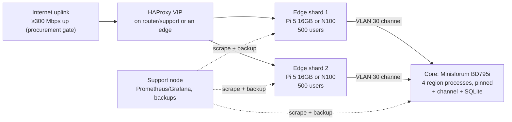

# Goal G1 — 1000 Concurrent Users: Definition + Device Elimination Deep Dive

**Date:** 2026-10-02. **Companion to:**
`EDGE-MICRO-DATACENTER-AND-SDN-PLAN.md` (same folder).
**Status:** goal defined, devices scored against published empirical data
and the engine's own benchmark definitions. **No device has passed yet** —
passing requires the live benches in Section 7 running on the physical
board. This document eliminates what arithmetic and measured proxy
benchmarks already rule out, so money is only spent on survivors.

---

## 1. The goal, defined precisely (G1)

Joey's words (2026-10-02): *"For my first architecture I'd like to be able
to host 1000 concurrent users at max load without dropping off or losing
connections or stalling out the resources on the compute device it'll
live on."*

That sentence becomes testable as follows.

### 1.1 What "1000 concurrent users" means

| Term | Definition (fixed for G1) |
|---|---|
| Concurrent user | Authenticated session, in-world avatar, WebSocket connected to an edge, receiving 30 Hz deltas. Lobby-idle and character-select do not count. |
| Pod | One micro-datacenter from the companion plan (§2.1 minimum pod or larger). G1 is a **pod-level** goal; §5 also scores the stricter single-device reading. |
| Distribution W1 (the G1 test) | 1000 users spread across 4 regions (250/region) on the pod's core tier, ~5000 simulated entities total (players + NPCs/creatures from the living-sim substrate). |
| Distribution W2 (stress, reported not gated) | 1000 users converging on one region/event. W2 numbers are recorded; failing W2 does not fail G1, but the W2 breaking point must be known and written down. |
| Max load | The repo's own transport-bench shape: every client receives a **1.2 KB delta at 30 Hz** (the "busy area" delta defined in `packages/engine-core/src/net/transport-bench.ts`) and sends **48 B intents**. Gameplay load uses live intents through the gateway; the transport bench is the ceiling test. |
| Duration | 10 min ramp to 1000, **60 min soak at 1000**, 10 min drain. Plus the E5/B6 10-min soak rules remain in force for smaller runs. |

### 1.2 Pass/fail gates (any single failure = G1 not met on that hardware)

**Connections (the "no dropping off" clause):**
- G1-C1: **Zero** involuntary disconnects during the soak.
- G1-C2: **Zero** lost deltas — tick sequence at every edge is strictly
  sequential (same assertion as E5/B6).
- G1-C3: Zero silently hung channel requests (E5/B5 blackout rule).

**Stall (the "no stalling out" clause):**
- G1-S1: Core tick duration **p99 < 33.3 ms** at 30 Hz in every region;
  tick overruns (>33.3 ms) on < 0.1% of ticks.
- G1-S2: Edge router latency p99 < 50 ms (H1's budget); channel hop
  p99 < 1 ms on-pod (E5/B1 budget — the budgets do not move).
- G1-S3: CPU: no single core ≥ 95% sustained for > 5 min; all-core
  average ≤ 70% per node during soak (30% headroom is the definition of
  "not stalling out its resources").
- G1-S4: RAM ≤ 80% per node, zero swap activity, RSS growth < 100 MB
  over the soak (E5/B6 rule).
- G1-S5: Network ≤ 70% of measured link rate sustained per node
  (≤ 85% in any 1-min window).
- G1-S6: Zero thermal-throttle events (Pi `get_throttled` clean, x86
  package-temp headroom > 10 °C from limit at soak end).
- G1-S7: SQLite checkpoints/snapshot writes cause no tick > 33.3 ms
  (stall is stall, whatever causes it).

**Recovery (inherited from E4/N9, run once at full load):**
- G1-R1: Kill one edge at 1000 users → its users reconnect per the E4
  contract; core tick gates never blink.
- G1-R2: Kill the core process → edges hold all 1000 connections and
  serve `core.unavailable`; resync completes on restart (E5/B5 timings
  recorded).

### 1.3 What G1 is not

Not 1000 idle sockets. Not a single-device promise (see §5.3 for that
stricter reading and its verdict). Not a WAN promise: G1 is measured on
the pod LAN; the site's Internet uplink must separately carry the same
288 Mbps (see §3) or G1 holds locally and starves remotely — that is an
ISP/uplink procurement fact, recorded here so it is never confused with a
compute failure.

---

## 2. The empirical evidence base

Every number used for elimination below comes from a published measurement
or the repo itself. Sources are listed in Section 9; method notes matter:

- **Geekbench 6 / PassMark** are *proxy* benchmarks. They rank CPUs
  honestly against each other; they do not predict tick milliseconds.
  They are used here only for **relative elimination** (a chip with 9% of
  the winner's multi-core throughput does not get the benefit of the
  doubt as a 1000-user core), never as a capacity claim.
- **The repo's transport bench is ground truth for fan-out shape:**
  30 Hz, 1.2 KB deltas out, 48 B intents in, measuring server CPU (% of
  one core), broadcast-loop p50/p99, RSS, and delivered-vs-sent (nothing
  dropped), at 100/250/500/1000 clients by default.
- **The repo already has one transport verdict** (`docs/DECISIONS.md`,
  2026-09-30): uWebSockets.js vs `ws`, measured at 100–2000 clients —
  uWS used 25–35% less server CPU; at 2000 clients `ws` saturated a core
  and fell behind (57k of 60k msg/s) while uWS held at 69% of one core.
  That was transport alone (no sim, no encoding) on a desktop-class dev
  machine. Every SBC below is slower than that machine; the elimination
  math accounts for it.

### 2.1 Candidate silicon, measured

| CPU (board) | Cores | GB6 single | GB6 multi | PassMark single | PassMark multi | Multi vs 7945HX |
|---|---|---|---|---|---|---|
| BCM2712 — Raspberry Pi 5 | 4× A76 @2.4 | ~833 (stock) | ~1805 | — | — | **9%** |
| Intel N5105 — youyeetoo X1 / LattePanda 3 Delta | 4c/4t @2.9 | — | ~1553 (X1 board) | 1492 | 3987 | **8%** |
| Intel N100 — LattePanda Mu / N100 boxes | 4c/4t @3.4 | — | ~3288 (Mu board) | 1880 | 5307 | **17%** |
| Intel i5-1340P — LattePanda Sigma | 4P+8E/16t | 2374 | 10611 | — | — | **55%** |
| AMD Ryzen 9 7945HX — Minisforum BD790i/795i | 16c/32t @5.4 | 2906 | 19413 | 4076 | 55213 | **100%** |

Read the rightmost column as "how much simulation computer is this,
relative to the strongest candidate." The Pi 5 and the N5105 are,
multi-core, roughly one-tenth of a BD board. The N100 is one-sixth. The
Sigma is over half — a different species from the other small boards.
Single-core (what one tick thread feels): Pi ≈ 29% of the 7945HX, Sigma
≈ 82%.

Power context from reviews: Pi 5 idle ~3.2 W, full stress ~9.8 W. An N100
system idles ~7.5–10 W at the wall and stresses around 17–20 W. The
7945HX is a 100 W TDP-class part (configurable to ~120 W). Performance-
per-watt is computed per role in §5 — raw watts alone eliminate nobody;
delivering G1 per watt is the metric.

### 2.2 Network, measured

| Link | Measured / known | Note |
|---|---|---|
| Pi 5 onboard GbE | **~932–942 Mbps** iperf3 (multiple independent reviews) | The Pi edge ceiling; USB/PCIe 2.5GbE adapters exist but spend the Pi's single PCIe lane that NVMe wants — board-level either/or, recorded as a constraint |
| 2.5GbE (x86 SBCs, BD) | ~2.35 Gbps practical planning figure | To be confirmed per board in H5 |
| VXLAN encapsulation | ~50 bytes/packet overhead, overlay MTU 1450 on a 1500 underlay | CPU encap/decap cost is H5's question on SBC cores; this is why EVPN stays gated in the companion plan |

### 2.3 WebSocket fan-out, measured (external, indicative)

Published Node WebSocket comparisons at ~1000 connections put the `ws`
library in the ~100–150k msg/s class and uWebSockets.js several× higher
(~500k msg/s class) on desktop hardware — consistent with the repo's own
finding that uWS is the transport that survives 2000 clients. G1 needs
30,000 sends/s per pod (§3), which is not a large message rate; the risk
is never raw msg/s, it is **per-send CPU cost × message size on a slow
core**, which is precisely what the repo bench measures per board.

---
## 3. The G1 workload model (arithmetic, checked twice)

All figures use the repo's bench constants: 1000 users, 30 Hz,
1.2 KB delta out, 48 B intent in.

### 3.1 Bandwidth

```
Outbound deltas : 1000 × 1200 B × 30/s = 36.0 MB/s = 288 Mbps per pod
Per user        : 288 kbps outbound
Intent inbound  : at bench shape (intent/tick) 30,000 msg/s = 11.5 Mbps
                  at 10 Hz gameplay intents    10,000 msg/s =  3.8 Mbps
```

| Scenario (delta size) | Pod outbound | One Pi edge (all 1000) | Split over 2 edges | Split over 4 edges |
|---|---|---|---|---|
| 0.5 KB (quiet area) | 123 Mbps | 13% of Pi link | 7% | 3% |
| **1.2 KB (repo busy-area — G1 basis)** | **288 Mbps** | **31%** | **15%** | **8%** |
| 5 KB (crowded event) | 1229 Mbps | **130% — impossible** | 65% | 33% |
| 10 KB (pathological) | 2458 Mbps | impossible | 130% — impossible | 65% |

Conclusions the table forces:
1. At the repo's own busy-area delta, **bandwidth does not eliminate a
   single Pi edge** (31% of its measured link). Anyone who says "a Pi
   can't do 1000 users because Gigabit" is wrong at 1.2 KB.
2. At event-scale deltas (5 KB), a single Pi edge is arithmetically dead
   and a 2-edge split is at the 70% gate's edge. Delta size discipline
   (interest management, already the engine's direction) is worth more
   than any board upgrade.
3. The pod's **WAN uplink** must carry the same 288 Mbps upstream to
   real players. Most residential uplinks fail this before any SBC does.

### 3.2 Message rate and CPU (the real edge fight)

- Fan-out: 30,000 sends/s per pod; 7,500/s per edge at a 250-user split.
- The repo's desktop measurement: `ws` saturates one core at 2000
  clients (60k sends/s attempted, 57k delivered); uWS holds 2000 at
  69% of one core. Halving to G1's 1000 clients suggests transport alone
  is a substantial fraction of one *desktop* core with `ws`, less with
  uWS — before delta encoding, before TLS (which HAProxy absorbs), on
  cores 3–10× slower than the desktop's. **This, not bandwidth, is the
  Pi/N5105/N100 edge question**, and it is answered per board by running
  `bench:transport` on the board, not by argument.
- RAM is not the fight: even a pessimistic 128 KB of buffers per
  connection is ~125 MB per 1000 connections. The 16 GB Pi and 16 GB
  Sigma are both fine; 4 GB variants are eliminated on this line alone
  once OS + metrics + headroom are counted (see §5).

### 3.3 Core (tick) load

The tick's true cost at 1000 players + ~4000 NPCs is **not knowable from
proxy benchmarks** — it depends on the engine's systems (physics crowd,
brains, living-sim slices as they land). What elimination can honestly
use today:

- A region's tick thread is single-core-bound first. Proxy single-core:
  Pi ≈ 29%, Sigma ≈ 82%, N100/N5105 in the Pi's neighbourhood or below,
  of the 7945HX.
- Multi-region packing is multi-core-bound second: 4 regions (W1) want
  4 honest tick cores plus channel/SQLite/OS. Pi = 4 cores total. N100 =
  4. Sigma = 4 performance cores (+8 efficiency cores for background).
  7945HX = 16.
- The C++ addons (Jolt/Recast/FastNoise2/scatter) are x86-built today.
  An ARM core additionally requires the ARM build matrix work — a real,
  schedulable cost that counts against ARM-as-core in elimination, and
  zero against ARM-as-edge (no addons at the edge).

---

## 4. Elimination rules (applied uniformly, no favourites)

A device is **eliminated for a role** when any rule fires. "Eliminated"
always names the role — a board eliminated as core may survive as edge.

- **X1 (arithmetic):** required sustained bandwidth > 70% of the node's
  measured link at G1's delta size.
- **X2 (single-core proxy):** GB6/PassMark single-core < 40% of the
  7945HX **and** the role is simulation core → eliminated as a G1 core.
  (40% is a judgement line, stated openly: below it, a tick thread has
  under half the winner's headroom before the sim even starts.)
- **X3 (multi-core proxy):** multi-core < 25% of the 7945HX **and** the
  role requires ≥ 4 simultaneous regions → eliminated as sole G1 core.
- **X4 (platform):** role requires C++ addons and no build exists for
  the architecture → eliminated until that work is scheduled.
- **X5 (memory):** < 8 GB RAM for edge, < 16 GB for core → eliminated
  (OS, page cache, metrics, and the no-swap gate G1-S4).
- **X6 (storage):** no NVMe-class storage path → eliminated for any role
  touching SQLite or sustained logs (microSD sustained-write and wear
  behaviour is measured and poor; this rule is not controversial).
- **X7 (thermal):** cannot run its own stress test 10 min without
  throttling in its intended enclosure class → eliminated until cooling
  is redesigned.
- **S (survives to live bench):** none of the above fired. Survival is
  not passing — Section 7's benches on the physical board decide.

---

## 5. Device-by-device verdicts

### 5.1 As simulation core for G1 (1000 users, W1)

| Device | Verdict | Rules / reasoning |
|---|---|---|
| Raspberry Pi 5 16GB | ❌ **Eliminated** | X2 (29% single), X3 (9% multi), X4 (no ARM addon builds) |
| youyeetoo X1 (N5105) | ❌ **Eliminated** | X2/X3 (8% multi; 4 threads); x86 addons fine, the CPU is not there |
| LattePanda 3 Delta (N5105) | ❌ **Eliminated** | Same silicon as X1; 8 GB SKU also trips X5 |
| LattePanda Mu (N100) | ❌ **Eliminated as sole core** | X3 (17% multi, 4 threads for 4 regions + OS); strongest of the small x86, still one-sixth of the BD |
| LattePanda Sigma (i5-1340P) | ⚠️ **Survives, conditional** | No rule fires: 82% single, 55% multi. Conditions: 16 GB soldered RAM caps entity growth; 4 P-cores means W1's 4 regions + channel/SQLite compete; must prove G1-S1/S3 in H3. Honest label: *possible, not recommended as the first architecture's only core.* |
| Minisforum BD795i (7945HX) | ✅ **Survives — the G1 core** | No rule fires; 16c/32t, up to 96 GB, dual NVMe, 2.5GbE, PCIe x16 spare for 10GbE. Must still pass §7 on the bench. |

### 5.2 As edge node for G1

Scored two ways: **solo edge** (one node carries all 1000) and
**shard edge** (250–500 users per node, the pod pattern from the
companion plan).

| Device | Solo edge (1000) | Shard edge (250–500) | Reasoning |
|---|---|---|---|
| Pi 5 16GB + NVMe | ⚠️ Provisional — CPU question | ✅ Survives | Bandwidth passes (31%). Transport CPU at 1000 on A76 cores is the open question: repo desktop data says `ws` is heavy at this scale; uWS on ARM (prebuilt availability + bench) decides. At 250–500/node the same math has 2–4× headroom. |
| youyeetoo X1 / 3 Delta (N5105) | ❌ Eliminated | ⚠️ Provisional (250 only) | Weakest x86 multi-core in the set (below the Pi on GB6 multi at board level); solo 1000 fails the headroom gate G1-S3 by proxy. |
| LattePanda Mu (N100) | ⚠️ Provisional | ✅ Survives | ~2× the N5105's board multi-core; dual-2.5GbE SKUs fix the NIC line entirely. Solo verdict waits on its `bench:transport` run. |
| LattePanda Sigma | ✅ Survives | ✅ Survives | Desktop-adjacent single-core; dual 2.5GbE. Using a Sigma as a pure edge wastes its core potential — it's the premium/fallback edge. |
| Minisforum BD | ✅ Survives (overkill) | ✅ | The single-device reading's edge (§5.3). As a dedicated edge in a pod it's wasted watts. |

### 5.3 The strict single-device reading

If "the compute device it'll live on" means **one board runs everything**
(edge + core + support) for 1000 users:

- **Only the BD795i-class survives scoring**, with edge and core as
  separate pinned processes on the same board (the split is a process
  boundary, not a hardware mandate — E1–E4 work identically).
- The Sigma is the runner-up: survives CPU scoring, but 16 GB soldered
  RAM + one 2.5GbE path carrying player, channel, and backup traffic on
  a single board leaves no headroom story. Classified ⚠️ bench-or-bust.
- Everything else is eliminated by X2/X3/X5 combinations above.

Recommendation, stated plainly: **G1's first architecture = BD core +
two Pi 5 (or N100) edge shards + support node** (the companion plan's
minimum pod). The single-BD variant is a legitimate lab configuration
for the §7 benches and a fallback if budget forces it — and the benches
will say exactly what it costs in headroom.

### 5.4 Eliminated from the whole programme (any role)

- Any 2–4 GB RAM variant of anything (X5).
- Any node whose only storage is microSD/eMMC for a SQLite- or
  log-bearing role (X6). eMMC is acceptable for a pure edge's OS.
- Fanless enclosures for core-tier boards at sustained load until an
  X7 pass exists (the fanless N100 stress data shows power-limit
  throttling to ~2.6 GHz — fine for edge, disqualifying for a tick).
- Pi 4 and older, RK3566-class and older SBCs: an order below the Pi 5
  on every proxy; including them would be theatre, not diligence.

---

## 6. The surviving G1 architecture (first build)



Why two shards at 500 rather than one edge at 1000: G1-R1 (kill an edge
at full load) is only meaningful with somewhere for users to land, and
the shard split converts every CPU question in §5.2 from "maybe" to
"headroom." The BD runs W1's four regions pinned per the companion
plan §3.3, one core reserved for channel/SQLite/OS.

---

## 7. Live bench protocol (how a survivor actually passes)

Run in order; stop at the first failed gate and record it — a failed
bench is a result, not an embarrassment. All results to
`docs/MICRODC-RESULTS.md` (pod inventory hash, board/firmware, ambient
temp, commit) per the companion plan §6.

1. **B-TRANS (per edge candidate):** `npm run bench:transport` at
   250/500/1000 clients, both transports where loadable. Pass = at the
   device's assigned shard size, CPU < 70% of one core equivalent
   sustained, broadcast p99 < 5 ms (inside the 33 ms tick with room),
   zero dropped (delivered == sent).
2. **B-TICK (per core candidate):** engine regions at W1 entity counts,
   scripted player load; record tick p50/p99/p99.9 per region while
   adding regions. Pass = G1-S1 with 4 regions (BD) or the region count
   claimed (Sigma).
3. **B-E2E (the G1 run):** k6/client swarm → HAProxy → 2 edges → BD
   core, §1.1's ramp/soak/drain, E6 metrics live. Pass = every gate in
   §1.2.
4. **B-KILL:** G1-R1/R2 drills inside the soak's final 15 min.
5. **B-THERM:** the same soak with power + throttle logging (H7);
   zero-throttle gate G1-S6.

Devices that fail B-TRANS/B-TICK at their assigned role are eliminated
*for real* at that point, and §5's table gets an appended correction —
the proxy table never overrules a measurement.

---

## 8. What would change these verdicts

- **Interest management shipping** (smaller effective deltas) moves
  every bandwidth line down and rehabilitates solo-Pi-edge at 1000.
- **An ARM addon build matrix** (Jolt/Recast/scatter on aarch64) removes
  rule X4 — the Pi would still fail X2/X3 as a G1 core, but an
  RK3588-class board (not scored here) would deserve a fresh look.
- **uWS ARM prebuilds proving out** in B-TRANS upgrades Pi/N100 solo-edge
  from provisional to surviving.
- **A second BD board** converts G1's core from "one strong node" to a
  failover pair; the goal worth defining next (G2) is probably
  *2000 users or 1000 users with core-node loss*, and this document's
  gates extend to it mechanically.

---

## 9. Sources (all retrieved 2026-10-02)

Engine-internal:
- `packages/engine-core/src/net/transport-bench.ts` — 30 Hz, 1.2 KB
  delta, 48 B intent, CPU/broadcast/RSS/drop metrics, default client
  counts 100–1000.
- `docs/DECISIONS.md` (2026-09-30) — uWS vs `ws` measured verdict:
  25–35% less CPU at 100–2000 clients; `ws` saturating a core at 2000
  (57k/60k msg/s), uWS holding at 69%.

CPUs:
- Ryzen 9 7945HX: Geekbench 6 2906/19413, PassMark 4076/55213,
  83.2 GB/s memory bandwidth. https://www.topcpu.net/en/cpu-c/amd-ryzen-9-7945hx-vs-intel-core-i9-13900h
- Intel i5-1340P: Geekbench 6 2374/10611, 28 W TDP. https://www.cpu-monkey.com/en/compare_cpu-intel_core_i7_8565u-vs-intel_core_i5_1340p
- Intel N100 vs N5105: PassMark 5307/3987 multi, 1880/1492 single;
  N100 6 W, N5105 10 W TDP. https://www.cpubenchmark.net/compare/5157vs4412/Intel-N100-vs-Intel-Celeron-N5105
- Raspberry Pi 5: Geekbench 6 ~833/1805 stock (Geerling, SDRAM tuning
  article); idle 3.2 W / stress 9.8 W (Geerling via Tom's Hardware).
  https://www.jeffgeerling.com/blog/2024/raspberry-pi-boosts-pi-5-performance-sdram-tuning/
- LattePanda Mu (N100) board Geekbench 6 1237/3288; youyeetoo X1
  (N5105) board scores in the same review's comparison.
  https://magazinmehatronika.com/en/lattepanda-mu-review/

Network / platform:
- Pi 5 iperf3 ~942 Mbps (CNX Software review) and ~933 Mbps (Tom's
  Hardware) — two independent measurements agreeing.
  https://www.cnx-software.com/2023/11/05/raspberry-pi-5-review-raspberry-pi-os-bookworm-benchmarks-power-consumption/
- VXLAN ~50 B/packet overhead, MTU 1450 planning figure (Proxmox SDN
  deep dive). https://github.com/harryvasanth/harryvasanth.github.io/blob/HEAD/_posts/2023-02-15-proxmox-sdn-architectural-deep-dive.md
- Node WebSocket library classes at 1000 connections (`ws` ~100–150k
  msg/s, uWebSockets.js ~500k+ msg/s, indicative).
  https://github.com/moro-js/moro/blob/HEAD/docs/UWEBSOCKETS_GUIDE.md
- N100 system power: idle 7.5–7.6 W, all-core stress 17.2–19.8 W at the
  wall (MINIX Z100-0dB, CNX Software).
  https://www.cnx-software.com/2024/03/09/minix-z100-0db-review-fanless-intel-n100-mini-pc-ubuntu-22-04/

*Proxy benchmarks rank; they do not certify. Every ✅/⚠️ above is an
invitation to a named bench in Section 7, and a bench result replaces a
proxy verdict wherever they disagree — appended as a correction, never
edited away.*
