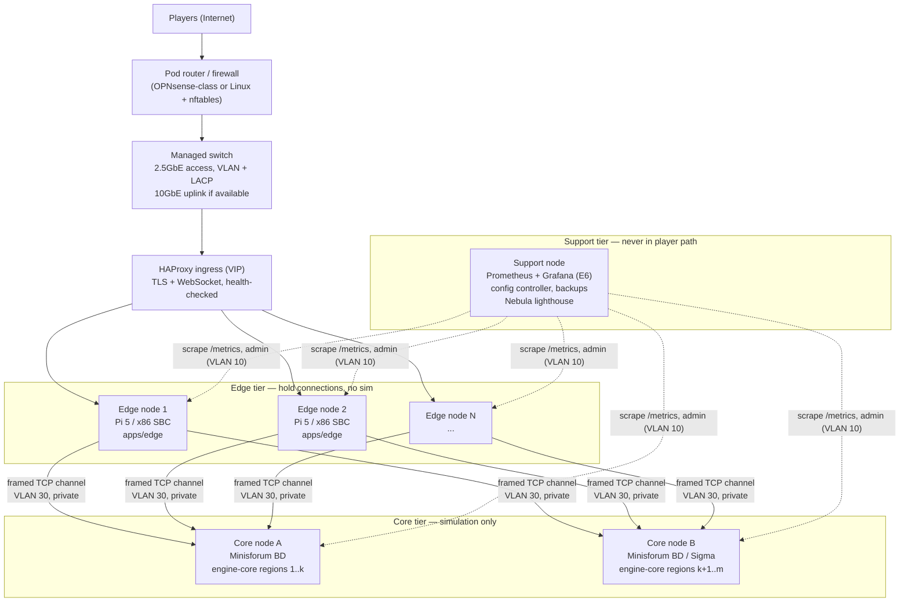
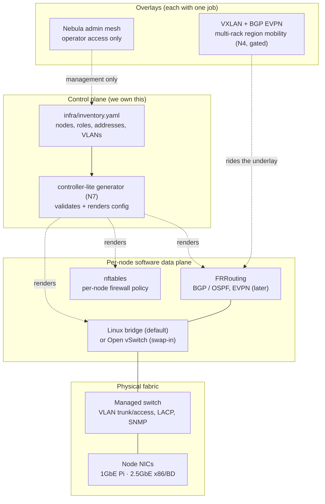
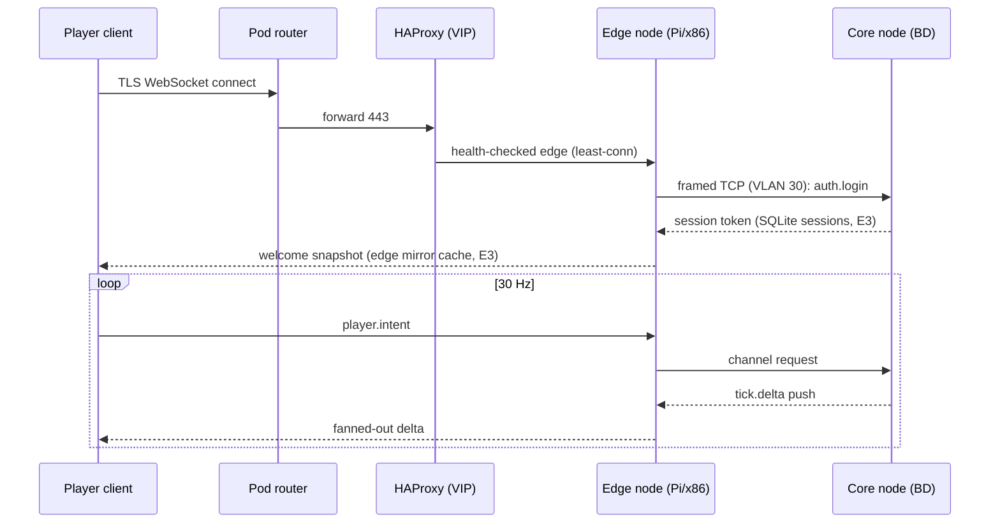

# Edge Micro-Datacenter + SDN Stack — Build Plan

**For:** Claude (the implementing agent) and Joey (hardware/ops).
**Goal:** run the MMO engine's edge/core split on a super-compact, self-owned
micro-datacenter built from SBCs and compact x86 boards, with a software-defined
network (SDN) stack that a solo operator can actually run.

**Companion plans (do not duplicate them):**
- `~/workspace/your_files/mmo-engine-quest-system/EDGE-CORE-SPLIT-BUILD-PLAN.md`
  — the E1–E6 software slices (edge process, framed-TCP channel, core
  decoupling, degraded mode, E5 benchmarks, E6 network-health metrics).
  This plan is the *physical + network* layer underneath those slices.
- The mmo-engine skill (`~/workspace/skills/mmo-engine/SKILL.md`) — locked
  decisions. Nothing here overrides them; where this plan extends them, it
  says so explicitly.

**Status:** design + build plan. No hardware has been purchased or benchmarked
for this yet, and **no player-capacity number in this document is a promise**.
Every capacity figure is a benchmark question with a named test (Section 6),
not an estimate dressed up as a fact.

---

## 0. The one-paragraph version

Player traffic lands on cheap, replaceable **edge nodes** (Raspberry Pi 5
class), whose only job is holding WebSocket connections and fanning out
deltas. Simulation lives on a small number of **heavy core nodes**
(Minisforum BD-class, 16-core Ryzen on a Mini-ITX board). Between them sits
an SDN stack made of boring, swappable parts: managed-switch VLANs as the
foundation, Linux bridges first (Open vSwitch as the swap-in), FRRouting
(FRR) for routing and — only when a second rack justifies it — BGP
EVPN/VXLAN overlay, HAProxy for player ingress, nftables on every node,
Nebula for the admin mesh, and a small config generator we own ("controller-
lite") that turns one inventory file into every node's network config.
No Kubernetes. No cloud controller. Every choice sits behind a seam so it
can be replaced.

---

## 1. Design principles (inherited, not negotiable here)

1. **Edge/core split is the load-bearing idea.** The edge never simulates;
   the core never holds player connections (skill, locked 2026-10-01).
   Hardware tiers exist to serve that split, not to blur it.
2. **Swappable by design.** Every network component is chosen behind a
   narrow interface: Linux bridge ↔ Open vSwitch, Nebula ↔ Headscale,
   static routes ↔ FRR. If a part becomes a problem, it is replaced, not
   worked around forever.
3. **Boring tech wins.** Same posture as the ByteByteGo alignment scan:
   distribute for fault isolation, not fashion. Kubernetes and its CNI
   ecosystem (Cilium/Calico etc.) were already dropped as *not our deploy
   story*; a 4–10 node shelf does not need a container orchestrator's
   control plane eating the same CPUs the tick needs.
4. **The Node-only rule covers engine services, not support tooling.**
   FRR, HAProxy, Prometheus/Grafana (Go binaries, per Joey 2026-10-01) are
   daemons/binaries alongside the engine, exactly like the observability
   stack in E6.
5. **Cost/benefit gate, like the shader rubric.** Every node must justify
   its watts. The metric that matters is *sustained players (or connections)
   per watt per dollar*, measured, not vibes.
6. **Determinism stops at the core door.** The network must never become a
   source of simulation nondeterminism: the core consumes intents from its
   queue in tick order regardless of which edge delivered them.

---

## 2. Physical topology

One "pod" = one shelf/rack unit group that could run a small live service
by itself. Pods replicate; they do not stretch (no pod depends on another
pod's switch being alive).



**Reading the diagram:** every box maps to something real. `apps/edge`,
`packages/channel`, `packages/engine-core`, `packages/nethealth` are the
repo packages from the edge/core plan (E1–E6). The router, switch, HAProxy,
FRR, bridges/OVS, and Nebula are this plan's additions; each appears again
in Section 5 with its job, license, and swap alternative. Support-tier
services must never sit in the player path: if the support node dies, the
game stays up and only graphs/backups pause.

### 2.1 The minimum viable pod

| Slot | Count | Example hardware | Role |
|---|---|---|---|
| Router/firewall | 1 | Any dual-NIC x86 SBC or the support node wearing a second hat (documented compromise) | WAN NAT, inbound firewall, HAProxy VIP owner |
| Switch | 1 | Managed 2.5GbE, VLAN/LACP/SNMP capable | The pod's physical fabric |
| Edge nodes | 2 | Raspberry Pi 5 (16GB) or x86 SBC | `apps/edge`; two so one can die/reboot without dropping the pod |
| Core node | 1 | Minisforum BD795i-class | `packages/engine-core`, several pinned regions |
| Support node | 1 | Pi 5 or retired x86 SBC | Prometheus/Grafana, controller-lite, backups, Nebula lighthouse |

Everything beyond this (second core, more edges, second switch) is growth,
driven by Section 6's numbers.

### 2.2 Power and cooling budget (the real constraint)

Peak-nameplate math for the minimum pod, to be replaced by measured draw
(H7 in Section 6):

| Item | Budget basis |
|---|---|
| Pi 5 edge ×2 | ~7W loaded each, 5V/5A supplies (headroom matters; undervolted Pis throttle and corrupt SD/NVMe writes) |
| BD core ×1 | 100W TDP class, up to ~120W configured; needs a real 120mm fan and unobstructed exhaust |
| Switch + router + support | ~15–35W combined, model-dependent |
| **Pod planning ceiling** | **~200W per pod shelf** until measurements say otherwise; UPS sized for 10 minutes at that draw, enough for clean SQLite checkpoint + shutdown |

Rules:
- No node runs at its thermal limit 24/7. Sustained-throttle = failed node
  (H7 soak must show zero throttle events on Pis, no thermal shutdowns
  anywhere).
- One failed fan must not cascade: core exhaust must not blow into edge
  intakes. In a compact enclosure, airflow layout is drawn before boards
  are mounted.
- All nodes auto-power-on after power loss (BIOS setting on x86; Pi
  behaviour verified per board) and boot into systemd services with no
  human at a keyboard.

---

## 3. Hardware tiers

### 3.1 Tier E-Pi — edge node, Raspberry Pi 5 (the floor)

| Item | Spec / rule |
|---|---|
| Board | Raspberry Pi 5, 16GB preferred (8GB acceptable for edge-only) |
| CPU | Quad Cortex-A76 @ 2.4GHz |
| Cooling | Active cooler, mandatory. A throttled edge lies about its capacity. |
| Storage | NVMe via PCIe HAT, OS + logs. **microSD is boot-fallback only** — never SQLite, never sustained logs. |
| Network | Onboard Gigabit Ethernet (this is the tier's ceiling — see §3.5) |
| Power | Official-class 5V/5A supply; PoE only with a HAT rated for Pi 5 draw |
| Runs | `apps/edge`, HAProxy (if wearing the ingress hat), FRR (later slices), Nebula client |
| Never runs | engine-core, C++ addons, bake jobs, Grafana |

**Why this tier exists:** it is the cheapest possible "max perf on Pi"
discipline target. If the edge is clean here — no per-packet allocation,
batched fan-out, backpressure respected — it is clean everywhere.

### 3.2 Tier E-x86 / C-Light — x86 SBCs (LattePanda, youyeetoo, peers)

| Board class | CPU shape | Where it fits |
|---|---|---|
| youyeetoo X1 class | Intel N5105, quad-core, ~10W TDP | Edge node, or support node; cheapest x86 |
| LattePanda Mu class | Intel N100 compute module | Edge node; cluster-friendly form factor |
| LattePanda 3 Delta class | Intel N5105, 8GB | Edge/support; same silicon family as X1 |
| LattePanda Sigma class | Intel i5-1340P (12c/16t), 16GB LPDDR5, **dual 2.5GbE** | Light core (small region, dungeon instances), or premium edge with separate public/channel NICs |

Rules:
- **x86 is the addon-compatible tier.** The existing C++ addons (Jolt,
  Recast, FastNoise2, scatter) are built for x86 Windows/Linux today.
  A Pi *core* means an ARM build matrix for every addon; a Pi *edge*
  needs no addons at all. This asymmetry is deliberate.
- Dual-NIC boards (Sigma) are preferred for any node that both faces
  players and talks to cores: public traffic and channel traffic get
  physically separate paths into different VLANs.
- Light cores pin one region per process; core count sells regions, not
  magic — measure per-region tick cost (H4) before stacking regions.

### 3.3 Tier C-Heavy — core node, Minisforum BD series

| Item | Spec / rule |
|---|---|
| Board | Minisforum BD790i/BD795i-class Mini-ITX "mobile on desktop" |
| CPU | AMD Ryzen 9 7945HX, 16 cores / 32 threads, up to 5.4GHz |
| RAM | DDR5 SODIMM, 64GB minimum, 96GB ceiling; regions + SQLite page cache eat RAM first |
| Storage | Dual M.2 NVMe: OS on one, `sim.db`/SQLite + snapshots on the other; backup target is the support node, not the same board |
| Network | Onboard 2.5GbE; the PCIe x16 slot is reserved for a 10GbE NIC if H5 shows 2.5GbE is the bottleneck — decide by measurement, not by catalogue |
| Power/cooling | 100W TDP class (up to ~120W): full-size 120mm cooling, the pod's dominant heat source |
| Runs | `packages/engine-core` (multiple region processes, CPU-pinned), channel server, node exporter/metrics |
| Never runs | Player WebSockets, HAProxy public ingress (keep the blast radius clean), bake sweeps while live regions are hot |

**Pinning rule:** each region process pins to dedicated physical cores
(taskset/cgroup), SMT siblings counted honestly, one core left for OS +
channel + SQLite flusher. The tick is a latency budget; core neighbours
are a benchmark variable (H4), not an afterthought.

### 3.4 Tier S — support node

One Pi 5 or x86 SBC per pod: Prometheus + Grafana (E6's Go binaries),
controller-lite (Section 7), backup receiver (nightly `sim.db` snapshots
from every core, restore-tested), and the Nebula lighthouse (Section 5.6).
Two support nodes when the pod matters; they replicate Prometheus config
and backups, they do not cluster (boring > clever).

### 3.5 The honest Pi math (why "how many players" is a benchmark)

Two different questions get conflated:

1. **Connections held** (edge): mostly RAM + file descriptors + fan-out
   bandwidth. Cheap per idle connection.
2. **Players simulated** (core): tick CPU. Nothing to do with the Pi.

The edge ceiling on a Pi 5 is its **Gigabit Ethernet**. The fan-out budget
per edge node is:

```
usable_bps  ≈ 0.7 × link_bps            (leave headroom; bursts are real)
bytes/sec   = players × delta_bytes_per_player_per_tick × 30 ticks/sec
players_max ≈ usable_bps / (8 × delta_bytes × 30)
```

`delta_bytes` comes from E5/B4's measurements at 1k/5k/10k entities — until
B4 runs, any players-per-Pi number is fiction. Section 6 (H1/H2) reruns
that math per tier with real deltas and reports **connections, active
players, and players-per-watt** separately. The same formula is why the
x86 edge tier exists: dual 2.5GbE Sigma-class edges raise the numerator
without touching the game design.

CPU-side, the edge threat is JSON/control-plane cost and GC pauses on the
fan-out path — exactly what E5/B4 (encode p99 < 5ms) and E6 metrics watch.
ARM vs x86 for that path is H2's question.

---
## 4. The SDN stack

"SDN" here does not mean a heavyweight controller appliance. It means:
**network behaviour is defined in data, generated into node config, and
versioned like code** — the same data-driven discipline as
`content/edge/routes.json`, applied one layer down.

### 4.1 Layer map



### 4.2 The picks, one by one

| Layer | Pick (default) | License | Why this one | Swap alternative |
|---|---|---|---|---|
| Physical fabric | Managed 2.5GbE switch, VLAN/LACP/SNMP | hardware | Cheapest real segmentation; SNMP feeds E6 observability | Second switch + LACP for redundancy (H6 drill) |
| Node switching | **Linux bridge + `ip`/`bridge` tooling** | GPL-2.0 (kernel) | Zero extra daemon, in-kernel, identical on ARM and x86; a Pi pays no userspace tax | **Open vSwitch** (Apache-2.0): OpenFlow programmability, fine-grained QoS, sFlow/NetFlow mirroring — adopt when a named feature is needed, measure the Pi cost first (H5) |
| Routing | **FRRouting (FRR)** | GPLv2-or-later (daemon use; see §10 note) | BGP/OSPF/EVPN in one suite; upstream describes it as running "from cheap SBCs to commercial grade routers"; it's the routing daemon inside SONiC/Cumulus-class stacks, so skills transfer | BIRD (GPLv2) if FRR ever misbehaves on ARM; static routes remain the always-available fallback |
| Overlay (multi-rack) | **VXLAN with BGP EVPN**, FRR as control plane | as FRR/kernel | Regions can move between core nodes without re-IPing edges; EVPN gives control-plane MAC/IP learning instead of flood-and-learn | Plain VLANs within one rack (the starting state — overlay is gated, §4.4) |
| Player ingress | **HAProxy** | GPLv2 (binary daemon) | C, event-driven, built for this: TCP/HTTP balancing, WebSocket tunneling, health checks, stick-tables; terminates TLS so edges stay dumb | The edge process itself behind DNS round-robin (documented degradation, not a strategy) |
| Node firewall | **nftables** | GPL-2.0 (kernel) | One policy language on every node, rendered from inventory; default-deny between segments | None — this is the floor, not a choice |
| Admin overlay | **Nebula** (Slack) | MIT | Certificate-based mesh, file-config (fits controller-lite), runs on ARM and x86, built-in firewall groups; lighthouse brokers connections, carries no traffic | **Headscale** (BSD-3-Clause, self-hosted Tailscale control plane) if Tailscale-client ergonomics ever matter more than file-config purity |
| Service discovery | Static registry rendered from inventory (hosts + HAProxy backends + Prometheus targets) | ours | A 10-node pod does not need Consul; the inventory *is* the registry | CoreDNS if name count outgrows files |
| Time sync | chrony | GPL-2.0 | Metrics, session expiry, and log correlation all assume honest clocks; cores timestamp ticks | systemd-timesyncd for edge-only nodes |
| Provisioning | cloud-init / Ansible over the Nebula mesh | Apache-2.0 (Ansible) | Nodes rebuild from inventory + playbooks, never from memory | Plain SSH + rendered scripts (the generator's output is the product either way) |

**Explicitly not adopted:** Kubernetes + CNI (Cilium/Calico/Flannel),
OpenDaylight/OpenStack-class controllers, ZeroTier-style hosted control
planes, and any SDN that requires a JVM or a cloud account on the player
path. Each is real software solving a bigger problem than a pod has;
adopting one would spend the operator (Joey, nights) instead of the
hardware. Recorded here so the question stays closed until scale reopens
it.

### 4.3 Segmentation plan (VLANs + addressing)

One pod = `10.42.0.0/16`. Addressing is rendered from inventory; the table
below is the seed every pod starts from.

| VLAN | Name | Subnet | Who lives there | May talk to |
|---|---|---|---|---|
| 10 | MGMT | 10.42.10.0/24 | Node management IPs, support node, switch management | Nebula mesh only inbound; admin only |
| 20 | INGRESS | 10.42.20.0/24 | HAProxy VIP, edge public interfaces | Internet (via router), VLAN 30 |
| 30 | CHANNEL | 10.42.30.0/24 | Edge↔core framed-TCP channel (`CORE_CHANNEL_PORT`, default 4000) | Edge + core nodes only; **no Internet route, ever** |
| 40 | DATA | 10.42.40.0/24 | Core SQLite backup streams, snapshot transfer, bake artifact delivery | Core + support only |
| 50 | LAB | 10.42.50.0/24 | Bake-time sim lab (C++→Wasm sweeps), load generators (k6) | Isolated; can be powered off in production hours |
| 60 | OBSERVE | 10.42.60.0/24 | Prometheus scrape paths, syslog/flow collectors | Support node inbound to all tiers |
| — | LOOPBACK | 10.42.255.0/24 (/32 per node) | FRR router-ids, VXLAN VTEPs (N4) | Routed within pod |

nftables baseline (rendered per role, default-deny both directions):
- **Edge node:** inbound 443/WS on INGRESS from HAProxy VIP; outbound to
  CHANNEL for core ports; outbound DNS/NTP; MGMT inbound from support +
  Nebula only.
- **Core node:** inbound on CHANNEL from edge IPs only; inbound MGMT/OBSERVE
  from support; outbound DATA for backups; **no inbound Internet, no
  player-facing ports** (mirrors E3's grep check at the network layer).
- **Support node:** the only node allowed to initiate MGMT connections;
  receives backups and scrapes everything; its compromise must not reach
  the channel VLAN except through the same edge-facing rules as anyone.

### 4.4 Routing and overlay, staged honestly

- **Stage 1 (ship first):** one switch, VLANs above, static routes,
  gateway = pod router. FRR installed but only doing loopback reachability
  + OSPF inside the pod (or nothing — static is fine at this size; the
  slice is about *rehearsing* FRR, not needing it).
- **Stage 2:** FRR eBGP between nodes (unnumbered or loopback-peered),
  nodes advertise their /32s and role subnets; switch becomes a dumb
  L2 fabric. Failover = routing reconvergence, drilled in N9.
- **Stage 3 (gated):** VXLAN + BGP EVPN across **two or more racks/pods**,
  VNI per segment (10020 INGRESS, 10030 CHANNEL, 10040 DATA). Gate: a
  named need — region migration between physical cores without edge
  reconfiguration — plus H5 showing VXLAN overhead keeps the E5 channel
  budget (p99 hop < 1ms on-pod). Inside one rack, VXLAN is cost without
  benefit and stays off.

The staging is the point: each stage is independently shippable and
independently reversible, per the swappability principle.

### 4.5 Traffic flows

Player join + play (steady state):



Failure behaviour (already specified in E4 — this is the network view):
- **Core node dies:** its edges see channel-down, answer
  `core.unavailable`, keep every WebSocket alive. HAProxy does nothing —
  the failure is one layer up and already handled.
- **Edge node dies:** HAProxy health checks drain it; new connections land
  on surviving edges; existing players' clients reconnect per the E4
  contract and receive the cached latest snapshot from the new edge.
  Simulation never noticed.
- **Switch dies (single-switch pod):** the pod is down; this is the known
  price of the minimum pod, removed by the second-switch growth step.
  Core nodes keep simulating locally and edges resync on fabric return —
  the split's fault isolation works at the network layer too.
- **Support node dies:** game unaffected; backups/metrics pause; alerted
  on recovery, missed-backup window reported, not hidden.

### 4.6 The admin mesh (Nebula)

Operator access never rides the player network. Nebula certificates are
issued per node + per operator device from an offline CA (kept with the
same care as the repo deploy key — never pasted into chat, never on a
player-facing node unencrypted). Groups map to roles: `op` may SSH MGMT
VLAN; `edge`/`core` nodes accept management only from `op`. The
lighthouse lives on the support node plus one off-pod instance (a $5-class
VPS is fine — it brokers peer discovery and carries no game traffic).
If Nebula is down, the fallback is physical/LAN access, documented, not
improvised.

---
## 5. Build slices N0–N9 (do them in order)

Same contracting style as E1–E6: exact files, exact behaviour, a done
checklist that can be verified without asking anyone a question. Repo
paths are relative to the engine repo root. New top-level directory:
`infra/` (network + hardware, deliberately outside `packages/` — it is
ops, not engine code).

### N0 — Inventory + addressing (the source of truth)

**Goal:** one file describes the pod. Everything else in this plan renders
from it.

**Files:**
```
infra/inventory.example.yaml      (create: the minimum pod from §2.1, fake IPs)
infra/inventory.schema.json       (create: JSON Schema for the below)
infra/README.md                   (create: what a pod is, how to add a node)
```

**Inventory shape (exact top-level keys):**
```yaml
pod: { name: "pod-a", subnet: "10.42.0.0/16" }
nodes:
  - { name: "edge-1", role: "edge", board: "rpi5-16gb",
      mgmt: "10.42.10.11", ingress: "10.42.20.11",
      channel: "10.42.30.11", loopback: "10.42.255.11/32",
      mac: "aa:bb:cc:dd:ee:ff" }
  # roles: edge | core | support | router ; boards: rpi5-16gb | lattepanda-* |
  # youyeetoo-x1 | minisforum-bd795i | generic-x86
vlans: [10, 20, 30, 40, 50, 60]   # meanings fixed by §4.3 — do not renumber
services:
  haproxyVip: "10.42.20.254"
  coreChannelPort: 4000           # must match EDGE-CORE plan E1 defaults
```

**Rules:** node names unique; every IP inside the pod subnet; role/board
from the enums above (schema rejects anything else); a node's `channel`
address is required iff role is `edge` or `core`.

**Tests:** schema validation test (valid example passes; duplicate name,
out-of-subnet IP, and edge-without-channel each fail naming the field).
Use the repo's existing test runner and Zod conventions — schema file is
documentation, the validator is TypeScript in N7.

**Done:** example inventory validates; README explains adding a node in
5 steps; no real MACs/IPs of Joey's home network committed (examples only).

### N1 — Physical fabric bring-up

**Goal:** switch + VLANs live, nodes reachable on MGMT.

**Files:** `infra/switch/RUNBOOK.md` (create: vendor-neutral checklist —
trunk/access port map per node role, LACP groups, SNMP read-only community
via secrets file, config backup command), `infra/switch/ports.example.csv`
(create: `port,node,vlan-mode,vlans,notes`).

**Done (manual checklist, ticked in the runbook):** every node pings its
MGMT gateway; a node plugged into an INGRESS access port cannot reach
VLAN 30 (negative test, recorded); switch config backed up beside the
runbook (not in git).

### N2 — Node baseline (every board, every tier)

**Goal:** any board becomes a pod node by running one playbook/script set.

**Files:**
```
infra/node/baseline.md        (create: ordered checklist)
infra/node/nftables/edge.nft  (create: §4.3 edge ruleset, addresses as {{placeholders}})
infra/node/nftables/core.nft  (create: core ruleset — no player ports)
infra/node/nftables/support.nft (create)
infra/node/chrony.conf        (create: pod-local sources first)
infra/node/journald.conf      (create: log size caps — NVMe is not infinite)
```

**Baseline rules (exact):** OS updates applied; password SSH off, key-only;
auto-power-on enabled where the board supports it; active cooling verified
under `stress-ng` 10 min with no throttle flags; NVMe SMART captured to
the node log; hostname = inventory name.

**Done:** nftables ruleset loads (`nft -c -f` clean) on ARM and x86;
external port scan of a core node from the INGRESS VLAN shows zero open
player ports; clock offset vs pod source < 50ms.

### N3 — FRR routing (Stage 2 of §4.4)

**Files:** `infra/frr/frr.conf.template` (create: zebra + bgpd, one
eBGP ASN per pod `65042`, nodes advertise loopback/32 + role subnets,
BFD fast timers off — SBC CPUs first), `infra/frr/RUNBOOK.md`
(verification commands: `show bgp summary`, `show ip route`, expected
output shapes).

**Done:** kill one edge's link; BGP reconverges and HAProxy drains it
without manual touches; routes match runbook expectations; FRR CPU on a
Pi 5 at pod scale < 5% sustained (measured, recorded — if not, Stage 1
static remains the default and this slice reports that honestly).

### N4 — VXLAN + EVPN overlay (GATED — do not build until the gate opens)

**Gate (all three required):** (1) a second physical rack/pod exists or a
region must migrate between cores without edge changes; (2) H5 shows
VXLAN keeps the E5 hop budget on-pod; (3) Joey explicitly opens the gate.

**Files (when built):** `infra/frr/evpn.md`, VNI map extending §4.4,
`advertise-all-vni` config fragment, symmetric IRB notes.

**Done (when built):** a region's core process restarts on the other core
node; edges keep channel sessions to the same /32; no edge config change;
packet capture shows UDP 4789 with the expected VNI.

### N5 — HAProxy player ingress

**Files:** `infra/haproxy/haproxy.cfg.template` (create), `infra/haproxy/RUNBOOK.md`.

**Config contract (exact):** TLS terminates here; WebSocket backends =
edge nodes from inventory; balancing `leastconn`; health check = edge
`GET /health` (E1) every 2s, 2 failures drains; `timeout tunnel 1h` for
WebSockets; stats socket local-only (never published); when all edges are
down, HAProxy serves a static "world is restarting" page (same words as
E1's `core.unavailable` message — one voice everywhere).

**Done:** pull one edge's cable mid-soak (k6, E6): no new connection
errors; existing-client behaviour matches the E4 contract; stats show the
drain.

### N6 — Nebula admin mesh

**Files:** `infra/nebula/config.template.yaml`, `infra/nebula/RUNBOOK.md`
(CA ceremony: offline generation, cert issuance per node/operator,
revocation steps, lighthouse setup).

**Done:** operator laptop reaches every node's MGMT IP over the mesh and
nothing else (firewall groups verified by attempted cross-role access);
player VLANs unreachable over Nebula (negative test); CA private key is
not on any pod node (checklist attestation in the runbook).

### N7 — Controller-lite (the SDN "controller")

**Goal:** the generator that makes this SDN instead of a pile of SSH
sessions. Small Node/TypeScript tool, repo-conventional.

**Files:**
```
infra/controller/package.json     (workspace member)
infra/controller/src/load.ts      (parse + validate inventory vs schema)
infra/controller/src/render.ts    (inventory -> frr.conf, *.nft, haproxy.cfg, prometheus targets, /etc/hosts block)
infra/controller/src/diff.ts      (rendered vs on-node current -> unified diff; NEVER auto-pushes in v1)
infra/controller/test/render.test.ts
infra/controller/README.md
```

**Rules:** deterministic rendering (sorted keys, fixed whitespace) so
renders diff cleanly in git; secrets never rendered (templates reference
secret files by path); one command prints the full pod diff; pushing is a
separate, manual, per-node step in v1 (ansible/ssh by Joey) — automation
of the push is a future slice with its own approval, not a flag.

**Tests:** golden-file test on the example inventory (rendered outputs
byte-identical across runs); every rendered nftables file passes
`nft -c -f`; rendered HAProxy passes `haproxy -c`; rendered FRR passes
`frr` config check where available (or documented manual check).

**Done:** change one node's role in a test inventory → diff shows exactly
the expected files; README documents render/diff/push as three separate
verbs.

### N8 — Network observability wiring (feeds E6, does not replace it)

**Goal:** the network gets the same "watch always" treatment E6 gives the
engine.

**Files:** `infra/observability/prometheus-targets.example.yaml` (rendered
in production), `infra/observability/NETWORK-METRICS.md` (catalog).

**Catalog (exact minimum):** per-node exporter (CPU/thermal/throttle flags,
NVMe wear, NIC throughput/errors/drops); switch SNMP (port bytes, errors,
link state); HAProxy (connections, backend health, 5xx); FRR (BGP session
state, route counts); flow visibility via switch mirroring or OVS sFlow
*if* OVS is adopted (H5 decides). Alerts mirror E6's style: channel-VLAN
link down, BGP session down > 60s, any throttle event, NVMe wear > 80%,
edge NIC drops rising 5 min.

**Done:** killing a link raises the alert in Grafana (E6 dashboard gets a
"Pod network" row — extend, don't fork, `docs/grafana/dashboard.json`);
catalog matches what's actually scraped (test like E6's metric-catalog
test, extended to the infra scrape list).

### N9 — Failover drills (the SDN acceptance test)

**Drills (each: expected behaviour named in advance, wall-clock timings
recorded like E5/B5):**
1. Core node power-pull → edges degrade per E4; restart → resync; timings
   vs E5 budgets.
2. Edge node power-pull → HAProxy drain time; client reconnect behaviour
   per E4 contract; zero core impact.
3. Single switch-port failure on a dual-homed x86 node → LACP/BGP
   reconvergence time.
4. Nebula lighthouse loss → existing mesh sessions survive; new joins
   documented as queued until lighthouse returns.
5. Whole-pod power loss → UPS ride-through: clean core shutdown at the
   configured battery threshold; on restore, cold-boot order (switch →
   support → cores → edges → HAProxy VIP) brings the pod up unattended.

**Done:** all five drilled on real hardware, timings in
`docs/MICRODC-RESULTS.md` (see §6); every surprise becomes a named
follow-up slice, not a shrug.

---

## 6. Benchmark plan H1–H8 (extends E5, never redefines it)

E5's budgets remain the law: channel hop p99 < 1ms, push overhead
< 0.5ms/tick, JSON encode p99 < 5ms. This plan replays those budgets
*per hardware tier* and adds the network/hardware questions. All results
land in `docs/MICRODC-RESULTS.md` (create on first run) with: date, pod
inventory hash, board models + firmware, ambient temperature, commit hash.

| Bench | Question | Method (fixed) | Report |
|---|---|---|---|
| H1 | What does a **Pi 5 edge** actually fan out? | k6/E6 soak: 10/50/100/250/500 WS clients per edge, 30Hz deltas from B4 captures (1k/5k/10k entities) | Max clients at p99 router latency < 50ms, NIC %, CPU %, **active players + players/W** |
| H2 | What does x86 buy the edge? | H1 replayed on N100/N5105 and Sigma tiers | Same table; ARM-vs-x86 cost/benefit verdict in one paragraph |
| H3 | Light-core ceiling | Sigma/N100 core, regions added one at a time, scripted NPC load | Tick p99 per region count; the region count where 33.3ms budget breaks |
| H4 | Heavy-core packing | BD node, region processes pinned per §3.3, vary pinning/SMT | Regions per node at tick p99 < 33.3ms; best pinning map (named, reusable) |
| H5 | Network tax | `iperf3` + channel B1 replayed over: plain VLAN → FRR-routed → VXLAN (→ OVS variant if adopted) | Throughput, p99 hop per variant vs the 1ms budget; MTU/fragmentation notes |
| H6 | Ingress tax | H1 with and without HAProxy in path | Added latency p50/p99; drain behaviour cross-check with N5 |
| H7 | Thermal + power truth | 2-hour full soak per tier, smart-plug watts, throttle flags, inlet/outlet temps | Sustained (not peak) watts per tier; throttle events (budget: zero); pod watts at H1 max |
| H8 | Bake/lab isolation | C++→Wasm sim-lab sweep on LAB VLAN while H1 runs | Proof the lab cannot hurt the player path (latency deltas on/off, budget: none beyond noise) |

**Reading the results:** the deliverable of H1–H4 is a *capacity table* —
per tier: connections held, active players, tick headroom, watts, and the
first bottleneck hit (NIC, CPU, encode, thermal). Growth purchases are
made from that table, never from board marketing.

---

## 7. Ops essentials (the unglamorous half of "data center")

- **Backups:** nightly per-core SQLite snapshots to the support node;
  weekly restore drill onto the lab tier (a backup that has never been
  restored is a rumour). Aligns with E3's sessions/snapshot design.
- **Spares:** one cold-spare Pi 5 + NVMe per pod; one spare PSU per board
  class. Mean-time-to-repair target: swap-and-reprovision < 30 min using
  N2 + N7.
- **Updates:** rolling, edges first, one node at a time, HAProxy drain
  between; cores during lowest-population window; FRR/HAProxy config
  changes go through N7 diff, never live-editing.
- **Secrets:** SSH keys, Nebula CA, switch SNMP, TLS certs live in the
  operator's vault (Secure Vault pattern), referenced by path in
  inventory, never committed, never pasted into chat.
- **Documentation:** every manual step lives in the slice runbook that
  created it. If it isn't in a runbook, it didn't happen.

---

## 8. Risks, unknowns, and explicit non-goals

| Item | Honest state |
|---|---|
| ARM addon builds | Not started. Pi stays edge-only until/unless a named need + build-matrix work is approved. |
| BD single NIC | 2.5GbE onboard; 10GbE costs the PCIe slot. H5 decides; no pre-purchase. |
| Pi 1GbE ceiling | Real. The formula in §3.5 + H1 numbers decide when a Pi edge retires to support duty. |
| VXLAN overhead on SBC CPUs | Unknown until H5. EVPN stays gated (N4) for exactly this reason. |
| FRR GPLv2 | Running the daemon is unencumbered; *distributing* an appliance image that bundles GPL binaries carries obligations — verify before ever shipping a pod image to anyone else. Same diligence pattern as the HRealEngine/HAIPro license checks. |
| Home power/ISP | A pod at home inherits residential power and uplink. The design tolerates it (UPS, fault isolation); it does not pretend to be a colo. Multi-pod/multi-site is the growth answer, out of scope here. |
| Not a goal | Beating cloud economics at day one, Kubernetes compatibility, multi-tenant hosting for strangers, anycast across the public Internet. |

---

## 9. How this plan meets the engine (one-page map)

| This plan | Engine counterpart | Status |
|---|---|---|
| Edge tier nodes | `apps/edge` (E1) | E-plan written, unbuilt |
| CHANNEL VLAN 30 | `packages/channel` framed TCP (E2), `CORE_CHANNEL_PORT` 4000 | E-plan written, unbuilt |
| Core tier nodes | `packages/engine-core` decoupled (E3), SQLite sessions | E-plan written, unbuilt |
| Edge loss / core loss drills (N9) | E4 degraded mode + resync contract | E-plan written, unbuilt |
| H1–H8 budgets | E5 benches B1–B6 (`docs/EDGE-SPLIT-RESULTS.md`) | Budgets locked, unmeasured |
| N8 network metrics | E6 `packages/nethealth`, Prometheus/Grafana | E-plan written, unbuilt |
| LAB VLAN 50 | Bake-time sim lab: C++ kernel → Wasm (locked 2026-10-01) | Design locked, unbuilt |

Build order across both plans: E1–E4 (software) can proceed on any desk
hardware today; N0–N2 + N5–N7 make the first real pod; H1–H8 then price
every growth decision. N3/N4 land when the pod outgrows one switch.

---

## 10. References (verified 2026-10-02)

- FRRouting overview — "hardware ranging from cheap SBCs to commercial
  grade routers"; GPLv2. https://docs.frrouting.org/en/stable-8.0/overview.html
- FRRouting EVPN docs (VXLAN control plane, `advertise-all-vni`).
  https://github.com/frrouting/frr/blob/HEAD/doc/user/evpn.rst
- Open vSwitch README — Apache-2.0; VLAN, bonding, VXLAN/Geneve, NetFlow/sFlow.
  https://github.com/openvswitch/ovs/blob/HEAD/README.rst
- Nebula (Slack) — MIT, mutually-authenticated peer-to-peer overlay, certificate groups.
  https://github.com/definednet/nebula-docs/blob/HEAD/docs/intro.md
- Headscale — BSD-3-Clause self-hosted Tailscale control plane (swap option).
  https://github.com/inapp-mobile/headscale
- HAProxy — GPLv2, C load balancer/proxy with WebSocket support.
  https://en.wikipedia.org/wiki/HAProxy
- Raspberry Pi 5 launch specs — Cortex-A76 2.4GHz, PCIe NVMe.
  https://www.tomshardware.com/news/raspberry-pi-5-launches-to-eager-makers
- Minisforum BD795i SE — Ryzen 9 7945HX 16C/32T Mini-ITX, 2.5GbE, ~100W TDP.
  https://manuals.plus/asin/B0CNPZ874Y.pdf
- LattePanda Sigma review — i5-1340P, 16GB LPDDR5, dual 2.5GbE.
  https://www.tomshardware.com/reviews/lattepanda-sigma-review
- youyeetoo X1 — N5105 quad-core x86 SBC, ~10W TDP.
  https://www.cnx-software.com/2023/07/27/youyeetoo-x1-compact-intel-jasper-lake-sbc-going-for-110-and-up/?amp=1

*Spec numbers above are starting points for the benchmark plan, not
substitutes for it. Where a vendor page and a measurement disagree, the
measurement (Section 6) wins and this file gets an appended note.*


---

## Appendix — G1 goal + device elimination (added 2026-10-02)

Joey defined the first concrete capacity goal: **1000 concurrent users
at max load, no dropped/lost connections, no resource stalling.** The
full definition (workload W1/W2, gates G1-C/S/R), the workload model
built on the repo's own transport-bench constants (1.2 KB deltas at
30 Hz → 288 Mbps per pod), and the device-by-device elimination table
(Pi 5, youyeetoo X1, LattePanda Mu/3 Delta/Sigma, Minisforum BD) live
in the companion deep dive:

`~/workspace/your_files/mmo-engine-micro-datacenter/1000-USER-GOAL-AND-DEVICE-ELIMINATION.md`

Headline verdicts (proxies — live benches in that document's Section 7
decide): BD795i-class is the G1 core; Pi 5/N100 survive as edge shards,
not as cores and not as solo 1000-user edges; N5105 boards are eliminated
from G1 except as 250-user edge shards; the Sigma survives scoring as a
conditional light core. Nothing in Sections 0–10 above is changed by
this appendix.


---

## Appendix — Dense HPC cluster research (added 2026-10-02)

Joey expanded the target from a single G1 pod to a strong cluster built from smaller, cheaper parts in a much denser footprint, with a dedicated orchestrator/head node as the cluster entry point and strict separation from the actual compute cores.

The full research synthesis lives in:

`~/workspace/your_files/mmo-engine-micro-datacenter/HPC-DENSE-CLUSTER-RESEARCH.md`

Headline alignment with this plan:

- PodBrain/orchestrator is a separate head node. It owns intent, scheduling policy, verification, audit, and the LLM operator layer.
- Compute cores stay pure simulation/bake workers. They never absorb orchestration, LLM, or network-policy duties.
- Small nodes scale the number of regions, edge shards, and bake throughput. They do not make one stateful region faster.
- Initial fabric remains managed 2.5GbE. InfiniBand/RoCE are rejected until a real tightly coupled workload exists.
- Hot state stays on local NVMe; NFS is for images, inputs, completed artifacts, and backups only.
- Ceph/BeeGFS/Lustre, Kubernetes/Kueue, OpenPBS, and MaaS are rejected at initial pod scale. Nomad is the preferred execution substrate beneath PodBrain pending BUSL review, with a small custom bake queue as fallback.
- Density gates are physical: watts per shelf, circuit budget, airflow, NVMe endurance, cable/port count, out-of-band recovery, and failure-domain size.

Nothing in Sections 0–10 or the G1 appendix is changed by this appendix.


---

## Appendix — First-iteration budget and HPC texts (added 2026-10-02)

Two appendices were added to the dense-cluster research document
(`HPC-DENSE-CLUSTER-RESEARCH.md`, same directory):

- **Appendix A** prices the first iteration under Joey's essentially-
  under-$3,000 constraint using 2026-10-02 verified US prices. Headlines:
  the BD895i SE (8945HX) succeeds the BD795i at $419.90; DDR5 SO-DIMM
  pricing (~$1,000 for 64GB) forces a 32GB first iteration; dropping PoE
  saves $300 on the switch (Netgear MS308E, $149.99); Pi 5 16GB at $305
  board-only is eliminated on price for iteration 1. Recommended target
  tier — BD core, two new Beelink edge shards, used EliteDesk orchestrator,
  managed 2.5GbE, UPS — totals **$2,901.59 including 10% contingency**.
- **Appendix B** folds in Severance & Dowd's *High Performance Computing*,
  Hager & Wellein's *Introduction to HPC for Scientists and Engineers*, and
  selective .edu sources as benchmark methodology: application benchmarks
  as the procurement gate, per-system balance analysis, bandwidth-
  sensitivity/co-tenancy tests, strong-vs-weak scaling labels, network
  transfer-model fits at real message sizes, and PodBrain partitions modeled
  on university HPC facilities (reserved tick/edge, preemptible bake
  backfill, fairshare for bake/bench only).

Nothing in Sections 0–10 or the earlier appendices is changed by this
appendix.

## Appendix — Hosting decision: self-host vs managed (added 2026-10-09)

The question: AccelByte (managed game backend + AMS dedicated-server fleet)
vs self-hosting on the iter-1 micro-datacenter, at the 1,000-CCU G1 target.

- Verified pricing (2026-10-09, two sources): AccelByte public cloud bills
  ~$0.0124 per peak-CCU per day past the free tier (30 PCCU/day free for
  90 days, no card). **That covers the backend platform only — AMS
  dedicated-server compute is billed separately** on VM/bare-metal rates.
- At 1,000 sustained peak CCU: ~$372/mo platform + est. $150–400/mo compute
  for 2–4 always-on world-server VMs = **~$500–800/mo all-in, estimate**,
  from launch day. At 5,000 CCU the platform alone is ~$1,860/mo.
- Self-host: BD895i SE ($419.90, inside the $3,000 budget) + ~$10–20/mo
  power + existing internet = roughly $600–700 year one. ~10x cheaper at
  G1 scale.
- Architectural fit: AccelByte AMS is built for session-based dedicated
  servers (matches spin up and down); our world servers are persistent,
  long-lived processes. Containerizable, but we would pay for
  orchestration around a lifecycle we don't have, plus backend services
  (accounts, entitlements) we already built ourselves.
- **Decision: self-host for iter-1.** Triggers to flip to managed:
  (1) sustained peaks where the managed monthly bill drops below the value
  of ops hours plus hardware refresh (roughly the 2,000–5,000 CCU band);
  (2) a public launch with unknowable spike size — managed for the launch
  window, even temporarily; (3) paying players / SLA expectations, where
  downtime costs reputation or refunds; (4) a DDoS or security incident
  beyond home absorption; (5) players spread across continents needing low
  latency (the home lab is one region).
- **Portability rule (keeps both doors open):** containerize the world
  server now. Managed becomes a deployment target, not a rewrite.
- Free-tier note: AccelByte's 30-PCCU/day free tier is a usable managed
  *staging* environment even while prod self-hosts.

Nothing in Sections 0–10 or the earlier appendices is changed by this
appendix.

## Appendix — Mesh VPN: third contender + scope ruling (added 2026-10-09)

- The admin-mesh pick was never locked (Nebula default, Headscale swap
  alternative). **NetBird joins as third contender**: the only one of the
  three (vs Tailscale, Twingate) that runs its full stack on our own
  hardware, with a single-container quickstart.
- **Scope ruling: a mesh VPN is access control, NOT anti-cheat**
  (decided 2026-10-09). It answers "who can reach the server"; every real
  cheat vector is "is the client telling the truth." A cheater enrolls
  their own device legitimately and cheats from inside the mesh. Full
  reasoning: `~/workspace/your_files/mmo-engine-system-design/ANTI-CHEAT.md`.
- Approved mesh uses: the admin/SDN plane, and a closed-alpha velvet rope
  (invite-only network, no public exposure, no port forwarding). Never
  public player transport — per-player enrollment friction for zero
  cheat-prevention gain.

Nothing in Sections 0–10 or the earlier appendices is changed by this
appendix.
