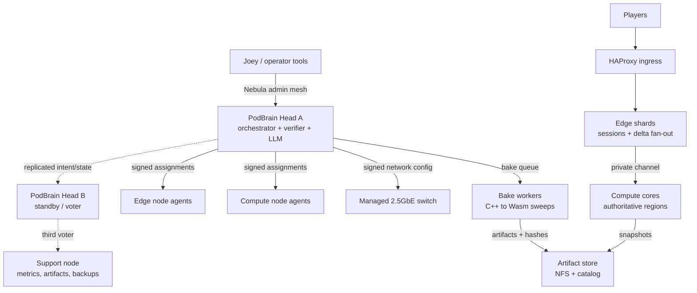

# Dense Small-Node HPC Cluster Research

**Date:** 2026-10-02  
**Status:** research synthesis for Joey's review; component picks are proposed defaults, not locked purchases.  
**Companion docs:** `EDGE-MICRO-DATACENTER-AND-SDN-PLAN.md`, `1000-USER-GOAL-AND-DEVICE-ELIMINATION.md`

## 0. Executive verdict

Build a **heterogeneous, HPC-style cluster**, not a pile of identical tiny computers and not a miniature cloud.

The winning shape is:

- A **dedicated orchestrator/head node** is the cluster entry point for operators, workloads, network intent, and the tiny LLM.
- **Compute cores stay pure.** They run authoritative regions or bake jobs and receive signed assignments through a thin local agent; they do not host the scheduler, LLM, network-policy engine, or cluster brain.
- **Edges stay pure.** They hold player sessions and fan out deltas; they do not decide cluster placement.
- **Small nodes scale throughput, not a single stateful region.** More nodes mean more regions, more edge shards, and more bake jobs per hour. They do not make one authoritative region tick faster unless the engine is later redesigned for distributed simulation.
- **The first fast fabric is boring managed 2.5GbE.** There is no current MPI workload that justifies InfiniBand or RoCE.
- **Hot state stays on local NVMe.** Shared storage is for images, inputs, completed artifacts, snapshots, and backups — never region SQLite in the tick path.
- **Density is won or lost on power, thermals, storage, cabling, and recovery**, not just CPU benchmarks.

The first production target remains the G1 pod: 1000 concurrent in-world users, four regions, zero lost deltas/disconnects under the G1 gates. The HPC layer grows around that pod as bake capacity, extra region capacity, and controlled experiments. It must never destabilize the game service to win a benchmark.

### Recommended first cluster

| Role | First choice | Why | Main watch item |
|---|---|---|---|
| Orchestrator / PodBrain head | Dedicated Ryzen mini-PC class (for example Minisforum UM790 Pro class) or equivalent small x86 head | Enough CPU/RAM for controller, verification, telemetry ingestion, and local LLM; physically separate from compute | Single NIC is acceptable because it is not in the player data path; add standby before calling it production HA |
| Authoritative compute core | Minisforum BD795i SE / BD790i class, Ryzen 9 7945HX | Best sourced compute per watt and per dollar among candidates; 16 cores, up to 96 GB RAM, PCIe x16 for future fast NIC/GPU | Larger and hotter than mini nodes; wall power and case volume must be measured in the chosen build |
| Edge shards | 2× Raspberry Pi 5 16GB + NVMe, or 2× N100 dual-2.5GbE nodes | Keeps G1-R1 meaningful; proven-enough edge role from the G1 study | Pi transport CPU and N100 idle draw both need live bench confirmation |
| Bake pool | Start with one BD-class node or a small set of used 1L x86 / Ryzen mini nodes | Bake is embarrassingly parallel and restartable; measure tasks/hour and tasks/kWh before buying a shelf | Used-node condition and idle power can erase purchase savings |
| Support / third voter | Pi 5 or N100 with NVMe | Prometheus, artifact store, backups, control-plane voter; never in player path | Storage endurance and backup restore tests |
| Lab / ARM density experiment | NanoPC-T6, RK1/Turing Pi, or CM5 blade trial — one unit only | Tests ARM density and management without betting the fleet | CM5 pricing/stock and RK3588 software maturity are unresolved |

## 1. What "strong cluster" means here

"Strong" cannot mean aggregate core count. A hundred weak cores do not help a single authoritative region that must finish one tick in 33.3 ms.

We should score the cluster on five different strengths:

1. **Region strength** — how many authoritative regions meet tick p99 < 33.3 ms at target entity counts.
2. **Service strength** — how many concurrent users meet G1 connection, delta, latency, and recovery gates.
3. **Throughput strength** — bake jobs/hour, accepted artifacts/hour, and sweep completion time.
4. **Efficiency strength** — players per watt, bake tasks per kWh, useful compute per liter, and useful compute per dollar.
5. **Operational strength** — time to provision a replacement node, time to recover remotely, blast radius of a shelf/switch/PSU failure, and whether the world survives orchestrator loss.

### Provisional cluster goals

These are design targets to validate by benchmark, not measured claims:

- **HPC-G1:** The game pod continues to satisfy the existing G1 gates while bake jobs are running under policy limits.
- **HPC-G2:** Orchestrator loss causes no region death, no edge disconnect storm, and no accepted-artifact corruption; new placements pause until a standby takes over.
- **HPC-G3:** A replacement node goes from bare hardware to ready-for-assignment in under 15 minutes using network boot + configuration automation.
- **HPC-G4:** Bake tasks are idempotent and content-addressed; duplicate execution may waste CPU but can never create duplicate accepted artifacts.
- **HPC-G5:** Zero thermal-throttle events during a two-hour full-density soak.
- **HPC-G6:** Every node can be power-cycled and diagnosed remotely; a failed node can be removed without unplugging neighbors.
- **HPC-G7:** The pod reports players/W, bake tasks/kWh, compute/L, and compute/$ from real workloads, not benchmark proxies alone.

## 2. The decisive workload split

Classic HPC assumes tightly coupled jobs: many processes exchanging small messages many times per second. That is not our main workload.

### 2.1 Authoritative regions — stateful services

Each region owns its simulation state and local SQLite. Regions do not perform MPI halo exchange or lock-step collectives with other regions.

What matters:

- Strong single-core and few-core performance.
- Memory bandwidth and capacity.
- Local NVMe latency.
- Tick determinism.
- Restart-in-place from local state.

What does not matter much:

- Microsecond cross-node latency.
- Aggregate core count.
- Shared parallel filesystems.

### 2.2 Bake sweeps — embarrassingly parallel batch

The C++→Wasm sim kernel is the ideal cluster workload:

```text
task = hash(kernel build + config + seed range)
worker computes on local NVMe
output = artifact + output hash
artifact store catalogs hash and provenance
```

Tasks are independent, restartable, and duplicate-safe if acceptance is by hash. This workload scales almost linearly with node count until artifact upload, queue dispatch, or power becomes the bottleneck.

### 2.3 Edge fan-out — network service shards

Edges are long-lived connection services. They scale by adding shards, but their limits are transport CPU, sockets, bandwidth, and reconnect behavior — not MPI latency.

### 2.4 Tightly coupled HPC — not a current requirement

Published latency context from the research pass:

- InfiniBand / RDMA: roughly 1–2 µs round-trip class.
- RoCEv2: low-microsecond when the lossless fabric is correctly tuned.
- TCP Ethernet: often 10–50 µs, with one sourced MPI comparison around 20–50 µs and older 10GbE MPI around 7 µs.
- No credible OSU latency dataset was found for 2.5GbE; assume 1GbE-like latency class until measured.

That gap would matter for MPI. It does not matter against a 33.3 ms game tick or independent bake tasks. **Reject InfiniBand/RoCE for the initial cluster.** Revisit only if a future distributed-simulation design synchronizes one region across nodes, and even then trial 10GbE first.

## 3. Reference architecture



### Separation law

- PodBrain is the entry point for **control and work submission**.
- PodBrain is **not** the entry point for player packets.
- Compute cores accept only signed assignments from PodBrain through their thin agent.
- If PodBrain dies, running regions and edges keep their last signed state. The cluster freezes change; it does not freeze the world.

## 4. Node research

### 4.1 Measurement warning

The research used Geekbench 6 for several ARM boards and PassMark for several x86 systems because those were the reliably sourced common currencies. **Geekbench and PassMark scores are not interchangeable.** They are useful for rough elimination only. Final purchase decisions require B-TICK and B-BAKE on our own workloads.

Prices are time-sensitive and several are unverified street sightings. Re-check price, stock, RAM configuration, PSU inclusion, and warranty at purchase time.

### 4.2 Candidate summary

| Candidate | Sourced performance / physical facts | Strength | Fatal or limiting weakness | Verdict |
|---|---|---|---|---|
| Raspberry Pi 5 | GB6 about 788 single / 1,747 multi from aggregated data; ~17.1 GB/s memory bandwidth; GbE; idle ~2.7–3.3 W; stress ~7–9.8 W | Cheap, small, low idle, huge ecosystem | Weak core; 5V/5A power trap; no real BMC; GbE ceiling | Edge, support, control voter, light bake only |
| Compute Module 5 + Compute Blade | Up to 20 blades in 1U; per-blade NVMe, GbE + PoE, TPM option; derived ~35k GB6-multi per 1U at roughly 240 W realistic load | Densest credible Pi-family system | CM5 price/stock currently unstable and unverified; still weak per-node compute | Trial one blade/carrier, do not fleet-buy yet |
| RK3588 boards (ROCK 5B, NanoPC-T6, Orange Pi 5 Max) | Orange Pi 5 Max GB6 about 743 / 2,792; ~34 GB/s theoretical memory bandwidth; ROCK 5B measured 1.7 W idle / 11 W load; NanoPC-T6 has dual 2.5GbE | Best measured ARM compute/W in the pass; dual 2.5GbE on the right boards | Rockchip BSP/mainline maturity; provisioning/netboot unclear; single-core not better than Pi 5 | Strong ARM bake/light-shard candidate; buy one finalist |
| Turing Pi 2.5 + RK1 | Four nodes in mini-ITX; built-in 1GbE managed switch; real BMC; per-node NVMe; measured 4×RK1 draw roughly 30–50 W | Best small-cluster management story | Everything is 1GbE; CM5 not supported; prices conflict | Excellent lab/orchestrator sandbox; not the fleet fabric |
| Intel N100/N150 mini PCs | GB6 about 1,220 / 3,129; PassMark about 5,306 multi; 16 GB official RAM ceiling; Beelink EQ12 is 0.54 L with dual 2.5GbE | Cheap x86, dual 2.5GbE models, easy software compatibility | Single-channel memory, 16 GB ceiling, real idle often 10–14 W in dual-NIC boxes | Edge and light bake; not a serious region core |
| Used 1L x86 (HP EliteDesk Mini, Lenovo Tiny) | i5-8500T PassMark about 7,739; ~1.05–1.13 L; idle ~11–12 W; Q370 models can have Intel AMT | Cheapest compute per dollar; real remote management on the right models | Used condition lottery, 1GbE, older RAM/platform, PSU may be missing | Buy samples first; excellent bake-pool value if tested |
| Ryzen mini PCs (UM790 Pro / SER8 class) | UM790 Pro: 0.86 L, 64 GB, dual NVMe, 2.5GbE; idle ~5–7 W; max ~80–85 W; CPU proxy ~28k PassMark multi | Best compute per liter found; low idle for the performance | Usually one NIC; configured street price varies | Head-node and compact shard/bake finalist |
| Minisforum BD795i SE (7945HX) | PassMark about 53,770 multi / 4,011 single; 96 GB ceiling; PCIe 5.0 x16; board roughly $399–463 before RAM/storage/case/PSU | Best compute/W and compute/$; only candidate with real expansion for fast NIC/GPU | ~7 L build class; heat and wall power must be measured; not truly an SBC | G1 authoritative core and heavy bake anchor |
| NVIDIA Jetson Orin family | Orin Nano Super official 67 INT8 TOPS, 102 GB/s, 7–25 W, dev kit $249 at Dec 2024 announcement | GPU/ML inference density | TOPS do not tick a world; Nano/NX carriers commonly GbE only; module economics | Only for measured GPU bake or NPC-memory/ML pool |

### 4.3 Derived comparisons — directional only

ARM, using Geekbench 6 multi and measured watts:

- Pi 5: ~1,747 / 9.8 W ≈ 178 points/W.
- RK3588: ~2,792 / 11 W ≈ 255 points/W.
- Compute Blade with CM5: ~35,000 points per 1U by multiplication; useful density signal, not a simulation-capacity claim.

x86, using PassMark multi:

- UM790 Pro class: ~28,241 points in 0.86 L ≈ 32.8k/L; ~332/W at 85 W max.
- BD795i SE: ~53,770 points at an owner-reported ~140 W ≈ 384/W; at roughly $650 all-in in the research estimate ≈ 83 points/$.
- Used HP EliteDesk G4 class: ~7,739 points at roughly $125 used sightings ≈ 62 points/$, but price and condition are volatile.

The operational lesson is not "always buy the benchmark winner." It is:

- If **space** is the constraint, Ryzen mini PCs are remarkable.
- If **purchase cost and watts** are the constraints, BD-class boards are remarkable.
- If **node count for independent work** is the constraint and management is solved, CM5 blades deserve a trial.
- If **budget** is the constraint, used 1L x86 is hard to beat after sample testing.

## 5. Orchestration research

### 5.1 What classic HPC gets right

Borrow these patterns:

- Dedicated head/login node separate from compute.
- Thin compute daemon/agent.
- Role partitions instead of one undifferentiated pool.
- Job arrays for sweeps.
- Backfill so small jobs use gaps.
- Drain semantics before maintenance.
- Accounting: who ran what, where, for how long, with what result.
- Golden-image provisioning.
- Local scratch plus shared artifact storage.
- Controller failover where running work survives head loss.

### 5.2 Scheduler options

| Option | Fit | Decision |
|---|---|---|
| **Nomad** | One substrate can handle service jobs, batch jobs, and system agents; Raft gives real HA without building consensus; clients stay relatively dumb | **Preferred execution substrate beneath PodBrain, pending BUSL-1.1 license review** |
| **Custom bake queue** | Perfectly matches `(kernel hash + config + seed) → artifact hash`; lightest footprint; no scheduler license issue | **Fallback**, or bake-only implementation if Nomad is rejected |
| **Slurm** | Excellent partitions, arrays, backfill, accounting, drain, and requeue semantics; controller loss freezes new work while running jobs continue | Borrow concepts now; optional bake-only benchmark later |
| **OpenPBS** | Similar separation but heavier legacy surface and no advantage for our workloads | Reject |
| **Kubernetes + Kueue** | Powerful quota/admission model, but control-plane weight is wrong for a tiny pod | Reject at current scale; borrow quota ideas only |
| **MaaS** | Good lifecycle vocabulary: enlist → commission → deploy → release | Reject the product at pod scale; borrow the vocabulary |

Do not build a custom scheduler that tries to reimplement Raft, leases, failover, accounting, and a general job API all at once. PodBrain should own the game-specific policy. The execution layer should be boring.

### 5.3 PodBrain's job

PodBrain owns:

- Inventory and node identity.
- Desired state.
- Intent compilation.
- Deterministic verification.
- Signed releases.
- Placement policy.
- Bake sweep expansion.
- Artifact catalog.
- Network policy proposals.
- Audit history.
- The tiny LLM operator interface.

Node agents own only:

- Authenticate to PodBrain.
- Fetch signed desired state.
- Apply it locally.
- Start/stop/drain assigned services when instructed.
- Report health and telemetry.

The LLM may summarize, explain, and propose. It may not run on compute cores, issue unsigned instructions, alter authentication, or participate in tick/failover correctness.

### 5.4 Workload classes and priority

| Class | Examples | Scheduling rule |
|---|---|---|
| P0 — player service | Authoritative regions, edge shards | Reserved capacity; bake never preempts by surprise |
| P1 — service support | Metrics, artifact store, backups | Guaranteed small reservation |
| P2 — interactive bake | Designer-triggered town/sim bake | Preempts P3, not P0 |
| P3 — background sweeps | Large seed/parameter sweeps | Uses spare cycles and spare watts; first thing throttled |

Power is a schedulable resource. A bake job should declare a watt budget as well as CPU/RAM, because the pod's real ceiling may be a circuit or shelf temperature rather than core count.

## 6. Provisioning and node lifecycle

Recommended chain:

```text
iPXE network boot
  → cloud-init first-boot identity only
  → Ansible day-two configuration
  → node agent registers with PodBrain
  → PodBrain assigns role from inventory
```

Rules:

- Maintain separate ARM64 and x86_64 golden images.
- cloud-init sets hostname, admin identity, SSH keys/certificates, and bootstrap only. It is not the long-term configuration system.
- Ansible owns base hardening, agents, exporters, runtimes, and rendered configuration.
- Pi-family network boot is not standard PXE; it uses EEPROM boot order and TFTP content keyed by board identity. Treat it as its own provisioning path.
- RK3588 network boot was not credibly established in research. Assume golden-image flashing until proven otherwise.
- A single provisioning server is a demo-grade failure domain. Replicate boot and artifact sources before fleet scale.

Borrow Warewulf's image + overlay discipline, but do not make region cores diskless at first. Region cores intentionally keep local SQLite and NVMe state.

## 7. Storage architecture

| Tier | Location | Contents | Rule |
|---|---|---|---|
| Hot | Local NVMe on each node | Region SQLite, bake scratch, temporary outputs | Never replace with network storage in the tick path |
| Shared | NFS on support/head storage | Golden images, bake inputs, completed artifacts, config history | Failure must not stop running regions |
| Durable | Separate backup target | Artifact catalog, snapshots, PodBrain state backups | Restore-tested, not merely copied |

### Rejected for the initial pod

- **Ceph:** operational and RAM/network overhead consumes the capacity the pod is supposed to sell.
- **BeeGFS:** first parallel filesystem to revisit if artifact throughput ever proves the need, but striping over 2.5GbE loses to local NVMe for hot data.
- **Lustre:** designed for much larger HPC installations; reject outright at this scale.

### Storage hardware rule

MicroSD is boot/firmware media only, or eliminated by network boot. Root filesystems, SQLite, logs, etcd-like state, and write-heavy telemetry live on NVMe. Consumer microSD has no useful TBW contract and can fail without SMART warning; small NVMe drives publish TBW and health telemetry.

## 8. Physical density: the real walls

### 8.1 Power

Measured or reported wall draw from the research pass:

| Node class | Idle | Sustained load | Provisioning note |
|---|---:|---:|---|
| Pi 5 | ~2.7–3.3 W | ~7–12 W depending on load/peripherals | Budget the official 27 W supply class; ordinary USB-C bricks may not provide the 5.1V/5A profile and can trigger USB current limits |
| N100 mini PC | ~6–14 W depending on model/NICs | ~15–29 W | Vendor TDP is not wall idle; measure the exact dual-NIC model |
| Ryzen mini PC | ~5–7 W for UM790 Pro in STH testing | ~80–85 W max | Excellent idle for the available compute |
| BD795i headless | ~18–25 W estimated idle range in research synthesis | ~120–145 W at a 100 W CPU cap in reports | Owner-reported and build-dependent; measure our exact board/RAM/PSU |

Planning arithmetic:

- US 15 A / 120 V circuit continuous planning ceiling: about 1,440 W.
- US 20 A circuit: about 1,920 W.
- One G1 pod at roughly 200–250 W is electrically easy.
- Eight BD-class bake nodes at ~140 W each are about 1,120 W before switch, storage, and conversion losses. That shelf is a circuit-planning exercise.

Rules:

- Never share an unregulated 5 V rail across Pi 5 nodes.
- One PDU per circuit; no daisy-chained power strips.
- Metered PDU per shelf doubles as power telemetry.
- UPS is a graceful-shutdown bridge, not ride-through hosting. Size it for checkpoint + clean stop.
- BIOS-cap BD nodes when density matters. Dropping from a 100 W cap toward 55–75 W is the biggest single density lever, subject to B-TICK/B-BAKE measurement.

### 8.2 Thermals

- Every wall watt becomes room heat: 1 W = 3.412 BTU/h.
- A useful planning approximation is ~158 CFM per kW at a 20°F temperature rise; double it for real pods with filters, cable blockage, and recirculation.
- Pi 5 throttles around 80–85 °C. An uncooled board can lose roughly 38% of clock in thermal testing; the official Active Cooler holds far safer temperatures. Active cooling is mandatory at density.
- Fanless N100/N5105 cases are heatsinks. They need fin clearance and cannot be sandwiched tightly.
- BD-class nodes need directed front-to-back airflow and the largest cooler the shelf honestly fits.
- Alarm on Pi throttle state, not just temperature. Silent throttling is a capacity bug.

### 8.3 Cabling and switch ports

Every node costs at least power + Ethernet, or one PoE cable. PoE+ can power a Pi 5-class node and makes the switch port a remote power switch, but it concentrates data and power failure into the switch.

Rules:

- Tool-less sleds/caddies per node.
- Label both ends of every cable at install.
- Service loop so one node slides out without disturbing neighbors.
- Keep spare switch ports per shelf.
- Stock a cold-spare switch before calling a single-switch design resilient.

### 8.4 Out-of-band recovery

No candidate board class has a real enterprise BMC across the board. Layer the solution:

Baseline for every node:

- Network boot / PXE or Pi EEPROM netboot.
- Serial console terminated on an aggregator.
- Hardware watchdog.
- Remote power through PoE port bounce or switched PDU.

Targeted KVM:

- Low-cost JetKVM/NanoKVM-class devices can make per-node KVM plausible on x86 nodes.
- Buy one high-quality floating PiKVM-class unit for the pod instead of gold-plating every node.
- Intel AMT on the right used HP/Lenovo models is a genuine advantage; verify the exact chipset/model before buying.

Keep all KVM and serial management on the management segment, reachable only through the admin mesh.

## 9. Failure domains

The shelf is the natural failure domain: one shelf, one PDU feed, one blast radius we can afford.

Rules:

- A shared PSU may take down one edge shard or one bake shelf. It may never take down the only core.
- A single switch is a named single point of failure until a second path or cold spare exists.
- PoE merges power and data failure into the switch; accept that explicitly if we use it.
- Fans are wear items. Assume shelf fan failures and alarm temperatures to PodBrain.
- Orchestrator gets the best UPS outlet and the floating KVM because it is the node we need to resurrect first — even though running workloads must survive without it.

### Failure behavior contract

| Failure | Required behavior |
|---|---|
| PodBrain head down | Regions keep ticking; edges keep serving; bake workers finish or abandon safely; new placements pause |
| Bake worker down mid-task | Task returns to pending; duplicate compute is acceptable; duplicate accepted artifact is not |
| Edge down at load | Remaining edges accept reconnects under the E4 contract; core never blinks |
| Core process down | Restart on same core from local SQLite/snapshots; migration only if real replication exists |
| NFS/artifact store down | Running regions unaffected; bake uploads queue or fail for retry |
| Switch down | Named outage unless second path exists; cold spare swap is the recovery drill |
| Shelf PSU down | Only the pre-declared shard/shelf is lost |

## 10. Telemetry and accounting

Run node exporter everywhere. On Pi 5, add firmware-level telemetry for PMIC rails, voltage, clocks, and decoded throttle/under-voltage state.

Prometheus belongs on support/head storage, not on compute-core SD cards and not in the simulation path. Normal scraping can be ~15 s, with a faster thermal/power job where the hardware justifies it.

PodBrain should account for:

- Region CPU time, tick p50/p99, restarts.
- Bake task CPU/wall time, node, seed range, input hash, output hash, retries.
- Edge users served and reconnects.
- Node watts and watt-hours.

That accounting produces the only efficiency numbers that matter:

- Players per watt.
- Bake tasks per kWh.
- Cost per accepted artifact.
- Cost per concurrent user.
- Useful compute per liter and per dollar on real workloads.

Identity and secrets:

- Short-lived SSH certificates as the fleet grows.
- mTLS only on PodBrain ↔ node-agent control traffic.
- SOPS + age for encrypted GitOps secrets.
- No secrets in inventory, prompts, or LLM context.
- No Kerberos or Vault cluster at pod scale.

## 11. Custom-fit hardware opportunities

The uncharted territory worth exploring is not a homemade CPU. It is the shelf and control hardware around commodity nodes:

1. **PodBrain appliance** — dedicated head with NVMe, hardware watchdog, secure element for signing, serial console to the switch, e-ink status display, and a physical autonomy key: observe / propose / approved-auto.
2. **Instrumented shelf** — per-shelf metered PDU, temperature sensors at inlet and exhaust, N+1 fans, and per-node power switching where the node class allows it.
3. **Standard node sleds** — one mechanical pattern per node family, tool-less removal, labeled power/network, and a pre-imaged spare on the shelf.
4. **CM5 blade trial** — test whether a 1U blade carrier gives us a real dense bake/control tier after price and stock are verified.
5. **Future whitebox switch** — SONiC-class hardware only when the pod outgrows the commodity managed switch or needs a fabric feature the switch cannot provide.

Do not design a custom switch PCB around a managed Ethernet ASIC as an early project. SDK access, high-speed layout, magnetics, PoE, and firmware would consume the entire research budget for a worse result than a $25–$500 managed switch.

## 12. Build and research slices

### P0 — Finalist bench purchase

Buy one of each finalist before any fleet decision:

- BD795i-class core build.
- UM790 Pro / SER8-class Ryzen mini.
- One used HP EliteDesk Mini or Lenovo Tiny sample, then two more only if the first passes.
- NanoPC-T6 or ROCK 5B.
- Pi 5 16GB + NVMe.
- CM5 blade trial only if price/stock verify.

### P1 — Real workload benches

- **B-TICK:** real region tick p50/p99 at target entity counts for at least 60 minutes in the intended enclosure.
- **B-BAKE:** one real C++→Wasm bake job; report jobs/hour and jobs/kWh.
- **B-IDLE:** wall idle with the actual stack loaded and quiet.
- **B-NET:** iperf3 and latency tests on the real switch/SDN stack.
- **B-THERM:** full-density two-hour soak; zero throttle budget.
- **B-OPS:** provision, power-pull, remote recovery, OS update, and agent overhead measurements.

### P2 — PodBrain skeleton

- Inventory schema.
- Node identity and mTLS.
- Signed desired-state releases.
- Thin node agent.
- Prometheus/node exporter/Pi exporter.
- Audit log.

### P3 — Provisioning

- iPXE service on the management segment.
- cloud-init first-boot identity.
- Ansible roles for ARM64 and x86_64.
- Bare-node-to-ready drill.

### P4 — Execution substrate bake-off

Compare:

- Nomad service + batch.
- Custom bake queue + systemd region services.
- Slurm arrays for bake only, if the comparison still looks worthwhile.

Measure dispatch overhead on a 10,000-task sweep, retry correctness, accounting quality, operator burden, and failure recovery. Gate Nomad on BUSL review.

### P5 — Artifact system

- Local NVMe scratch.
- NFS artifact store.
- Content-addressed catalog.
- Provenance: kernel hash, config hash, seed range, node, tool versions.
- Backup and restore drill.

### P6 — PodBrain policy and LLM shadow mode

- Intent compiler and verifier.
- Network twin / reachability checks.
- LLM proposes structured patches only.
- No actuation until shadow proposals are boringly reliable.
- First approved reversible power: quarantine an unknown device or drain an edge.

### P7 — Physical shelf

- Sleds, airflow, metered PDU, UPS, serial aggregator, switched power, floating KVM.
- Circuit budget per shelf.
- Failure-domain labels on every shelf.

### P8 — HA and chaos drills

- Kill active head during soak.
- Kill bake worker mid-task.
- Kill edge at load.
- Restart region process on same core.
- Disconnect NFS while regions run.
- Pull shelf power.
- Verify no unsigned config is accepted and no duplicate artifact is cataloged.

### P9 — Optional expansion islands

Only after measurements demand them:

- CM5 blade shelf.
- Jetson/GPU bake pool.
- 10GbE island.
- SONiC whitebox switch.
- Distributed-simulation fabric research.

## 13. Eliminations

Eliminated as fleet foundations for now:

- Loose Pi 5 boards at scale without blade/carrier management.
- Jetsons as the shard fleet.
- Mixtile Cluster Box as a foundation, based on price, management gaps, and firmware/shipping maturity concerns from research.
- DeskPi/PicoCluster-style CM4-only systems for new dense builds.
- Ceph, BeeGFS, and Lustre for initial storage.
- InfiniBand and RoCE for the initial fabric.
- Kubernetes + Kueue at pod scale.
- OpenPBS.
- MaaS.
- A custom general-purpose scheduler that reimplements consensus and accounting.
- Any design that puts PodBrain or the LLM in the player packet path or inside the simulation tick.

## 14. Open questions before fleet purchases

1. Does Nomad's BUSL-1.1 posture pass Joey's license review for internal use and future commercial hosting?
2. Do we start with one PodBrain head + cold standby, or pay immediately for three control voters?
3. What is the verified current street price and stock situation for Pi 5 16GB and CM5 modules?
4. Does a used 1L x86 sample pass PSU, fan, NVMe SMART, RAM, and AMT checks cleanly enough to trust a lot purchase?
5. In the chosen BD case/PSU, what are real idle/load watts, volume, and sustained tick performance at 55 W, 75 W, and 100 W caps?
6. Does RK3588 earn a bake role on real B-BAKE results, or is it only a lab curiosity?
7. Is there a measured GPU bake workload that justifies even one Jetson?
8. What is the pod's actual room/circuit budget at the intended install location?

## 15. Research sources and audit notes

This synthesis combines three research passes: node hardware, HPC orchestration, and physical/operational constraints. Benchmark proxies and prices must be re-verified before purchase. The most important sources are grouped below.

### Node hardware

- Raspberry Pi 5 launch and specs: https://www.cnx-software.com/2023/09/28/raspberry-pi-5-sbc-broadcom-bcm2712-quad-core-cortex-a76-soc/
- Pi 5 benchmark aggregation: https://www.cpu-monkey.com/en/compare_cpu-raspberry_pi_5_b_broadcom_bcm2712-vs-intel_core_i5_2500t
- Pi 5 review/power: https://www.tomshardware.com/reviews/raspberry-pi-5
- Compute Blade density: https://buyzero.de/en/products/uptime-industries-compute-blade
- Turing Pi 2.5: https://turingpi.com/product/turing-pi-2-5/
- RK3588 board and power research: https://bret.dk/radxa-rock-5b-review-powerful-rk3588-sbc/
- NanoPC-T6 launch: https://www.cnx-software.com/2023/05/09/nanopc-t6-arm-linux-sbc-offers-dual-gbe-hdmi-2-1-output-hdmi-2-0-input-2x-m-2-sockets/
- Beelink EQ12 review: https://www.cnx-software.com/2023/05/16/beelink-eq12-review-intel-processor-n100-mini-pc-windows-11-truenas-pfsense-ubuntu/
- HP EliteDesk 800 G4 Mini: https://www.servethehome.com/hp-elitedesk-800-g4-mini-tinyminimicro-guide-review/3/
- Lenovo Tiny research: https://www.servethehome.com/lenovo-thinkcentre-m720q-tinyminimicro-feature/3/
- Minisforum UM790 Pro: https://www.servethehome.com/minisforum-um790-pro-review-big-upgrade-to-a-small-amd-system/4/
- BD795i SE CPU comparison: https://www.CPUBenchmark.net/compare/5232vs5196/AMD-Ryzen-9-7945HX-vs-AMD-Ryzen-9-7845HX
- Jetson lineup: https://developer.nvidia.com/embedded/jetson-modules

### Orchestration, provisioning, and storage

- Slurm quickstart: https://slurm.schedmd.com/quickstart_admin.html
- Slurm high availability: https://slurm.schedmd.com/high_availability.html
- Nomad architecture: https://developer.hashicorp.com/nomad/docs/concepts/architecture
- Kubernetes components: https://kubernetes.io/docs/concepts/overview/components/
- Kueue overview: https://kueue.sigs.k8s.io/docs/overview/
- Ceph hardware recommendations: https://docs.ceph.com/en/reef/start/hardware-recommendations
- BeeGFS system requirements: https://doc.beegfs.io/7.4.4/system_design/system_requirements.html
- Warewulf provisioning: https://github.com/warewulf/warewulf/blob/HEAD/userdocs/getting-started/provisioning.rst

### Physical and operational constraints

- Pi 5 power guide: https://bret.dk/how-to-power-the-raspberry-pi-5-a-complete-guide/
- Pi 5 review and power consumption: https://www.cnx-software.com/2023/11/05/raspberry-pi-5-review-raspberry-pi-os-bookworm-benchmarks-power-consumption/
- N100 mini-PC power survey: https://selfhosting.sh/hardware/mini-pc-power-consumption/
- Data-center cooling calculation: https://www.techtarget.com/it-infrastructure/tip/How-to-calculate-data-center-cooling-requirements
- Airflow physics: https://www.datacenterfrontier.com/special-reports/article/11427261/understanding-the-physics-of-airflow-in-high-density-environments
- 300-node Pi cluster precedent: https://www.zdnet.com/article/building-a-300-node-raspberry-pi-supercomputer/
- Oracle Pi cluster account: https://medium.com/oracledevs/a-temporal-history-of-the-worlds-largest-raspberry-pi-cluster-that-we-know-of-4e4b1e214bdd
- PiKVM: https://github.com/pikvm/pikvm/blob/master/README.md
- NanoKVM: https://github.com/sipeed/NanoKVM

### Known weak or unverified inputs

- Pi 5 and CM5 current pricing after reported 2026 increases.
- Compute Blade US stock and final CM5 compatibility at purchase time.
- Turing Pi board/module street pricing, which conflicted across sources.
- Used 1L x86 prices, which swing enough to move rankings.
- BD795i wall power and volume in our exact case/PSU.
- RK3588 PassMark, netboot support, and 2.5GbE MPI latency.
- Slurm/Nomad per-node agent memory on our exact ARM nodes.

Those gaps are purchase gates, not footnotes. P0/P1 exist to close them with our own measurements.


---

## Appendix A — First-iteration budget under $3,000 (added 2026-10-02)

Joey set the constraint: the **first iteration** should land essentially under
$3,000 while leaving room to grow. Prices below were verified on dedicated
in-stock US product pages on 2026-10-02. Totals exclude sales tax; several
items included free shipping. This is a purchasing plan, not a purchase —
nothing has been ordered.

### A.1 What changed since the research pass

- The exact BD795i SE appears superseded. The current board on Minisforum's
  store is the **BD895i SE (Ryzen 9 8945HX, 16C/32T) at $419.90** (list $529),
  board only. The same page lists a BD775i SE (7745HX) variant at $295.
- **DDR5 SO-DIMM pricing is the budget breaker.** A 64GB (2×32GB) DDR5-5600
  kit is ~$1,000 at every credible merchant checked (G.SKILL $999.99, Crucial
  $1,002.57); 96GB is $1,695. A 32GB (2×16GB) kit is $464.99 on sale. Any
  first-iteration build that starts at 64GB cannot meet the cap alongside
  the non-negotiables.
- **PoE was inflating the switch line.** The 8-port 2.5GbE PoE+ managed
  switch with 10G SFP+ uplinks is $449.99. The non-PoE managed equivalent
  (Netgear MS308E, 8× 2.5GbE, VLAN + link aggregation) is $149.99 on sale —
  a $300 saving for dropping a feature the pod does not use. Trade-off: no
  10G uplink; that becomes the growth upgrade.
- **Pi 5 16GB is eliminated on price for iteration 1.** At $305 board-only
  (plus HAT, PSU, cooler, storage), it costs more than a complete used
  EliteDesk with RAM and SSD included. The Pi's role is deferred until its
  price normalizes; this is a price elimination, not a capability verdict.

### A.2 First-iteration scope (what the money buys)

One G1-capable pod, no growth fleet:

- **Core:** BD895i SE board + 32GB DDR5 + 1TB NVMe + Mini-ITX case with
  200W PSU. Four regions pinned on 16 cores; second M.2 slot and PCIe x16
  left empty for growth.
- **Edges:** two shards, 500 users each. New Beelink S13 (N150, dual
  2.5GbE, 16GB/512GB) in the target tier; used EliteDesk 800 G4 Mini in the
  lean tier. A 500-user shard needs ~144 Mbps of the pod's 288 Mbps total,
  so even the EliteDesk's 1GbE is not the bottleneck — CPU fan-out and tail
  latency are, which is what B-TRANS/B-E2E measure.
- **Orchestrator:** one used EliteDesk, dedicated to PodBrain duties per the
  separation law. It is not a simulation core and never joins the player
  path. (A Pi 5 orchestrator was priced and rejected: $322+ before PSU and
  cooler, for less capability.)
- **Network:** Netgear MS308E managed 2.5GbE. Four of eight ports used
  (core, orchestrator, two edges); four free for growth nodes.
- **Power:** CyberPower CP1500PFCLCD pure-sine UPS ($239.95) — oversized
  for a ~250W pod, deliberately: graceful SQLite shutdown headroom.
- **Deferred to iteration 2 (growth, not iteration 1):** 64GB/96GB RAM,
  2TB NVMe, 10G-uplink/PoE switch, UM790-class second core or premium
  orchestrator, Pi/CM5 nodes, hot spares, second pod.

### A.3 The three tiers (verified prices, 2026-10-02)

Core build (all tiers unless noted): BD895i SE $419.90 · 32GB DDR5 $464.99 ·
1TB 990 PRO $239.99 (sale) · InWin Chopin MAX case + 200W PSU $150.00 =
**$1,274.88**. Network $149.99 · UPS $239.95 in every tier below.

| Tier | Edges | Orchestrator | Subtotal | +10% contingency* | Total |
|---|---|---|---|---|---|
| Lean | 2× used EliteDesk @ $274.99 | used EliteDesk $274.99 | $2,489.79 | $248.98 | **$2,738.77** |
| Target (recommended) | 2× Beelink S13 @ $349 | used EliteDesk $274.99 | $2,637.81 | $263.78 | **$2,901.59** |
| Stretch (iteration-2 preview) | 2× Beelink S13 @ $349 | UM790 Pro $879 | $4,226.82† | $422.68 | **$4,649.50** |

\* Contingency covers Ethernet cables, fans, tax variance, and small parts.
It is spent only against receipts, not pre-allocated to upgrades.
† Stretch also upgrades to 64GB RAM ($999.99), 2TB NVMe ($389.99), and the
TP-Link PoE/10G switch ($449.99). It is shown so the growth path is priced,
not as an iteration-1 option.

**Verdict:** the target tier meets G1's hardware shape for **$2,901.59**
with contingency included — under the cap with $98.41 of slack before tax.
The lean tier buys $261.23 of slack by accepting refurb risk on all three
small nodes. Either way, the honest statement is: $3,000 buys the pod
*shape* today; it does not buy 64GB of RAM, and margins are thin enough
that one price move (especially DDR5) reopens the plan. Re-verify prices
the week of purchase.

### A.4 Purchase gates and caveats

- EliteDesk listings are refurbished; **confirm the AC adapter is included**
  before ordering (not stated on the listing). Buy one first, sample-test
  PSU, fan, NVMe SMART, and RAM before buying the other two (slice P0
  discipline).
- The BD895i board's G1 standing is inherited from the BD795i proxy
  verdict, not measured. B-TICK on the physical board is the real gate; if
  it fails, the board becomes the bake anchor and the plan reopens.
- The 32GB kit fills both SO-DIMM slots (2×16GB). The 64GB upgrade is a
  kit replacement, not an add — budget it as iteration 2 and sell/reuse the
  32GB kit in a bake node.
- The Netgear switch has no 10G uplink. The day a second core or a 10GbE
  NAS arrives, the TP-Link (2× 10G SFP+) is the priced replacement.
- Prices are a 2026-10-02 snapshot. DDR5 and Pi pricing are visibly
  inflated versus historical norms; both are flagged "re-check at purchase"
  rather than treated as stable.


---

## Appendix B — HPC texts and the .edu source pool (added 2026-10-02)

Joey supplied two HPC texts and a standing instruction to mine university
(.edu) HPC material. Analysis of both books plus selective .edu spot checks
is folded in here. These are **methods texts, not hardware catalogs**: their
durable value is how to measure and reason, not their (dated) numbers.

### B.1 Sources

- **Severance & Dowd, *High Performance Computing*** (Connexions
  `col11136/1.5`, Rice University; collection CC Attribution 3.0; structure
  revised 2010, PDF generated 2012; book lineage 1996–1998). The Michigan
  State connection is biographical (Severance's MSU degrees), not an MSU
  publication.
- **Hager & Wellein, *Introduction to High Performance Computing for
  Scientists and Engineers*** (Chapman & Hall/CRC, ©2011, ISBN
  978-1-4398-1192-4). Conventional copyright — cite and paraphrase only.
- **.edu spot checks:** SDSC/UCSD memory-bandwidth sensitivity modeling;
  UMBC HPCF heterogeneous facility operations; Cornell CS5220 locality in
  simulations; CMU 15-418 work distribution/locality/contention; UW–Madison
  CHTC partitions, backfill, and fairshare policy.

### B.2 Principles adopted into our benchmark methodology

1. **Application benchmarks or it didn't happen.** Both books insist vendor
   peaks and generic suites are triage only; the only safe procurement
   evidence is the real workload in wall-clock time. This is now the formal
   spine under B-TICK / B-TRANS / B-BAKE / B-THERM: p50/p99, RSS, swap,
   throttling, and watts recorded, on the actual board.
2. **Balance analysis per system.** Adapt Hager & Wellein's code balance to
   game terms — bytes touched per entity-update, per intent, per delta —
   against measured (STREAM-class) memory bandwidth per board. When a
   system reaches ~80% of its bandwidth-predicted ceiling, stop tuning
   arithmetic; reduce traffic or improve locality. Working-set sweeps with
   cache-cliff detection are part of B-TICK/B-BAKE.
3. **Bandwidth sensitivity is a selection criterion.** The SDSC work shows
   the fastest algorithm at full bandwidth can be the most sensitive to
   reduced per-core bandwidth and lose when cores share a memory
   controller. Our benches therefore repeat with 1/2/4 co-tenant regions or
   bake workers and report slowdown per added co-tenant. Prefer designs
   that degrade gracefully.
4. **Locality is the scaling strategy.** Cornell's formulation — near-field
   interactions dominate, distant dependence can be approximated, dilute
   systems should communicate only events — is the academic statement of
   our region + interest-management design. Small nodes scale the *number*
   of regions, shards, and bake tasks; they do not make one hot region
   faster. Interest management is a locality mechanism, not just a network
   feature.
5. **Imbalance is a serial fraction.** Amdahl applies to load imbalance:
   the slowest region or worker sets the tick. Scaling claims must be
   labeled strong vs weak, with max/mean worker finish times reported.
   Region tick = strong scaling; bake sweeps = weak scaling.
6. **Networks: fit the transfer model, not just iperf.** Measure latency,
   asymptotic bandwidth, and the latency-bandwidth crossover at our real
   message sizes (48B intents, ~1.2KB deltas, snapshots), then test with
   all edges active. Pairwise peak throughput cannot reveal fabric
   saturation; HAProxy/VXLAN decisions gate on effective bandwidth and p99
   at real sizes.
7. **PodBrain behaves like a tiny HPC facility head.** UMBC and UW–Madison
   both separate login/head nodes from compute and run explicit partitions
   with different preemption rules. Ours: `tick` and `edge` reserved and
   never preemptible; `bake` checkpointable, preemptible backfill; `bench`
   short and bounded; fairshare/accounting applies to bake and bench
   consumers, never to player traffic. Local NVMe is scratch/hot state;
   durable artifacts and backups live in the catalog/support tier.
8. **Heterogeneity is normal when it's ledgered.** University facilities
   run mixed generations by role. Every node gets a class label (role,
   generation, CPU, memory, NIC, NVMe, cooling, PSU); benchmarks compare
   inside a class or state the class. Old boards retire into bake/edge/
   support roles instead of contaminating core measurements.

### B.3 What we deliberately do not take from these sources

Any quantitative figure older than the candidate hardware generation is
qualitative only: 1990s–2010s processor peaks, DDR-era bandwidth/latency
charts, Gigabit-vs-InfiniBand fits, PVM/Sun-era examples, Sandy Bridge
solver rankings. They justify measurements; they never set purchasing
thresholds. New rule for the research docs: external claims carry a source
year and a qualitative/quantitative tag.

### B.4 Net effect

Nothing overturns the architecture. The burden of proof sharpens: the BD
core's real gate is four-region B-TICK with memory co-tenancy, cache
cliffs, SQLite checkpoints, and thermals — not PassMark. Edge shards gate
on effective bandwidth and p99 at real delta sizes under aggregate fan-out.
Density is throughput density (regions, shards, bake seeds/sec per watt and
per liter), never a promise that many weak nodes speed up one region.
