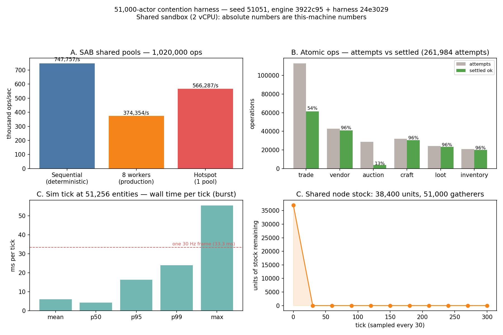

# 51,000-actor contention — first scale report

**Date:** 2026-10-23. **Harness:** `arlo/contention-harness` (local branch
only — not pushed, not merged), worktree `~/workspace/wt-contention`.
**Engine build tested:** `origin/main` @
`3922c955e44d0d96a6426468b1551cf0979411f2`, plus harness commits
`6265dfb` (library + tests) and `24e3029` (bench CLI). The harness adds
files only; it changes no engine behaviour.
**Run it:** `npm run bench:scale51k --workspace=@mmo-engine/engine-core`
(seed 51051, writes a results JSON with `--out`).

Raw data: [results-run1.json](results-run1.json) ·
[results-run2.json](results-run2.json) (two separate processes, same seed).

## Read this first — caveats

- **This sandbox is shared and virtualized: 2 vCPUs, ~7 GiB RAM, other
  tenants on the box.** Absolute CPU numbers below are *this machine's*
  numbers — indicative, not representative of your hardware. Re-run the
  harness on your machine before quoting absolutes anywhere. (Same
  caveat shape as `docs/PERFORMANCE-SAB.md`.)
- **Numbers only.** Nothing here declares the engine passed or failed
  any bar. Where a reference line appears (the 33.3 ms frame), it is
  the engine's own fixed step interval, shown for scale — the verdict
  is yours.
- The 51,000 actors are **logical in-process actors** (1,000
  user-flavoured + 50,000 NPC/object-flavoured), not 1,000 networked
  clients. The network fan-out path is measured separately by the
  Phase 5 benches; this harness measures the contention surfaces
  underneath it.

## What was in the loop — and what was not

| Layer | Real code driven | Not in the loop |
|---|---|---|
| A. SAB pools | `sab-contention.ts` Phase 4 production Atomics patterns (`tryHarvest` CAS loop, `deposit`, `tryClaim`/`release`) over one SharedArrayBuffer, incl. real `worker_threads` | The sim tick; any rendering |
| B. Atomic ops | The six world-tier operations (`tradeCommit`, `vendorTransact`, `auctionSettle`, `craftExecute`, `lootGrant`, `inventoryMutate`) on `MemoryWorldStore` — the real store implementation, sharing its transition logic (`atomic.ts`) with the SurrealDB store | The SurrealDB backend itself; webrpc/HTTP transport; region gateway/session code |
| C. Sim + gathering | `SimWorld` with `IntentSystem` + `IntegrateSystem` over 51,256 live entities, and the production `GatheringSystem` (stock, cooldowns, reach checks) under a fake clock | Physics (Jolt), snapshot/delta encoding (covered by the B4 bench), creature brains, networking |

Contention model for B, stated plainly: within each round, all 51,000
actors build their operation from the **round-start snapshot** of
record versions — shards deciding concurrently against cached state —
then operations serialize through the store in actor order. Any
operation whose participants were already touched that round presents
a stale fence and collides. A collision triggers the production cure:
refresh the fences from the store and retry once. Session steals
(24, seeded) bump lock epochs world-side so stale-epoch fences occur
too. Trades and auctions concentrate on a 512-actor market hub,
because that is where real contention lives.

## Layer A — SAB shared pools (1,020,000 ops per run)

16 pools × 25,000 stock (deliberately scarce: total harvest demand
≈ 612k against 400k stock + returning deposits), 1,024 claimable
resources, op mix 60% harvest / 20% deposit / 20% claim.

| Run | Throughput | Harvest ok / insufficient | CAS attempts per success | Claims won / contended | Reconcile |
|---|---:|---:|---:|---:|---|
| Sequential (deterministic) | 747,757 ops/s | 603,836 / 8,585 | 1.00 (no racers) | 203,666 / 0 | exact |
| 8 workers (production shape) | 374,354 ops/s | 603,842 / 8,579 | 1.01 | 203,494 / 172 | exact |
| Hotspot: ONE pool of 50,000 | 566,287 ops/s | 253,913 / 358,508 | **2.43** | — | exact |

- Release violations: **0** in every run. Pool drift: **0** in every run.
- Op latency (workers, histogram approx): p50 0.18 µs, p95 0.36 µs,
  p99 0.72 µs. Hotspot p99: 0.36 µs.
- On this 2-vCPU box the 8-worker run is *slower* than the
  single-threaded run — thread oversubscription on a tiny shared box,
  the same effect the Phase 4 bench notes. The worker count that
  matters is workers ≈ cores on real hardware.
- CAS retry pressure is a non-story at 16 pools (1.01 attempts per
  success) and stays modest even when all 51,000 actors hammer one
  counter (2.43). What contention produces here is *insufficient-stock
  failures and lost claims*, not retry storms.

## Layer B — world-tier atomic ops (4 rounds × 51,000 actors)

51,000 seeded character records (1,000 gold, 4 items each), one store,
261,984 operation attempts in 20.0 s = **13,077 ops/s** (in-process,
including the driver's refresh reads and retries).

| Operation | Attempts | Settled ok | Per-attempt |
|---|---:|---:|---:|
| tradeCommit | 113,016 | 61,396 | 54% |
| vendorTransact | 42,920 | 41,027 | 96% |
| auctionSettle | 28,869 | 3,838 | **13%** |
| craftExecute | 31,970 | 30,550 | 96% |
| lootGrant | 24,337 | 23,304 | 96% |
| inventoryMutate | 20,872 | 19,987 | 96% |

Rejections across all attempts: **VERSION_CONFLICT 58,123 (22.2% of
attempts)**, ITEM_NOT_PRESENT 23,734 (9.1%), EPOCH_STALE 25,
INSUFFICIENT_FUNDS 0, LOCK_CONFLICT 0.

- Of 204,000 operations planned, **180,102 (88.3%) eventually settled**.
  Every conflicted operation that could be rebuilt after a fence
  refresh did settle: 57,984 of 57,984 built retries succeeded;
  164 were abandoned because their preconditions (the item, the
  seller's shelf) had vanished in the meantime. The cure costs:
  111,065 refresh reads against 261,984 attempts.
- Op latency (exact samples): mean 69.3 µs, p50 30.6 µs, p95 73.3 µs,
  **p99 322.7 µs**, max 62.6 ms — the max is a single outlier on a
  shared box (GC and host noise live in that tail; the p99 is the
  number to carry).
- **Value conservation, audited:** the run appended 399,734 item-ledger
  entries. Replaying the whole ledger afterwards reproduced every
  character's final inventory exactly (0 `from` violations, 0 ownership
  mismatches), and total gold matched to the unit — 50,438,116 final
  against 51,000,000 seeded, the difference fully accounted for by
  ledgered vendor purchases, craft fees, and the 5% auction cut.
- Auction proceeds that could not be paid directly (seller's fence
  stale at settle time) became pending credits, exactly as the fleet
  parity path designs: 2,567 credits totalling 145,685 gold, all
  drained and verified in the audit.

## Layer C — SimWorld tick + gathering (51,256 entities, 300 ticks)

51,000 avatars wandering around 256 shared resource nodes (150 stock
each, no regrow), every actor gathering from its home node on a
~1.23 s cadence: 413,513 gather attempts over the run.

- Tick wall time (burst mode, no pacing): **mean 6.06 ms, p50 4.19 ms,
  p95 16.32 ms, p99 23.93 ms, max 55.57 ms** — 157 ticks/s burst rate.
  Split: movement systems mean 4.61 ms (p99 21.1 ms); gather phase
  mean 1.45 ms (p99 12.0 ms).
- Stock: all 38,400 units were harvested; **the nodes were worked out
  within the first 30 ticks**. 375,113 attempts (90.7%) found an empty
  node. With ~199 gatherers per node and 150 units per node, that is
  arithmetic, not an engine limit — the gather phase stayed cheap
  (1.45 ms mean) while absorbing all of it.
- Zero unexpected gather errors (no cooldown, reach, or pouch failures
  — the cadence and wander keep actors in reach of their node by
  construction; the contention measured is stock, not movement).

## Bottlenecks, in plain language

1. **Auctions against a hot seller are the sharpest edge.** Settling
   one specific item from one specific seller serialized behind
   everything else touching that seller: 13% per-attempt success,
   and most of the 23,734 ITEM_NOT_PRESENT rejections are actors
   settling items that were already gone. The mechanism never
   corrupted value — it just said "no" a lot. Whether that "no" rate
   is acceptable is a game-design question (escrowed listings would
   change the shape); the engine-side cost is measured above.
2. **Stale versions are the world tier's main tax.** 22.2% of all
   attempts collided on version. The refresh-and-retry cure always
   lands, but it is not free: roughly one extra store read per two
   attempts at this hub concentration. Halve the hub traffic and
   this rate falls with it — it is a property of the contention
   profile, not a defect found in the store.
3. **The sim tick's tail, not its mean, is the open question.** Mean
   tick 6.06 ms at 51,256 entities is comfortable; the p99 (23.9 ms)
   and max (55.6 ms) on this shared box are where a re-measure on
   your hardware matters — the same honest miss shape as the B4
   delta-encode p99 in `docs/PERFORMANCE-SAB.md`.
4. **CAS contention is not the problem it was designed to fear.**
   At realistic pool counts the Atomics patterns run at ~1 attempt
   per success; even a single white-hot pool only reaches 2.43.
   The Phase 4 design holds at this scale; its cost shows up as
   clean failures (insufficient stock, lost claims), never as
   corrupted state — reconciliation was exact in every run.

## Repeatability evidence

Same seed (51051), two separate processes; each bench invocation also
runs every deterministic layer twice internally:

| Digest | Run 1 | Run 2 | Match |
|---|---|---|---|
| A sequential profile | `edc4822cc06b5957` | `edc4822cc06b5957` | ✅ |
| B atomic-ops profile | `1bc8d7ac4106f200` | `1bc8d7ac4106f200` | ✅ |
| C sim/gather profile | `4b4d01d940307de1` | `4b4d01d940307de1` | ✅ |

The multi-worker A runs are interleaving-dependent by design: their
counts differ slightly between runs (harvest successes 603,842 vs
603,838; contended claims 172 vs 195) while their reconciliation
invariants held exactly in both. Only the invariants — never the
counts — are the cross-run claim for that shape.

## Tests

`packages/engine-core/test/contention-harness.test.ts` (9 tests):
FNV-1a vectors, digest key-order insensitivity, exact percentile
math, and at small scale — per-layer digest reproduction, exact
ledger reconciliation, real conflict generation, and stock depletion.
All green; the engine-core change is additive (two new source files,
one test file, one `bench:scale51k` script).
