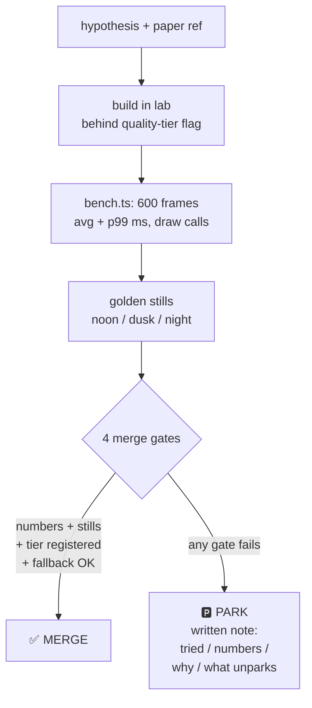

# Shader & FX R&D — Program Index

The shader R&D program for the NexusMMOEngine client (three.js r186).
Goal: AAA-stylized rendering — WoW readability, Oblivion-Remaster-grade
lighting — proven experiment by experiment, nothing merged on vibes.

## The bundle (read in this order)

| # | Document | What it is |
|---|----------|-----------|
| 1 | `SHADER-FX-DEEP-DIVE.md` | Techniques + illustrative code. The starting point. |
| 2 | `SCHOLARLY-FINDINGS.md` | University papers and course notes behind the techniques — **citation-audited** (see audit log at the end of that doc). Trust is the point. |
| 3 | `TECHNIQUES-ILLUSTRATED.md` | Each finding paired with its exact repo files + diagrams. |
| 4 | `SHADER-EXPERIMENTS.md` | The 10 executable experiment specs. |
| 5 | `RENDER-ARCHITECTURE.md` | Pipeline diagrams, shader data model, runtime flows. |
| 6 | This file | Program map: order, verdict loop, definition of done. |
| 7 | `SHADER-FX-EXTENDED.md` | Companion: external library evaluations (three-pinata, stylized-components grass/water, Three-VFX), the server-authoritative-FX contract, proposed Exp 12, and the open art-direction decision. Works Cited in MLA format. |
| 8 | `STYLIZED-RENDERING-DNA.md` | Companion: the 12 recurring technique strands behind AAA stylized appeal (Xrd normals, Genshin SDF faces, Kajiya-Kay hair, outlines, ramps…), backbone integration map, and phased automation roadmap (A-NORM, A-SDF, A-PACK, A-HULL, A-TANGENT, A-RAMP, A-VFX). Works Cited in MLA format. |

## The guiding constraint: as far as possible, within reason

Joey's directive, baked into every verdict below: **push graphics and
aesthetics as far as they can go — inside a hard cost/benefit gate.**
Ambition is high; cost justification is mandatory. Two facts drive it:

- He pays real resources to run the server — the program must not
  design a client only a flagship GPU can run.
- Players' GPUs vary enormously. A technique that only works on high-end
  hardware is a tech demo, not a shipped feature.

In practice this means every experiment carries three numbers before it
can merge:

1. **Frame-ms budget** — the per-experiment cost ceiling (table in
   `SHADER-EXPERIMENTS.md` §0.4). Measured on named hardware, not
   borrowed from papers.
2. **GPU-memory delta** — new textures, render targets, shader programs
   counted via `perf-stats.ts` gauges. A technique that blows the VRAM
   budget on a mid-range GPU fails no matter how pretty the stills.
3. **Mandatory quality-tier fallback** — every merge registers its
   on/off state per tier in `QUALITY_PRESETS` (`quality.ts`). The `low`
   tier must never regress: if a technique can't be cleanly gated off,
   it doesn't merge.

Pretty is not a verdict. Pretty *within budget, on tiered hardware* is.

## Execution order (not the spec's numbering)

The specs are numbered 1–10 for reference; execute in this order:

```mermaid
flowchart LR
    E1["1. TSL proof<br/>unlocks authoring"] --> E3["3. TAA eval<br/>sets stills baseline"]
    E3 --> E5["5. Materials v1<br/>Gooch first —<br/>cheapest win"]
    E5 --> E2["2. Lighting rig<br/>SH ambient, then LTC"]
    E2 --> E6["6. Wind vegetation<br/>cheapest 'alive'"]
    E6 --> E8["8. Shafts + fog<br/>cheap atmosphere"]
    E8 --> E9["9. Water<br/>foam + lakes"]
    E9 --> E4["4. N8AO vs GTAO<br/>likely park"]
    E4 --> E10["10. Cloud shadows<br/>most speculative"]
    E10 --> E7["7. GPU weather<br/>biggest lift"]
```

**Why this order:**
- **TSL proof first** — every later experiment is authored in TSL. It
  also pays for the shared lab/bench/stills infrastructure once.
- **TAA second** — temporal AA changes every pixel. All stills from Exp
  5 on are shot against the final AA baseline, so the AA verdict has to
  land before the stills-heavy work.
- **Materials third** — the biggest visible style win, and Gooch shading
  is ~5 ALU with 0 textures: the cheapest merge in the program. Early
  visible payoff keeps momentum.
- **Lighting rig fourth** — SH ambient (~20 lines) is the highest
  value-per-line item; LTC tavern test follows. Lighting multiplies the
  materials work.
- **Wind, shafts, water** — ascending cost, each a self-contained visual
  payoff. Water's foam-band energy fix is a correctness fix, not a
  beauty contest.
- **N8AO vs GTAO late** — the comparison needs the lab and terrain
  scenes to exist; its likely outcome is "park with numbers," which is
  fine.
- **Cloud shadows second-to-last** — most speculative; the bar is
  "obviously worth it."
- **GPU weather last** — biggest engineering lift, and the only
  WebGPU-only technique (fallback design is part of the spec).

Experiments are independent once the lab exists — parallelize across
sessions freely, except: nothing TSL-authored starts before Exp 1's
verdict, and nothing stills-heavy starts before Exp 3's.

## The verdict loop

Every experiment ends the same way. No exceptions, no vibes.

**Merge gates:** (1) acceptance criteria met on named hardware;
(2) stills approved by a human art eye; (3) registered in `quality.ts`
tiers (`low` never regresses); (4) WebGL2 fallback renders correctly
(or its fallback is specified in the experiment);
**(5) the cost/benefit gate — frame-ms within the experiment's budget,
GPU-memory delta declared and within budget, tier fallback specified.**
Gate 5 is not a tiebreaker; it is a gate. A technique that fails it
parks no matter how good the stills look.

## What "done" looks like

The program is done when:
- [ ] All 11 experiments have verdicts (merge or parked-with-note).
- [ ] Every merge is registered in `quality.ts` tiers.
- [ ] `stills/` holds noon/dusk/night triplets for every experiment.
- [ ] The client holds 60fps on the named target hardware with the full
  merged set on the `high` tier.
- [ ] This bundle is the handoff doc: a new developer can reproduce any
  experiment from `SHADER-EXPERIMENTS.md` alone.

## Standing decisions (don't re-litigate per experiment)

- **Stylized PBR** art direction: physical shading, style in the inputs.
- **TSL** is the shader authoring language (pending Exp 1's verdict).
- **No Rust, no engine rewrites** — this program extends the client FX
  stack; working systems are not replaced.
- **Tessendorf FFT stays parked** — out of an MMO client's GPU budget.
- **PRT stays parked** behind Exp 2's verdict — only if the LTC rig
  leaves perf headroom.
- **True volumetrics are out** — Exp 8's cheap shafts are the ceiling.
- Borrowed numbers never gate a merge — only our measured numbers on
  named hardware do.
- **Within reason, always:** the guiding constraint above. Ambition is
  high, cost justification is mandatory, `low` tier never regresses.
