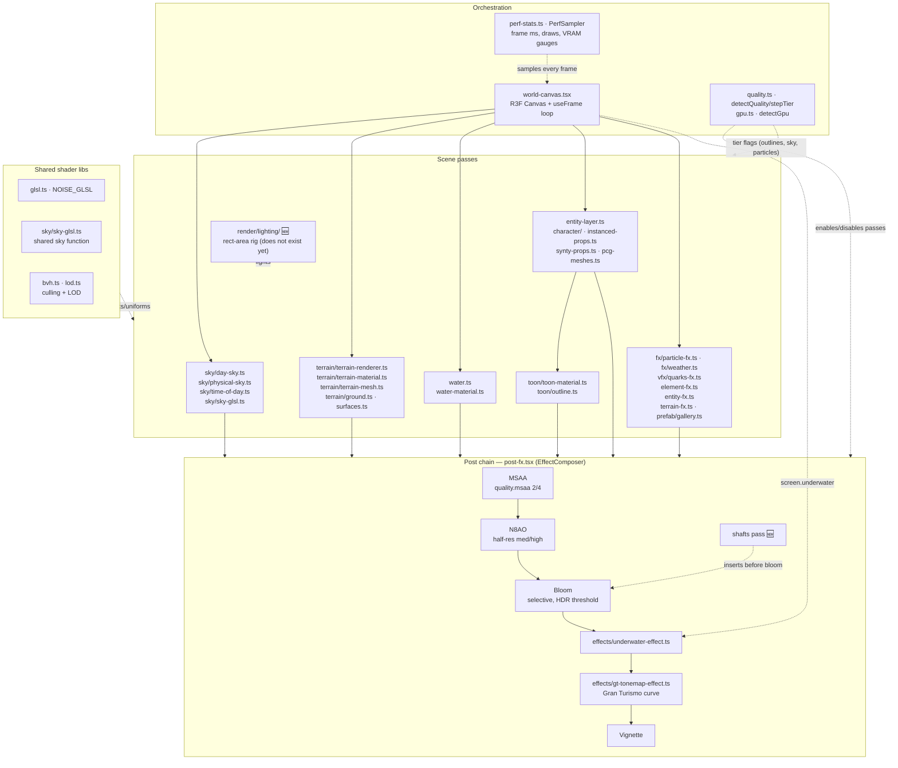
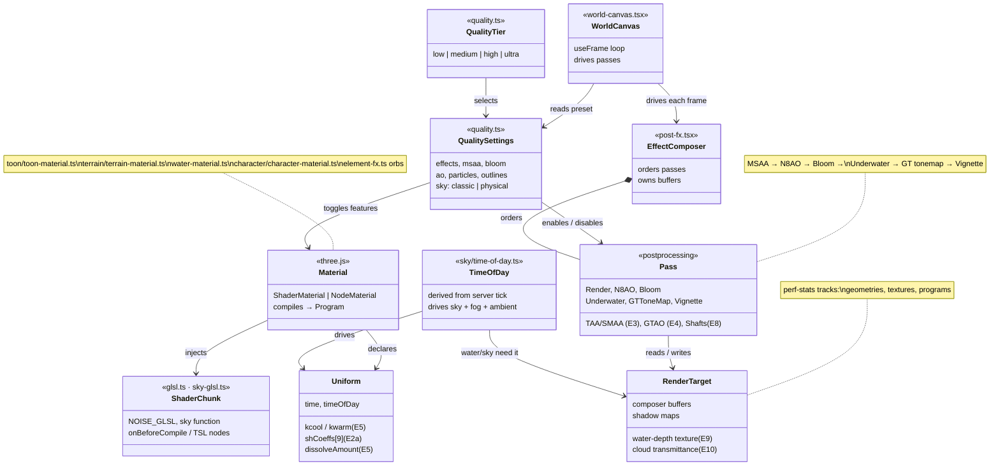
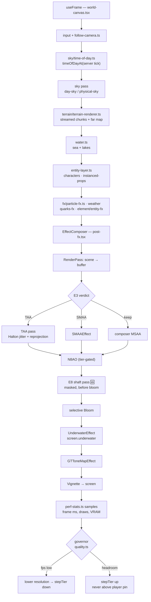
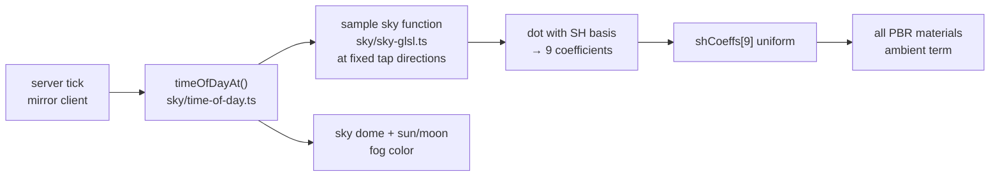
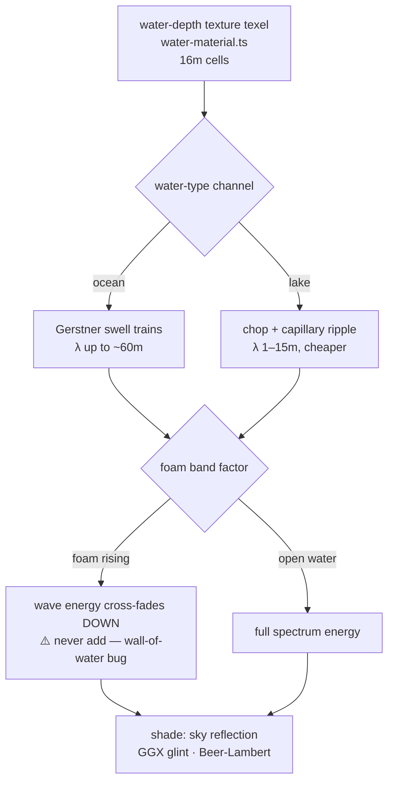
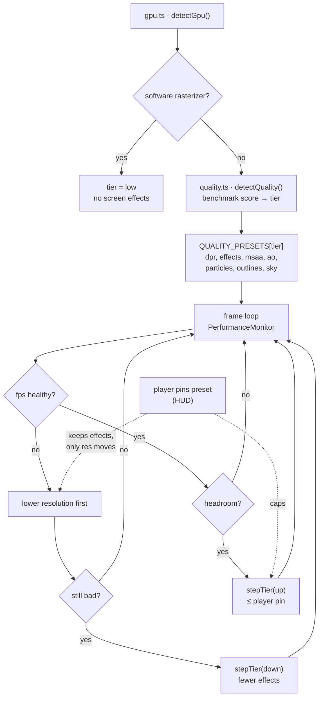

# Client Render Pipeline — Software Architecture

Diagrams of the NexusMMOEngine client renderer as it exists
(`NexusMMOEngine @ 522c0c0`, three `^0.186.1`). Every box names the real
file under `apps/client/src/render/` — no orphans, no aspirational boxes
except where explicitly marked `NEW` (an experiment's planned module).

Companion docs: `TECHNIQUES-ILLUSTRATED.md` (findings → files),
`SHADER-EXPERIMENTS.md` (specs E1–E10), `R&D-INDEX.md` (program map).

---

## (a) Pipeline architecture with experiment plug-in points

**Experiment plug-in map** (where each spec lands):

| Exp | Plug-in file(s) | What changes |
|-----|----------------|--------------|
| E1 TSL proof | `element-fx.ts`, `showcase.ts`, new `lab/bench.ts` | Fire orb ported to TSL; lab infra built |
| E2a SH ambient | `sky/time-of-day.ts` | 9-coeff SH uniform replaces hemisphere color |
| E2b LTC rig | new `render/lighting/`, lab tavern scene | Rect-area lights vs point lights |
| E3 TAA | `post-fx.tsx` | TAA or SMAA in composer, MSAA replaced/augmented |
| E4 AO | `post-fx.tsx` | GTAO port vs incumbent N8AO |
| E5 materials | `toon/`, `character/`, `entity-fx.ts`, new `render/materials/` | Gooch, SSS, bevels, dissolve, cel ramps |
| E6 wind | `instanced-props.ts` (+ grass site TBD in impl) | Vertex sway via `windWeight` attribute |
| E7 GPU weather | `fx/weather.ts` | TSL compute path, nebula fallback kept |
| E8 shafts/fog | `post-fx.tsx`, scene fog setup | Radial-blur shaft pass + height fog |
| E9 water | `water.ts`, `water-material.ts` | Foam advection, lake spectrum, foam-band fix |
| E10 clouds | `sky/day-sky.ts`, `terrain/terrain-material.ts` | Transmittance texture, chunk-local projection |

---

## (b) Shader system data model

**Relationships in words:**
- A `Material` injects `ShaderChunk`s (shared GLSL libs or TSL nodes)
and declares `Uniform`s; three.js compiles it to a `Program`
(`perf-stats.ts` counts programs — the merge-time GPU-memory signal).
- `EffectComposer` orders `Pass`es; each pass reads/writes
`RenderTarget`s (composer buffers, plus domain targets like the
water-depth texture).
- `QualitySettings` is the cost-control plane: it enables/disables
passes and toggles material features per tier. **Every experiment's
output must register here** — a technique with no tier flag is not
shippable.
- `TimeOfDay` (server-tick-derived, so every client sees the same hour)
drives uniforms and render targets — the single source of truth for
the day cycle.

---

## (c) Runtime flowcharts

### Per-frame render flow (with TAA insertion point)

### SH ambient update (driven by time-of-day) — E2a

One update per frame (or per time-of-day change): the ambient follows
dawn/dusk/night for free because the sky function already animates.

### Water spectrum selection (ocean vs lake) — E9

### Quality-tier selection and fallback

Every experiment's merge registers its on/off state per tier in
`QUALITY_PRESETS` — that table is the fallback mechanism, not an
afterthought.

---

## File index (all 42, by subsystem)

| Subsystem | Files |
|-----------|-------|
| Orchestration | `world-canvas.tsx`, `follow-camera.ts`, `input/` (sibling) |
| Quality/governor | `quality.ts`, `gpu.ts`, `perf-stats.ts` |
| Post chain | `post-fx.tsx`, `effects/gt-tonemap-effect.ts`, `effects/underwater-effect.ts` |
| Sky | `sky/day-sky.ts`, `sky/physical-sky.ts`, `sky/sky-glsl.ts`, `sky/star-field.ts`, `sky/time-of-day.ts` |
| Terrain | `terrain/terrain-renderer.ts`, `terrain/terrain-mesh.ts`, `terrain/terrain-material.ts`, `terrain/ground.ts`, `terrain/surfaces.ts`, `terrain-fx.ts` |
| Water | `water.ts`, `water-material.ts` |
| Entities | `entity-layer.ts`, `entity-fx.ts`, `character/character-animator.ts`, `character/character-kit.ts`, `character/character-material.ts`, `character/character-stage.ts`, `instanced-props.ts`, `synty-props.ts`, `pcg-meshes.ts` |
| FX | `fx/particle-fx.ts`, `fx/weather.ts`, `vfx/quarks-fx.ts`, `element-fx.ts` |
| Toon | `toon/toon-material.ts`, `toon/outline.ts` |
| Shared libs | `glsl.ts`, `bvh.ts`, `lod.ts`, `assets.ts` |
| Lab/showcase | `showcase.ts`, `prefab/gallery.ts`, `prefab/prefab-builder.ts` |
| R&D-planned 🆕 | `render/lighting/` (E2b), `render/materials/` (E5), `render/lab/bench.ts` (§0) |
