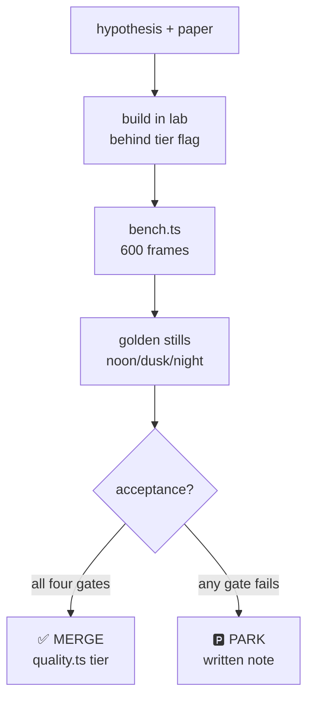

# Shader R&D — Executable Experiment Specs

Ten experiments. Each is specified to the point where it can be executed
without further design decisions: hypothesis, paper reference, exact files,
steps, benchmark, stills, acceptance, verdict. Build the shared lab
infrastructure (§0) first — every experiment after Exp 1 assumes it exists.

All repo paths are `apps/client/src/render/` unless noted, verified against
`NexusMMOEngine @ 522c0c0`, three `^0.186.1`. This is a **docs-only**
program spec; it does not modify the repo.

**Ground truths the specs rely on** (verified in the clone):
- Elemental orbs (`element-fx.ts`) are self-contained `ShaderMaterial`s on
  spheres, procedural fbm via `NOISE_GLSL` from `glsl.ts` — ideal TSL port
  target.
- `post-fx.tsx` runs pmndrs `postprocessing` `EffectComposer` (Bloom, N8AO,
  Vignette, custom `UnderwaterEffect`, `GTToneMapEffect` — the client uses
  the Gran Turismo tone curve, not ACES). AA today is composer MSAA
  (`quality.msaa`: 2/4).
- `quality.ts` already runs **N8AO** (half-res on medium/high, full on
  ultra) — there is no SSAOPass to compare against; Exp 4 is reframed
  accordingly.
- `sky/physical-sky.ts` already implements a precomputed-scattering
  (takram) sky on high/ultra — the remaining sky work is clouds, not the
  dome.
- `showcase.ts` is the FX showcase ring (orbs + `vfx/quarks-fx.ts` +
  `prefab/gallery.ts`) — it grows into the shader lab.
- `quality.ts` tiers are `low | medium | high | ultra` with a frame-rate
  governor — every merged experiment registers here.

---

## §0. Shared infrastructure (build first)

### §0.1 The shader lab

Extend `showcase.ts` into a lab mode (`render/lab/`):

- **Fixed camera bookmarks** — named viewpoints (tavern interior, grass
  field, shoreline, forest dusk, creature close-up). Same coordinates every
  run; no hand-held cameras during measurement.
- **Time-of-day override** — pin `time-of-day.ts` to noon / dusk / night
  during captures; the day cycle must not drift mid-benchmark.
- **Stat overlay** — rolling avg + p99 frame ms (manual delta
  accumulation, not the HUD fps), draw calls + triangles from
  `renderer.info`, active texture count. Rendered as DOM overlay, excluded
  from captures.
- **A/B toggle** — old vs new technique on one keypress, same camera, for
  still pairs.

### §0.2 Benchmark harness

New `render/lab/bench.ts` (spec — build it in Exp 1):

- Warm-up 120 frames, measure 600 frames, report: avg frame ms, p99 frame
  ms, draw calls, triangles. Log JSON per run; keep a runs ledger so
  regressions are visible across sessions.
- **Target hardware must be named per run** (GPU, resolution, browser).
  A number without hardware is not a result.
- TSL note: plain TSL materials compile to WGSL *and* GLSL (WebGL2
  fallback automatic). **TSL compute does NOT fall back** — any compute
  path (Exp 7) needs a non-compute fallback by design.

### §0.3 Golden stills

- `canvas.toDataURL` at `devicePixelRatio = 1`, fixed bookmark, fixed
  time-of-day, fixed weather seed.
- Per experiment: noon / dusk / night triplet + one feature close-up (+
  A/B old-vs-new pair where applicable).
- Archive: `your_files/mmo-engine-shader-rnd/stills/<exp>-<name>/`.
  Stills are the visual half of the verdict — no merge on numbers alone.

### §0.4 Verdict rubric (applies to every experiment)

**The guiding constraint** (Joey's directive): push graphics and
aesthetics as far as possible **within reason**. He pays real resources
to run the server and players' GPUs vary enormously — so ambition is
high and cost justification is mandatory. Pretty is not a verdict.
Pretty *within budget, on tiered hardware* is.

**Merge** requires ALL of:
1. Acceptance criteria met (numbers on named hardware).
2. Stills approved (Joey or designated art eye — no self-approval).
3. Registered in `quality.ts` tiers (off/low/high or equivalent; low tier
   must never regress).
4. WebGL2 fallback still renders correctly (or the fallback path is
   explicitly specified, as in Exp 7).
5. **The cost/benefit gate:** measured frame-ms ≤ the experiment's
   budget (table below); GPU-memory delta (new textures, render
   targets, programs — read from `perf-stats.ts` gauges) declared and
   within budget; tier fallback specified (which tiers get it, which
   don't). Gate 5 is not a tiebreaker — a technique that fails it parks
   no matter how good the stills look.

**Per-experiment cost budgets** (frame-ms at 1080p on the named test
GPU unless noted):

| Exp | Budget | Notes |
|-----|--------|-------|
| E1 TSL proof | ±5% vs baseline | Must be perf-neutral; it's infrastructure |
| E2a SH ambient | <0.1ms | ~20 lines; wins on stills |
| E2b LTC rig | ≤2ms | Else fall back to 3 rect + baked emissive |
| E3 TAA | <1ms | Ghosting test is pass/fail regardless |
| E4 GTAO | <1.5ms half-res | And must visibly beat N8AO |
| E5 materials | neutral each | Per-material verdict; Gooch ~5 ALU |
| E6 wind | <0.3ms @10k instances | Vertex-stage only |
| E7 GPU weather | ≤ nebula parity @50k | Plus main-thread ms saved |
| E8 shafts/fog | <1ms half-res | No banding, masking correct |
| E9 water | neutral-ish | Foam-band fix is correctness, not beauty |
| E10 cloud shadows | <1.5ms | Bar is "obviously worth it" |
| E11 splat vistas | ≤3ms @3 vistas | Memory + wire bytes declared per vista; low tier loads zero splat bytes |

GPU-memory rule of thumb: no experiment may add more than a handful of
new programs/textures without a written justification; `perf-stats.ts`
gauges (`geometries`, `textures`, `programs`) are the ledger.

**Park** requires a written note: what was tried, the numbers, why it
failed, and what would unpark it (hardware shift, three.js version, etc.).
Parked is a result, not a failure. A technique parked *on the cost
gate* says so explicitly — "too expensive at current budgets," not
"didn't look good."

---

## Exp 1 — TSL pipeline proof

**Goal:** prove one TSL-authored material renders identically on the
WebGPU and WebGL2 paths, making TSL the authoring language for every
later experiment.

**Hypothesis:** a TSL port of an existing `ShaderMaterial` compiles to
both backends with no visual divergence and neutral performance.

**Files:**
- `apps/client/src/render/element-fx.ts` — port the **fire** orb
  (self-contained, procedural, high visual complexity = strong test).
- `apps/client/src/render/showcase.ts` — side-by-side old vs new.
- `apps/client/src/render/lab/bench.ts` — new (the §0.2 harness).

**Steps:**
1. Build `bench.ts` + lab bookmarks (§0) — this experiment pays the
   infrastructure cost once.
2. Rewrite the fire orb's fragment logic as TSL nodes. Noise: sample a
   runtime-generated noise texture through TSL (keeps the fbm look
   without reimplementing noise in nodes).
3. Render on WebGPU (`three/webgpu`) and WebGL2 fallback; capture stills
   of both.
4. Pixel-diff the still pairs (perceptual check + human sign-off).

**Benchmark:** frame ms vs the `ShaderMaterial` baseline (expect ±5%);
shader compile time cold.

**Stills:** fire orb, 3 angles × 2 backends, A/B old-vs-new.

**Acceptance:**
- Renders on both backends, zero shader-compile console errors.
- Frame time within 5% of baseline on named hardware.
- Stills approved as identical-or-better.

**Verdict:** merge → TSL is mandatory for Exps 2–10. Park → TSL stays
optional; each later experiment re-evaluates (and the program gets
slower — say so in the note).

---

## Exp 2 — Lighting rig: SH ambient + LTC area lights

**Goal:** the Oblivion-Remaster-grade lighting upgrade, in two slices.

**2a — SH ambient (do first: ~20 lines, highest value-per-line in the
program).**
Hypothesis (Ramamoorthi & Hanrahan 2001; Green 2003): 9-coefficient SH
irradiance sampled from the sky dome replaces the flat hemisphere ambient
and follows the day cycle for free.

Files: `apps/client/src/render/sky/time-of-day.ts`.
Steps: sample the sky function at fixed tap directions once per frame
(or per time-of-day change), dot with the SH basis, feed the 9
coefficients as a uniform replacing the hemisphere color.
Benchmark: frame ms delta (expect <0.1ms). Stills: character close-up at
dawn / noon / dusk / night — the grounding difference should be obvious
at dawn/dusk.
Acceptance: visibly grounded characters at low sun; no perf regression.
Verdict: merge on sight — this one wins on stills alone.

**2b — LTC area lights (the tavern test).**
Hypothesis (Heitz et al. 2016): 6–10 rect area lights beat equivalent
point lights on quality-per-ms; soft shadow edges and long GGX
reflections fall out of the math. three.js already ships LTC for
`RectAreaLight` — the R&D is placement and count.

Files: `apps/client/src/render/sky/time-of-day.ts` (sun-as-area-light at
dawn/dusk), new `render/lighting/` rig module, lab tavern scene.
Steps:
1. Build the tavern test scene in the lab (boxes suffice — this tests
   light, not art).
2. Light it with 6–10 `RectAreaLight`s (forge, windows, candles as
   rectangles); build the equivalent point-light version.
3. Tone mapping: the client uses the GT curve (`GTToneMapEffect`) — A/B
   it against ACES in stills; keep GT unless ACES clearly wins.
4. Sun-as-rect-light at dawn/dusk for long shadows.

Benchmark: frame ms at 1080p, rect vs point, on named hardware.
Stills: tavern interior, soft-shadow-edge close-up, GGX streak on metal,
dawn exterior.
Acceptance: rect version ≤2ms at 1080p; stills show softer shadows and
cleaner speculars than the point version.
Verdict: merge → register tier in `quality.ts`. If >2ms: fall back to 3
rect + baked emissive and re-run before any merge.

---

## Exp 3 — Temporal AA evaluation

**Goal:** kill vegetation/specular shimmer — the two noisiest elements in
the frame — and set the AA baseline every later experiment's stills are
shot against.

**Hypothesis** (recipe: Karis 2014 — Halton(2,3) jitter, velocity-buffer
reprojection, 3×3 neighborhood clamp; cost: Yang, Liu & Salvi 2020, §7
Table 1 — 0.14ms @1080p → 0.52ms @4K in UE4 on RTX 2080 Ti): temporal AA
costs a fraction of a millisecond and stabilizes stylized rendering
(CMU 15-466: temporal continuity is *the* hard problem for game NPR).

**Files:** `apps/client/src/render/post-fx.tsx` (the composer chain).

**Steps:**
1. **SMAA baseline first** — pmndrs `postprocessing` ships `SMAAEffect`:
   one import, measure, stills. This is the fallback candidate; it must
   exist before TAA is judged.
2. Evaluate the TSL TAA node from the three.js WebGPU examples in the
   composer (before bloom — temporal stability improves bloom too).
3. **Ghosting test:** scripted fast camera pan past high-contrast edges;
   capture 3-frame sequences.
4. **Shimmer test:** static camera on grass field + water glint; measure
   per-pixel variance across 60 frames (the shimmer metric).

**Benchmark:** pass cost at 1080p; shimmer metric (frame-to-frame pixel
variance on static scene) for MSAA vs SMAA vs TAA.

**Stills:** grass close-up, water glint, pan-sequence triplet.

**Acceptance:** TAA pass <1ms; ghosting invisible in the pan test;
shimmer metric down vs the MSAA baseline.

**Verdict:** TAA if the ghosting test passes → it replaces/augments
composer MSAA. Visible ghosting → SMAA. Neither wins → keep MSAA and
park with the numbers. **Fallback rule:** if TAA ends up WebGPU-only,
the WebGL2 path keeps SMAA/MSAA — specify it, don't discover it later.

---

## Exp 4 — AO: N8AO baseline vs GTAO port

**Goal:** decide whether porting GTAO is worth it given the client
*already* runs N8AO.

**Hypothesis** (Jimenez et al. 2016): GTAO's per-pixel hemisphere
visibility integration gives fewer halos and light leaks than SSAO-family
techniques at comparable cost. The open question is only whether it beats
our N8AO enough to justify a port.

**Files:** `apps/client/src/render/post-fx.tsx`, `apps/client/src/render/quality.ts`.

**Steps:**
1. Characterize the incumbent: benchmark N8AO at current settings
   (half-res medium/high, full ultra) on a terrain-crevice scene —
   caves, overhangs, where props meet ground.
2. Port the GTAO slice integration from the Amplify Occlusion reference
   (MIT, open source) into a TSL post node: half-res + bilateral
   upsample.
3. A/B stills on identical bookmarks.

**Benchmark:** pass ms at 1080p, half-res vs full, N8AO vs GTAO.

**Stills:** cave interior, terrain overhang, prop-ground contact —
halo/leak inspection at 200% crop.

**Acceptance:** GTAO merges **only** on a visible crevice-quality win
**and** <1.5ms at 1080p half-res.

**Verdict:** likely **park** — N8AO is already a strong incumbent; say so
in the note with the numbers. Merge only on a clear win. Either way this
experiment's value is the documented comparison.

---

## Exp 5 — Material library v1

**Goal:** the WoW readability layer — PBR underneath, style in the
inputs — plus the cheapest scholarly upgrade in the program.

**Hypotheses:**
- (Gooch et al. 1998) A hue-shift term (`mix(kcool, kwarm, NdotL)`,
  mid-tone shading, extremes reserved for edges/highlights) keeps
  characters readable in dark caves and bright snow for ~5 ALU and 0
  textures.
- (Blizzard/Overwatch breakdowns, industry secondary) Painted bevels,
  SSS blood-masks, and specular-only micro-detail give the stylized
  look without extra light passes.

**Files:**
- `apps/client/src/render/toon/toon-material.ts` — Gooch term injects
  here as a hue-shift stage *before* ramp quantization.
- `apps/client/src/render/toon/outline.ts` — already the edge-lines half
  of Gooch's recipe; verify pairing in stills.
- `apps/client/src/render/character/` — SSS mask + painted bevels on one
  hero creature.
- `apps/client/src/render/entity-fx.ts` — dissolve with HDR edge glow on
  entity death/teleport (deep-dive §1 snippet).
- New `render/materials/` — the library home; each material registers
  its `quality.ts` tier on merge.

**Steps:**
1. Gooch first (cheapest): inject per `TECHNIQUES-ILLUSTRATED.md` §1;
   kcool/kwarm as uniforms for per-biome art direction.
2. SSS blood-mask on the hero creature; backlit test (light behind
   subject).
3. Painted-bevel normals on one prop; distance readability check.
4. Dissolve + HDR edge on death/teleport.
5. Cel-ramp variants (4-step cartoon vs soft) as the tone control.

**Benchmark:** ALU estimate per material; new texture count (Gooch: 0).

**Stills:** hero creature noon/dusk/night, backlit SSS, cave (dark) vs
snow (bright) readability pair, dissolve 3-frame sequence.

**Acceptance:** readable in cave *and* snow without tone-mapper blowout;
stills approved; perf neutral per material.

**Verdict:** merge per material (independent). Gooch is expected to be
the first merge of the program after Exp 1.

---

## Exp 6 — Wind vegetation

**Goal:** WoW's sway formula on instanced grass — the cheapest "alive"
in the program.

**Hypothesis** (open WoW reimplementation research, secondary):
`sin(uTime + dot(position.xy, vec2(0.071, 0.049))) * 0.22 * windWeight`
vertex sway + 0.55–1.0 lighting clamp + distance fade sells living
vegetation for negligible vertex cost.

**Files:** `apps/client/src/render/instanced-props.ts` — locate the grass
mesh creation during implementation (verify: grass may live in
`terrain/`; the sway injection point is wherever the instanced grass
geometry is built).

**Steps:**
1. Add a `windWeight` instanced attribute (0 at roots, 1 at tips).
2. Inject the sway in the vertex stage (TSL `positionNode` or
   `onBeforeCompile` — TSL preferred post-Exp-1).
3. Distance fade via smoothstep on the draw distance; verify the
   0.55–1.0 lighting clamp against the current terrain lighting.
4. Chunk-bounds culling already exists — confirm grass batches respect
   it.

**Benchmark:** frame ms with 10k swaying instances vs static; vertex ALU
delta.

**Stills:** grass field still vs swaying (motion needs video — capture a
3-frame sequence), distance-fade boundary check.

**Acceptance:** <0.3ms added at 10k instances; no visible popping at the
fade distance; no z-fighting at roots.

**Verdict:** merge → tier-gated (off on `low`). This is a strong
merge candidate: tiny cost, large "world is alive" payoff.

---

## Exp 7 — GPU weather particles

**Goal:** 50k weather particles in 1 dispatch + 1 draw via TSL compute.

**Hypothesis:** moving particle integration to the GPU
(`instancedArray` + `storage` buffers, one compute dispatch) beats the
CPU-driven three-nebula path on both frame time and main-thread load.

**Files:** `apps/client/src/render/fx/weather.ts`,
`apps/client/src/render/fx/particle-fx.ts`.

**Steps:**
1. Port weather integration to TSL compute (deep-dive §7 pattern):
   gravity + curl-ish wind + respawn in a camera-following box when
   below ground.
2. Keep three-nebula for small hero effects (splashes, bursts) where
   CPU control is handy — this is a split, not a replacement.
3. **Fallback is mandatory:** TSL compute needs WebGPU; the WebGL2 path
   keeps nebula. Design the fallback first, not after.

**Benchmark:** frame ms + draw calls (target: 1 dispatch + 1 draw) +
main-thread ms saved, at 50k particles.

**Stills:** rain storm, snow storm, stills at particle counts
10k/25k/50k.

**Acceptance:** 50k particles at frame time ≤ nebula's cost at the same
count; no CPU spikes; WebGL2 fallback verified rendering.

**Verdict:** merge as the WebGPU path with nebula fallback; wire the
particle budget into `quality.ts` (`particles` multiplier already
exists). Biggest engineering lift in the program — schedule accordingly.

---

## Exp 8 — Light shafts + height fog

**Goal:** 80% of volumetrics for one fullscreen pass.

**Hypothesis:** radial-blur shafts from the sun/moon disc + height-falloff
fog read as volumetric light at a fraction of true volumetrics' cost.

**Files:** `apps/client/src/render/post-fx.tsx` (new pass, masked to
bright pixels, before bloom), scene fog setup (extend height falloff).

**Steps:**
1. Extend scene fog with height falloff (we have distance fog — add the
   vertical term).
2. Radial-blur shaft pass from the sun/moon disc position; mask to
   bright pixels so it doesn't haze the whole frame.
3. Dusk forest test scene (shafts need occluders to read).

**Benchmark:** pass ms at half res (target <1ms at 1080p).

**Stills:** forest at dusk with/without, tavern doorway shaft, night
moon-shaft.

**Acceptance:** <1ms; no banding in the blur; masking correct (sky
doesn't glow); shafts visibly anchored to the disc.

**Verdict:** merge if cheap and the stills sell it — atmosphere
per dollar is high here. Park if banding or masking can't be tamed.

---

## Exp 9 — Water: foam advection + lake spectrum split

**Goal:** apply the scholarly water warnings as engineering: moving foam
and honest lakes.

**Hypotheses** (Tessendorf 2001/04 — the FFT canon we are *not* using;
Finch 2004 — the Gerstner shaping we *are* using):
- Foam advected along the flow direction reads as moving water; rain
  ripple normals add weather response.
- Lakes need their own spectrum — high-frequency chop + capillary
  ripple, no ocean swell (fetch-limited water) — and wave energy must
  cross-fade *down* inside the foam band, never add (the wall-of-water
  warning).

**Files:** `apps/client/src/render/water.ts`,
`apps/client/src/render/water-material.ts`.

**Steps:**
1. Foam advection along flow direction; rain ripple normal detail.
2. Add a water-*type* channel to the water-depth texture (16m cells
   already drive Beer-Lambert depth + foam band): ocean vs lake.
3. Lake spectrum: chop + capillary only (cheaper than the ocean path).
4. Invert the energy curve inside the foam band — cross-fade down as
   foam comes up. Verify visually: no wall of water at the shoreline.
5. Tessendorf FFT stays parked: out of an MMO client's GPU budget; our
   swell-train sums are the right call (document the reasoning with
   measured numbers, not borrowed ones).

**Benchmark:** ALU delta on the water shader; texture channel cost.

**Stills:** shoreline cross-section (the warning, verified absent),
lake vs ocean comparison, rain-on-water.

**Acceptance:** no energy wall at shore; lakes read as lakes (short
chop, no long swell); foam visibly drifts.

**Verdict:** merge per sub-feature. The foam-band energy fix is a
correctness fix — it doesn't need a beauty contest, just the
before/after still.

---

## Exp 10 — Projected cloud shadows

**Goal:** Hillaire's cheap win — 2D cloud transmittance projected onto
the world — without the flat-planet trap.

**Hypothesis** (Hillaire 2016): baked 2D cloud-shadow transmittance,
projected onto terrain and fed into ambient, grounds the scene for
~1ms; single-channel cloud noise keeps the layer cheap; chunk-local (or
spherical) projection dodges the flat-planet failure our large world
would otherwise hit.

**Files:** `apps/client/src/render/sky/day-sky.ts` (cloud layer home),
`apps/client/src/render/sky/sky-glsl.ts` (shared sky function can drive
the transmittance), `apps/client/src/render/terrain/terrain-material.ts`
(receives the shadow), `apps/client/src/render/quality.ts`.

**Steps:**
1. Single-channel noise cloud layer (the "same look, faster" opt).
2. Bake transmittance to a 2D texture; project chunk-locally onto
   terrain (NOT one planar projection across the world).
3. Feed into the ambient term (pairs with the Exp 2a SH ambient).
4. Drift animation; verify no stretching at world edge.

**Benchmark:** ms at 1080p on named hardware. *(Literature note:
Hillaire's 0.91ms @720p Xbox One is the main cloud-view pass, not the
shadow bake — no shadow-bake timing is published, so there is no
literature figure to beat. The <1.5ms gate is ours.)*

**Stills:** terrain with/without drifting shadows, world-edge check.

**Acceptance:** <1.5ms at 1080p; shadows visibly drift; no projection
stretching at distance.

**Verdict:** merge if cheap and clean — most speculative experiment in
the program, so the bar is "obviously worth it." Park with notes
otherwise.

## Exp 11 — Gaussian splat vistas (Spark)

**Goal:** determine whether 3D Gaussian Splatting via Spark
(`@sparkjsdev/spark`, MIT, by World Labs) earns a place as a client
content tier — captured-real-world vistas and hero locations rendered
as splats fused with the mesh world.

**Hypothesis:** splat vistas deliver a large familiarity/nostalgia win
(the north-star thesis: a real world, not THE real world) at a
measurable, budgetable memory/bandwidth cost, with clean tier fallback:
splats on high, mesh backdrops on low, zero splat bytes on low.

**Files:**
- `apps/client/src/render/splat-vista.ts` — new (SparkRenderer +
  SplatMesh integration, tier-gated loading).
- `apps/client/src/render/quality.ts` — register `splatVistas` tier
  flag (high-only).
- `apps/client/src/render/lab/bench.ts` — extend (§0.2 harness: splat
  GPU-memory + frame-ms gauges).
- `apps/client/src/render/showcase.ts` — A/B: splat vista vs mesh
  backdrop.

**Steps:**
1. `npm install @sparkjsdev/spark`. Verify MIT at install; record in
   the repo license review. Note: its Rust/WASM component ships
   prebuilt — a dependency, not our code (the no-Rust direction for
   engine code is unaffected).
2. Load 2–3 sample splats (one SPZ compressed, one uncompressed PLY)
   as `SplatMesh` in a test scene alongside mesh geometry; verify
   correct inter-splat and splat/mesh sorting.
3. Measure with the bench harness: GPU memory per splat, frame ms
   with 1/3/5 splats visible, load time and wire bytes (SPZ vs PLY).
4. Capture stills: splat vista vs mesh-only backdrop at noon/dusk/
   night; close-range artifact check (floaters, popping at silhouette
   edges).
5. Optional: one dynamic-transform test (animated vista element) —
   record cost only, do not merge on it.
6. Implement the tier fallback: low tier never fetches splat bytes
   (verify in the network panel).

**Benchmark:** ≤3ms for up to 3 concurrent vistas at 1080p on named
hardware (proposed — confirm against the first measurement);
memory-per-vista and wire-bytes-per-vista declared in the verdict
note.

**Stills:** vista A/B (splat vs mesh), 3 lighting conditions; artifact
close-ups.

**Acceptance:**
- Splat/mesh fusion renders with correct sorting, zero console
  errors, on WebGL2.
- Frame time within budget; memory + wire bytes declared and within
  the written budget.
- Stills approved: splat vista obviously better *and* worth the bytes
  (art-eye sign-off, no self-approval).
- Low tier loads zero splat bytes (network-panel verified).
- License review entry recorded.

**Verdict:** merge → splats become a vista content tier with
per-asset memory/wire budgets; document the capture→compress→ship
pipeline. Park → "too expensive at current budgets" with the measured
numbers; unpark on better compression or hardware shift.

---

## Cross-experiment notes

- **TAA (Exp 3) lands before stills-heavy work** — every experiment from
  Exp 5 on is still-shot against the final AA baseline.
- **Exp 1 gates all TSL authoring.** If it parks, later experiments
  re-specify their authoring path.
- **Exp 4's likely outcome is park** — that's fine; the documented
  N8AO-vs-GTAO comparison is the deliverable.
- **Exp 7 is the only WebGPU-only technique** — its fallback is part of
  the spec, not an afterthought.
- Numbers in hypotheses that cite literature are being citation-audited
  (see `SCHOLARLY-FINDINGS.md`); acceptance gates use *our* measured
  numbers on named hardware, never borrowed ones.
