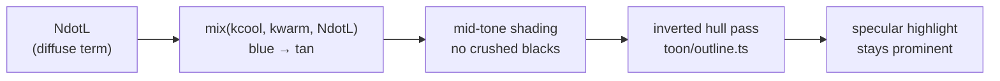
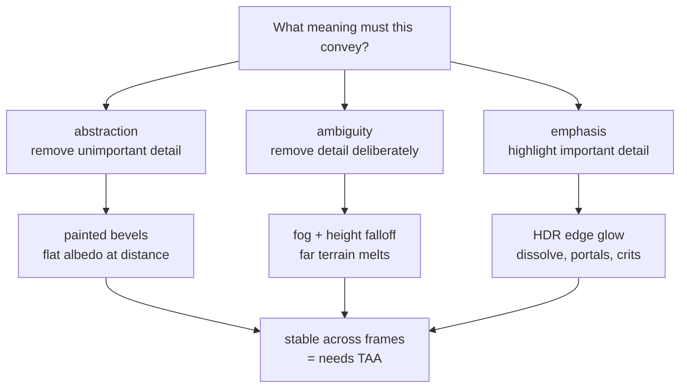
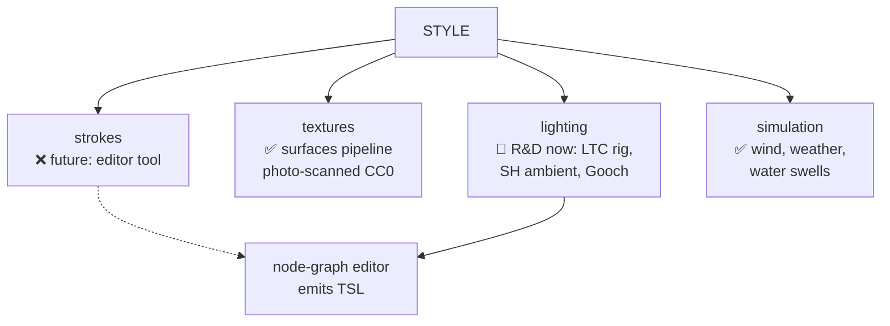
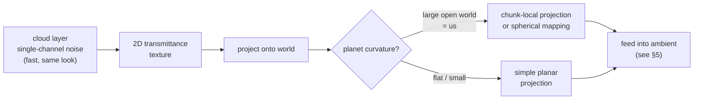
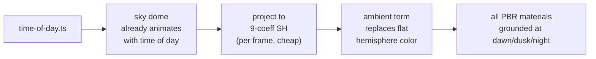
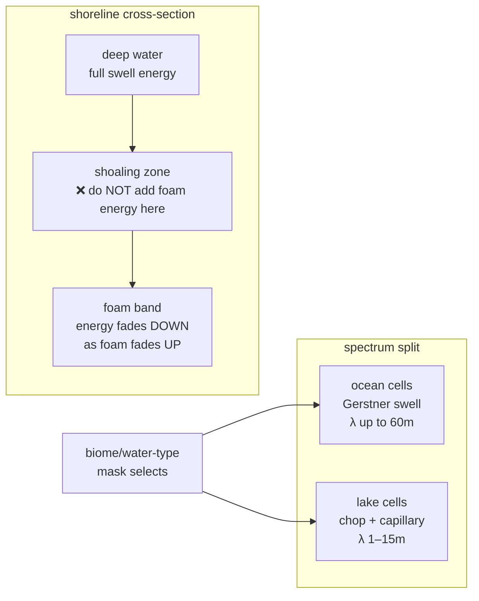
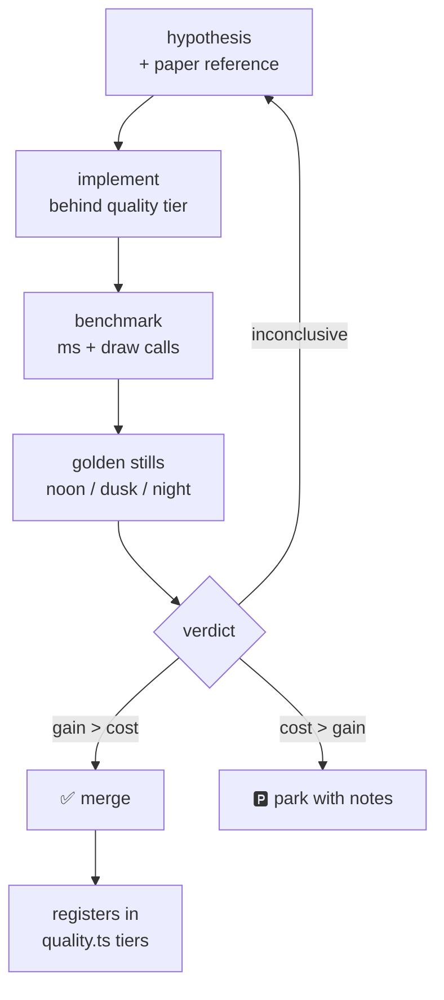
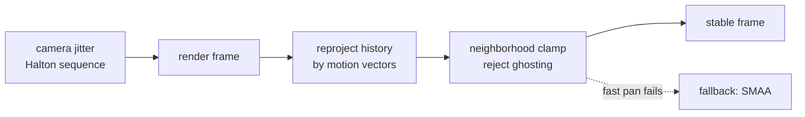

# Techniques Illustrated — Code References & Diagrams

Companion to `SHADER-FX-DEEP-DIVE.md` and `SCHOLARLY-FINDINGS.md`. Every
section pairs a scholarly finding with the exact repo files it touches and
a diagram. All paths are `apps/client/src/render/` unless noted, verified
against `NexusMMOEngine @ 522c0c0`.

---

## 1. Gooch shading — hue shift without dynamic range

**Finding** (Gooch et al. 1998, Utah — peer-reviewed, SIGGRAPH '98):
blend `kcool`/`kwarm` by the cosine term (l·n) — in modern notation
`mix(kcool, kwarm, NdotL)` (the paper's Eq. 2 uses (1±l·n)/2 weights) —
to imply shape without dynamic range; reserve extremes for edges and
highlights.

**Code references:**
- `toon/toon-material.ts` — Genshin-style cel material; the Gooch term
  injects here as a hue-shift stage *before* the ramp quantization.
- `toon/outline.ts` — inverted hull outlines (already the "edge lines"
  half of Gooch's two-pass recipe: cool-to-warm base + black edges).



**Integration sketch** (TSL, into the toon material's color node):

```ts
// kcool/kwarm as uniforms so art direction can tune per-biome
const gooch = mix(kcool, kwarm, ndl.clamp(0, 1));
mat.colorNode = albedo.mul(gooch); // hue carries the shape, not brightness
```

**Cost:** one `mix()`, two uniforms, 0 textures. Prototype on the player
character — highest screen time wins first.

---

## 2. Convey meaning, not light (CMU)

**Finding** (CMU 15-466): abstraction, ambiguity, emphasis. Temporal
continuity is the hard problem for games.



**Code references:**
- Emphasis: `entity-fx.ts` (portals, trails), `element-fx.ts` (orbs) —
  already the emphasis layer; the deep-dive's HDR edge glow extends it.
- Abstraction: `terrain/terrain-material.ts` (biome blending), `toon/` —
  detail lives in roughness, not albedo.
- Temporal stability: `post-fx.tsx` — where TAA lands (Experiment 3).

---

## 3. Style as four dials (UT Austin / Haeberli)

**Finding:** style = Strokes × Textures × Lighting × Simulation, independently
tunable. Lake et al. '00 adds: it must scale to real-time.



**Code references:**
- Textures: `terrain/surfaces.ts`, `scripts/fetch-surfaces.mjs`
  (untouched by this R&D — already strong).
- Lighting: `sky/time-of-day.ts`, `sky/day-sky.ts` — the rig experiments
  land here.
- Simulation: `fx/weather.ts`, `fx/particle-fx.ts`, `water.ts`.
- Strokes: nothing yet — parked for the editor phase, vocabulary ready.

---

## 4. Cloud shadows without the flat-planet trap (Hillaire 2016)

**Finding** (Hillaire 2016 — industry course notes, EA/DICE, not .edu):
bake cloud shadows to a 2D transmittance texture, project onto the world,
feed GI. **Cost correction:** the 0.91ms @720p Xbox One figure is the
*main cloud-view rendering pass* (worst case: horizon view, ⅗ coverage,
16 samples/pass) — **not** the shadow bake, whose cost is unpublished.
The projection *"assumes a overall flat planet around the camera"*
(Hillaire's words); we use chunk-local projection as cheap insurance
regardless.



**Code references:** `sky/day-sky.ts` (cloud layer home), `sky/sky-glsl.ts`
(shared sky function the water shader already evaluates — the same
function can drive the transmittance).

---

## 5. Spherical-harmonic ambient — sky-driven, nearly free

**Finding** (Ramamoorthi & Hanrahan 2001; Green 2003): 9 coefficients
capture diffuse irradiance. Sloan 2002/2003: precompute transport, relight
dynamically (parked for later).



**Code references:** `sky/time-of-day.ts` — owns the sun/moon/sky lights
today; the SH projection slots in beside them. ~20 lines: sample the sky
function at 9 directions (or fixed tap points), dot with SH basis, feed as
uniform. **This is the highest value-per-line item in the whole program.**

---

## 6. Water — the two warnings, illustrated

**Findings:** (a) never *add* wave energy where the shore foam comes up —
cross-fade down instead; (b) lakes need a fetch-limited spectrum, not ocean
swell (JONSWAP).



**Code references:**
- `water.ts`, `water-material.ts` — the water-depth texture (16m cells)
  already drives Beer-Lambert depth and the foam band; extend it with a
  water-*type* channel (ocean vs lake) and invert the energy curve inside
  the foam band.
- Current swells stay; Tessendorf FFT remains parked (Bruneton et al.
  2010: **19.2ms** at 1024×768 on a GeForce 8800 GTS — 11.1ms waves +
  8.1ms shading, the full water pipeline — says our swell-train sums are
  the right budget).

---

## 7. The R&D verdict loop

**Finding** (process, from the program): no technique merges on vibes.



**Code references:** `quality.ts` — every experiment's output registers a
tier here (off/low/high), no exceptions. `showcase.ts` — the FX showcase
ring grows into the shader laboratory where golden stills are captured.

---

## 8. TAA pipeline (Karis 2014)

**Finding** (recipe: Karis 2014, SIGGRAPH course talk; numbers: Yang, Liu
& Salvi 2020, *A Survey of Temporal Antialiasing Techniques*, CGF 39(2)
§7 Table 1): Halton(2,3)-jittered camera + motion-vector (velocity
buffer) reprojection + 3×3 neighborhood clamping; **0.14ms @1080p →
0.52ms @4K** in UE4 on RTX 2080 Ti. Kills vegetation/specular shimmer —
our two noisiest frame elements. (Karis 2014 itself gives no millisecond
figures — its cost claim is qualitative.)



**Code references:** `post-fx.tsx` — the pmndrs post chain; TAA inserts
before bloom (temporal stability improves bloom too). Ghosting test: fast
pan past high-contrast edges; fail → SMAA.

---

## Reading order

1. `R&D-INDEX.md` — program map: order, verdict loop, definition of done.
2. `SHADER-FX-DEEP-DIVE.md` — techniques + code.
3. `SCHOLARLY-FINDINGS.md` — papers + why (citation-audited; see its
   audit log).
4. This file — where each idea lives in the repo.
5. `SHADER-EXPERIMENTS.md` — the executable specs.
6. `RENDER-ARCHITECTURE.md` — pipeline diagrams, shader data model,
   runtime flows (every box mapped to a real file).
