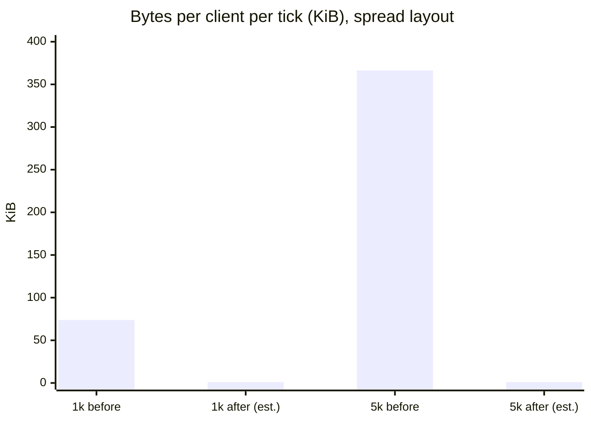

# Interest management (IM)

## Intent
Every client gets the whole region's delta every tick. B4 measures that delta at **73.8 KiB per tick at 1k moving
entities** (366 KiB at 5k, 732 KiB at 10k; base64 channel frames, so about 55 KiB of raw FlatBuffers per client per
tick at 1k). All towns loaded at once, settlement residents and megafauna will multiply the entity count. Interest
management is the biggest scale lever left: a client should get the entities near it, plus the few it must always
see, and the server's cost should grow with occupied sectors, not with clients.

## What exists today (checked on main, 3922c955)
- **Sector grid, no filtering.** `engine-core/src/net/sector.ts`: 64 m square sectors, topics `sector:<sx>,<sz>`.
  `Gateway.broadcast` subscribes each session to its avatar's sector and publishes the **same global delta** once per
  occupied sector topic. The file's own comment names per-sector content as the follow-up it exists for.
- **One global diff and encode per tick.** `DeltaTracker.diff` produces changed-eid lists per component;
  `encodeDeltaFromSim` encodes them once. Rows are absolute values (upserts), not field diffs.
- **The protocol already has enter and leave.** `Delta` carries `spawned` and `despawned` wire ids. A spawned entity
  arrives with all its rows; the mirror (`mirror/src/state.ts`) upserts rows and deletes despawned ids, and the
  client's entity layer drops meshes for missing ids. No new message is needed to say "appear" or "disappear"; what is
  missing is per-client choice of which ids.
- **E3b multiplies the channel cost.** Through the edge, `ChannelTransport.publish` base64s and pushes each publish
  separately, so a tick with *k* occupied sectors sends *k* copies of the global delta over the channel (30 occupied
  sectors at 1k entities is about 2.2 MiB per tick). Before E3b, uWS's native publish shared one buffer. The edge's
  `game-relay.ts` then sends to each topic member in a JS loop.
- **Side messages are global too.** Names (0x12) and drops for spawned ids, hits, life, abilities, telegraphs,
  statuses go to every welcomed session. Snapshots (every 300 ticks, and on resync) are the whole region: 125.7 KiB at
  1k.
- **The bench hides the problem.** `engine-core/test/bench/world.mjs` puts every entity in a 100 m square, which is
  four sectors. Any AOI measurement needs a spread layout.
- Dungeon instances are their own `Gateway` and `SimWorld` on their own port, a few hundred entities at most.
- Region hand-off (`world/migration.ts`) moves an entity and redirects its client; there is no cross-border view.

## Decisions for you
1. **Visibility radius.** My default: interest sectors are those whose rectangle is within **96 m** of the avatar
   (a 3x3 to 4x4 block at 64 m), dropped only beyond **128 m** (hysteresis). Big enough for melee and a town square,
   small enough for a crowded town. Megafauna wants to be seen from further: see "far entities" below.
2. **Dungeon instances keep "see everything"** (`interest: "all"` on the instance gateway) until a dungeon is measured
   to need more. They are small and their rooms are short-range.
3. **Periodic snapshots stay**, rebuilt from per-sector full states (shared, see below), not dropped to
   resync-only. They are the drift guard.

## Goals
1. Bytes per client per tick follow the entities near the client, not the region's count.
2. Each sector's delta is encoded once per tick and shared by every client that sees it; core cost grows with
   occupied sectors, not clients.
3. One message per client per tick, applied atomically (an entity crossing between two visible sectors never flickers).
4. Some entities are always visible to their client regardless of distance.
5. The editor's play-mode debugger and admins can still see everything.

## Non-goals
- Line-of-sight or occlusion culling. Distance only.
- Server-side rate LOD in the first cut (see slice IM7).
- Changing the sim, systems or the tracker's diff.

## Anti-goals
- Per-client encoding of sector content. A client's message is a concatenation of shared bytes plus a small
  per-client part (its pinned entities).
- A client holding an entity it can no longer receive updates for (stale ghosts): leaving a sector always removes
  what lived in it.
- Cheating by omission: interest is decided on the core from the authoritative position, never by the client.

## Design

### Grid and interest sets
- Reuse `sector.ts` (64 m, world coordinates). Each tick, one pass over the changed eids buckets them by the sector of
  their `Transform` (`Math.floor(px / 64)`), and records sector moves (an entity whose sector differs from last tick).
- Each session has an **interest set** of sectors, recomputed only when its avatar crosses a sector boundary or moves
  past the hysteresis distance: add a sector when its rectangle is within `enterM` (96) of the avatar, drop it when
  further than `leaveM` (128). Both in `content/rules/interest.json`, editable like the ingress rules.
- An entity's **home sector** is where its Transform is. Entities without a Transform (rare) are global.
- Terrain chunk entities (Chunk component) have their own wider ring (`chunkM`, default the client's terrain view):
  they almost never change, so they cost bytes only on enter.

### Per-sector encoding, once
For each occupied sector with changes this tick, the core encodes one **sector delta** (the existing SoA encoder over
that sector's eid lists):
- rows for its entities that changed;
- entities that moved **in** from another sector: listed in `spawned`, with all their rows;
- entities that moved **out**, or despawned: listed in `despawned`.

The sum of sector deltas is about the size of today's one global delta (plus a small header per sector), so encode
cost stays about where it is. A **sector full state** (every entity homed there, all rows, plus their names and drop
data) is encoded lazily, at most once per sector per tick, only when some client enters that sector this tick or on a
snapshot tick.

### One message per client per tick: `DeltaSet`
A new envelope type (protocol bump), `DeltaSet { tick, entries[] }`, each entry
`{ sector, kind: delta | full | leave, bytes }`, plus one optional **pinned** entry (below). The mirror applies a
DeltaSet atomically:
1. `leave` entries: drop every entity homed in that sector (the mirror keeps `wireId -> home sector`, set by the
   entry an entity's rows arrived in).
2. All `despawned` lists.
3. All upserts (`full` and `delta` rows), re-homing each entity to the entry's sector.
4. One interpolator push for the tick's merged transforms.

Despawns before upserts is what makes an entity crossing from sector A to B safe for a client that sees both: A's
entry says it left, B's entry carries it in full, and it ends up present and homed in B. The mirror tells the renderer
whether an entity *left view* or *despawned* (a `left` set beside `despawned`), so the client can fade it out instead
of playing a death or pickup.

Separate WS messages per sector were rejected: *k* sends per client per tick, and no atomicity for crossings.

### Who assembles: the edge
The core decides interest; the edge assembles bytes.
- Per tick the core sends one push, `wire.sectors { tick, deltas: {sector: bytes}, fulls: {sector: bytes} }`, instead
  of *k* `wire.publish`. Channel bytes per tick are about one global delta, whatever the client count (fixes the E3b
  multiplication). E5a's binary frames remove the base64 on top; IM does not wait for E5a.
- Interest changes reuse `wire.sub` / `wire.unsub` with the sector topic. `wire.sub` gains `full: true` (send this
  sector's full state on the next tick); `wire.unsub` makes the edge add a `leave` entry.
- Per session per tick the edge concatenates its sectors' entries (full for newly entered, delta otherwise) and the
  session's pinned bytes (sent as `wire.send`, see below) into one `DeltaSet` and sends it. That is a memcpy of shared
  buffers per client; the edge exists to absorb this fan-out, and it scales out by adding edges.
- Without an edge (a core listening directly: tests, editor play, dungeon instances) the gateway runs the same
  assembly function in-process. The function lives in `packages/protocol` so both ends share it.

The topic sets the edge already keeps (`topics: Map<topic, Set<sid>>`) become per-session sector sets; the edge's
publish loop for `sector:` topics is replaced by assembly. Non-sector topics keep plain publish.

### Always visible ("pinned")
Per session, entities visible regardless of distance. When a pinned entity's home sector is also in the session's
interest set, the sector copy is used and the pinned copy skipped.
- **Own avatar.** Always pinned (it also anchors the interest set).
- **Party members.** Pinned while in the same region: the party frame needs health and position.
- **Current target** and anything that has the session targeted (an attacker out of range of its victim's view).
- **Quest NPCs** of the session's active quest steps (the quest log knows them), for the tracker arrow.
- **Far entities:** an entity tagged `farVisible` (megafauna, landmarks, world bosses) joins every session within its
  own `farM` (default 400 m), carrying transform only beyond `enterM`.

Pinned rows are per client (small: a party of five and a target), encoded per session from the same tracker diff and
sent with `wire.send` just before the tick's assembly; the edge folds them in as the pinned entry. A pin added mid-way
sends that entity in full; a pin removed while out of view becomes a `left`.

Not entities, so not affected: guild and chat (already per session or per channel), party state, friends, wallet,
skills, stats, body, mana. Local "say" chat stays as it is for now.

### Events follow interest
Hits, life, ability casts, telegraphs, statuses and names and drops are sent to a session only when their source or
target (or the telegraph's centre) is in its interest set or pinned. Names and drops of an entity also ride its
sector's full state, so an entity entering view arrives with its name.

### Snapshots
The welcome snapshot, the periodic one (every 300 ticks) and resyncs become **interest snapshots**: the session's
sector full states plus its pinned entities, as a DeltaSet of `full` entries with a "replace" flag (the mirror clears
first). On a snapshot tick the sector full states are encoded once and shared, so the snapshot tick no longer costs
the whole region per client.

### The debugger, admins and instances
- A session may ask for `interest: "all"` in hello; the gateway honours it only for an editor play-mode session or an
  admin account. It receives every sector's delta in its DeltaSet (today's bytes, so the debugger's ECS inspector,
  selection cards and overlays work unchanged). The play-mode debugger gets a toggle, "show everything / show what the
  player sees", so designers can check AOI itself; the overlay draws the session's interest sectors.
- Admin console commands work by wire id and are unaffected. An admin teleporting is an ordinary interest change.
- Dungeon instance gateways start with `interest: "all"` for every session (decision 2).

### Cross-region view at borders (IM8)
A player near a region border sees the neighbour region's entities within range, read-only. Minimal design, built
from what the fleet already has:
- **Who decides:** the home core. It knows the neighbours from the world's region registry (`RegionInfo`: chunk range
  and endpoint), which the migration coordinator already fetches and refreshes on registry changes. While a session's
  avatar is within `enterM` of a live neighbour's range it sends the client a `Border` control message
  `{kind:"border", region, endpoint, ticket, exp}` (renewed before `exp`); past `leaveM` it sends
  `{kind:"border", region, endpoint, leave:true}`.
- **Ticket:** `HMAC-SHA256(WORLD_API_KEY, "border|<region>|<from>|<account>|<exp>")`, 60 s (`from` is the home
  region). Every region of a fleet holds
  `WORLD_API_KEY` already (it registers with it), so the neighbour checks the ticket with no round trip.
- **The neighbour serves an observer session.** The client opens a second socket to the neighbour's endpoint and says
  hello with `observe: {region, from, account, exp, ticket}`. The neighbour welcomes it without a player entity; the session
  gets IM DeltaSets for an interest set anchored on a position the client reports (`{kind:"observe", x, z}`), and its
  intents are refused. The neighbour clamps the anchor into the home region's range, so an observer sees at most the
  strip of its world a player at the border would see anyway.
- **Wire ids stay apart:** each region's ids live in their own mirror (a second `MirrorClient`), so ids from two sims
  never collide; the client draws the observer's entities beside its own, read-only.
- **Hand-off:** when the player migrates into the neighbour, the observer socket closes; the old home becomes the
  neighbour and the same messages start from the other side.
- Without a fleet (a core alone, editor play, dungeon instances) no `Border` is ever sent.
- ponytail: the observer anchor is client-reported (clamped into the home region); a home-signed anchor per tick is the
  upgrade if the strip leaks too much. Events (hits, casts) from the neighbour ride the observer session's interest
  like any other session's.

### Region hand-off
The target region welcomes the redirected client with an interest snapshot, the normal enter path. The source region
drops the session when it leaves; nothing extra. Because sectors are in world coordinates the same sector ids name the
same ground on both sides.

### Client mirror
- `applyDeltaSet` as above, the home-sector map, the `left` set, and the existing `applyDelta`/`applySnapshot` kept
  for the protocol path tests and the `all` mode.
- The entity layer fades `left` entities (short alpha out) and despawns the rest as today.
- Rendering LOD is the client's own (meshoptimizer chains already exist); the mirror adds nothing for it. A view
  distance setting in the client must not exceed `enterM`; beyond it there is nothing to draw except far entities.

## Measurement plan
New bench **B7, interest bandwidth**, in `engine-core/test/bench/` (beside B3, B4), not part of `npm test`:
- Layouts: *spread* (1k and 5k entities over a 2 km square) and *towns* (the same counts, 70% in five 150 m towns, the
  rest spread). 50 simulated sessions placed like the entities (players go where people are).
- Reports per row: mean and p99 **bytes per client per tick**, **core tick ms** (mean, p99), **channel bytes per tick**
  (core to edge), and edge assembly ms per tick. Before (global delta, today's path) and after (IM on).
- Every IM PR that touches the tick path posts B7 before/after as Mermaid charts in its PR body (the repo rule), and
  runs `npm run valgrind:perf`, saying what moved; a deliberate cost updates the baseline in the same PR.

Chart format for the PRs (the "before" bar is B4's measurement; the "after" bars are filled in by IM3's measurement,
these placeholders are my estimate for the spread layout: about 12 entities in view at 5k over 4 km^2):

A second chart, core tick ms (mean) at 1k and 5k before and after, comes from B7's first run in IM0; it is left out
here rather than invented.

Towns are the honest worst case: 300 residents inside one 3x3 block is about 17 KiB per tick for a client standing in
it, a quarter of today's 1k figure, and it does not grow with the rest of the world.

## Left to the builder
Exact entry encoding in `DeltaSet` (length-prefixed entries in one buffer), the sector-index structure, the interest
rules file shape, fade timing on the client, and test fixtures. The sector size stays 64 m unless B7 says otherwise.

## Slices (one PR each, in order)
- **IM0: B7 bench, baseline.** Spread and towns layouts, sessions, bytes per client, tick ms, channel bytes; before
  numbers recorded in `EDGE-SPLIT-RESULTS.md`. No product change.
- **IM1: one publish through the edge.** While the content is global, publish once per tick to one region topic
  instead of once per occupied sector, so the channel carries one copy (fixes the E3b multiplication now). B7 chart.
- **IM2: `DeltaSet` in protocol and mirror.** Envelope type, shared assembly function, `applyDeltaSet` (home map,
  leave, despawns first, one interpolator push), the `left` set and the fade in the entity layer. The gateway sends
  every tick as a one-entry DeltaSet; same entities, protocol bump.
- **IM3: per-sector encode and interest sets in the core**, in-process assembly (direct transports), own avatar
  pinned, hysteresis, `content/rules/interest.json`. Behind `MMO_INTEREST=1`. B7 before/after, valgrind:perf.
- **IM4: edge assembly.** `wire.sectors`, `wire.sub {full}`, `leave` on unsub, per-session assembly in
  `game-relay.ts`. B7 through the edge, valgrind:perf.
- **IM5: pins and events.** Party, targets and attackers, quest NPCs, far entities; hits, life, abilities,
  telegraphs, statuses, names and drops filtered by interest.
- **IM6: interest snapshots, the `all` mode and the debugger toggle.** Welcome, periodic and resync snapshots from
  shared sector fulls; `interest: "all"` for editor play, admins and dungeon instances; the play-mode overlay of
  interest sectors. `MMO_INTEREST` on by default.
- **IM8: cross-region view at borders** (built after IM6; IM7 only if B7 asks). `Border` message and ticket on
  the home core from the registry, observer hello and anchor on the neighbour, a second mirror in the client.
- **IM7 (only if B7 asks): rate LOD.** Sectors in the outer ring sent at 10 Hz as the union of the last three ticks'
  changed rows at current values (rows are absolute, so no second baseline is needed).

Ordering with work in flight: IM1 and IM4 touch the same publish path as `perf/drop-tick-delta-push` and E5a; land
after the first and independent of the second (E5a only makes `wire.sectors` cheaper).

## Answered (2026-10-23)
1. Radius: **96 m in, 128 m out, 400 m for far entities, approved as is.**
2. Local "say" chat: **stays region-wide.**
3. Dungeon instances: **keep seeing everything.**
4. Cross-region view at borders: **not deferred**; built as IM8 (above), after IM6.
