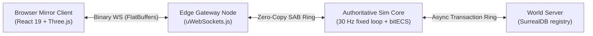
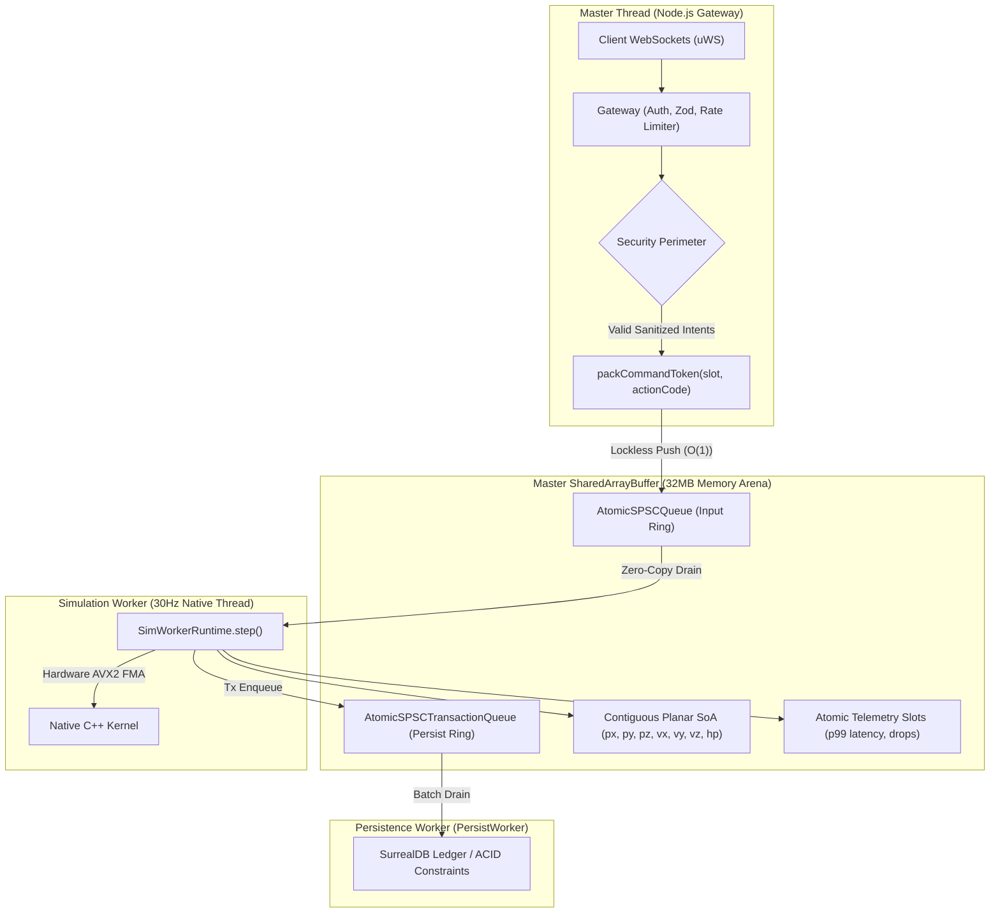

# 01. Architectural Blueprint

[← Back to Wiki Index](README.md) | [Next: Engine / Game Decoupling →](02-engine-game-split.md)

---

## 1. Overview
The Nexus MMO Engine is an authoritative, data-oriented spatial simulation engine engineered for large-scale persistent virtual worlds. 

The architecture physically isolates:
1. **Network Ingress & Session Handling** ([`apps/edge`](file:///c:/Users/user/Downloads/mmo-engine-full/apps/edge))
2. **Authoritative Simulation** ([`packages/engine-core`](file:///c:/Users/user/Downloads/mmo-engine-full/packages/engine-core))
3. **World Coordination & Persistence** ([`packages/world-server`](file:///c:/Users/user/Downloads/mmo-engine-full/packages/world-server))
4. **Client Visualization** ([`apps/client`](file:///c:/Users/user/Downloads/mmo-engine-full/apps/client))

---

## 2. The 3-Tier Execution Topology



### Tier 1: Client Mirror
- The browser client runs **no authoritative game logic**.
- The client receives binary snapshots and deltas, interpolates transforms, predicts local camera movement, and sends user intents back to the server.

### Tier 2: Edge Ingress Layer
- Runs `uWebSockets.js` directly over native C++ socket polling.
- Authenticates users, rate-limits requests, validates packets against strict schemas, and routes intents to the simulation core.
- Computes sector-based Area of Interest (AoI) and serializes binary delta frames per connection.

### Tier 3: Authoritative Simulation Core
- Fixed 30 Hz simulation loop ($dt = 1/30\text{s} = 33.33\text{ms}$).
- Owns all canonical entity state, spatial indexing, physics step integration, and module updates.
- Steps native C++ kernels directly in-process via N-API with zero per-entity serialization overhead.

---

## 3. The Hybrid Data Plane & Production Topology

Communication across threads uses lock-free queues over a single page-aligned `SharedArrayBuffer` arena (`MMO_DATA_PLANE=1`):



1. **Planar SoA Component Storage**: Contiguous 64-byte aligned columns of floats/integers, enabling direct SIMD AVX2 vector processing.
2. **Lockless Command Rings**: Single-producer (`AtomicSPSCQueue`) and multi-producer queues operating via atomic CAS operations without mutex locks.
3. **Atomic Telemetry**: Thread-safe atomic counters tracking tick duration (`LAST_TICK_US`, `MAX_TICK_US`), budget overruns, and spiral drop events (`SPIRAL_EVENTS`, `DROPPED_MS`).
4. **Crash Containment & Hot Reattachment**: The network gateway isolates client sockets from the simulation worker thread. If the simulation worker crashes, client WebSockets remain in `WebSocket.OPEN` state while `restartSimWorker()` hot-reattaches a fresh worker to the shared memory arena with zero state loss.

---

## 4. The 30 Hz Fixed Timestep Loop

The loop in [`packages/engine-core/src/tick-loop.ts`](../packages/engine-core/src/tick-loop.ts) and [`packages/engine-core/src/sim-worker.ts`](../packages/engine-core/src/sim-worker.ts) decouples simulation time from wall-clock variance:

- **Accumulator**: Wall time is accumulated ($dt = 1/30\text{s} = 33.33\text{ms}$). Frame gaps exceeding $250\text{ms}$ are clamped to absorb pathological pauses (tab switches, debugger stops).
- **Spiral Guard**: At most 5 catch-up steps (`MAX_STEPS_PER_FRAME = 5`) run per frame. Excess backlog is dropped and atomically counted as a `spiralEvent` in telemetry, preventing frame death cascades.
- **Measured Contention Performance (B3 Soak)**: In 51,000-entity stress benchmarks with 1,000 active client streams under injected network latency (45ms) and jitter (±15ms), $p99$ tick duration measures **$0.562\text{ms}$** (only $1.7\%$ of the $33.33\text{ms}$ budget), with **0 dropped steps**.

---

[← Back to Wiki Index](README.md) | [Next: Engine / Game Decoupling →](02-engine-game-split.md)

---

## 1. Overview
The Nexus MMO Engine is an authoritative, data-oriented spatial simulation engine engineered for large-scale persistent virtual worlds. 

The architecture physically isolates:
1. **Network Ingress & Session Handling** ([`apps/edge`](file:///c:/Users/user/Downloads/mmo-engine-full/apps/edge))
2. **Authoritative Simulation** ([`packages/engine-core`](file:///c:/Users/user/Downloads/mmo-engine-full/packages/engine-core))
3. **World Coordination & Persistence** ([`packages/world-server`](file:///c:/Users/user/Downloads/mmo-engine-full/packages/world-server))
4. **Client Visualization** ([`apps/client`](file:///c:/Users/user/Downloads/mmo-engine-full/apps/client))

---

## 2. The 3-Tier Execution Topology


### Tier 1: Client Mirror
- The browser client runs **no authoritative game logic**.
- The client receives binary snapshots and deltas, interpolates transforms, predicts local camera movement, and sends user intents back to the server.

### Tier 2: Edge Ingress Layer
- Runs `uWebSockets.js` directly over native C++ socket polling.
- Authenticates users, rate-limits requests, validates packets against strict schemas, and routes intents to the simulation core.
- Computes sector-based Area of Interest (AoI) and serializes binary delta frames per connection.

### Tier 3: Authoritative Simulation Core
- Fixed 30 Hz simulation loop ($dt = 1/30\text{s} = 33.33\text{ms}$).
- Owns all canonical entity state, spatial indexing, physics step integration, and module updates.
- Steps native C++ kernels directly in-process via N-API with zero per-entity serialization overhead.

---

## 3. The Hybrid Data Plane

Communication across threads uses lock-free queues over a single page-aligned `SharedArrayBuffer`:

```
┌────────────────────────────────────────────────────────────────────────┐
│                   SHAREDARRAYBUFFER MEMORY ARENA                       │
├────────────────────┬────────────────────┬──────────────────────────────┤
│ 1. Planar SoA      │ 2. Lockless Rings  │ 3. Telemetry Counters        │
│ Contiguous columns │ AtomicSPSCQueue    │ Atomic tick metrics,         │
│ (px, py, pz, ...)  │ AtomicMPSCQueue    │ packet counts, drop counters │
└────────────────────┴────────────────────┴──────────────────────────────┘
```

1. **Planar SoA Component Storage**: Contiguous 64-byte aligned columns of floats/integers, enabling direct SIMD vector processing.
2. **Lockless Command Rings**: Single-producer and multi-producer queues operating via atomic CAS (Compare-And-Swap) operations without mutex locks.
3. **Atomic Telemetry**: Thread-safe atomic counters tracking tick duration, frame drops, and queue depths.

---

## 4. The 30 Hz Fixed Timestep Loop

The loop in [`packages/engine-core/src/tick-loop.ts`](file:///c:/Users/user/Downloads/mmo-engine-full/packages/engine-core/src/tick-loop.ts) decouples simulation time from wall-clock variance:

- **Accumulator**: Wall time is accumulated; when accumulated time exceeds $33.33\text{ms}$, a tick executes.
- **Spiral Guard**: If frame time exceeds $166.6\text{ms}$ (5 catch-up ticks), excess backlog is dropped and counted as a `spiralEvent`. This prevents catastrophic frame death cascades.

---

[← Back to Wiki Index](README.md) | [Next: Engine / Game Decoupling →](02-engine-game-split.md)
