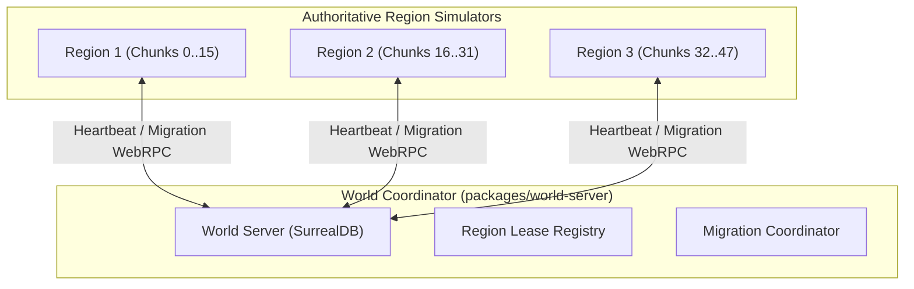

# 06. Multi-Region World Coordination

[← Previous: Networking & Edge](05-networking-and-edge.md) | [Back to Wiki Index](README.md) | [Next: Procedural Generation & Synthesis →](07-procedural-generation.md)

---

## 1. Overview
The multi-region architecture divides large continuous open worlds into discrete spatial chunks simulated by independent `engine-core` region servers. The world server coordinates chunk assignments and manages cross-region migration.

---

## 2. Region Server vs. World Server



### The Region Server
- Each region server simulates an authoritative chunk range (`REGION_CHUNK_RANGE`, as `"x0,z0,x1,z1"`; or the range the world assigns it).
- Owns its 30 Hz tick loop, local entity memory, its client gateway, and its embedded SQLite databases.
- Players' traffic goes to their region (through that region's edge, see chapter 5), never through the world server.

### The World Server
- Acts as a coordinator: keeps the region registry and leases, detects stale regions (heartbeats), and arbitrates border hand-offs. It never moves entities itself.
- **Never simulates physics or gameplay.**
- Stores its records in embedded SurrealKV by default, or in a server through `WORLD_DB_URL`.
- Runs off the region tick loop: the hand-off code makes its calls from timers, not from inside the tick, so a slow world call cannot stall a region.

---

## 3. Border Hand-offs

The world records and arbitrates a hand-off; the regions do the work (`MigrationCoordinator` in `packages/engine-core/src/world/migration.ts`).

```
Region A (source)                World server                Region B (target)
      │── BeginMigration(entity, B, state) ─►│  recorded "begun"       │
      │── redirect the entity's client to B, with the migration id ───►│ (via the client)
      │                                      │◄── GetMigration ────────│ reads the state
      │                                      │◄── CommitMigration ─────│ "committed": B has authority
      │◄── heartbeat ack lists it committed ─│                         │
      │ drops the entity                     │                         │
```

- **The source keeps authority until the commit.** An entity that walks back, or a hand-off that is aborted or does not commit within `WORLD_MIGRATION_TIMEOUT_MS` (10 s), stays where it was.
- **Commit and expiry are compare-and-set on "begun"**, so exactly one wins. A target whose commit the world refuses drops its copy, so authority is never duplicated.
- If the source dies, the target can still read the entity's state from the world.
- **Measured** (`docs/WORLD-STRESS-RESULTS.md`): at 16 regions, each with 500 entities and 100 players crossing borders at 7 m/s, 1,584 of 1,584 hand-offs committed, with a hand-off time of **5.1 ms (p50) and 15.4 ms (p99)**, measured from the redirect to the target's confirmed commit by a harness that plays the clients. That is the world's part, not a client's reconnect time over a real network.

---

[← Previous: Networking & Edge](05-networking-and-edge.md) | [Back to Wiki Index](README.md) | [Next: Procedural Generation & Synthesis →](07-procedural-generation.md)
