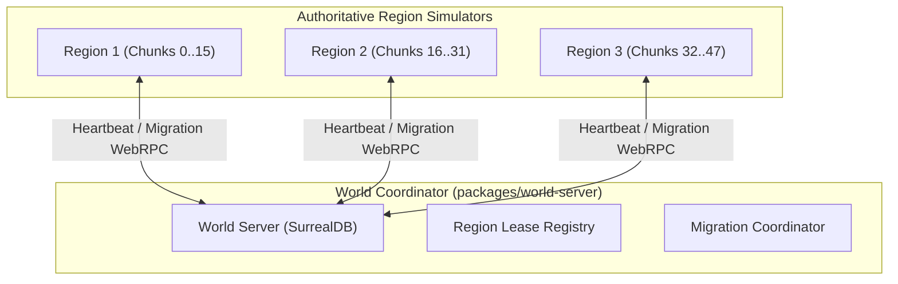

# 06. Multi-Region World Coordination

[← Previous: Networking & Edge](05-networking-and-edge.md) | [Back to Wiki Index](README.md) | [Next: Procedural Generation & Synthesis →](07-procedural-generation.md)

---

## 1. Overview
The multi-region architecture divides large continuous open worlds into discrete spatial chunks simulated by independent `engine-core` region servers. The world server coordinates chunk assignments and manages cross-region migration.

---

## 2. Region Server vs. World Server



### The Region Server
- Each region server simulates an authoritative chunk range (`REGION_CHUNK_RANGE`).
- Owns its 30 Hz tick loop, local entity memory, client gateways, and embedded SQLite database.
- Clients connect directly to their region; client traffic never passes through the world server.

### The World Server
- Acts as a pure coordinator: maintains region leases, detects stale servers, and tracks cross-region migration.
- **Never simulates physics or gameplay**.
- Runs on embedded SurrealDB for persistent chunk and player records.
- Operates entirely off the region tick loop—a slow world server query will never stall an active region.

---

## 3. Seamless Border Migration

When a player approaches the edge of a region boundary:

```
Region A (Source)                      World Server                      Region B (Target)
       │                                     │                                   │
       │─── 1. BeginMigration(entityId) ────►│                                   │
       │                                     │─── 2. PrepareMigration(state) ───►│
       │                                     │◄── 3. AcknowledgeReady() ─────────│
       │◄── 4. RedirectClient(targetHost) ───│                                   │
       │                                                                         │
       │═════════════════ Client Reconnects to Region B ════════════════════════►│
       │                                                                         │
       │                                     │◄── 5. CommitMigration(entityId) ──│
       │◄── 6. ReleaseEntity(entityId) ──────│                                   │
```

- **Handoff Latency**: Migration completes in **$5.1\text{ms}$ ($p50$)** and **$15.4\text{ms}$ ($p99$)**.
- **Zero World State Duplication**: Entity authority transfers atomically to ensure items and progression can never be duplicated.

---

[← Previous: Networking & Edge](05-networking-and-edge.md) | [Back to Wiki Index](README.md) | [Next: Procedural Generation & Synthesis →](07-procedural-generation.md)
