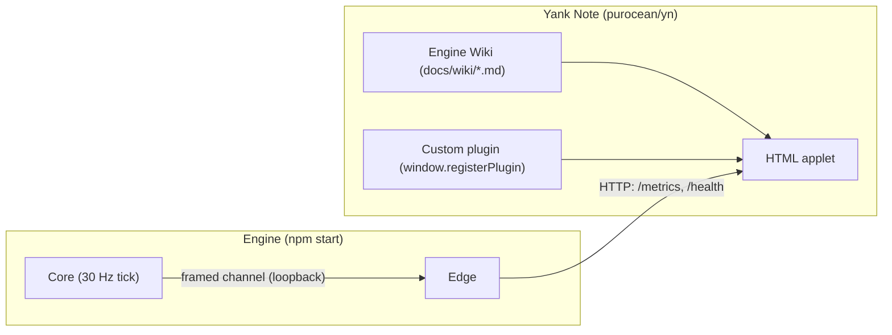

# 10. Developer Tooling & Interactive Documentation Ecosystem (Yank Note & Data Apps)

This chapter outlines the recommended developer tooling and interactive documentation ecosystem for the **Nexus MMO Engine**, detailing the incorporation of **Yank Note** ([`purocean/yn`](https://github.com/purocean/yn)) as an extensible, programmer-first Markdown knowledge base and interactive data application host.

---

## 1. Motivation & Ecosystem Philosophy

The Nexus MMO Engine is documented using pure, version-controlled Markdown (`docs/WIKI.md`, `docs/wiki/`, `docs/DECISIONS.md`, and `docs/ROADMAP.md`). While standard text editors and static web generators can view these files, complex distributed game engines benefit from an **interactive documentation environment** that integrates:

1. **Local-First File Integrity:** Works directly with the repository's `.md` files without intermediate databases, cloud lock-in, or proprietary formatting.
2. **In-Note Executable REPL:** Allows engineers to run engine build commands, unit tests, and performance benchmarks directly from documentation pages.
3. **Interactive Diagrams & Architectural Models:** Flawlessly renders supported Mermaid architectures (`flowchart TD`, `sequenceDiagram`, `stateDiagram-v2`, `xychart-beta`), Draw.io schemas, and PlantUML models.
4. **Interactive Data Dashboards (Data Apps):** Hosts embedded HTML applets, React + Vite data widgets, and real-time engine telemetry monitors.
5. **Zero-Knowledge Encrypted Notes (`.c.md`):** Client-side encrypted documents for staging deployment credentials, region access tokens, and infrastructure secrets without leaking plain text into repository history.

To fulfill these requirements, **Yank Note** (`purocean/yn`) is incorporated into our recommended developer toolchain.

---

## 2. Core Capabilities of Yank Note (`purocean/yn`)

| Feature | Developer Benefit | In-Engine Application |
| :--- | :--- | :--- |
| **Monaco Editor Kernel** | VS Code editing experience with multi-cursor, syntax highlighting, and code folding. | Seamless editing of engine wiki documents and FlatBuffers schemas. |
| **Runnable Code Blocks** | In-note execution of Node.js, Python, and shell scripts with inline output display. | 1-click execution of test suites (`npm test -w @mmo-engine/protocol`, which builds first) and benchmarks directly from docs. |
| **HTML Applets & Reveal.js** | Embeds interactive web components, custom HTML/JS widgets, and presentations. | Embedding real-time simulation visualizers and telemetry monitors. |
| **Plugin Architecture** | Thin, powerful JavaScript plugin API via `window.registerPlugin`. | Custom engine inspector plugins, webrpc schema browsers, and build shortcuts. |
| **Document Encryption** | Frontend client-side encryption for `.c.md` files. | Safely keeping private staging configs, production keys, and deployment profiles locally. |
| **Integrated Terminal** | Embedded sidebar terminal bound to project working directory. | Rapid command-line operations without switching application focus. |

---

## 3. Architecture: Interactive Telemetry & Data Apps

Yank Note's HTML applet support lets technical designers and live-ops engineers embed data apps in documentation notes. The engine's live numbers are served by the **edge** as a Prometheus scrape (`GET :3000/metrics`, see [OPERATIONS.md](../OPERATIONS.md)) and its health at `GET :3000/health`. There is no WebSocket telemetry stream: an applet polls.



### 3.1 Embedding a telemetry applet in a note

An HTML block that polls `/metrics`, reads the core's tick counter (`mmo_core_tick`, relayed by the edge) and says whether the core's numbers are stale (`mmo_edge_core_metrics_stale`). The edge must be running (`npm start`), and the page may need the edge to allow the note's origin; if the browser blocks the request, use the plugin below, which runs outside the page sandbox.

````markdown
```html
<div id="telemetry-card" style="padding: 16px; background: #161b22; border-radius: 8px; color: #f0f6fc; font-family: sans-serif;">
  <h3 style="margin-top: 0; color: #58a6ff;">Engine telemetry</h3>
  <div>Core tick: <b id="m-tick">-</b></div>
  <div>Core numbers stale: <b id="m-stale">-</b></div>
</div>
<script>
async function poll() {
  try {
    const text = await (await fetch("http://127.0.0.1:3000/metrics")).text();
    const get = (name) => (text.match(new RegExp("^" + name + "(?:\\{[^}]*\\})?\\s+(\\S+)", "m")) || [])[1];
    document.getElementById("m-tick").innerText = get("mmo_core_tick") ?? "n/a";
    document.getElementById("m-stale").innerText = get("mmo_edge_core_metrics_stale") ?? "n/a";
  } catch (e) {
    document.getElementById("m-tick").innerText = "edge offline";
  }
}
setInterval(poll, 2000);
poll();
</script>
```
````

---

## 4. Custom Yank Note Plugin for Nexus MMO Engine

A plugin placed in Yank Note's plugins folder (`<home>/yank-note/plugins/plugin-nexus-engine.js`) can add a status-bar health indicator and a test shortcut. The edge's `/health` answers `{ "ok": true, "core": "up" | "down" | "unknown" }`. The Yank Note plugin API is Yank Note's own; check its documentation for the exact names, which this sketch uses as of this writing and which this repository does not test.

```javascript
// plugin-nexus-engine.js - Nexus MMO Engine Integration Plugin for Yank Note
window.registerPlugin({
  name: "nexus-mmo-engine",
  register: (ctx) => {
    // 1. Status bar item: is the core up, as the edge sees it?
    ctx.statusBar.tapMenus((menus) => {
      menus["nexus-status"] = {
        id: "nexus-status",
        position: "right",
        title: "Nexus: check",
        onClick: async () => {
          try {
            const res = await fetch("http://127.0.0.1:3000/health");
            const data = await res.json();
            ctx.ui.useToast().show("info", `Edge ok, core ${data.core}`);
          } catch (e) {
            ctx.ui.useToast().show("error", "Edge offline (port 3000)");
          }
        },
      };
    });

    // 2. Editor action: run the active test file
    ctx.editor.addCommand({
      id: "nexus-run-test",
      label: "Nexus: Run Active Test File",
      keybindings: [ctx.monaco.KeyMod.CtrlCmd | ctx.monaco.KeyCode.F9],
      run: () => {
        const filePath = ctx.editor.getCurrentFilePath();
        if (filePath && filePath.endsWith(".test.ts")) {
          ctx.terminal.sendText(`npx tsx --test "${filePath}"\n`);
        } else {
          ctx.ui.useToast().show("warning", "Current file is not a *.test.ts document.");
        }
      },
    });
  },
});
```

---

## 5. Setting Up Yank Note with Nexus MMO Engine

1. **Install Yank Note:**
   - Download the prebuilt release for Windows / macOS / Linux from [github.com/purocean/yn/releases](https://github.com/purocean/yn/releases).
2. **Open Engine Repository as Workspace:**
   - In Yank Note, select **File $\to$ Open Folder...** and choose the repository's `docs` folder.
   - All documentation chapters, decision logs, and roadmaps will appear in the native navigation sidebar.
3. **Configure Executable Code Snippets:**
   - Navigate to **Settings $\to$ Extensions $\to$ Code Runner**.
   - Ensure `node` and `npm` executables are mapped in PATH.
   - Code blocks with language `bash`, `powershell`, or `javascript` can now be executed directly with a single click.
4. **Mermaid Rendering Standard:**
   - Always format Mermaid diagrams using the supported grammar standards (`flowchart TD`, `graph TD`, `sequenceDiagram`, `stateDiagram-v2`, `classDiagram`, `erDiagram`, `xychart-beta`).
   - Avoid unsupported experimental diagrams (e.g. `quadrantChart`) to guarantee 100% rendering fidelity across both Yank Note and web documentation viewers.
