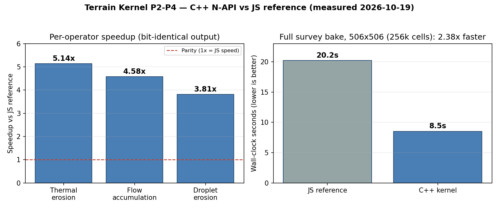

# Terrain Kernel — Performance

Measured 2026-10-19 on the build VM (Linux, single run per configuration).
These are indicative numbers for capacity planning, not guarantees — absolute
times vary with hardware; the speedups and the bit-identity guarantee are the
durable claims.



## Correctness gate (must hold before speed matters)

The C++ operators produce **bit-identical output** to the compiled JS
reference (`terrain/erosion.ts`). Verified by `test/parity.test.js` (4/4) and
the end-to-end bake fingerprint: `0876fc70` for both implementations,
including deepest-cut and droplet mean/max statistics.

## Per-operator speedups (parity test)

| Operator | Speedup vs JS |
|---|---|
| Thermal erosion | 5.14× |
| Flow accumulation | 4.58× |
| Droplet erosion | 3.81× |

## Full survey bake (scripts/bench.cjs)

Sequence: thermal (15 iterations) → fluvial (12) → droplet (150k droplets) →
thermal (15), on a 506×506 heightfield (256,036 cells) — the survey scale the
world baker uses.

| Stage | Speedup vs JS |
|---|---|
| Thermal (first pass) | 3.46× |
| Fluvial | 3.03× |
| Droplet | 2.15× |
| Thermal (second pass) | 2.11× |
| **Total wall-clock** | **20.2s → 8.5s (2.38×)** |

## What this means in practice

- A full survey-scale terrain bake that took ~20s in JS takes ~8.5s with the
  kernel, with zero output drift — existing baked worlds do not change.
- Kernel tests: 13/13 pass (`test/kernel.test.js`), including cross-process
  determinism and tectonics ridge continuity.

## Reproduce

```sh
npm install            # node-gyp rebuild
bash scripts/build-jsref.sh
node --test test/kernel.test.js
node --test test/parity.test.js
node scripts/bench.cjs
```
