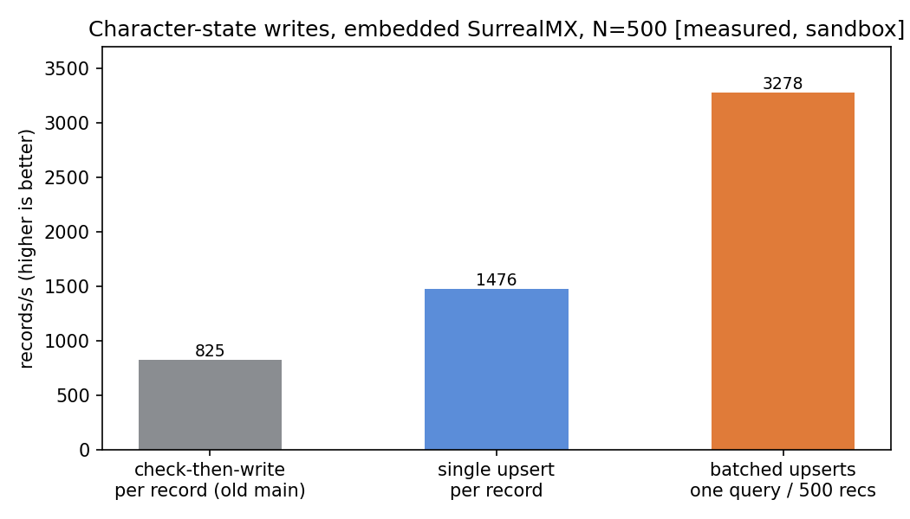

# Batched character-state writes — store layer (2026-10-28)

Directive (Joey): "We should be batching OPs to maximize MX ops."
This slice batches the save-sweep write path at the store layer, on
top of the SurrealMX adoption (`docs/SURREALMX-ADOPTION-REPORT.md`).
Branch: `arlo/surreal-mx` (local; not pushed).

## What was wrong

On current main, `putCharacterState` and `putCharacterLock` were
still check-then-write — SELECT, then UPDATE or CREATE: **2 store
round trips per record**. (The single-statement conversion from the
2026-10-27 throughput slice never landed on main.) A region saving
N characters paid 2N queries before any core-side ceremony.

## What changed

- `putCharacterState` / `putCharacterLock`: one `INSERT ... ON
  DUPLICATE KEY UPDATE` statement over the unique characterId index
  (the UPSERT pattern the SurrealDB performance best-practices doc
  prescribes). The update clause rewrites every mutable field, so
  the statement stores the record verbatim — identical semantics,
  one query instead of two.
- New `WorldStore.putCharacterStates(records[])`: the records'
  upserts ride **one `db.query()` per chunk of 256 statements**
  (indexed parameters, the same multi-statement idiom
  `applyPendingCredits` already uses). MemoryWorldStore implements
  it as a loop, so the shared contract covers both stores.
- The SDK's array form (`db.upsert(table, records[])`) was tried
  first and rejected on measurement: it errors against this
  SDK/engine combination ("Cannot execute UPSERT statement using
  value: 'character_state'") — the multi-statement query is also
  the form whose semantics we verified record-by-record.

## Measured [sandbox: 2 vCPU, Node v24.22.1, embedded SurrealMX]

Raw-statement forms, 500 records, realistic character payloads:

| Form | Rate |
|---|---|
| Check-then-write per record (old main) | 825 recs/s |
| Single upsert per record | 1,476 recs/s |
| Batched upserts, one query | 3,278 recs/s |

Through the real store (`bench-batch.mjs`, 500 records):

| Path | Fresh | Repeat |
|---|---|---|
| Sequential `putCharacterState` | 1,504 recs/s | 2,128 recs/s |
| Batched `putCharacterStates` | 4,561 recs/s | 4,737 recs/s |

So the batch is ~2.2–3.0× the (already improved) sequential upsert
and ~5.5× the old main write path. Sandbox numbers are a floor: the
box, not MX, is the ceiling here; MX's headroom shows on hardware.

## Verification

- New contract file `test/batch-writes.test.ts` (both stores):
  mixed new/existing batch lands verbatim, a 600-record batch
  (crossing the 256 chunk) lands completely, empty batch is a
  no-op, single put/lock create-then-overwrite regression cover.
- World-server suite: **123 tests — 122 pass / 0 fail / 1 skip
  embedded; 123 / 123 against the live SurrealMX 3.3.5 server.**
- Correctness of the batched form was additionally verified
  record-by-record in a standalone probe before implementation
  (insert batch, then a mixed update/insert batch, read back exact).

## Wired end-to-end (second commit on this branch)

The store batch is now the live save path:

1. **Store batch reads**: `getCharacterStates` / `getCharacterLocks`
   / `getOpResults` by id list (one `IN` query each over the unique
   indexes) + batched `storeOpResults`, so the core ceremony runs
   in a constant number of round trips per sweep instead of ~6 per
   character. Contract-covered in `test/batch-writes.test.ts`.
2. **Bulk core op**: `WorldCore.putCharacterStates` runs the single
   put's ceremony per record — dedup (stored op results first,
   intra-batch replays included), lock fencing with the identical
   codes/messages, the per-record credits drain as the version
   base, version = prior + 1 — and reports **per-record outcomes**:
   a fenced record fails its own outcome and its stored record is
   untouched; the rest of the batch lands. Exposed as the
   `World.PutCharacterStates` webrpc method (batch cap 32, body
   limit sized per entry) with the engine-core `WorldClient` method
   to match. Contract: `test/batch-core.test.ts` on both stores,
   including a simulated credits-drain version bump.
3. **Coalescer**: `WorldCharacterSync.save` now enqueues its
   prepared put; puts collect for 10 ms (or until 32 are queued)
   and flush as one bulk call, at most 2 batches in flight (one
   query ≈ one core — bounded concurrency, not one serial queue).
   Logout's final commit flushes immediately. A world that answers
   404/501 (it predates the bulk op) flips the sync to per-record
   puts permanently for that session — saves survive a rolling
   upgrade; the fleet test rig, which dispatches only the single
   put, exercises exactly that fallback. Tests:
   `packages/engine-core/test/world-sync-batch.test.ts`.

Verification for the wiring commit: world-server suite 126 tests
(125 pass / 0 fail / 1 skip embedded; **126/126 against the live
SurrealMX 3.3.5 server**); engine-core character/fleet/terrain
files 56/56. One pre-existing engine-core failure is unrelated and
remains: the net transport test expects a dotted-quad peer address
and this sandbox returns the IPv6-mapped form (code path untouched
by this work).
