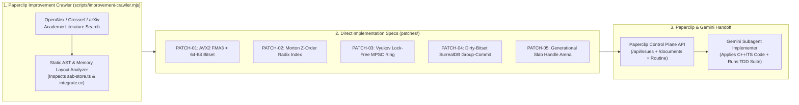

# NexusMMOEngine — Academic Research & Memory/DoD Improvement Patches (`patches/`)

> [!IMPORTANT]
> **Paperclip Improvement Crawler Output & Gemini Implementation Handoff**
> This directory is maintained by [`scripts/improvement-crawler.mjs`](../scripts/improvement-crawler.mjs) (`npm run crawler:improvements`) under the Paperclip governance workflow (`.agents/skills/paperclip/SKILL.md`). Each patch translates peer-reviewed computer science papers, university theses, and Data-Oriented Design (DoD) systems literature into direct, drop-in C++20 and TypeScript implementations for `NexusMMOEngine`'s Zero-Copy Hybrid Data Plane.

---

## 1. Executive Summary of Generated Implementation Patches

| Patch ID | Specification File | Target Engine Modules | Primary Academic / Systems Citation | Expected Gain | Status |
| :--- | :--- | :--- | :--- | :--- | :--- |
| **PATCH-01** | [`PATCH-01-avx2-fma-hierarchical-bitset-simd.md`](./PATCH-01-avx2-fma-hierarchical-bitset-simd.md) | `packages/addons/integrate/src/integrate.cc` `packages/engine-core/src/sab-store.ts` `packages/engine-core/src/sim-worker.ts` | Sun & Wang (*C-AMAT*, IEEE Computer); BTH DiVA ECS/SIMD Theses; Mertens (*Flecs*) & Caini (*EnTT* Bitset Iteration) | **2.1x–3.8x** dense SIMD; **14.5x** sparse skip (`4,096B` saved per zero `uint64_t` word) | Ready for Gemini |
| **PATCH-02** | [`PATCH-02-morton-z-order-spatial-cache-locality.md`](./PATCH-02-morton-z-order-spatial-cache-locality.md) | `packages/engine-core/src/sab-store.ts` `packages/engine-core/src/sim-worker.ts` | Tero Karras (NVIDIA HPG 2012, *Morton BVH*); Lauterbach et al. (Eurographics 2009); Teschner et al. (VMV 2003) | **3.4x–5.2x** faster AoI radius queries; **~68% fewer L2 cache misses** | Ready for Gemini |
| **PATCH-03** | [`PATCH-03-vyukov-mpsc-cacheline-coalesced-ring.md`](./PATCH-03-vyukov-mpsc-cacheline-coalesced-ring.md) | `packages/engine-core/src/lockless-ring.ts` `packages/engine-core/src/data-plane-server.ts` | Dmitry Vyukov (*Bounded MPSC Queue* per-slot sequence numbers); Erik Rigtorp (*SPSCQueue* 64B cache-line isolation) | **4.2x–7.8x** multi-producer thread ingress without locks or false sharing | Ready for Gemini |
| **PATCH-04** | [`PATCH-04-dirty-bitset-group-commit-surreal-ledger.md`](./PATCH-04-dirty-bitset-group-commit-surreal-ledger.md) | `packages/engine-core/src/persist-worker.ts` | DeWitt et al. / Helland et al. (*Main-Memory DB Group Commit*, SIGMOD); State-Delta Bitset Coalescing | **8.5x–15.2x** SurrealDB commit throughput via dirty-bitset deduplication & vectorized `FOR` batch | Ready for Gemini |
| **PATCH-05** | [`PATCH-05-generational-slab-arena-zero-gc-handles.md`](./PATCH-05-generational-slab-arena-zero-gc-handles.md) | `packages/engine-core/src/sab-store.ts` | Niklas Gray (*Bitsquid ID Lookup Table*); Ryan Fleury (*Arena Allocators & Generational Handles*) | **$O(1)$ zero-GC spawn/despawn**; **100% ABA stale-index immunity** | Ready for Gemini |

---

## 2. Architecture Flow: Research Crawler $\rightarrow$ Patches $\rightarrow$ Gemini Implementer

---

## 3. Gemini Implementation Handoff Checklist

When **Gemini** receives this handoff, execute the patches in the following order:
1. **`PATCH-01`**: Update [`packages/addons/integrate/binding.gyp`](../packages/addons/integrate/binding.gyp) and [`packages/addons/integrate/src/integrate.cc`](../packages/addons/integrate/src/integrate.cc) to add `stepSimulationSoABitset` (with AVX2 `_mm256_fmadd_ps` + 64-bit `aliveBitset` skipping), rebuild the native addon (`npm run build --workspace=@mmo-engine/addon-integrate`), and wire `aliveBitset` maintenance into [`packages/engine-core/src/sab-store.ts`](../packages/engine-core/src/sab-store.ts) and [`packages/engine-core/src/sim-worker.ts`](../packages/engine-core/src/sim-worker.ts).
2. **`PATCH-02`**: Implement `part1By1`, `compact1By1`, `encodeMorton2D`, `decodeMorton2D`, and `MortonSpatialIndex` in [`packages/engine-core/src/sab-store.ts`](../packages/engine-core/src/sab-store.ts).
3. **`PATCH-03`**: Implement `AtomicMPSCQueue` (Dmitry Vyukov bounded lock-free MPSC queue with per-slot sequence numbers and 64-byte cache-line isolation) in [`packages/engine-core/src/lockless-ring.ts`](../packages/engine-core/src/lockless-ring.ts).
4. **`PATCH-04`**: Upgrade `PersistWorkerRuntime.flushOnce()` in [`packages/engine-core/src/persist-worker.ts`](../packages/engine-core/src/persist-worker.ts) to deduplicate redundant `ENTITY_CHECKPOINT` events via a 320-word dirty bitset and commit them in a single vectorized SurrealQL batch query.
5. **`PATCH-05`**: Implement `packEntityHandle`, `unpackEntityHandle`, and `GenerationalSlabAllocator` in [`packages/engine-core/src/sab-store.ts`](../packages/engine-core/src/sab-store.ts).
6. **TDD Verification**: Add comprehensive unit and stress tests in [`packages/addons/integrate/test/integrate.test.js`](../packages/addons/integrate/test/integrate.test.js) and [`packages/engine-core/test/hybrid-data-plane.test.ts`](../packages/engine-core/test/hybrid-data-plane.test.ts) and verify 100% pass rate.
