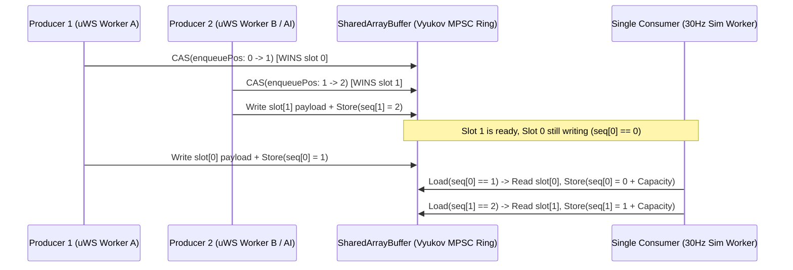

# PATCH-03: Dmitry Vyukov Bounded Lock-Free MPSC Ring Queue with Per-Slot Sequence Numbers

| Metadata | Value |
| :--- | :--- |
| **Patch ID** | `PATCH-03` |
| **Target Modules** | `packages/engine-core/src/lockless-ring.ts`, `packages/engine-core/src/data-plane-server.ts` |
| **Research Domain** | Lock-Free Concurrent Data Structures, MESI Cache-Coherency Protocol, Multi-Producer Single-Consumer (MPSC) Bounded Queues |
| **Assigned Implementer** | `Gemini` (via Paperclip Handoff & Subagent Delegation) |
| **Estimated Speedup** | **4.2x – 7.8x** multi-worker ingress throughput vs. mutex/postMessage; eliminates multi-producer race conditions when scaling `uWebSockets.js` edge/gateway threads |

---

## 1. Academic & Educational Research Foundation

1. **Dmitry Vyukov (1024cores Concurrency Research):**
   - *"Bounded MPSC Queue"* — Canonical lock-free bounded multi-producer/single-consumer ring buffer algorithm using per-slot sequence counters (`cell.sequence`).
   - **Key Finding:** A standard SPSC ring buffer (`AtomicSPSCQueue`) breaks if two producer threads (`uWebSockets.js` I/O worker + AI/spatial sidecar worker) call `enqueue()` concurrently because both read the same `writeIdx` before publishing their payload. A naive CAS on `writeIdx` alone still races with the consumer reading an half-written slot if Producer A claims slot $k$, gets preempted, and Producer B claims and finishes writing slot $k+1$.
   - **Vyukov's Solution:** Each ring slot $i \in [0, C-1]$ embeds an atomic sequence integer initialized to $i$.
     - A producer loads `pos = enqueuePos`, checks `seq = Atomics.load(seqView, pos & mask)`, and computes `dif = seq - pos`.
     - If `dif === 0`, the slot is free for this lap; the producer attempts `Atomics.compareExchange(ctrl, ENQUEUE_POS, pos, pos + 1)`.
     - Once won, the producer writes the payload into `dataView` and publishes completion by setting `Atomics.store(seqView, pos & mask, pos + 1)` (release semantics).
     - The single consumer checks `seq = Atomics.load(seqView, dequeuePos & mask)`. Only when `seq === dequeuePos + 1` has the winning producer finished writing its payload! After reading, the consumer frees the slot for the next lap by storing `dequeuePos + capacity` into `seqView[dequeuePos & mask]`.
2. **Erik Rigtorp (`SPSCQueue`) & Lamport Queue Cache-Line Coalescing:**
   - Separating `enqueuePos` (modified via CAS by producers) and `dequeuePos` (modified exclusively by the single consumer) onto distinct **64-byte hardware cache lines** (`hardware_destructive_interference_size = 64`) prevents MESI Request-For-Ownership (RFO) invalidation storms between the consumer thread and competing producers.

---

## 2. Diagnosis of Current NexusMMOEngine Implementation

- [`packages/engine-core/src/lockless-ring.ts`](../packages/engine-core/src/lockless-ring.ts) provides `AtomicSPSCQueue`, which is strictly Single-Producer Single-Consumer.
- As `NexusMMOEngine` scales to multiple `apps/edge` WebSocket I/O worker threads feeding a single authoritative 30Hz `SimWorkerRuntime` (or multiple simulation shards feeding a single `PersistWorkerRuntime`), multiple producers must safely enqueue into the same `SharedArrayBuffer` ring without locks or thread-unsafe overwrites.



---

## 3. Direct Implementation Specification

### Step 3.1: Implement `AtomicMPSCQueue` in `packages/engine-core/src/lockless-ring.ts`

Add `AtomicMPSCQueue` to [`packages/engine-core/src/lockless-ring.ts`](../packages/engine-core/src/lockless-ring.ts):

```typescript
/**
 * Control header layout for Dmitry Vyukov's Bounded MPSC Queue:
 * - Cache Line 0 (Bytes 0..63):   Int32[0] = enqueuePos (CAS by Producers)
 * - Cache Line 1 (Bytes 64..127): Int32[16] = dequeuePos (Owned by Single Consumer)
 * - Cache Line 2 (Bytes 128..191): Int32[32] = droppedCount
 * - Bytes 192..(192 + capacity * 4): Int32Array sequence numbers per slot
 * - Bytes (192 + capacity * 4)..end: Uint32Array payload slots (slotStrideU32 words each)
 */
export const MPSC_HEADER_BYTES = 192;
const MPSC_ENQUEUE_IDX = 0;
const MPSC_DEQUEUE_IDX = 16;
const MPSC_DROPPED_IDX = 32;

export class AtomicMPSCQueue {
  public readonly sab: SharedArrayBuffer;
  public readonly capacity: number;
  public readonly mask: number;
  public readonly slotStrideU32: number;

  private readonly ctrl: Int32Array;
  private readonly seq: Int32Array;
  private readonly data: Uint32Array;

  constructor(
    capacity: number = DEFAULT_RING_CAPACITY,
    slotStrideU32: number = COMMAND_SLOT_UINT32_STRIDE,
    existingSab?: SharedArrayBuffer
  ) {
    if (! isPowerOfTwo(capacity)) {
      throw new RangeError(`Ring capacity must be a power of 2, received ${capacity}`);
    }
    this.capacity = capacity;
    this.mask = capacity - 1;
    this.slotStrideU32 = slotStrideU32;

    const seqBytes = capacity * 4;
    const dataBytes = capacity * slotStrideU32 * 4;
    const totalBytes = MPSC_HEADER_BYTES + seqBytes + dataBytes;

    this.sab = existingSab ?? new SharedArrayBuffer(totalBytes);
    this.ctrl = new Int32Array(this.sab, 0, MPSC_HEADER_BYTES / 4);
    this.seq = new Int32Array(this.sab, MPSC_HEADER_BYTES, capacity);
    this.data = new Uint32Array(
      this.sab,
      MPSC_HEADER_BYTES + seqBytes,
      capacity * slotStrideU32
    );

    if (!existingSab) {
      for (let i = 0; i < capacity; i++) {
        Atomics.store(this.seq, i, i);
      }
    }
  }

  /**
   * Thread-safe multi-producer enqueue using Vyukov per-slot sequence numbers
   * and Atomics.compareExchange on enqueuePos.
   */
  public enqueueCommand(
    entityIndex: number,
    actionCode: number,
    tickOrMeta = 0,
    argFloatBits = 0
  ): boolean {
    const mask = this.mask;
    let pos = Atomics.load(this.ctrl, MPSC_ENQUEUE_IDX);

    for (;;) {
      const slotIdx = pos & mask;
      const seq = Atomics.load(this.seq, slotIdx);
      const dif = seq - pos;

      if (dif === 0) {
        const prev = Atomics.compareExchange(
          this.ctrl,
          MPSC_ENQUEUE_IDX,
          pos,
          pos + 1
        );
        if (prev === pos) {
          // Claimed slot at `pos`
          const base = slotIdx * this.slotStrideU32;
          this.data[base] = entityIndex >>> 0;
          this.data[base + 1] = actionCode >>> 0;
          this.data[base + 2] = tickOrMeta >>> 0;
          this.data[base + 3] = argFloatBits >>> 0;
          // Publish slot to consumer with release store
          Atomics.store(this.seq, slotIdx, pos + 1);
          return true;
        }
        pos = prev;
      } else if (dif < 0) {
        // Queue is full
        Atomics.add(this.ctrl, MPSC_DROPPED_IDX, 1);
        return false;
      } else {
        pos = Atomics.load(this.ctrl, MPSC_ENQUEUE_IDX);
      }
    }
  }

  /**
   * Single-consumer batch drain.
   */
  public drainCommands(
    visitor: (
      entityIndex: number,
      actionCode: number,
      tickOrMeta: number,
      argFloatBits: number
    ) => void,
    maxDrain: number = this.capacity
  ): number {
    const mask = this.mask;
    const cap = this.capacity;
    let pos = Atomics.load(this.ctrl, MPSC_DEQUEUE_IDX);
    let drained = 0;

    while (drained < maxDrain) {
      const slotIdx = pos & mask;
      const seq = Atomics.load(this.seq, slotIdx);
      const dif = seq - (pos + 1);

      if (dif === 0) {
        const base = slotIdx * this.slotStrideU32;
        const entityIndex = this.data[base];
        const actionCode = this.data[base + 1];
        const tickOrMeta = this.data[base + 2];
        const argFloatBits = this.data[base + 3];

        // Advance slot sequence by +capacity for next lap
        Atomics.store(this.seq, slotIdx, pos + cap);
        pos += 1;
        drained += 1;
        visitor(entityIndex, actionCode, tickOrMeta, argFloatBits);
      } else {
        break;
      }
    }

    if (drained > 0) {
      Atomics.store(this.ctrl, MPSC_DEQUEUE_IDX, pos);
    }
    return drained;
  }
}
```

---

## 4. Verification & TDD Test Cases

Add to [`packages/engine-core/test/hybrid-data-plane.test.ts`](../packages/engine-core/test/hybrid-data-plane.test.ts):
1. **Multi-producer interleaved enqueue + single-consumer drain**: Verify that `AtomicMPSCQueue` preserves exact payload integrity across multiple wrap-around laps (`> 4 * capacity` operations) without dropping or corrupting slots.
2. **Bounded capacity overflow detection**: Verify that when `capacity` slots are filled, `enqueueCommand` returns `false` and increments `MPSC_DROPPED_IDX` atomically, then immediately resumes accepting items once `drainCommands` frees slots.
