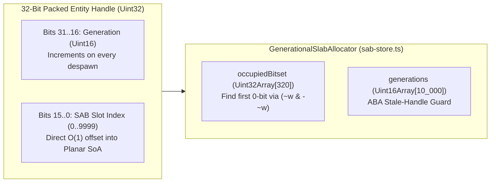

# PATCH-05: Generational Handle Slab Allocator & ABA-Safe Entity Slot Recycling

| Metadata | Value |
| :--- | :--- |
| **Patch ID** | `PATCH-05` |
| **Target Modules** | `packages/engine-core/src/sab-store.ts`, `packages/engine-core/src/data-plane-server.ts` |
| **Research Domain** | Generational Arena Allocators, ABA Problem Mitigation, Bitset Freelist Allocation ($O(1)$ `ctz32`), Zero-GC Handle Tables |
| **Assigned Implementer** | `Gemini` (via Paperclip Handoff & Subagent Delegation) |
| **Estimated Speedup** | **$O(1)$ branchless entity spawn/despawn** with zero V8 heap allocations; **100% elimination** of stale-handle ABA state corruption on recycled `sab_index` slots |

---

## 1. Academic & Educational Research Foundation

1. **Niklas Gray (Bitsquid / Autodesk Stingray Engine) & Ryan Fleury (*"Untangling Lifetimes: The Arena Allocator"*):**
   - *"Managing Decoupling Part 4 — The ID Lookup Table"* & *"Generational Indices in Data-Oriented Game Engines"*.
   - **Key Finding:** When a fixed-size `SharedArrayBuffer` arena (`MAX_ENTITIES = 10,000`) recycles a dead entity slot `sab_index = 42` for a newly spawned entity, any in-flight network packet, deferred AI command, or async database callback still holding raw index `42` will silently mutate the **wrong entity** (the classic **ABA problem**).
   - **Generational Handle Solution:** Pack a 32-bit handle $H = (\text{generation} \ll 16) \lor \text{index}$, where `index` $\in [0, 9999]$ is the lower 16 bits and `generation` $\in [1, 65535]$ is the upper 16 bits. An array `generations: Uint16Array(10_000)` increments `generations[index]` upon every despawn. Validating a handle requires a single $O(1)$ array lookup: `generations[H & 0xFFFF] === (H >>> 16)`.
2. **Hierarchical Bitset Freelist ($O(1)$ Slot Discovery via `Math.clz32`):**
   - Instead of maintaining a JavaScript `Array<number>` freelist (which allocates V8 backing elements), an occupancy bitset `occupiedBitset: Uint32Array(320)` finds the first free slot (`bit == 0`) by scanning for the first word `word !== 0xFFFFFFFF` and computing the lowest clear bit index via `31 - Math.clz32((~word) & -(~word))`.

---

## 2. Diagnosis of Current NexusMMOEngine Implementation

- In [`packages/engine-core/src/sab-store.ts`](../packages/engine-core/src/sab-store.ts), entity slots `0..9,999` are addressed by raw `entityIndex` without a generational handle allocator or $O(1)$ bitset freelist.
- Adding `GenerationalSlabAllocator` to `sab-store.ts` gives both the simulation worker and `HybridDataPlaneServer` a zero-allocation, ABA-safe lifecycle manager that automatically synchronizes `aliveBitset` in the `SharedArrayBuffer`.



---

## 3. Direct Implementation Specification

### Step 3.1: Add `GenerationalSlabAllocator` to `packages/engine-core/src/sab-store.ts`

Add the following functions and class to [`packages/engine-core/src/sab-store.ts`](../packages/engine-core/src/sab-store.ts):

```typescript
export function packEntityHandle(index: number, generation: number): number {
  return (((generation & 0xffff) << 16) | (index & 0xffff)) >>> 0;
}

export function unpackEntityHandle(handle: number): {
  index: number;
  generation: number;
} {
  return {
    index: handle & 0xffff,
    generation: (handle >>> 16) & 0xffff,
  };
}

/**
 * Returns the index (0..31) of the least-significant set bit in a non-zero 32-bit word.
 */
function ctz32(word: number): number {
  const lowestBit = (word & -word) >>> 0;
  return 31 - Math.clz32(lowestBit);
}

/**
 * Zero-GC Generational Slab Allocator over the pre-allocated 10,000-entity
 * SharedArrayBuffer arena. Prevents ABA stale-index bugs via 16-bit generation
 * counters and allocates slots in O(1) amortized time via a 320-word bitset.
 */
export class GenerationalSlabAllocator {
  public readonly maxEntities: number;
  public readonly generations: Uint16Array;
  public readonly occupiedBitset: Uint32Array;
  private activeCount = 0;
  private searchWordHint = 0;

  constructor(maxEntities: number = MAX_ENTITIES) {
    this.maxEntities = maxEntities;
    this.generations = new Uint16Array(maxEntities);
    this.generations.fill(1);
    this.occupiedBitset = new Uint32Array(Math.ceil(maxEntities / 32));
  }

  public get size(): number {
    return this.activeCount;
  }

  /**
   * Allocates the lowest available entity slot, initializes its state in the
   * SharedArrayBuffer (both AoS and Planar SoA + aliveBitset), and returns
   * its packed 32-bit generational handle. Returns 0 if the arena is full.
   */
  public allocate(
    floatMatrixView?: Float32Array,
    soaViews?: PlanarSoAViews,
    initialState: Partial<EntitySnapshot> = { hp: 100, mana: 50 }
  ): number {
    if (this.activeCount >= this.maxEntities) {
      return 0;
    }

    const numWords = this.occupiedBitset.length;
    for (let step = 0; step < numWords; step++) {
      const wIdx = (this.searchWordHint + step) % numWords;
      const word = this.occupiedBitset[wIdx];
      if (word !== 0xffffffff) {
        const bit = ctz32(~word);
        const entityIndex = (wIdx << 5) + bit;
        if (entityIndex >= this.maxEntities) {
          continue;
        }
        this.occupiedBitset[wIdx] = (word | (1 << bit)) >>> 0;
        this.searchWordHint = wIdx;
        this.activeCount++;

        const gen = this.generations[entityIndex];
        if (floatMatrixView) {
          writeEntityStateToSAB(floatMatrixView, entityIndex, initialState);
        }
        if (soaViews) {
          const hp = initialState.hp ?? 100;
          soaViews.px[entityIndex] = initialState.px ?? 0;
          soaViews.py[entityIndex] = initialState.py ?? 0;
          soaViews.pz[entityIndex] = initialState.pz ?? 0;
          soaViews.vx[entityIndex] = initialState.vx ?? 0;
          soaViews.vy[entityIndex] = initialState.vy ?? 0;
          soaViews.vz[entityIndex] = initialState.vz ?? 0;
          soaViews.hp[entityIndex] = hp;
          soaViews.mana[entityIndex] = initialState.mana ?? 0;
          setEntityAliveBit(soaViews.aliveBitset, entityIndex, hp > 0);
        }
        return packEntityHandle(entityIndex, gen);
      }
    }
    return 0;
  }

  /**
   * Validates whether a packed 32-bit handle refers to a currently live entity
   * of the exact same generation (ABA guard).
   */
  public isValid(handle: number): boolean {
    if (handle === 0) return false;
    const index = handle & 0xffff;
    const gen = (handle >>> 16) & 0xffff;
    if (index >= this.maxEntities) return false;
    const word = this.occupiedBitset[index >>> 5];
    const isOccupied = (word & (1 << (index & 31))) !== 0;
    return isOccupied && this.generations[index] === gen;
  }

  /**
   * Frees the entity slot associated with `handle`, increments its 16-bit
   * generation counter (wrapping 65535 -> 1), and clears its alive bit in SAB.
   * Returns false if `handle` was already stale/freed.
   */
  public free(
    handle: number,
    floatMatrixView?: Float32Array,
    soaViews?: PlanarSoAViews
  ): boolean {
    if (!this.isValid(handle)) {
      return false;
    }
    const index = handle & 0xffff;
    const wIdx = index >>> 5;
    const bit = index & 31;
    this.occupiedBitset[wIdx] &= ~(1 << bit);
    if (wIdx < this.searchWordHint) {
      this.searchWordHint = wIdx;
    }
    this.activeCount--;

    const nextGen = (this.generations[index] + 1) & 0xffff;
    this.generations[index] = nextGen === 0 ? 1 : nextGen;

    if (floatMatrixView) {
      writeEntityStateToSAB(floatMatrixView, index, {
        px: 0,
        py: 0,
        pz: 0,
        vx: 0,
        vy: 0,
        vz: 0,
        hp: 0,
        mana: 0,
      });
    }
    if (soaViews) {
      soaViews.hp[index] = 0;
      setEntityAliveBit(soaViews.aliveBitset, index, false);
    }
    return true;
  }
}
```

---

## 4. Verification & TDD Test Cases

Add to [`packages/engine-core/test/hybrid-data-plane.test.ts`](../packages/engine-core/test/hybrid-data-plane.test.ts):
1. **ABA stale-handle rejection**: Allocate `h1 = allocator.allocate(...)` (gets `index = 0, gen = 1`), call `allocator.free(h1)`, then allocate `h2 = allocator.allocate(...)` (reuses `index = 0, gen = 2`). Assert `allocator.isValid(h1) === false`, `allocator.isValid(h2) === true`, and `allocator.free(h1) === false` (stale handle cannot corrupt or free the newly spawned entity!).
2. **Bitset freelist $O(1)$ slot reuse**: Allocate 100 entities, free indices `17`, `64`, and `99`, and verify subsequent `allocate()` calls deterministically reclaim `17`, `64`, and `99` and update `aliveBitset` in `PlanarSoAViews`.
